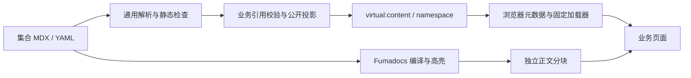

# Website 通用内容渲染

Website 的仓库内容通过通用 Fumadocs 编译链路接入 SPA。每个业务集合独立定义字段、公开投影和引用语义，编译、资源处理及正文加载不依赖 About。当前使用者是 About 和 Support；其他 Website 栏目可以注册新的 namespace。

_最后更新：2026-10-19_

## 边界与数据流

`apps/web/build/content/` 是 Node 构建侧：解析 MDX/YAML、检查静态作者语法、验证资源路径、生成公开虚拟模块。`apps/web/build/collections.ts` 汇总注册集合，Vite 和 `content:check` 共用该列表。`apps/web/source.config.ts` 显式定义 Fumadocs 集合与编译 preset。

业务定义实现 `ContentDefinition`：namespace、root、文件分类/schema、作者组件属性契约及 `project(entries)`。通用引擎先解析全部文件，业务投影再校验跨引用；公开元数据与正文 import 不包含草稿。未注册文件使检查失败。图片资源采用有 src/alt/width/height 的 ImageRef 形态，不把任意业务 src 字段当作本地资源。

MDX 的 YAML frontmatter 解析边界将 CRLF 和孤 CR 规范化为 LF，避免 Windows 换行使末尾数值变为字符串；字段仍经集合 schema 严格验证，不将带引号的数字强制转换为数值。原始 MDX 文件与正文处理保持不变；LF/CRLF 类型及带引号数字拒绝的回归见 `tests/content/compiler.test.ts`。

资源只从内容根 assets 目录导出；检查 realpath、存在性与路径边界。草稿独占资源不公开，公开内容共享使用的资源可以公开。内容目录不作为整个 public 目录复制。

读取内容时先将 Windows CRLF 归一化为 LF，再交给 frontmatter 与正文解析器。否则 gray-matter 可能将最后一项字段的末尾 CR 留在 YAML 标量中，使数字或 boolean 变成字符串。schema 仍严格校验类型，不通过字段强制转换绕过错误。

开发期文件变化经同一校验后更新注册表并刷新页面。错误通过 Vite overlay 呈现，修复后恢复。构建配置变化遵循 Vite 自身的重启流程；生成目录不参与根测试 watcher。

## 浏览器与 UI

`apps/web/src/content/store.ts` 管理固定正文加载器，共享进行中的 Promise、缓存成功结果、移除失败以支持重试。`useContent` 在切换 id 或重试时立即呈现 loading，并隔离旧请求和卸载后的结果。

浏览器自身可能缓存失败的原生 import；移除应用 Promise 不能清除这个缓存。正文错误态除普通重试外提供重新加载当前页面，恢复整份 document 的模块状态，保留当前地址。不能只用可再次成功的测试 loader 推定网络失败恢复；需要在真实浏览器阻断 chunk 请求后验证恢复入口。

`apps/web/src/content/mdx.tsx` 提供可扩展组件映射。`packages/components/src/content/` 提供无路由/API 依赖的 CodeBlock、ContentImage、Callout、ContentProse。路由链接、业务按钮和资源 URL 由 Web 集合适配器注入。全局主题、ExUI CSS 和 ExMessage 宿主继续由既有应用入口持有。

高亮在构建期完成；浏览器不加载 MDX 编译器、Node 文件系统或高亮引擎。普通代码块从编译 transformer 接收原始文本，复制只作用于当前块。源码与维护记录见 `packages/components/src/content/SOURCES.md`。

## About 适配

`apps/web/build/about/` 持有社区、成员、Media 与捐赠 schema，固定页要求和引用图。`apps/web/src/content/about/` 适配注册表、语义目标和资源 URL；`apps/web/src/pages/AboutUs/` 持有页面布局、栏目目录、成员 Modal、Media 章节、捐赠展示与阅读位置。

项目栏目、详情及其内容集合已移除，`/aboutus/projects` 及其子路径进入现有 404；导航、首页卡片和关联内容不再生成项目链接。

### 社区目录

`CommunitiesPage.tsx` 使用公开社区元数据生成切换条和展示区，按 order、slug 排序；名称与一句介绍来自社区 frontmatter，入口继续进入对应的 `/aboutus/communities/<slug>` 文档页。目录不展示栏目 MDX 正文、运营状态或图片说明栏。ExUI Tabs 提供鼠标与方向键切换，切换不改变 URL，也不自动轮播；目录的布局和阅读位置初始化不等待正文加载。屏幕阅读器保留目录 h1，当前社区名称为 h2。

社区页的 About 面包屑与栏目导航沿用其他子页的 72rem 宽度并居中；仅下方社区 Card 可以扩展到 84rem，小屏继续遵守统一页面边距。

Card 使用最小高度而非固定高度：桌面取 44rem 与 75vh 的较大值，手机取 28rem 与 65vh 的较大值；视口较高时按对应视口比例增长，长文案或放大字体仍可自然撑开展示区。

社区 cover 优先使用集合图片，未设置时复用两个社区现有的加入页本地素材；图片按原始比例完整显示。桌面右侧图片区最大宽度 32rem，在展示区垂直居中；中等视口随宽度缩至最多 26rem，手机改为纵向布局，图片在可用宽度内最大 28rem。缺少图片或加载失败时隐藏图片区域，名称、介绍和文档入口仍可用。

社区 Card 直接复用团队人物卡的 `TeamDotBackground`，以社区 theme 控制底色、点阵填充与描边；配色校验共用 `apps/web/src/config/shader-theme.ts`。shader 按原有懒加载、WebGL 检查、初始化超时与 context lost 规则降级，失败保留对应社区纯色底。未配置 theme 的旧社区使用深灰缺省主题。

### 音乐和影像

首屏向下入口使用浏览器原生平滑滚动定位音乐章节，并交给章节键盘焦点，不改变当前 URL；系统要求减少动态效果或通过键盘激活时即时定位。带修饰键的链接操作保留浏览器默认行为。

Media 介绍使用独立 `aboutMediaPage` 集合与 `kind: "media"` 投影，交给 `MediaPage.tsx` 组合大画面开场、原生 Apple Music 播放列表与视频外链三个纵向章节。首页入口同时识别这个专属类型。章节结构不等待正文完成才挂载，避免延迟 MDX 加载覆盖用户已发生的滚动；正文仍复用加载、重试与文档重新加载入口。视频保留 `media-{id}`，页面模板的音乐入口使用独立 `about-media-music` 前缀，避免与合法视频 id 冲突。

`MediaBackground.tsx` 管理静音循环视频、标签页可见性、减少动态效果与自动播放拒绝，不提供背景播放控件。减少动态效果模式初始不请求视频；后台暂停，回到前台自动尝试播放。失败保留静态深色底，不阻塞音乐和外链。卸载时暂停并移除资源地址、调用 load 释放加载；React Strict Mode 重放效果时必须先恢复地址再尝试播放，否则浏览器会保留无 source 的视频节点。

iframe 只由受控播放列表地址与固定权限组生成，桌面展示高度 640px、最大宽度 800px；Apple 原生内容固定 450px 高，容器按比例缩小 iframe 布局宽度再整体放大，使内容与可见框一同增大，而非在底部留白。手机保留原生 450px 高与完整布局宽度，避免缩小内部视口后产生横向裁切。页面不追加播放器下方的来源文字或外部打开链接；原生控件由 Apple 管理。不能将跨域 iframe 的 load 事件解释为播放或账号验收。视频目录仅展示 video 条目并沿用草稿过滤、封面降级与相关内容入口。Media 反色样式只作用于本页，正文容器和关联成员按钮的交互状态也需继承可读前景色。内容维护见 `.ai/knowledge/web/content-authoring.md`。

About 入口及正文分别懒加载。成员只拥有正文 id，不创建个人路由；简介 Modal 不改变 URL。阅读位置按 Router location key 保存于模块内有限 Map，离开 About 再后退仍能恢复，页面刷新不持久化该状态。位置由 scroll 事件记录；离开时不再读取 window.scrollY，因为目的页 DOM 已可能缩短文档并将位置压缩，cleanup 再保存会覆盖原阅读位置。

location key 变化时先清除当前的「已恢复」标识，即使目的页正文仍未就绪；历史位置 Map 继续保留。这样在目的页加载期间立即后退时，旧页会重新执行恢复，不会因遗留的旧 key 跳过定位。POP 恢复仍等待足够的文档高度，并保留当前焦点。回归位于 `apps/web/src/pages/AboutUs/useReadingPosition.test.tsx` 与 `tests/browser/about-home-refined.mjs`。

首页由 `AboutHome.tsx` 组合背景 Hero 与品牌叙事布局。`AboutHomeHero.tsx` 暂用 Rifling 911 加入页的首张图片和相同 HalftoneDots 参数，标题、引言与简介叠在渐变遮罩上。图片先显示，再检查 WebGL2 并懒加载半调组件；WebGL 不可用时保留原图，图片失败时保留纯色背景与文案。半调设置 `speed=0`，不持续绘制，像素预算限制为 200 万。

Hero 在正常文档流中占满顶栏下方的首屏，圆角图片背景与页面背景上的箭头分为两行，之间留有间距，箭头下缘距视口底部 1rem；短视口或放大页面时文案可以撑开 Hero。正文从第二屏开始。下方为社区文字入口、全宽理念、团队横向展开、Media 与历程并列，最后是全宽捐赠入口。理念直接渲染首页完整 MDX，加载与失败恢复入口位于该区。其余五个栏目从现有注册表取得路由与缺省文案；社区块不预留图片，其他四个栏目的图片独立于链接，未提供或加载失败均为同尺寸普通占位。

捐赠栏目使用固定 `/aboutus/donations` 路由。`Donations.tsx` 组合图片开场、渠道与致谢名单三个区域，页面标题与 About 导航仍来自元数据，开场展示标题由模板提供。`AboutImageBackground.tsx` 在 WebGL2 可用时懒加载 Paper `ImageDithering`，保留图片原色并使用静态 8×8 抖色，渲染预算限制为 200 万像素；资源来自同源本地文件，加载期间或 WebGL2 不可用时显示原图，遮罩保证白色文案可读。介绍正文来自 `donations.mdx`，保留完整正文与加载、重试入口；正文失败不隐藏下方渠道和名单。渠道与昵称/日期清单来自 `donations/items.yaml`，公开投影后展示；二维码和外链可分别或同时提供，名单保留作者顺序，首字装饰不代表真实头像。无数据时呈现整理中空态。清单沿用独立 meta 集合且禁用 Macro，不作为正文 import 暴露；否则 Fumadocs 的 frontmatter export 会把子条目 draft 原始字段送入浏览器。实际构建测试同时检查注册表与所有正文 chunk 均无草稿昵称、渠道及独占二维码资源。页面不处理支付或自动查询捐赠记录。

捐赠开场入口保留 `donation-channels` 与 `donation-donors` 锚点。普通激活在页内滚动并将焦点交给章节标题，不改变 URL；键盘或减少动态效果模式即时定位，修饰键保留原生链接行为。章节在正文加载前已存在，阅读位置初始化不等待 MDX，避免加载完成覆盖早期跳转；直接打开 hash 同时定位与聚焦标题，后退仍复用 location key 阅读位置。

首页不挂载 About 栏目导航或面包屑；旧 Icon Shader 的 `AboutHero.tsx` 与 `hero/` 文件不由首页导入。前进导航使用 h1 入口焦点；无外圈的底部箭头链接到故事网格的 `about-content`，普通激活平滑滚动并将键盘焦点交给该区域，不改变当前 URL，减少动态效果模式使用即时定位。箭头只在顶栏下方可见且标签页位于前台时轻微上下移动；悬停、键盘聚焦或系统要求减少动态效果时保持静止。该 id 兼容旧 hash，并按顶栏高度留出滚动边距。首页静态布局已包含该区域，阅读位置初始化不等待理念 MDX，否则延迟加载完成会覆盖用户已进行的箭头滚动。除 Media 与捐赠页外，其余子页仍等待正文就绪，浏览器后退仍由原有 location key 机制恢复阅读位置。

子页的 `AboutNavigation` 根据当前页面元数据在栏目栏左侧渲染面包屑，右侧保留栏目链接或手机目录。正文不再重复面包屑；详情页的父栏目保持 `aria-current="location"`。长面包屑允许换行，目录按钮保留自身宽度。About 标题统一使用 ExUI 粗体 token；`AboutBody` 的局部样式同时覆盖页面正文与通过 Portal 展示的成员正文，不修改通用内容组件的字重。首页仅局部替换 Callout 的展示，保留作者 title、kind 与正文，不改变子页或通用内容组件。

### 历程展示

`StoryPage.tsx` 在保留栏目导航的前提下，为 `story.mdx` 注入独立的 Timeline、StoryChapter 与 Milestone 映射；加载、错误、重试和关联内容继续复用既有流程。`StoryTimeline.tsx` 用原生横向滚动与 CSS scroll snap 展示章节，桌面并列照片与事件，手机将照片和事件纵向排列。箭头、年份与方向键可切换，Home/End 定位首尾；减少动态效果模式使用即时滚动。

照片排布按章节顺序选取固定的一张或两张布局，位置、尺寸与旋转角度有所变化，重新渲染不重新随机。章节选择按 Router location key 保存于有限 Map，后退恢复，刷新不持久化。事件保留 `milestone-{id}` 锚点；直接打开事件时先定位所属章节，再由 `useReadingPosition` 将滚动与键盘焦点交给该事件。作者结构与图片字段见 `.ai/knowledge/web/content-authoring.md`。

历程容器与捐赠开场共用 `AboutImageBackground.tsx` 的 Sequoia Dark 图片及抖色效果，图片资源与加载、静态回退规则见上方捐赠说明。背景限定在 Card 圆角内，叠加暗色遮罩。标题按用户要求使用固定白色，配合细深灰描边与阴影，不使用 difference 混合；年份和附注带局部浅色底。事件卡片保留主题表面与正文颜色。登录与 404 继续使用 `AuthBackdrop` 的默认黑白配色和全屏模式。选中年份使用 ExUI control primary token，切换按钮组使用 ExUI glass 和 full 圆角。

### 团队展示与招募

`apps/web/content/about/team.mdx` 使用独立的 `aboutTeam` 集合和 `kind: "team"` 投影，交给 `apps/web/src/pages/AboutUs/TeamPage.tsx` 组合人物与招募两个章节。正文仍使用既有内容加载、错误和重试流程；两章节采用视口最低高度，长内容自然增高。模板公开 `join` 锚点，作者链接校验只为团队页登记该目标。团队页等待正文离开 loading 后定位，并通过 `useReadingPosition` 的可选第五参数交给 hash 目标焦点；Story 页也启用该选项，其余页面保持默认行为。

展示成员来自公开 JSON，经 `apps/web/src/config/team.ts` 解析后由 `apps/web/src/config/team-config.ts` 导入；不进入通用 MDX 引擎，也不替换旧成员正文、Media 引用或简介 Modal。Vite 的 `apps/web/build/team-config.ts` 校验配置与照片 realpath，站内入口集合从 `apps/web/src/App.tsx` 的字面量路由和已验证的公开 About 页面生成，浏览器通过虚拟模块复用该集合。配置更新按稳定 id 保留选择，已删除的选择回到首项或空态。

人物首屏按页面主题、姓名、职责、能力名称、详细介绍组织视觉层级。展示标题使用站点正文颜色，其中的 `Exre` 片段跟随成员强调色；引言下的完整 MDX 正文保留，通过团队页局部段落样式呈现为次级说明，不修改通用 ContentProse。桌面保留左资料、中央人物、右能力三列，职责加大，简介和能力条目用细线分隔，能力图标使用浅色底与成员强调色。手机端仍按姓名、人物、资料、能力排列，长内容自然撑开，不裁切。

成员主题与资料切换由同一选择状态控制，快速切换取消旧动画；DotGrid 保持实例，仅更新主题颜色。招募区复用同一份过渡中的成员主题，MeshGradient 在白色与成员背景色之间渐变，静态回退也跟随该主题。招募 MeshGradient 使用 240×264 的小源和 64,000 像素预算，CSS 放大到容器，resize 不增加 Canvas 预算。背景加载先保留静态回退，需观察 Shader 的就绪标记与公开 mount；仅有 canvas 不代表初始化成功。三秒未就绪或 context lost 时卸载失败背景。库的异步初始化错误仍可能出现在控制台，局部回退不吞掉全局 rejection。编辑字段和资源边界见 `.ai/knowledge/web/content-authoring.md`。

静态内容不调用 Website Server、不新增 HTTP Contract 或数据库。Docs 入口边界见 `.ai/architectures/overview.md`；文档搜索、侧栏和版本切换没有附带在这套基础渲染中。

## Support 适配

`apps/web/build/support/` 持有错误、分类、联系人与面板配置 schema，以及 Support 路由引用校验和发布投影。`supportErrors` 是唯一 Fumadocs doc 集合；设置与联系人 YAML 由通用引擎读取，不生成浏览器 meta import。字段与编辑入口见 `.ai/knowledge/web/content-authoring.md`，已接受的产品边界见 `.ai/decisions/support-center/01-authenticated-support-and-clickup-view.md`。

`apps/web/src/content/support/` 适配虚拟注册表、资源及正文 store。`apps/web/src/pages/Support/` 消费同一投影生成首页精选、列表与详情，正文目录只从实际渲染的 h2/h3 派生。路由导航聚焦并滚动至标题；有 hash 时优先定位当前页面的目标，正文迟到加载不会在无 hash 时再次抢焦点。

`apps/web/src/routes/SupportAccess.tsx` 位于页面 lazy/Suspense 与内容错误边界之外，读取既有 AuthProvider 的会话结果。只有 authenticated 才挂载 Support 子树；其他状态不启动页面 lazy loader。App、RootLayout 与 SiteHeader 不静态导入 Support 注册表。登录按钮经 RootLayout Outlet context 打开既有弹窗，关闭时优先归还页面触发器焦点，失效后回退顶栏。

共享 Web Client 收到当前会话的 SESSION_INVALID 时仍清理 token 并通知认证订阅者；在 `/support` 及其后代停留原地址，交给上述边界显示登录提示并保留 query/hash。仅名称前缀相似的其他路由不使用此例外。

ClickUp 配置包含 `game`、`community` 与 `requestBucket` 三个视图，每个视图的 title、embedUrl 与可选 publicUrl 都经过构建校验。固定 host 策略在 `apps/web/build/support/clickup-policy.ts` 中维护，当前只允许用户提供的官方 iframe 来源 `sharing.clickup.com`，YAML 不能扩展来源。Support 首页通过 ExUI Glass「游戏｜社区｜需求桶」Tabs 切换，默认游戏；方向键只移动焦点，Enter/Space 激活视图。仅挂载当前视图的 iframe，切换后重新加载该视图，外链与当前视图对应。需求桶 iframe 宽度为容器的 100%、高度为 700px，其余视图沿用 80vh。跨域内容仍归 ClickUp，组件测试或内容编译通过不证明外部任务实际显示。

需求桶直接作为第三个 Tab 展示，Tab 栏不再提供独立需求桶菜单。面板下方保留需求桶用途说明与当前视图的外部打开回退；作者字段见 `.ai/knowledge/web/content-authoring.md`。

编辑约定见 `.ai/knowledge/web/content-authoring.md`。实现证据来自 `tests/content/`、`apps/web/src/content/` 中的加载、真实 Fumadocs 编译和 Vite 更新测试；这些检查不替代认证、外部应用或部署验收。
