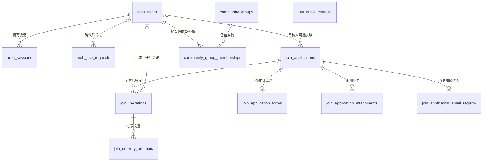
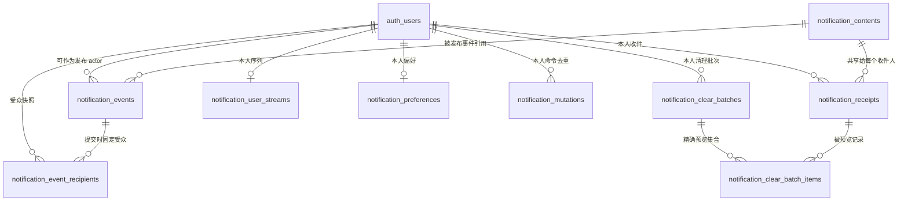

# 账号与加入申请数据模型

本文件记录表的业务职责、关系和必须保留的数据规则。它是修改模型前的设计入口，不代替可执行结构：PostgreSQL 结构以 `apps/server/src/db/schema.ts` 和 `apps/server/drizzle/` 为准；HTTP 字段与行为以 `api/openapi.yaml` 为准。

_最后更新：2026-10-15_

## 适用范围

邀请生命周期依据 `.notes/archive/join-registration/rfcs/join-registration-rfc.md`；完整申请与一次申请规则依据 `.notes/archive/join-registration/rfcs/join-application-pages-rfc.md`。PostgreSQL 从空库建立当前有效模型，不导入旧 SQLite 记录；版本 0 历史简版的读取兼容规则仍保留在应用行为中。

下文“身份与会话集成模型”记录已写入 Website schema 和 migration 的数据职责；实际物理结构以 `apps/server/src/db/schema.ts` 和 `apps/server/drizzle/` 为准。跨服务身份控制流见 `.ai/architectures/identity/integration-boundaries.md`。

`join_email_controls` 按规范化邮箱保存冷却和错误窗口，不与账号、申请建立外键。申请邮箱也不是账号外键：申请、同意和验证码验证均不创建正式账号。

## 表的职责与关键规则

| PostgreSQL 表                     | 职责                                                         | 关键标识与约束                                                                                                                                                                                                                                                                                                                                            |
| --------------------------------- | ------------------------------------------------------------ | --------------------------------------------------------------------------------------------------------------------------------------------------------------------------------------------------------------------------------------------------------------------------------------------------------------------------------------------------------- |
| `auth_users`                      | 保存正式本站账号和基础资料。                                 | 账号 ID 稳定，邮箱唯一；名字、QQ 和 FiveM ID 可重复，QQ、FiveM ID 和头像引用可为空。只保存密码哈希。FiveM ID 是未经验证的声明，不参与认证或授权。头像引用由服务端生成，已引用对象只属于一个用户，图片字节不进入数据库。                                                                                                                                   |
| `join_applications`               | 保存邮箱、申请名字、QQ、表单版本标记和审核事实，不保存密码。 | 状态为 pending、approved、rejected；同邮箱跨类别及所有状态只能提交一次，旧重复历史保留；重复提交不能覆盖原资料。同意、拒绝只从 pending 转换，相同决定幂等，相反决定冲突。本期审核人固定为空，预留账号关系不代表已实现授权。版本标记区分真实旧记录与新资料缺失，不能以缺少表单行推断为旧记录。                                                             |
| `join_application_email_registry` | 持续登记已提交过申请的规范化邮箱，并关联该邮箱最近历史申请。 | 每邮箱一行，关联必须属于该邮箱；最近按提交时间降序、稳定 ID 降序确定。拒绝、邀请到期或注册完成都不释放登记，申请人不可修改。旧重复记录不删除，新增申请由登记唯一约束和受控事务阻止。                                                                                                                                                                      |
| `join_application_forms`          | 保存完整申请的类别、版本及结构化回答与承诺。                 | 每申请最多一行；所有新申请必须同时具有版本 1 标记和版本 1 表单，类别为全新或经验且与封闭 JSON 中类别一致。调转申请的新界面要求确认遵守社区规定；既有版本 1 调转记录可缺少这项承诺，读取时仍按 Contract 接受。保存及读取按对应版本 Contract 验证；旧三字段记录版本 0、没有表单，不补造回答或承诺。缺失、损坏或错配的新表单属于数据错误，不能降级为旧记录。 |
| `join_application_attachments`    | 保存与具体申请关联的可选证明文件元数据和 `bytea` 字节。      | 仅经验申请可有 0–5 个附件，每个 1 字节至 10 MiB，顺序 0–4 且申请内唯一；真实字节长度与摘要一致。所有关联外键限制删除历史，列表不读取附件字节；下载必须核对申请归属，不提供公开路径或内联预览。                                                                                                                                                            |
| `join_invitations`                | 保存获批申请的验证资格、当前验证码、短期完善凭证和完成账号。 | 每条邀请关联一个申请，同申请最多一条 active 邀请。资格有效 7 天，码最长 10 分钟，凭证最长 30 分钟，均不能超过邀请截止时间。码只存绑定邀请及版本的 HMAC，凭证只存摘要。有效性按服务端时间复核，不只看持久化状态。                                                                                                                                          |
| `join_email_controls`             | 按邮箱维护 60 秒发送冷却和 10 分钟错误窗口。                 | 邮箱是主键；累计 5 次错误锁定至窗口结束，重发和邀请更新均不重置。未知邮箱也维护短期错误窗口。投递失败不撤销冷却。                                                                                                                                                                                                                                         |
| `join_delivery_attempts`          | 保存每次验证码投递结果，区分审批事实和邮件交付。             | 邀请与码版本组合唯一；状态为 pending、sent、failed。不保存明文码、链接、邮件正文或原始异常。每次尝试只更新自身结果，超时后的迟到结果不能改回成功。                                                                                                                                                                                                        |
| `auth_sessions`                   | 保存普通登录产生的本站会话。                                 | token 只存摘要；必须关联正式账号，记录到期与撤销状态；不因使用续期。                                                                                                                                                                                                                                                                                      |
| `auth_sso_requests`               | 保存本地 CLI 创建、等待浏览器确认的短期 SSO 请求。           | 请求标识只存摘要；状态为 pending、completed，确认前可无用户，确认后关联用户；完成 SSO 不创建本站会话。                                                                                                                                                                                                                                                    |
| `community_groups`                | 保存需显式授予的社区身份组标识和展示名称。                   | code 唯一且稳定；保留组 admin 表示管理员身份，展示名称不参与关联；普通身份不建组记录。                                                                                                                                                                                                                                                                    |
| `community_group_memberships`     | 保存正式用户与显式授予身份组的多对多关系。                   | 用户与组组合唯一且双方必须存在；正式账号无成员关系时为普通身份；申请和未完成邀请没有成员关系。                                                                                                                                                                                                                                                            |

## 身份与会话集成模型

本站 `exre` 数据库承担 Website 账号、本站会话与 Hydra 身份关联。Hydra 提供 OIDC 协议，不成为本站账号或会话的事实来源。外部应用拥有各自的会话和业务授权，本站不接管其数据。身份客户端配置改变不删除 Website 身份表或重写历史 migration。HTTP 请求和响应字段仍由 `api/openapi.yaml` 定义。

| Website 表             | 职责与关系                                                                                                                           | 必须保持的数据规则                                                                                                                                                                                                                             |
| ---------------------- | ------------------------------------------------------------------------------------------------------------------------------------ | ---------------------------------------------------------------------------------------------------------------------------------------------------------------------------------------------------------------------------------------------- |
| `auth_users`           | 在现有账号上保存可空 `disabledAt` 和非负 `profileVersion`，分别记录停用事实与资料版本。                                              | 停用使该用户所有本站会话失效；恢复账号不恢复旧会话。昵称、邮箱或头像更新在同一事务中递增资料版本，供外部应用区分较新资料与迟到同步。                                                                                                           |
| `auth_sessions`        | 保留 `tokenHash` 主键与现有 Bearer 凭据模型，另有唯一、非空、稳定的 UUID `id`，供 Hydra sid 与外部应用会话关联；迁移时为既有行回填。 | `id` 是非凭据标识，不外发 token 摘要。退出只撤销当前会话组；同账号其他设备的会话不受影响。被关联的已撤销或到期会话须保留到撤销投递完成及重试保留期结束。                                                                                       |
| `auth_oidc_flows`      | 保存短期 login/consent challenge 处理状态及同一本站会话的重试结果，关联 `auth_sessions.id`。                                         | `phase + challengeHash` 唯一；challenge 只存摘要，跳转结果短期加密保存。有效期不超过 10 分钟或本站会话到期时间。处理中、已完成、须重新发起的状态可区分；过期 flow 才可清理。                                                                   |
| `auth_oidc_bindings`   | 关联 `clientId`、`hydraSid`、本站 `sessionId` 和 `userId`，记录创建与撤销事实。                                                      | `clientId + hydraSid` 唯一；会话外键按限制删除，且关联用户必须与会话拥有者一致。失效会话不能新增有效绑定；绑定已撤销后不因协议清理失败恢复有效。                                                                                               |
| `auth_identity_outbox` | 在会话退出或用户停用事务中保存待投递撤销事件和所有受影响 binding 的 `clientId/hydraSid` 快照。                                       | `eventId` 幂等；保存重试次数、下次时间及各目标结果，Hydra 逐 sid 清理和已配置的应用通知均完成后才标记完成；没有应用通知配置时只执行 Hydra 撤销，缺失目标仍 pending。待投递事件不得因过期或会话清理而丢失；普通退出不能按用户批量撤销其他设备。 |

撤销事务先锁定会话，标记会话和相关 binding 无效，并写入 outbox；提交即为本站拒绝后续核验的生效点。账号停用按用户锁、会话锁、binding 锁的顺序进行；用户锁使用 `FOR NO KEY UPDATE`，以免与 outbox 外键的 `KEY SHARE` 锁互相阻塞。用户级事件为停用时每个旧绑定固化原 Website `sessionId` 和独立、稳定的投递 `eventId`。账号恢复不恢复旧会话；迟到投递只能撤销快照中的旧会话，不能按 userId 撤销恢复后的新会话。缺少这些快照字段的旧事件保留待处理并报告错误，不能扩大撤销范围。

binding 创建使用同一会话锁并复核有效性。会话到期清理先为仍有效的 binding 写入撤销事件；没有 binding 的旧会话沿用到期清理规则。有关联的失效会话和 binding 保留为无效记录，直到所有撤销目标完成；完成后至少保留 24 小时供退出重试，未完成事件不受这个期限限制。清理先处理到期 flow 和超过保留期的已完成 outbox，再删除无相关事件的已撤销 binding，最后删除无引用的失效会话；删除前重新核对依赖。

## 支持反馈模型

投诉和建议扩展依据 `.notes/support-center/specs/2026-10-15-complaints-and-suggestions-design.md` 与 `.notes/support-center/rfcs/complaints-and-suggestions-rfc.md`：新增 suggestion、complaint 使用 v3，原六类保留 v2。仅 complaint 有必需 boolean anonymous；开启时对外任务省略用户身份字段，内部 user_id 仍用于归属和限流，昵称快照为空。匿名状态属于不可变表单，重放改变它属于载荷冲突。增量约束变更不得删除原反馈或附件；本站用户额度仍共同核对。

新 Bug 提交必须选择有效的问题分类（Type）；功能分类、资源类型、需求分类和部门仍可选。此前已固化的 v2 Bug 可保留 null 分类，读取与继续推进使用原表单及任务载荷快照，不因新必填规则补写或改写记录。

反馈采用独立的 `support_feedback_submissions` 和 `support_feedback_attachments`，不复用申请表或公开存储。六类 v2 的依据为 `.notes/support-center/specs/2026-10-15-support-feedback-redesign-design.md` 与 `.notes/support-center/rfcs/support-feedback-redesign-rfc.md`；v3 扩展保留原记录，不重复执行早期退役表清理。表单可选 `contentFormat: markdown` 表示原样保存经过安全检查的 GFM，缺省继续按原纯文本转义。项目未上线，本次两种格式均保持 content rule 1，只通过冻结表单中的格式标识选择处理语义，不修改数据库约束或增加迁移。form version 仍按 development/community 保持 2/3，旧快照不补写格式标识或重新解释正文。

| 表                             | 职责与关系                                                                               | 必须保持的数据规则                                                                                                                                                                                                                             |
| ------------------------------ | ---------------------------------------------------------------------------------------- | ---------------------------------------------------------------------------------------------------------------------------------------------------------------------------------------------------------------------------------------------- |
| `support_feedback_submissions` | 属于正式账号，保存不可变表单、昵称快照、正文、清单摘要及外部写入进度。账号外键限制删除。 | 用户＋客户端 UUID 唯一；同键同载荷重放，同键不同载荷冲突。每次状态改变递增安全整数 revision，父行锁裁决认领；外部调用不在事务内。任务 ID 唯一，未知创建不得盲重试。当前 attempt 保存步骤、附件、期限和进程 boot ID；迟到结果不能覆盖维护裁决。 |
| `support_feedback_attachments` | 属于一份反馈，独立私有 bytea 暂存，保留元数据和 ClickUp 附件 ID。父外键限制删除。        | 提交＋附件 UUID 主键，ordinal 0–4 在提交内唯一；最多五个、单个 1–20 MiB、总计 100 MiB。received 等状态保留与声明长度和摘要一致的字节；uploaded 必须保存远端 ID 并释放字节。同一远端 ID 在同一提交内唯一。                                      |

表单、附件清单和 ClickUp 创建载荷（List、TaskType、状态、自定义字段、Tag）在 prepare 时冻结并校验摘要；后续配置更新不能重解释旧载荷。development 六类为 bug、feature、asset、request、content、campaign；仅 feature 有 Domain，Bug 无 Domain，asset/content 的操作映射 Space Tag；community 为 suggestion、complaint，使用独立列表和分类 Tag；均不使用 Category。幂等摘要不包含昵称或服务端生成时间。新记录额度在用户锁内核对，重放不计新提交；每用户十分钟最多十份新记录、最多两份未过期 receiving。receiving 有效 24 小时，已开始外部同步的记录继续保留。读取不认领、不清理、不写远端；任务和全部附件已确认成功才能 completed。

维护回填要求精确 attempt 与远端对象归属，附件须以下载文件摘要证明内容一致；明确未写入需有限的提供方证据。过期 receiving 仅经显式维护清理。普通启动、读取与停止不删除反馈记录；开发 reset 仍遵循显式目标与确认流程。备份包含正文和失败附件，不能纳入版本控制。

## 注册与投递边界

完整申请、邮箱登记、表单和全部附件在一次短写事务中保存，任一步失败全部回滚，不留下半份资料或无效邮箱占用；邮箱竞争必须由数据库唯一约束裁决。已存在任意申请历史优先于正式账号冲突；申请提交不发邮件、不清理邀请、不创建账号。资料与承诺提交后不能由申请人修改。

查询在只读一致快照内计算：已完成邀请且正式用户存在优先，其余取最近申请及最新邀请；只计算到期，不更新状态或发送控制，不发码。损坏关联返回安全失败。旧 SQLite 的账号和申请历史不导入新库。

附件字节保存在独立的 PostgreSQL `exre` 数据库，不新增附件文件目录。一次申请唯一性、完整表单版本、申请与附件原子一致性和受控读取边界仍须保留。公网部署权限、资料保留/删除和备份恢复策略另行设计；当前无自动删除或清理接口。备份会包含完整个人资料与附件，不纳入版本控制。

申请、邀请和投递事实保留供审核核对；敏感摘要在码消费或到期、凭证替换或到期、邀请到期时清除。验证码验证消耗码并签发完善凭证，不创建用户。新验证替换旧凭证，单独重发码不撤销已签发凭证。

完善事务创建账号并完成邀请：QQ 沿用申请、名字采用完善输入，头像和 FiveM ID 初始为空；不创建会话或身份组成员关系。完成后在原凭证期限内保留摘要及结果，只允许同一凭证重试得到原结果，不能覆盖账号名字或密码。密码哈希只在正式账号保存，异步哈希后必须在写入事务中复查凭证、资格和邮箱唯一性。

资格检查只读一致快照，不发码、不更新冷却或失败窗口、不清理到期状态、不返回申请资料或凭证。码过期、消费或投递失败不撤销尚未到期的邀请资格，用户仍可进入重发步骤；验证和完善必须独立复查资格。

审批事务先提交同意结果、邀请和投递记录，再在事务外调用适配器；投递失败不回滚审批。当前公开临时审核、审核人为空，不具备公网生产权限方案。

PostgreSQL 基线从空库一次创建当前有效表及 `admin` 社区组，不回放 SQLite migration，也不导入旧注册材料。迁移与重置的操作边界见 `.ai/databases/knowledge/database-lifecycle-traps.md` 和 `.ai/databases/decisions/03-database-changes-only-by-explicit-command.md`。

## 持久通知模型

持久通知使用「事件 → 共享内容 → 本人收件状态」三层结构，全部落在 `exre` 数据库。设计入口为 `.notes/notifications/specs/2026-10-08-persistent-notifications-v2.1-design.md`；HTTP 字段与行为仍以 `api/openapi.yaml` 为准。

| PostgreSQL 表                    | 职责                                                                                                                                                  | 关键标识与约束                                                                                                                                                                                                                                                |
| -------------------------------- | ----------------------------------------------------------------------------------------------------------------------------------------------------- | ------------------------------------------------------------------------------------------------------------------------------------------------------------------------------------------------------------------------------------------------------------- |
| `notification_events`            | 保存已提交的业务事实：事件类型/版本、源与 revision、scope、actor、去重键、规范化摘要和封闭 data，以及站内投影的进度。                                 | `eventId` 主键；`dedupeKey` 唯一。同 key 同摘要重放返回原事实，异摘要为冲突，由唯一约束裁决。投影状态为 pending、completed、failed；lease 与下次时间只服务单实例 worker 的认领与恢复，不代表已投递。                                                          |
| `notification_event_recipients`  | 保存提交时精确的账号受众快照，不按昵称、邮箱或后来的成员关系推断。                                                                                    | `(eventId, userId)` 唯一；状态为 pending、delivered、suppressed_preference、skipped_disabled、expired、withdrawn。终态不重投，suppressed 不算 delivered。                                                                                                     |
| `notification_contents`          | 保存单个 publication 的标题与规范化受限 HTML、纯文本、派生摘要，以及模板/策略版本、scope、类别、catalog 必要性、结构化 actions 与生效/过期/撤回时间。 | `contentId` 主键；内容为不可变 publication，修正产生新 publication 而非原地改写。只保存已通过安全策略的规范化 HTML，不保存不受控原始输入。                                                                                                                    |
| `notification_user_streams`      | 保存每人序列分配与状态版本，供 keyset 分页、清理上界和投影串行化使用。                                                                                | `userId` 主键；`lastSequence` 在同事务内分配，`stateVersion` 只用于状态变化提示，不保存易漂移的未读计数。                                                                                                                                                     |
| `notification_receipts`          | 保存本人的收件状态：投递、已读、不可恢复的清理与个人状态版本。                                                                                        | `receiptId` 主键；`(contentId, userId)` 唯一保证同一内容不重复投影，`(userId, sequence)` 唯一保证序列稳定。外键限制删除。清理只改本人行，不删源内容、事件或业务记录；`clearedAt`、`clearBatchId`、`clearRevision` 保留清理事实与并发核验；不含 `archivedAt`。 |
| `notification_preferences`       | 保存本人可选类别的站内开关与 revision。                                                                                                               | `userId` 主键；无行按默认值处理。必要通知由 catalog 决定，不接受关闭，也不接受未启用渠道或服务器字段。                                                                                                                                                        |
| `notification_mutations`         | 保存本人命令的终态结果，供 read-all、clear 按 `(userId, requestId)` 去重重放。                                                                        | `(userId, requestId)` 唯一；新命令只写入 `read_through` 或 `clear`。历史 `restore` 行仍可读取，复用其 requestId 必须按 kind 与摘要判定为冲突。保存输入摘要与终态结果，不保存正文或凭据。                                                                      |
| `notification_clear_batches`     | 保存本人清理预览与执行事实：快照标识、上界序列、预览到期、状态和计数。                                                                                | `batchId` 主键；新批次状态为 preview、applied。历史 `restored` 状态及 `restored_at` 字段保留，不提供恢复或批次列表 API。它不是内容历史列表，不保存正文。                                                                                                      |
| `notification_clear_batch_items` | 保存预览时的精确 receipt 集合及各 `expectedClearRevision`，执行时记录 `appliedClearRevision`。                                                        | `(batchId, receiptId)` 唯一；用于避免后到或 clear revision 已变化的项被旧命令覆盖。                                                                                                                                                                           |

规则：源事实、受众快照与内容在一次短写事务中提交，任一步失败全部回滚；投影只消费已提交事实，不扩大受众。服务级通知、活动/报名表、真实第三方 webhook 表与业务 Action 命令表都没有真实业务或授权模型支撑，当前不建表、不注册可用能力。清理是本人不可恢复的软清理，只作用于精确预览集合，之后到达的通知保留；仍有效的预览各自独立，回收只删除不可再提交的过期 preview。已执行批次、items、历史恢复行与物理约束原样保留，本次不修改 schema、migration 或历史数据。

## 头像与社区身份

头像字节在 `apps/server/data/avatars/`，数据库只保存引用；当前单实例拓扑使用本机文件。本人资料不得泄露给匿名调用方，公开图片不包含邮箱，清除或替换后旧引用不可继续公开读取。先写完新文件、再提交引用、最后清理旧文件；失败可留下待显式核对的孤立文件，不能留下指向未写完文件的引用。多实例共享存储留待后续设计。

社区身份组不映射游戏角色或 FiveM 权限。普通身份由正式账号存在隐含，不写成员关系；未登录者不因此取得普通身份。admin 只由受信任流程显式授予，注册不授予。PostgreSQL 空库基线只创建 `admin` 组，不导入旧 SQLite 账号或成员关系。外键及组合唯一约束防止孤立与重复关系。当前没有管理员初始化、组管理或权限判断；admin 记录是后续授权规则依据。理由见 `.ai/databases/decisions/06-implicit-ordinary-explicit-admin-membership.md`。

## 修改模型时

职责、关系或数据规则变化前先更新本文件并评审 PostgreSQL 的影响，再修改 schema 和 migration。纯索引、迁移实现或测试数据调整不要求更新模型；实际字段和约束以实现文件核对。
