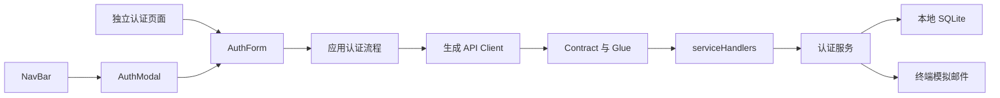

# RFC：共享认证表单与本地认证闭环

> 迁移说明（2026-09-29）：本文件保留当时的业务与实现决定；其中旧 `apps/mock-server/` 路径、本地 SQLite Mock 与未来 PHP/MySQL 接管的基础设施描述，已由 `.notes/archive/server-promotion/specs/2026-09-29-server-promotion-design.md` 和 `.notes/archive/server-promotion/rfcs/server-postgresql-migration-rfc.md` 取代。当前唯一 Server 位于 `apps/server/`，使用独立 PostgreSQL `exre`；正文中的旧路径和目标仅作历史记录。

> 2026-09-23 后续调整：用户已确认删除注册 QQ 号和确认密码，将昵称文案改为“用户名”（仅显示名称，允许重复，仍用邮箱登录）。下文相关旧字段与校验条款已被 Contract 0.3.0 取代；实现与迁移边界见 认证生命周期 `.ai/architectures/server/authentication-lifecycle.md`。其余认证流程保持原设计。

- 日期：2026-09-23
- 状态：技术方案待审阅；产品设计已由用户确认，尚未实施。
- 来源：已确认的设计 `.notes/archive/auth/specs/2026-09-23-auth-design.md`。原文件保留不变，其文内审阅状态早于本次用户确认。
- 模块根目录：`.notes/archive/auth/`；本 RFC 是该设计的单一实施入口。

## 1. 决策摘要

采用共享表单与 Modal/独立页面两种容器。UI 组件位于 `packages/components`，请求、会话和导航位于 `apps/web`。新增认证 operation 全部先定义在 OpenAPI，再通过 Glue、生成 Client 和 SQLite 实现本地闭环。

普通登录签发 7 天本站 token，浏览器写入 `localStorage` 后整页加载。SSO 密码登录或已有会话确认只完成指定请求，不创建本站会话、不返回新 token。SSO 发起与轮询不在本期实现；显式本地 CLI 提供验证用请求与结果查询。

人机验证暂不展示、不校验、不发送伪凭证。邮件验证码仅通过服务端终端模拟投递。上述范围已经确认，本 RFC 不重新选择产品行为。

## 2. 当前事实与约束

| 仓库证据                                                              | 对设计的约束                                                             |
| --------------------------------------------------------------------- | ------------------------------------------------------------------------ |
| OpenAPI `api/openapi.yaml` 只有 `getHealth`                           | 下文所有认证路径均为提案，不是已有接口；保留健康检查语义                 |
| app.ts `apps/mock-server/src/app.ts` 导出静态 `serviceHandlers`       | 保留显式映射与 handler 原始输出测试能力，不依赖 `this` 获得 Fastify 实例 |
| errors.ts `apps/mock-server/src/errors.ts` 统一 envelope              | 增加受信任业务错误类型，不能直接回显异常 message                         |
| server.ts `apps/mock-server/src/server.ts` 只监听回环并检查数据库存在 | 保留回环监听；增加只读的认证表可用性与密钥检查，不自动 migration         |
| 数据库 schema `apps/mock-server/src/db/schema.ts` 尚无业务表          | 用新的 migration 创建业务表，不修改 baseline                             |
| Client `packages/api-client/src/client.ts` 是 openapi-fetch 工厂      | 不让 Client 读取 localStorage；应用逐请求传递 Authorization              |
| AuthArea `packages/components/src/AuthArea.tsx` 使用本地占位登录态    | 替换为受控 UI，不保留第二份会话状态                                      |
| .ai 架构 `.ai/architectures/overview.md` 的模块边界                   | 共享 UI 不导入 Client、不定义路由；前端不直接 fetch、不复制 DTO          |
| Contract 测试 `tests/contract/health.test.ts` 使用真实 app 和独立 Ajv | 保留 HTTP、原始输出、覆盖检查三层；新增测试不触碰开发数据库              |

当前 Node 最低版本为 22.12，Mock Server 为 NodeNext 编译；运行时代码的相对 import 保留 `.js`。共享包继续通过消费方编译，不增加独立打包流程。

## 3. 结构与接口归属

| 建议模块位置                                             | 责任和接口                                                          |
| -------------------------------------------------------- | ------------------------------------------------------------------- |
| `packages/components/src/auth/`                          | `AuthForm`、`AuthModal`、各表单步骤与 UI 专属类型                   |
| `packages/components/src/AuthArea.tsx`、`SiteHeader.tsx` | 接收用户展示状态及登录/注册/退出回调                                |
| `apps/web/src/auth/`                                     | API 适配、流程状态、token 存储、会话恢复、SSO 上下文、导航          |
| `apps/web/src/pages/`                                    | `Login`、`Register`、`SsoSuccess` 页面容器                          |
| `apps/mock-server/src/auth/`                             | 注册/会话/SSO 服务、密码与验证码工具、只操作注入数据库的 repository |
| `apps/mock-server/src/handlers/auth/`                    | Contract 到服务的薄适配，返回公开 DTO                               |
| `apps/mock-server/src/cli/`                              | 本地 SSO 请求创建与检查入口；不允许被 import 执行                   |

以上为拟新增文件/目录，实施可合并过小文件，但不能合并职责边界。采用应用层 React context 与 hooks 管理认证，不另外引入全局状态库或认证框架。

### 3.1 Fastify 实例与测试依赖

`createApp` 新增必需的 `authServices` 参数，`logger` 仍可选；所有当前调用点同步迁移。生产入口显式打开固定数据库，构造服务，挂到实例的 `authServices` decorator。静态 `serviceHandlers` 的函数通过 `request.server.authServices` 获取服务，保持导出的映射与真实注册对象一致；没有默认数据库、全局单例或测试自动回退。

服务依赖数据库句柄、时钟、随机源、密码工具、验证码密钥与 `deliverVerificationCode`。生产适配用真实随机源与终端输出；测试用内存 SQLite、可控时钟和捕获式邮件适配。正常数据库只由生产入口创建连接；关闭 app 时由入口注册的关闭钩子释放，测试由夹具负责释放，不重复关闭。

Glue 使用 `securityHandlers.bearerAuth` 校验受保护 operation。通过的请求携带当前用户与会话的内部身份信息；这些不属于响应 DTO。SSO 完成和退出的事务必须再检查会话尚未过期/撤销，避免认证钩子与写入之间的竞争。

## 4. HTTP Contract 提案

### 4.1 通用规则

- 以下路径写入 `api/openapi.yaml` 时不带 `/api`；实际 HTTP 访问由 Glue 前缀加 `/api`。
- 所有 POST body 为 JSON，所有对象 `additionalProperties: false`，表中列出的字段均必填；不使用隐含默认字段或 Draft 2020-12 特性。
- 时间统一用非负安全整数 Unix 毫秒，schema `type: integer`、`minimum: 0`、`maximum: 9007199254740991`。`now >= expiresAt` 即过期。
- 普通 token、注册尝试标识、SSO 请求标识均为 32 随机字节的无填充 base64url：43 字符，模式 `^[A-Za-z0-9_-]{43}$`。各类标识独立生成，不能相互替代。
- 公开用户 ID 是随机 UUID v4 字符串，模式 `^[0-9a-f]{8}-[0-9a-f]{4}-4[0-9a-f]{3}-[89ab][0-9a-f]{3}-[0-9a-f]{12}$`，不依赖 format 插件。
- 认证响应及错误均发送 `Cache-Control: no-store`。429 同时声明并发送 `Retry-After`，值为至少 1 的十进制秒数文本。
- 仅 me、logout、SSO confirm 声明 `security: [{ bearerAuth: [] }]`，scheme 为 HTTP bearer。其他 operation 显式 `security: []`。不用 cookie 认证。
- 错误沿用 `{ error: { code, message, requestId } }`，不扩展 envelope，不将业务 code 变成会限制未来扩展的全局 enum。
- Contract 增加认证 tag 与说明，`info.version` 作为本次增量标识更新为 `0.2.0`；不新增 URL 版本前缀或兼容层，不改既有健康检查与错误外壳。

### 4.2 字段规范化与校验

登录与注册共同使用以下规范；登录不引入不同的邮箱或密码处理。

| 字段       | Contract 和行为                                                                                                                 |
| ---------- | ------------------------------------------------------------------------------------------------------------------------------- |
| `email`    | 字符串，trim 后转小写，最长 254 个码点；模式 `^[^\s@]+@[^\s@]+\.[^\s@]+$`；项目只做基础邮箱语法校验，注册通过验证码确认可访问性 |
| `nickname` | 字符串，trim 后 1–32 个码点；模式 `^[^\u0000-\u001F\u007F-\u009F]+$`，拒绝控制字符；不要求唯一                                  |
| `qq`       | 字符串，trim；模式 `^[1-9][0-9]{4,11}$`，数据库按字符串保存                                                                     |
| `password` | 字符串，8–64 个 Unicode 码点，不 trim、不做 Unicode 归一化、不限制字符组合；按 UTF-8 编码参与密码哈希                           |
| `code`     | 字符串，模式 `^[0-9]{6}$`，保留前导 0                                                                                           |

确认密码只属于 UI，不在请求中发送。前端用码点数计算长度，不依赖 HTML `maxLength` 的 UTF-16 计数来限制密码。禁止修剪密码、禁止将密码转小写。规范化的精确规则在 Contract description 中记录。

Fastify `preValidation` 仅对 body 中字符串类型的 email、nickname、qq 做上述规范化；不转换任何非字符串或其他字段。使用 Ajv `coerceTypes: false`、`removeAdditional: false`，避免数字 QQ 被转成字符串或额外字段被悄悄删掉。约束仍从 Contract 提供，不能在 Fastify 复制第二份 schema。注册原始 handler 的测试夹具提供已规范化且经 Contract 校验的请求，规范化本身另外通过真实 HTTP 覆盖。

### 4.3 Schema 形状

本表中的命名将作为 `components.schemas` 名称；TypeScript 使用生成类型索引引用，不人工复制 DTO。时间字段均使用本节整数时间 schema，其余字段均为 string 并引用对应约束；status 使用列出的 const/enum。

| Schema                      | 必填字段                                                                                 |
| --------------------------- | ---------------------------------------------------------------------------------------- |
| `RegisterRequest`           | `email, nickname, qq, password`，约束见上表                                              |
| `RegistrationRef`           | `registrationId`                                                                         |
| `VerifyRegistrationRequest` | `registrationId, code`                                                                   |
| `RegistrationChallenge`     | `registrationId, email, serverTime, codeExpiresAt, resendAvailableAt`                    |
| `RegistrationVerified`      | `status: const registered, email`                                                        |
| `RegistrationCancelled`     | `status: const cancelled`                                                                |
| `LoginRequest`              | `email, password`                                                                        |
| `LoginResponse`             | `token, expiresAt`，不含刷新 token                                                       |
| `CurrentUser`               | `id, email, nickname`，不包含 QQ、密码或 token                                           |
| `LogoutResponse`            | `status: const signed-out`                                                               |
| `SsoRequestRef`             | `ssoRequestId`                                                                           |
| `SsoPasswordRequest`        | `ssoRequestId, email, password`                                                          |
| `SsoRequestInfo`            | `ssoRequestId, status: enum [pending, completed], expiresAt, serverTime`，不暴露绑定账号 |
| `SsoCompleted`              | `status: const completed, ssoRequestId`，不含 token                                      |

`RegistrationChallenge` 的初次发送和重发均使用同一 schema。即使检查 SSO 请求返回 completed，也不能仅凭该结果显示登录成功；必须通过密码/有效本站会话确认同一个用户，或具有当前标签页本次流程保存的成功展示记录。

### 4.4 Operation 清单

| 方法与路径                        | operationId              | 输入                      | 成功结果                  | 业务错误                                                       |
| --------------------------------- | ------------------------ | ------------------------- | ------------------------- | -------------------------------------------------------------- |
| POST `/auth/registrations`        | `startRegistration`      | RegisterRequest           | 201 RegistrationChallenge | 409 邮箱/QQ 占用，429 冷却                                     |
| POST `/auth/registrations/resend` | `resendRegistrationCode` | RegistrationRef           | 200 RegistrationChallenge | 404 不存在，409 已完成/取消，410 尝试过期，429 冷却            |
| POST `/auth/registrations/cancel` | `cancelRegistration`     | RegistrationRef           | 200 RegistrationCancelled | 404 不存在，409 已完成                                         |
| POST `/auth/registrations/verify` | `verifyRegistration`     | VerifyRegistrationRequest | 200 RegistrationVerified  | 400 验证码不符，404 不存在，409 占用/已取消/次数耗尽，410 过期 |
| POST `/auth/login`                | `login`                  | LoginRequest              | 200 LoginResponse         | 401 凭据错误                                                   |
| GET `/auth/me`                    | `getCurrentUser`         | Bearer，无 body           | 200 CurrentUser           | 401 会话无效                                                   |
| POST `/auth/logout`               | `logout`                 | Bearer，无 body           | 200 LogoutResponse        | 401 会话无效，客户端视为已退出                                 |
| POST `/auth/sso/inspect`          | `inspectSsoRequest`      | SsoRequestRef             | 200 SsoRequestInfo        | 404 请求不存在，410 过期                                       |
| POST `/auth/sso/login`            | `loginForSso`            | SsoPasswordRequest        | 200 SsoCompleted          | 401 凭据错误，404 不存在，409 绑定其他用户，410 过期           |
| POST `/auth/sso/confirm`          | `confirmSsoWithSession`  | Bearer + SsoRequestRef    | 200 SsoCompleted          | 401 会话无效，404 不存在，409 绑定其他用户，410 过期           |

每个 operation 另有 Contract 校验 400 与 default ErrorEnvelope；所有错误状态均显式列出并引用共享 ErrorResponse。不增加验证码状态读取或 SSO 轮询的 HTTP operation。verify 遇到已完成但超出重试窗口时，使用 409 REGISTRATION_COMPLETED；cancel 遇到仍保留墓碑的 expired 尝试时，幂等返回 cancelled。

### 4.5 错误映射

| code                      | HTTP | UI 行为与固定文案                               |
| ------------------------- | ---- | ----------------------------------------------- |
| `BAD_REQUEST`             | 400  | Contract 输入校验；前端仍提供自身字段提示       |
| `EMAIL_IN_USE`            | 409  | 邮箱字段：“该邮箱已注册”                        |
| `QQ_IN_USE`               | 409  | QQ 字段：“该 QQ 号已注册”                       |
| `INVALID_CREDENTIALS`     | 401  | “邮箱或密码错误”                                |
| `SESSION_INVALID`         | 401  | 清除匹配的失效 token，恢复未登录或展示 SSO 表单 |
| `REGISTRATION_NOT_FOUND`  | 404  | “注册请求不存在，请重新注册”                    |
| `REGISTRATION_CANCELLED`  | 409  | 返回资料步骤；旧尝试不能继续使用                |
| `REGISTRATION_COMPLETED`  | 409  | 重发/取消遇到完成状态，转向登录，不重复创建     |
| `REGISTRATION_EXPIRED`    | 410  | 整个尝试失效，重新填写                          |
| `CODE_INVALID`            | 400  | “验证码错误，请重新输入”                        |
| `CODE_EXPIRED`            | 410  | “验证码已过期，请重新获取”                      |
| `CODE_ATTEMPTS_EXHAUSTED` | 409  | 禁止继续验证，允许冷却结束后重发                |
| `CODE_RESEND_TOO_SOON`    | 429  | 根据 Retry-After 更新重发等待时间               |
| `SSO_REQUEST_NOT_FOUND`   | 404  | “登录请求不存在，请从发起应用重新登录”          |
| `SSO_REQUEST_EXPIRED`     | 410  | “登录请求已过期，请从发起应用重新登录”          |
| `SSO_ACCOUNT_CONFLICT`    | 409  | “该登录请求已由其他账号完成”                    |
| `AUTH_BUSY`               | 503  | “服务繁忙，请稍后重试”，Retry-After 为 1 秒     |
| `INTERNAL_ERROR`          | 500  | 沿用安全固定文案，允许重试                      |

没有增加开放的 `message` 参数。`AuthError` 携带受限 code，只有限流错误可另携带正整数 retryAfterSeconds；`errors.ts` 从固定映射决定 HTTP 与文案并设置声明的 header。Glue 可能包裹 security handler 错误，错误处理器只提取明确的内部 `AuthError` 实例，不能信任任意异常的 code/message；必须覆盖包装场景测试。未经信任的 4xx 仍沿用现有安全回退。

## 5. 持久化、密码与状态机

### 5.1 新增表

SQLite INTEGER 保存毫秒，TEXT 保存字符串与状态。除表中明确标注可 null 的字段外，全部 NOT NULL。连接显式开启外键。所有 FK 不使用删除账号级联，因为本期没有删除账号功能。

| 表                    | 字段及约束                                                                                                                                                                                                                                                                            |
| --------------------- | ------------------------------------------------------------------------------------------------------------------------------------------------------------------------------------------------------------------------------------------------------------------------------------- |
| `auth_users`          | `id` PK；`email` UNIQUE NOT NULL；`nickname`；`qq` UNIQUE NOT NULL；`password_hash`；`created_at`                                                                                                                                                                                     |
| `auth_registrations`  | `id_hash` PK；`email`；`nickname`/`qq`/`password_hash` 可在清理后为 null；`code_digest` 可 null；`status` CHECK pending/completed/cancelled/expired；`failed_attempts` 0–5；`last_sent_at`；`code_expires_at`；`retain_until`；`completed_user_id` FK 可 null；`completed_at` 可 null |
| `auth_email_delivery` | `email` PK；`next_send_at`；独立于注册尝试，取消或创建新尝试不能清除冷却                                                                                                                                                                                                              |
| `auth_sessions`       | `token_hash` PK；`user_id` FK；`created_at`；`expires_at`；`revoked_at` 可 null；索引 user_id 和 expires_at                                                                                                                                                                           |
| `auth_sso_requests`   | `id_hash` PK；`created_at`；`expires_at`；`status` CHECK pending/completed；`user_id` FK 可 null；`completed_at` 可 null                                                                                                                                                              |

用户邮箱与 QQ 的预查询只能用于早期提示，最终依赖数据库唯一约束。多个未验证注册可暂存相同资料；成功创建账号后，同邮箱其他 pending 尝试取消并清除密码哈希。已存在账号不能被注册流程修改密码或资料。

### 5.2 哈希与密钥

密码选择 Node 内置异步 `crypto.scrypt`：随机 16 字节盐、输出 64 字节、`N=32768,r=8,p=1,maxmem=64 MiB`；存为含版本、参数、盐与输出的自描述字符串，校验只接受本实现的参数白名单。密码 UTF-8 编码不做归一化；等长结果使用 `timingSafeEqual`。异步 scrypt、盐与内存参数的可用性依据 [Node 22 官方 Crypto 文档](https://nodejs.org/docs/latest-v22.x/api/crypto.html#cryptoscryptpassword-salt-keylen-options-callback)。这是本地方案选择，生产 PHP 必须自行评估实现与容量，不能宣称已经验证生产密码策略。

token 与不透明请求标识以 SHA-256 摘要索引，原文仅用于交付/调用，不落数据库。验证码由 `randomInt(0, 1000000)` 生成并补齐 6 位，保存 `HMAC-SHA256(key, registrationIdHash + ':' + code)`；绑定注册尝试，不能跨尝试复用。该随机数接口的上界为不包含值，见 [Node randomInt](https://nodejs.org/docs/latest-v22.x/api/crypto.html#cryptorandomintmin-max-callback)。

本地服务新增必需环境变量 `AUTH_CODE_HMAC_KEY`，值为随机 32 字节的 64 位十六进制编码；不硬编码、不提交、不返回浏览器。通过 `apps/mock-server/.env.local` 或进程环境配置，启动脚本使用 Node 的 env-file 支持加载该文件。缺失/不合法即停止启动并提示配置；服务启动不生成密钥。测试显式注入测试专用密钥。

密钥轮换会使未完成验证码失效；按普通错误引导重发，不改变用户密码或本站 token。不自动重置数据库。重发避免复用旧数字码的比较以当前密钥有效的 digest 为依据；轮换后的旧 digest 已不可验证，不承诺识别其原来的数字值。

### 5.3 注册尝试

- 创建：规范化与 schema 验证 → 预查唯一性/冷却 → 在事务外异步计算密码哈希 → 短事务再次查唯一性与冷却、写 pending、更新邮箱冷却 → 提交后输出模拟邮件。
- 发送规则：每次实际发送令 `code_expires_at=now+10min`、`next_send_at=now+60s`、`retain_until=now+24h`；重发替换 digest 并清零失败次数。重发时不能产生与上一次相同的 6 位值，确保旧码不能碰巧继续有效。
- 验证：先检查 cancelled/retention，再检查次数、code 到期与 digest；格式错误被 schema 拒绝，不扣次数。匹配但最终邮箱/QQ 冲突返回字段错误并取消该尝试；没有账号写入。
- 次数：不符时在事务中增加 failed_attempts，第 1–4 次返回 CODE_INVALID，第 5 次及之后返回 CODE_ATTEMPTS_EXHAUSTED。次数增加必须提交后才向外抛业务错误，不能被异常回滚。过期码不增加次数。
- 成功：一个事务插入账号、将该尝试改 completed、关联 user，并取消同邮箱其他 pending。成功事务立即清空暂存密码哈希、昵称与 QQ，仅保留重试必需的标识、邮箱、digest 和时间。
- 幂等：completed 后原来的正确验证码在原 `code_expires_at` 之前、失败次数未耗尽时允许重复得到 registered；不新建账号。错误验证码仍计数，第 5 次或超过重试窗口返回 REGISTRATION_COMPLETED，UI 引导登录，不再提示对已完成尝试重发，也不撤销账号。
- 返回修改：取消成功后返回第一步并保留非敏感资料，清空密码。取消网络失败留在当前步骤允许重试；已取消重复取消返回 cancelled；已完成返回 REGISTRATION_COMPLETED。
- 代码到期但尚未到 retain_until 的 pending 尝试可重发；到 retain_until 时清除暂存敏感资料并标记 expired，必须重新填写。这一区分使“验证码过期后重发”不必重新输入全部资料。

`retain_until` 为数据清理期限，不会将验证码有效期延长到 24 小时。清理采用认证请求入口的惰性、限批处理：清理到期 pending 的资料和 digest，将其标为 expired；状态墓碑再保留 24 小时后删除。cancelled/completed 的无用资料立即清除，digest 在验证码到期后清除；墓碑保留至原 retain_until 后删除。邮箱冷却记录仅在 next_send_at 已到且无 pending 引用时删除。

数据库同步事务内部不执行 await、密码哈希或邮件 I/O。并发验证/重发/取消通过事务读取最新状态；禁止先读后无条件写。唯一约束异常映射为固定字段错误，不能回显 SQLite 异常。

模拟邮件输出在事务提交之后进行；若终端投递异常，返回安全 500，保留冷却与尝试状态，不宣称邮件已发送。用户可在冷却后重试发起/重发。该本地机制不声称提供真实邮件的投递保证。

### 5.4 本站会话

登录校验成功创建新的会话，`expires_at=created_at+7*24h`。不存在邮箱与密码不符均返回 INVALID_CREDENTIALS；未知账号使用固定的测试无关 dummy hash 完成同等密码校验路径。会话校验查询摘要，检查用户存在、未撤销、未过期。

退出将当前会话撤销，不撤销其他会话。已撤销或过期的 bearer 由认证层返回 SESSION_INVALID；应用仍清除该 token 并刷新。过期/撤销行可在惰性清理中删除。

### 5.5 SSO 请求

显式开发命令创建 pending 请求，10 分钟有效。inspect 只返回状态和时间；login/confirm 才能完成它。流程为检查请求 → 验证凭据或会话 → 事务再次检查有效期与状态 → 绑定用户并标记 completed。

相同用户、请求未过期时重复确认返回 completed；不同用户返回 SSO_ACCOUNT_CONFLICT，绝不覆盖绑定。已过期的请求不再接受确认，已完成记录至少保留至 expires_at 后 24 小时，便于 CLI 观察；清理不回滚已经成功的结果。

SSO password 路径不得调用会创建本站会话的普通 login 方法；二者共享的是密码校验函数。SSO confirm 在写事务中重新检查现有会话，且不延长其 7 天期限。

## 6. 前端流程契约

### 6.1 共享组件

`AuthForm` 接收 `step`（login/register/verify/registered）、`busy`、字段与表单错误、展示邮箱、重发剩余秒数、是否允许重试，以及以下回调：提交登录、提交注册、验证验证码、重发、返回修改、切换模式、立即前往登录。

字段编辑、密码可见性和确认密码校验由组件负责；应用给出步骤和请求状态。回调参数是 UI 草稿（包括确认密码），不能作为 API DTO 导出；应用通过生成类型将草稿转换成请求，明确删除确认密码。`registrationId`、token、API 错误对象不传给表单，应用映射成 UI 状态。

验证码满 6 位自动触发一次；请求中禁止修改/重复提交。错误后保留或允许清空重新输入；同一个值不因重新 render 重复触发。网络失败可显式重试提交当前值。成功态由应用计时 1.5 秒后转登录，立即按钮取消计时并只执行一次。

`AuthModal` 接收受控 open/onOpenChange 和表单内容。使用 Dialog 自带标题、描述、关闭、Escape 与焦点机制；关闭清除流程状态，恢复发起按钮焦点。首次进入相应模式聚焦首个字段，验证码步骤聚焦 OTP。

NavBar 接收 `loading | anonymous | authenticated | unavailable` 展示状态。authenticated 只包含昵称/头像展示数据与退出回调；unavailable 显示重试入口，不据此删除本地 token。已有个人中心/设置占位不扩展成新页面。

### 6.2 路由与容器

| 页面                         | 行为                                                                             |
| ---------------------------- | -------------------------------------------------------------------------------- |
| `/login`                     | 普通登录；成功保存 token 后 `location.replace('/')`                              |
| `/register`                  | 普通注册；成功后 SPA replace 到 `/login`，邮箱通过 router state 传递，不进入 URL |
| `/login?ssoRequestId=...`    | SSO 登录/免登录；成功整页 replace 到 `/sso/success`                              |
| `/register?ssoRequestId=...` | SSO 注册；成功 SPA replace 到保留同一参数的登录页                                |
| `/sso/success`               | 读取标签页成功展示记录，显示成功及返回发起应用提示；不发 token、不发起轮询       |
| 其他页面的 NavBar            | 打开 Modal；普通登录保存 token 后 `location.reload()`                            |

独立认证页面点击 NavBar 登录/注册切换路由，不再打开第二个认证容器。只要参数名 ssoRequestId 存在，就进入 SSO 解析分支；空值、重复参数或格式错误显示入口无效，不能悄悄退回普通登录。缺少该参数才是普通模式。忽略其他未经定义的跳转参数。

独立页与 Modal 共享相同的应用流程 hook，以明确的普通/SSO 上下文初始化。从 SSO 页面退出该页面就结束该上下文，不把 SSO 标识存在全局持久化状态。

### 6.3 存储与导航

本站 key 固定为 `exwebsite.auth.token`。读取、写入、删除均捕获异常。普通登录只有保存成功后才能刷新/跳转；失败停留表单提示重试，不用内存 token 冒充持久化成功。刷新后向 me 查询用户，不将 localStorage 当作可信身份来源。

401 清理只针对发起该请求时使用的 token：清理前比较当前存储值，避免迟到的旧请求清除其他标签页的新 token。storage 事件触发会话重查；查询采用递增 generation，只接受当前 generation 的结果。

每次开关 Modal、换路由或模式时使流程 generation 失效；卸载后清除定时器并尽力取消请求。取消不是服务端回滚保证。迟到成功响应不能写 token、改变当前步骤或触发导航。

SSO 成功展示记录 key 为 `exwebsite.auth.sso-success`，值为 `{ssoRequestId, confirmedAt}` JSON，写入当前标签页 sessionStorage。服务端确认成功后才写，再整页跳转；5 分钟有效。它不是凭据，不发送给服务端证明身份。读写失败提示重试；无记录/过期/格式错误时成功页显示“请从发起应用重新进入登录”，不宣称认证成功。

已有 token 的 SSO 页先 inspect，再 confirm；401 仅清除确认为失效的 token 并显示登录表单，404/410 显示请求错误，网络/500 保留 token 并重试。来自 inspect 的 completed 不跳过用户确认。SSO 期间注册成功只切换登录，不能写成功展示记录。

退出需先收到服务端成功或 SESSION_INVALID，再清除本地 token 并刷新；若删除失败，显示错误并允许重试，不反复刷新。其他网络失败保留本地状态。

### 6.4 请求与样式

所有请求通过现有共享 `api`，按请求显式设置 Bearer；注册、普通登录和 SSO password 不自动附加旧 token。业务 DTO 通过 `components`/`operations` 生成类型获取。表单错误只映射已知 code，未知错误显示通用可重试提示。

沿用 ExUI 公开 Dialog、Field、Input、InputOTP、Button、Avatar。label/id/aria-describedby 显式连接；CSS Modules 与 ExUI Token 负责单列表单、窄屏滚动和居中页面。继续保留 `main.tsx` 唯一 CSS 导入与 ThemeProvider。仅在将来启用真实人机验证时增加表单控件与 Contract 凭证，不提前创建无功能的接口层。

## 7. 本地配置、迁移与开发命令

- 新增迁移 `0001_auth`（以 Drizzle 实际生成的顺序名为准），创建第 5 节表/约束/索引；不改 baseline 或已有 journal 历史。
- `server.ts` 先检查固定数据库文件、只读查询必要认证表、校验 HMAC 密钥，再构造服务并监听。失败明确提示 migration 或密钥配置；不在启动过程中建表、写种子或创建新数据库。
- `.env.local` 继续受现有 ignore 规则保护。Mock 包 dev/start 使用 Node `--env-file-if-exists=.env.local`；开发时配合 `--import tsx --watch`，构建启动执行 dist/server.js。工作目录必须为 Mock 包目录，pnpm 包脚本保持这一点。
- 根增加转发命令 `pnpm sso:create`、`pnpm sso:inspect -- <ssoRequestId>`。Mock 包 CLI 使用既有直接执行保护、固定数据库与只读前置检查，不 import migrate/reset；创建仅插入 SSO 行，检查只读。
- create 输出请求标识、到期时间和 `http://localhost:8081/login?ssoRequestId=...`，与普通本地浏览入口保持同一 origin；开发者使用其他 hostname 时必须统一普通页与 SSO 页 hostname。
- inspect 输出 pending/completed/expired/not-found 及完成用户 ID，不输出本站 token、密码、验证码或 QQ。仅供本地验证，不能作为生产轮询 API。

数据库清理只处理认证表中的过期数据，不删除文件。新 CLI 不提供路径、任意 SQL、reset 或迁移参数。

## 8. 安全边界与风险

| 风险                                   | 本期处理与检测                                                                                                                                      |
| -------------------------------------- | --------------------------------------------------------------------------------------------------------------------------------------------------- |
| localStorage token 可被同源脚本读取    | 这是已确认的存储选择；不把 token 放 URL/日志/页面，不用 HTML 注入渲染昵称，测试成功/错误输出不泄露凭据。生产站点需另行落实脚本与内容安全策略        |
| 邮箱/QQ 枚举、QQ 被他人抢占            | 本期接受明确唯一性错误与不验证 QQ 归属；不将 QQ 当作身份凭据。生产归属找回属于后续产品设计                                                          |
| 无人机验证、口令暴力尝试、批量邮箱投递 | 本地 Mock 继续只绑定回环；实现验证码次数与每邮箱冷却，不声称具有生产反滥用能力。真实外网发布须独立设计限流与人机验证                                |
| scrypt 并发耗尽内存                    | 本地异步哈希最多 2 个同时运行；最多 16 个等待，超出以固定安全 503 错误响应，不阻塞事件循环；容量不是生产承诺                                        |
| 响应序列化掩盖内部额外字段             | 直接校验注册的 handler 返回值；测试 raw 返回值不能携带密码哈希、QQ、token 等未声明字段                                                              |
| SSO 请求被转发、盗取或恶意引导         | 本期只使用显式本地请求验证，不宣称实现生产 SSO；请求签发方身份、浏览器绑定/同意、发起方凭证与结果获取协议必须在生产对接设计中解决                   |
| 用户手改成功展示记录                   | 记录只影响 UI，不能改变数据库或生成会话；CLI 检查以服务器结果为准                                                                                   |
| 日志携带凭据或 SQL 参数                | 禁止记录请求 body/Authorization；业务错误只记 code/requestId，认证内部异常日志也不 dump 带 SQL 参数的对象；模拟邮箱验证码是唯一明确允许的开发期例外 |
| 重试与取消造成重复创建/绑定            | SQLite 事务、唯一索引与状态检查；覆盖并发提交、迟到响应、重发与验证竞争测试                                                                         |

哈希资源饱和的错误固定为 `AUTH_BUSY` / 503 / “服务繁忙，请稍后重试”，相关三个密码路径（startRegistration、login、loginForSso）在 Contract 增加 503 ErrorResponse 与 Retry-After: 1。客户端不自动循环重试。其他未预期故障继续 INTERNAL_ERROR。

本次只读核对确认本机 Node v22.22.1 的 `--help` 包含 `--env-file-if-exists`。实施时仍需在仓库最低支持版本上验证 dev/start 与 CLI，不能把本机参数存在当作最低版本启动已验证。

## 9. 验证策略与通过条件

### 9.1 Contract 与服务端

- 扩展现有 schema 读取帮助代码，仍从唯一 OpenAPI 编译 Draft-07 schema；不手写另一份测试 DTO/schema。
- 每个新 operation 必须验证真实 Fastify HTTP 状态/body/关键 headers，以及注册 handler 的原始返回值。成功返回是普通对象，handler 只设置 reply 状态码/headers，不能绕过返回值测试用 reply.send 隐藏结果。
- 每个 app 都注入独立的内存 SQLite；测试夹具直接调用 Drizzle migrator 对内存连接应用相同 migration，不 import 有副作用的 CLI，不接受用户数据库路径。
- 同步更新健康检查夹具，保留原有覆盖检查、404 安全 envelope 和错误脱敏断言；全量运行 `pnpm test`。
- 精确覆盖邮箱大小写/空白、QQ 字符串及前导零、昵称控制字符、密码空格和 emoji 码点、额外字段、数字密码/QQ 拒绝。
- 覆盖验证码 59/60 秒、有效期前后、前导零、5 次错误、重发旧码失效、24 小时 retention、取消/重试、同邮箱冷却不能绕过。
- 并发验证只创建一个账号；重发/取消/验证竞争线性化；计数递增不被异常回滚；处理唯一索引失败后不留下部分状态。
- 验证 7 天过期边界、撤销、多会话隔离、无效 bearer、Glue 包装错误、token hash 存储、密码不落日志/响应。
- 验证 SSO 两条成功路径均不创建 auth_sessions；同账号重复、不同账号冲突、到期、缺失、会话认证与事务间撤销。

### 9.2 前端与浏览器

新增用户行为测试所需的 Testing Library、user-event 与 DOM 环境作为开发依赖，独立配置前端测试环境；不改变 Contract 测试的 Node 环境。真实浏览器使用 Playwright 覆盖整页导航、storage 和 ExUI 交互，不能用 renderToStaticMarkup 代替这些验收。

最低验收矩阵：

| 场景                    | 必须观测的结果                                                 |
| ----------------------- | -------------------------------------------------------------- |
| Modal 注册 → 登录       | 注册成功仅切换表单；登录写 token 后刷新原 URL                  |
| 独立注册 → 登录         | 邮箱预填、密码清空；登录整页回首页                             |
| SSO 密码登录            | 服务端请求 completed；localStorage 无新增 token；整页成功页    |
| SSO 有效本站 token      | 无需输密码；服务器完成请求；原 token 不变                      |
| SSO 失效 token/请求     | 按错误来源分别显示登录或请求错误，不误显示成功                 |
| 网络/存储失败与迟到响应 | 不误清有效 token、不伪造成功、不由关闭的表单导航               |
| 重发/自动提交           | 倒计时依据 serverTime 校准；重复 render 不重复请求；失败可重试 |
| 键盘/主题/窄屏          | Modal 焦点恢复、错误关联、OTP 粘贴、明暗主题与滚动正常         |

浏览器验证使用实际 Mock Server 和明确的测试账户；邮件验证码从服务端终端获取。SSO 请求用显式 CLI 创建并检查。不运行 db:reset 清理开发者数据。单测模拟通过与真实浏览器通过分别报告。

实施最低门禁：`pnpm api:lint`、`pnpm api:generate`、`pnpm typecheck`、`pnpm test`、`pnpm build`，然后执行上述真实浏览器矩阵。若实施时出现 `TESTING.md`，优先遵循该文件。本 RFC 编写期间未执行这些实现门禁。

## 10. 落地顺序、兼容性与回退

1. 先落 Contract 与生成类型，保留既有 health；再落新的 migration 与独立测试夹具。
2. 落认证服务、固定错误映射、Glue security/handler、显式开发命令，完成 Contract 和数据测试。
3. 落共享表单与容器、应用状态和 Client 适配，替换占位 AuthArea，完成前端行为测试。
4. 显式运行 migration、配置本地密钥，再运行 dev，完成真实浏览器验收。

跨层变更作为一个完整功能交付；不让仅注册路由但缺 handler 的中间状态作为可用版本发布。已有 `/health` 消费方不需要迁移。createApp 与 SiteHeader 的内部调用点一次性迁移，无需保留占位兼容分支。

回退应用可撤回 UI/认证处理而保留新增数据表，不能回写或删除已应用的 migration。恢复到需要新表的版本时继续使用相同 migration 历史。用户账号与会话不因代码回退删除；数据库恢复是独立、明确授权的操作，本 RFC 不授权 reset。若上线前检查发现 Contract/handler 不一致、秘密泄露或关键浏览器失败，停止交付并修复。

## 11. 备选方案与后续边界

- 表单自行请求/导航：调用处更少，但违反共享 UI 依赖边界，不能采用。
- 自包含 JWT：可以减少会话查询，但退出撤销仍需状态；本地规模没有该收益，选择可撤销的不透明会话 token。
- SSO 共用普通登录 response：容易误存 token、混淆页面导航，选择独立 operation 与互不混用的结果。
- 注册前创建未激活账号：会预占邮箱/QQ 且增加账号状态；选择独立待验证记录，仅成功时创建正式账号。

本期没有未决的阻塞性产品问题。上述 endpoint、数据保留、加密参数、错误和 UI 接口属于本 RFC 的技术提案，尚未被实现测试证明。后续独立工作包括真实邮件、人机验证、外网反滥用、生产 PHP 实现，以及完整 SSO 发起方/轮询/授权边界；本 RFC 的完成不代表这些能力完成。

## 12. 文档核查记录

- 已对照批准 spec、现有 API/Client/Fastify/数据库/测试与组件边界进行逐项自查。
- 已检查状态机的重发、取消、幂等、唯一性竞争和 SSO 不签发本站 token 的约束。
- 本阶段仅新增 RFC；保留来源 spec，不修改 Contract、实现、数据库或持久 `.ai/` 知识，不创建提交。
- 静态文档核查与链接检查见本次交付结果；运行时、浏览器与生产验收均未执行。
