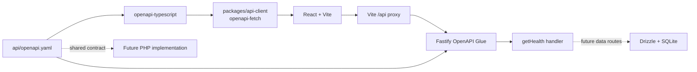

# Contract-first Backend Sandbox 脚手架 RFC

> 迁移说明（2026-09-29）：本文件保留当时的业务与实现决定；其中旧 `apps/mock-server/` 路径、本地 SQLite Mock 与未来 PHP/MySQL 接管的基础设施描述，已由 `.notes/archive/server-promotion/specs/2026-09-29-server-promotion-design.md` 和 `.notes/archive/server-promotion/rfcs/server-postgresql-migration-rfc.md` 取代。当前唯一 Server 位于 `apps/server/`，使用独立 PostgreSQL `exre`；正文中的旧路径和目标仅作历史记录。

- **状态：**Draft（依据已批准的设计说明起草）
- **日期：**2026-09-16
- **来源：**[Backend Sandbox 脚手架设计](../specs/2026-09-16-backend-sandbox-scaffold-design.md)
- **范围：**创建 React/Vite 前端、Fastify/SQLite 本地 Mock Server、OpenAPI Contract 和共享类型安全客户端的 pnpm workspace 骨架。

## 决策摘要

建立以 `api/openapi.yaml` 为唯一 HTTP API Contract 的 pnpm workspace。前端只能通过 `@workspace/api-client` 调用接口；Mock Server 通过 `fastify-openapi-glue` 根据该 Contract 注册路由，并使用 Drizzle 管理独立的本地 SQLite 数据库。

首版只实现 `GET /api/health`，用于验证 OpenAPI lint、类型生成、Vite 代理、Fastify 路由、Contract Test、迁移和安全重置流程。它不提供任何业务资源、认证或静态 JSON Mock。

## 背景与问题

前端开发不应依赖 PHP 后端的交付节奏。开发期需要一个实际可运行、未来可持久化业务状态的 Node 本地后端；同时，未来 PHP 后端接管时，前端业务调用不应因接口定义不一致而重写。

当前目录只有设计草稿和批准的设计说明，没有现有 package、运行时、Contract、数据库、源码或测试。因此本 RFC 定义新项目的初始边界，而不是重构现有实现。

## 目标与非目标

### 目标

1. `api/openapi.yaml` 成为唯一 API Contract；前端和 Fastify 都从它派生行为或类型。
2. `pnpm dev` 同时启动 Vite（`8081`）与 Mock Server（`8080`）。
3. 浏览器通过相对的 `/api` 调用，在开发期由 Vite 代理到 Mock Server；换接 PHP 时仅通过 `VITE_API_BASE_URL` 改变 API base URL。
4. `pnpm db:migrate` 可创建/升级固定的本地 SQLite 文件；`pnpm db:reset` 仅删除并重建该文件与其 SQLite sidecar 文件。
5. `pnpm api:lint`、`pnpm api:generate`、`pnpm typecheck`、`pnpm test` 和 `pnpm build` 可验证基础设施完整性。

### 非目标

- 业务资源、表、CRUD、种子业务数据或业务界面。
- 登录、Token、用户、角色、权限和认证授权策略。
- PHP/MySQL 实现、生产部署、CI、PHP Contract Test。
- React Query、服务端缓存、上传、SSE、WebSocket、队列、邮件或第三方服务。
- 通过 Drizzle/Fastify 反向生成 OpenAPI，或通过静态 JSON 伪造后端行为。

## 约束与已作决策

| 主题           | 决策与理由                                                                                                                                                          |
| -------------- | ------------------------------------------------------------------------------------------------------------------------------------------------------------------- |
| 工作区         | 使用 pnpm workspace，以根脚本协调 `apps/web`、`apps/mock-server` 和 `packages/api-client`。                                                                         |
| Contract       | 使用单文件 OpenAPI 3.1.1：`api/openapi.yaml`。首版规模不拆分 `paths/` 或 `schemas/`。                                                                               |
| Schema 兼容性  | Contract schema 限定在 Fastify 默认 Ajv 的 Draft-07 兼容子集。不可使用 Draft 2020-12 专有语义，直到另行设计并配置 Fastify 的对应 validator 与 serializer compiler。 |
| API Client     | `openapi-typescript` 生成 TypeScript 类型；`openapi-fetch` 实现 `createApiClient({ baseUrl })`。                                                                    |
| 前端           | React、Vite、TypeScript、Sass、Valtio、Framer Motion；首版不为了验证依赖而设计业务或演示交互。                                                                      |
| Mock Server    | Fastify、`fastify-openapi-glue`、Drizzle ORM 和 `better-sqlite3`。                                                                                                  |
| 数据库         | 仅使用 `apps/mock-server/data/mock.sqlite`，不连接或共享 PHP/生产数据库。                                                                                           |
| 数据库生命周期 | migration 由显式命令执行；服务启动不得创建 migration、建表或隐式 reset。                                                                                            |
| 路由前缀       | OpenAPI `servers[0].url: /api` 仅表示客户端 base URL；Fastify 注册 Glue 时显式配置 `prefix: '/api'`。                                                               |

## 目标工作区

```text
.
├── api/openapi.yaml
├── apps/
│   ├── web/
│   │   ├── src/{App.tsx,main.tsx,api/client.ts,styles/index.scss}
│   │   ├── index.html
│   │   ├── vite.config.ts
│   │   ├── tsconfig.json
│   │   └── package.json
│   └── mock-server/
│       ├── src/
│       │   ├── {app.ts,server.ts,errors.ts}
│       │   ├── handlers/health.ts
│       │   └── db/{client.ts,migrate.ts,reset.ts}
│       ├── drizzle/{0000_baseline.sql,meta/_journal.json}
│       ├── data/.gitkeep
│       ├── drizzle.config.ts
│       ├── tsconfig.json
│       └── package.json
├── packages/api-client/
│   ├── src/{client.ts,index.ts,generated/schema.d.ts}
│   ├── tsconfig.json
│   └── package.json
├── tests/contract/health.test.ts
├── {AGENTS.md,package.json,pnpm-workspace.yaml,tsconfig.base.json,redocly.yaml,.gitignore}
└── pnpm-lock.yaml
```

### 边界

| 边界                   | 责任                                                                      | 禁止事项                                                                    |
| ---------------------- | ------------------------------------------------------------------------- | --------------------------------------------------------------------------- |
| `api/`                 | 描述 HTTP 路径、operation、请求、响应及错误 schema。                      | 保存前端或 Fastify 实现。                                                   |
| `packages/api-client/` | 导出生成类型和 API client 工厂。                                          | 引入 React、Valtio、Framer Motion、业务状态或 endpoint 定义。               |
| `apps/web/`            | 配置 Vite、SCSS、环境变量，并将共享 Client 接入前端。                     | 直接使用浏览器 `fetch`、复制 DTO、臆造 endpoint。                           |
| `apps/mock-server/`    | 加载 Contract、映射 operation handler、运行 SQLite 访问和受控数据库命令。 | 用 `app.get()` 绕过 Contract、将 schema 作为第二 API 定义、连接生产数据库。 |
| `tests/contract/`      | 从 Contract 读取 schema，并对真实 Fastify app 的 HTTP 响应做验证。        | 仅单测 handler 而跳过路由与 schema 注册。                                   |

## 架构与请求流



### Contract 到运行时的映射

`api/openapi.yaml` 定义路径 `/health`、`operationId: getHealth` 和响应 schema。Fastify 通过 Glue 注册时必须明确传入 Contract、前缀和 handler 映射：

```ts
fastify.register(openapiGlue, {
  specification: openapiPath,
  prefix: '/api',
  serviceHandlers: { getHealth },
})
```

这意味着：

- OpenAPI 路径仍为 `/health`，实际注册 HTTP 路径为 `/api/health`。
- `servers[].url` 不能替代 Glue 的 `prefix` 配置。
- `operationId` 通过 `serviceHandlers.getHealth` 显式映射到 `handlers/health.ts` 的导出；文件名不参与自动解析。
- Glue 从 Contract 配置 method、路由和 validation schema；handler 只实现业务行为。

### 前端请求流

1. `apps/web/src/api/client.ts` 从 `VITE_API_BASE_URL` 读取 base URL，未设置时使用 `/api`。
2. 开发期 Vite 将 `/api/*` 代理到 `http://localhost:8080`。
3. 在 `import.meta.env.DEV` 下，根应用经共享 Client 调用 `GET /health` 验证通路；调用失败只记录明确的开发错误，不添加状态面板或业务 UI。
4. 未来接入 PHP 时，部署配置将 `VITE_API_BASE_URL` 指向 PHP 的 `/api` 前缀；调用点和共享 Client 不变。

## API Contract

首版规范的强制部分如下：

```yaml
openapi: 3.1.1
servers:
  - url: /api
paths:
  /health:
    get:
      operationId: getHealth
      responses:
        '200':
          description: Mock server is running
          content:
            application/json:
              schema:
                $ref: '#/components/schemas/HealthResponse'
        default:
          $ref: '#/components/responses/ErrorResponse'
components:
  responses:
    ErrorResponse:
      description: Safe application error response
      content:
        application/json:
          schema:
            $ref: '#/components/schemas/ErrorEnvelope'
  schemas:
    HealthResponse:
      type: object
      additionalProperties: false
      required: [status]
      properties:
        status:
          type: string
          const: ok
    ErrorEnvelope:
      type: object
      additionalProperties: false
      required: [error]
      properties:
        error:
          type: object
          additionalProperties: false
          required: [code, message, requestId]
          properties:
            code:
              type: string
            message:
              type: string
            requestId:
              type: string
```

`GET /api/health` 只能以 HTTP `200` 和精确 JSON `{ "status": "ok" }` 代表成功。该接口表示 Mock Server 已通过监听前置检查，不代表业务数据库可完成业务 CRUD；首版没有业务表。

未预期错误和未知路径使用统一错误结构：

```json
{
  "error": {
    "code": "INTERNAL_ERROR",
    "message": "A concise safe message",
    "requestId": "fastify-request-id"
  }
}
```

错误消息不得包括堆栈、SQLite 文件路径或其他内部细节。Fastify request ID 必须用于响应关联和日志关联。后续业务 operation 需显式引用该 response，或在 Contract 中定义、评审和版本化替代结构后才能返回另一种错误格式。

## 数据库与迁移

### 持久化边界

- 数据库文件固定为 `apps/mock-server/data/mock.sqlite`。
- 版本控制保留 `data/.gitkeep`，忽略 `mock.sqlite`、`mock.sqlite-wal` 和 `mock.sqlite-shm`。
- Drizzle 使用 `better-sqlite3`，仅访问该本地文件。
- 初始 `0000_baseline.sql` 和 Drizzle journal 建立 migration 基线，不添加业务表或种子数据。
- 首个业务表必须由新的 Drizzle migration 创建；不得回写或修改 baseline migration。

### 命令语义

| 命令              | 规范行为                                                                            | 数据安全边界                                                          |
| ----------------- | ----------------------------------------------------------------------------------- | --------------------------------------------------------------------- |
| `pnpm db:migrate` | 创建 `data/` 和 SQLite 文件，并根据 journal 应用未执行的 migration。                | 不删除现有数据库，不接受可变数据库路径。                              |
| `pnpm db:reset`   | 只删除 `mock.sqlite`、`mock.sqlite-wal`、`mock.sqlite-shm`，随后执行 `db:migrate`。 | 不删除目录、migration、源码或任何其他工作区文件；不接受可变路径参数。 |

`server.ts` 在监听前检查数据库文件是否存在。若不存在，进程停止并提示用户运行 `pnpm db:migrate` 或 `pnpm db:reset`。`app.ts` 保持可通过 `inject()` 测试；由于 `/health` 不读取业务数据，Contract Test 不读取或修改开发数据库。

## 命令与依赖

### 根命令

| 命令                | 行为                                                                             |
| ------------------- | -------------------------------------------------------------------------------- |
| `pnpm dev`          | 并发启动 Vite `:8081` 和 Mock Server `:8080`；不运行 migration/reset。           |
| `pnpm api:lint`     | 以 Redocly 校验 OpenAPI 解析、引用和项目规则。                                   |
| `pnpm api:generate` | 使用 `openapi-typescript` 更新 `packages/api-client/src/generated/schema.d.ts`。 |
| `pnpm typecheck`    | 对所有 workspace 包执行无输出的 TypeScript 检查。                                |
| `pnpm test`         | 运行 Vitest Contract Test。                                                      |
| `pnpm build`        | 构建 Vite 前端并编译运行所需的 TypeScript 工作区代码。                           |
| `pnpm db:migrate`   | 执行 Mock Server migration。                                                     |
| `pnpm db:reset`     | 受控重置本地 Mock SQLite 数据库。                                                |

新环境的操作顺序：

```bash
pnpm install
pnpm api:lint
pnpm api:generate
pnpm db:migrate
pnpm dev
```

API 修改的不可变顺序：修改 `api/openapi.yaml` → `api:lint` → `api:generate` → 实现 handler → 经共享 Client 调用 → `typecheck` 和 Contract Test。生成的 `schema.d.ts` 纳入版本控制并禁止手改。

### 依赖归属

| 工作区                | 生产依赖                                                     | 开发/构建依赖                                                            |
| --------------------- | ------------------------------------------------------------ | ------------------------------------------------------------------------ |
| 根目录                | 无                                                           | TypeScript、Vitest、concurrently、Redocly CLI、openapi-typescript、Ajv。 |
| `apps/web`            | React、React DOM、Valtio、Framer Motion。                    | Vite、React 插件、Sass。                                                 |
| `packages/api-client` | openapi-fetch。                                              | 无额外运行时生成器。                                                     |
| `apps/mock-server`    | Fastify、fastify-openapi-glue、Drizzle ORM、better-sqlite3。 | drizzle-kit、tsx、相应 TypeScript 类型。                                 |

根 `package.json` 应声明 `packageManager`，并使用由所选 Fastify 版本支持的 Node LTS 版本。所有精确版本由新增的 `pnpm-lock.yaml` 固定。

## AI 协作约束

新增的 `AGENTS.md` 必须包含以下可执行规则：

1. 不得臆造 endpoint、HTTP method、请求字段或响应字段。
2. 实现任意 API 调用前必须读取 `api/openapi.yaml`。
3. API 变更先更新 Contract，再 lint 和生成类型。
4. 前端只能通过 `@workspace/api-client` 发起 API 请求，不直接使用 `fetch` 或复制 DTO。
5. Mock Server 只实现具有 `operationId` 的 Contract operation；不得另行新增 Fastify HTTP 路由。
6. Mock 数据只保留在本地 SQLite，不提交数据库文件。
7. OpenAPI 3.1 schema 仅使用 Draft-07 兼容子集；引入 Draft 2020-12 特性前必须单独更新并确认运行时校验设计。
8. 破坏性 Contract 变更需要明确评审与版本化；本 RFC 不定义版本策略或兼容层。

## 实施与落地顺序

按以下顺序落地，避免产生没有 Contract 或无法验证的中间状态：

1. 创建 pnpm workspace、根 package 脚本、共享 TypeScript 配置、忽略规则与 `AGENTS.md`。
2. 新增 OpenAPI 文件和 Redocly 配置；实现 `api:lint`、`api:generate` 并生成初始类型。
3. 建立 `@workspace/api-client`，导出 `createApiClient({ baseUrl })` 和生成类型。
4. 建立 Drizzle SQLite 配置、baseline migration、`db:migrate` 与受控 `db:reset`。
5. 建立 Fastify app/server、Glue 注册、显式 handler 映射、错误处理和数据库存在性检查。
6. 建立 Vite React 空壳、SCSS 入口、`/api` 代理和开发期共享 Client 健康请求。
7. 增加 Contract Test，并运行全部验证命令修复集成问题。

## 验证

### 自动验证

| 检查          | 成功条件                                                                                                                          |
| ------------- | --------------------------------------------------------------------------------------------------------------------------------- |
| OpenAPI lint  | `api/openapi.yaml` 可解析，引用可解析，且满足 Redocly 规则。                                                                      |
| 类型生成      | `schema.d.ts` 从当前 Contract 成功生成，且 TypeScript 消费它。                                                                    |
| Contract Test | 真实 Fastify app 成功注册 `/api/health`；`inject()` 返回 200、JSON content type 和符合 `HealthResponse` 的 JSON，且没有额外字段。 |
| Schema 兼容性 | Fastify app 创建与 route registration 成功；测试以 Draft-07 兼容 Ajv 从 Contract 验证 response。                                  |
| 数据库迁移    | `db:migrate` 创建/升级固定 SQLite 文件。                                                                                          |
| 数据库重置    | `db:reset` 只重建该 SQLite 文件及其 sidecar 文件。                                                                                |
| 类型与构建    | `pnpm typecheck` 和 `pnpm build` 成功，Vite 可编译 SCSS。                                                                         |
| 开发运行      | `pnpm dev` 使 `8081` 和 `8080` 可用，且前端的开发期 Client 请求通过 Vite 代理到 `/api/health`。                                   |

### 失败路径

- 未运行 migration 时，直接运行 Mock Server 必须因缺少数据库文件明确失败，并提示正确的恢复命令；它不能隐式创建或重置数据库。
- handler 返回多余、缺失或错误类型字段时，Contract Test 必须失败。
- 尝试以未声明路径访问服务时，必须返回统一错误 envelope，且不泄露内部路径或堆栈。
- 在 Contract 中使用超出 Draft-07 兼容范围的 schema 时，必须在 Fastify route registration 或显式 schema 校验中失败，不能静默接受不一致行为。

## 风险与缓解

| 风险                                              | 可能性 | 影响 | 缓解或接受                                                            | 检测                                                   |
| ------------------------------------------------- | ------ | ---- | --------------------------------------------------------------------- | ------------------------------------------------------ |
| Contract 与 Mock 实现偏离                         | 中     | 高   | OpenAPI-first、Glue 路由注册、生成类型和真实 HTTP Contract Test。     | lint、类型检查与 Contract Test 失败。                  |
| `/api` 前缀被重复或遗漏                           | 中     | 高   | 仅在 Glue 注册中设置 `prefix: '/api'`；`servers.url` 仅供客户端使用。 | `inject('/api/health')` 与 Vite 代理验证。             |
| OpenAPI 3.1 schema 与 Fastify 默认 Ajv 语义不一致 | 中     | 中   | 首版限制 Draft-07 兼容子集；完整 2020-12 支持另行设计。               | Fastify app 注册与 Ajv Contract Test。                 |
| 本地 reset 删除超出预期的数据                     | 低     | 高   | 固定文件路径、无路径参数、只删除三个 SQLite 文件。                    | reset 测试与实现代码审查。                             |
| 未来 PHP 接管造成前端重写                         | 中     | 高   | 前端只依赖共享 Client 和 Contract；环境变量负责 base URL。            | 未来 PHP 实现的独立 Contract Test（不在本 RFC 范围）。 |
| 首版被业务需求污染                                | 中     | 中   | 明确非目标；任何业务资源需从 Contract 开始并单独确认。                | RFC 范围审阅和验收清单。                               |

## 安全与运行边界

该服务是本地开发 Mock，不处理认证、授权或敏感业务数据。仍应：

- 不在错误响应中暴露 SQLite 绝对路径、SQL、堆栈或原始异常。
- 不提交 SQLite 数据库、WAL 或 SHM 文件。
- 不提供任意数据库路径、任意文件删除或动态路由注册入口。
- 不将本地数据库配置指向生产 PHP/MySQL 数据库。

本 RFC 不声明生产可用性、SLO、监控、告警或容量指标；目前没有对应运行环境或基线。

## 发布、回滚与数据恢复

这是新建本地脚手架，不替换已运行服务，也没有生产数据迁移。

- **落地：**按“实施与落地顺序”执行；只有全部验证命令通过才将此骨架视为可供后续业务扩展的基线。
- **停止条件：**OpenAPI 与 Fastify 无法在 Draft-07 兼容范围内共同验证，或 `db:reset` 不能严格限制于目标 SQLite 文件时，停止实现并修正配置/设计；不得用绕过 Contract 或扩大删除范围的方式继续。
- **应用回滚：**删除尚未采用的脚手架提交可恢复到当前空项目状态；不涉及现有运行时。
- **数据回滚：**首版没有业务数据。开发数据库可由 `db:reset` 重建；该操作按设计有意丢弃本地 mock 数据，不应用于生产或共享数据。

## 替代方案与取舍

| 方案                            | 优点                                                                | 缺点                                                               | 结论     |
| ------------------------------- | ------------------------------------------------------------------- | ------------------------------------------------------------------ | -------- |
| 选定：OpenAPI-first workspace   | 单一 Contract 驱动 Client 与 Mock Server，符合未来 PHP 接管的边界。 | 初始配置多于单一前端工程。                                         | 采用。   |
| 运行时优先，稍后接入 OpenAPI    | 初始文件更少。                                                      | 最重要的生成与契约校验链路没有被首版验证，后续更易偏离。           | 不采用。 |
| Fastify schema 反向生成 OpenAPI | 后端编写路由快。                                                    | Fastify 实现会成为 API 定义，破坏 PHP 与前端共享 Contract 的目标。 | 不采用。 |
| 手写 fetch 与 DTO               | 不需要生成工具。                                                    | 类型、路径和 payload 容易漂移；不满足生成型 API Client 要求。      | 不采用。 |

## 未决问题

无阻塞未决问题。本 RFC 已冻结首版所需的目录、Contract、运行时、数据库、验证和回滚决策。

后续业务设计必须单独决定：资源模型、认证与授权、分页/过滤/排序、API 版本策略、完整 Draft 2020-12 支持、PHP Contract Test 与 CI。
