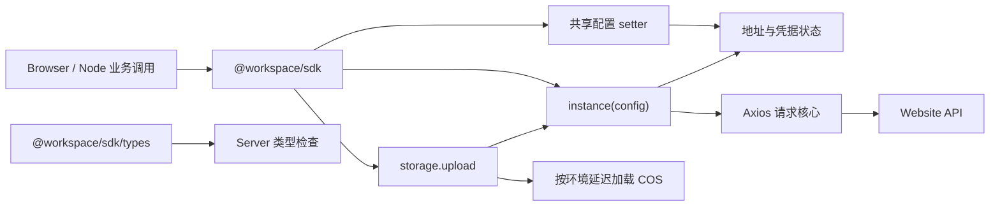

# RFC：统一 SDK 单例客户端

- 日期：2026-10-19
- 状态：待实施评审；源 spec 已由用户确认，本文不表示实现或运行验收通过。
- 来源：`.notes/client-consolidation/specs/2026-10-19-sdk-consolidation-design.md`
- 模块根目录：`.notes/client-consolidation/`
- 文档责任：本 RFC 固化实施契约，不改写源 spec。

## 1. 决策摘要与范围

将 `packages/api-client/` 的生成类型和请求适配移入 `packages/sdk/`。公开客户端只保留 `@workspace/sdk` 的模块单例：`instance({...})`、`storage.upload(...)`、`setBaseUrl`、`setAccessToken`，以及必要的会话失效 handler 设置。Server 通过 `@workspace/sdk/types` 消费原始生成类型。

所有本站业务调用使用同一请求管线和配置。取消公开工厂、旧实例名、旧方法族和旧包，不提供转发兼容层。外部工程仍可独立消费 Browser/Node ESM 产物；第三方请求可自行选择工具。

本次不改 HTTP operation、响应形状、数据库、Hydra 协议或存储后端，不增加登录、刷新 token、重试、多账号客户端、发布或部署能力。`packages/common/` 的入口与行为不变。

## 2. 当前证据与实施约束

| 已核对事实                                                            | 当前来源                                                                                              | 对设计的约束                                                    |
| --------------------------------------------------------------------- | ----------------------------------------------------------------------------------------------------- | --------------------------------------------------------------- |
| Client 的请求路径和成功类型来自生成的 paths，运行时必须注入 transport | `packages/api-client/src/client.ts`                                                                   | 合并后保留 Contract 类型推导，不以任意响应泛型替代。            |
| SDK 已经包含 Axios 错误处理、Token 快照、浏览器适配与上传流程         | `packages/sdk/src/http/core.ts`、`packages/sdk/src/shared.ts`                                         | 重组这些职责，保留失败路径；不另建请求引擎。                    |
| Web 自己组装两个工厂，并通过认证适配更新 HTTP token                   | `apps/web/src/api/client.ts`、`apps/web/src/auth/storage.ts`                                          | 移除工厂接线，保留同标签和跨标签认证通知、SSO 路由保护。        |
| Server 通过类型子入口引用 components/operations                       | `apps/server/src/http/handler-types.ts`、`apps/server/src/domains/support/validation.ts`              | SDK 类型入口保持无运行时依赖与无 DOM 的 NodeNext 编译边界。     |
| 开发监督器持有 application lock 和精确子进程归属，但尚无 SDK 重建循环 | `scripts/runtime/applications.mjs`、`scripts/runtime/local-dev.mjs`                                   | 重建在现有监督生命周期中扩展，不引入无归属后台 watcher。        |
| dev、test 先生成 Contract，build/typecheck 已依赖 SDK 构建            | `scripts/runtime/entry.mjs`、`scripts/runtime/tests.mjs`、`scripts/runtime/build.mjs`、`package.json` | 统一产物前置条件，更新对应断言和文档。                          |
| Browser SDK 静态引用 ExUI，peer 元数据为 optional                     | `packages/sdk/src/http/browser.ts`、`packages/sdk/package.json`                                       | Browser 仍必须提供 ExUI；Node 独立消费不安装或加载 ExUI/React。 |

现有依赖版本保持 lockfile 中的版本，不借此升级 Axios、COS、Vite、TypeScript 或 ExUI。实现前按 `TESTING.md`（若届时存在）或当前 `.ai/architectures/contract-tests/test-layers.md` 执行测试规则。

## 3. 模块与依赖设计

目标职责和文件位置为绑定选择；文件内部可以按清晰度继续拆分，但不新增公开包：

| 目标位置                                                  | 责任                              | 可依赖                                                  |
| --------------------------------------------------------- | --------------------------------- | ------------------------------------------------------- |
| `packages/sdk/src/generated/schema.d.ts`                  | 原始 Contract 生成类型            | 由生成命令写入。                                        |
| `packages/sdk/src/request-types.ts`                       | 对象请求与响应类型映射            | 生成类型及标准 Web 类型。                               |
| `packages/sdk/src/config.ts`                              | 地址、凭据来源、版本、失效锁      | 注入的环境读写函数；不导入 Web 应用。                   |
| `packages/sdk/src/http/core.ts`                           | 配置验证、序列化、HTTP 和错误策略 | config、Axios、请求类型；不导入 COS/ExUI。              |
| `packages/sdk/src/runtime.ts`                             | 包内依赖组装，产生一份单例公开面  | config、HTTP、storage、注入的环境适配。                 |
| `packages/sdk/src/browser.ts`、`packages/sdk/src/node.ts` | 根入口的两种环境产物              | 各自创建一次内部 runtime，导出同名对象与方法。          |
| `packages/sdk/src/storage/`                               | 上传协调及环境 COS 传输           | 同一请求管线；COS 适配延迟加载。                        |
| `packages/sdk/src/index.ts`                               | 共同公开类型与声明入口            | 请求类型、错误与 storage 公开类型，不暴露环境实现类型。 |

`runtime.ts` 内部的创建方法只用于根入口组装和单元测试，不进入 exports。Browser 与 Node 分别解析一个环境入口，同一入口内的所有命名导出引用同一 runtime；不把复制状态的构造过程放入 re-export 文件。



## 4. 公开接口

### 4.1 值与类型导出

根入口只导出以下运行值：

```ts
instance
storage
setBaseUrl
setAccessToken
setSessionExpiredHandler
ExAxiosError
StorageSdkError
```

配置与上传签名：

```ts
export declare function setBaseUrl(url: string): void
export declare function setAccessToken(token: string | null): void
export declare function setSessionExpiredHandler(handler: SessionExpiredHandler | null): void

interface Storage {
  upload(key: string, data: Blob | Uint8Array, options?: UploadOptions): Promise<string>
}
interface UploadOptions {
  medium?: 'file' | 'cos'
  contentType?: string
}
interface SessionExpiredContext {
  error: ExAxiosError
  loginUrl: string
}
type SessionExpiredHandler = (context: SessionExpiredContext) => void | Promise<void>
```

File 作为 Blob、Node Buffer 作为 Uint8Array 被支持。setter 同步验证并原子更新，验证失败抛 ExAxiosError CONFIG_ERROR；存储输入和上传错误仍使用 StorageSdkError。

根入口可导出 RequestConfig、SdkInstance、上传类型、错误类型、SessionExpiredContext 及生成的 paths/operations/components。`@workspace/sdk/types` 仅导出原始生成类型，不引入这些运行接口。保留 ExAxiosError 类名是为了延续已有错误识别，不保留名为 ExAxios 的实例或类型工厂。

删除 createSdk、createExAxios、createApiClient、ExAxios，以及 instance 上的 setToken、setBaseUrl、setAlert 等重复方法；instance 仅可调用。没有 GET/POST/get/post 等方法族。

### 4.2 对象配置与类型推导

公开 instance 的类型以一个 const 请求配置类型参数关联输入和输出；该参数表示输入配置，不表示调用方指定的响应 DTO。规范形态为：

```ts
interface SdkInstance {
  <const C extends RequestConfig>(config: C & CheckedConfig<C>): Promise<ResponseFor<C>>
}
```

RequestConfig、CheckedConfig、ResponseFor 必须从生成的 paths 映射推导，按以下顺序实现：

1. 枚举 paths 中有 operation 的 method/path 对，排除 never 和未声明的方法；不能用手写 endpoint 表。
2. method 可用该 operation 的全大写或全小写名称。只有 GET operation 可以省略 method；省略时不会推导成其他方法。
3. 从 operation.parameters.path/query 分别推导 pathParams/params。必填参数使对应字段必填；没有对应参数时不允许提供该字段。
4. requestBody 的 required 与媒体类型决定 data 是否必填；JSON 采用生成类型，multipart 采用 FormData，无正文 operation 不接受 data。
5. 对配置、pathParams、params 的未知字段进行类型检查，不能因 const 泛型允许额外字段而丢失已有负例。JSON 正文至少保持现有 Client 对字面量和判别联合的检查；不自行收紧生成类型允许的 additionalProperties。
6. 将对应 operation 的所有 2xx 响应映射为成功正文；无正文返回 void。responseType 默认为 json，显式 text/blob/arraybuffer 分别返回 string/Blob/ArrayBuffer；联合模式按联合返回。
7. 不提供 Promise<any>、Promise<T> 响应泛型、宽泛 string 路径或无约束配置重载来补救类型失败。返回类型必须与输入中的具体 method/path 关联。

运行字段白名单为 url、method、pathParams、params、data、headers、timeout、signal、responseType、alert。headers 是字符串映射；timeout 为有限非负毫秒，默认 30,000；alert 默认 true；signal 沿用 AbortSignal。未知字段在运行时也拒绝，包含 adapter、transport、socketPath、validateStatus、transformResponse 等底层覆写。

目标示例：

```ts
import { instance, storage, setBaseUrl, setAccessToken } from '@workspace/sdk'

// Browser 默认当前 origin 的 /api；Node 先显式设置。
setBaseUrl('http://127.0.0.1:8080/api')
setAccessToken(accessToken)

const health = await instance({ url: '/health' })
const page = await instance({
  url: '/notifications',
  method: 'GET',
  params: { view: 'unread', limit: 20 },
  alert: false,
})
const detail = await instance({
  url: '/notifications/{notificationId}',
  pathParams: { notificationId },
})
const file = await instance({
  url: '/storage/files',
  params: { key: 'demo/example.txt' },
  responseType: 'blob',
})
const url = await storage.upload('demo/example.txt', bytes)
```

accessToken、notificationId、bytes 是调用方输入，不是可用凭据或测试业务数据。上述符号均为拟议 API。

### 4.3 URL、序列化与目标范围

url 是以单个 `/` 开始的 Contract 路径模板，不含 API 根前缀。拒绝完整 URL、协议相对 URL、query、fragment、反斜杠、点段和编码的路径分隔符；请求值通过 pathParams 和 params 传递。pathParams 键与模板占位符对应，缺失、额外或无法编码的值在发送前拒绝。路径值逐个 encodeURIComponent，按现有规则拒绝会改变路径分段的值；查询值中的斜杠正常编码，例如存储 key。

API 根前缀来自配置，不从 OpenAPI servers 或 URL 字符串猜测。最终 URL 必须与 API 根的 origin 相同，且 pathname 等于根路径或属于其 `/` 子路径；`/api-other` 不是 `/api` 的子路径。查询数组重复键、undefined 省略，非法对象值在请求前拒绝。原 Contract 参数序列化约束测试继续保留。

JSON 只在有 data 且 data 不是 FormData 时设置相应 Content-Type；FormData 不手写 boundary。没有正文的 POST 不由 Axios 自动补表单 Content-Type。

保留安全请求头检查、错误 envelope 验证、64 KiB 二进制错误解析预算、requestId/Retry-After 提取、超时与取消分类。不给实例开放第三方目标和重定向开关；Browser 使用拒绝重定向的传输策略，Node 不自动跟随重定向，避免离开本站 API 范围。withCredentials 保持 false，不新增 cookie 认证。

## 5. 共享配置状态机

### 5.1 状态与环境输入

config 持有以下私有状态；任何字段都不作为公开可写 defaults：

| 状态                          | 含义                                                        |
| ----------------------------- | ----------------------------------------------------------- |
| baseUrl、scopeRevision        | 规范化 API 根及其变更版本；Node 初始地址未设置。            |
| effectiveToken、tokenRevision | 当前有效凭据及其版本；初始为空。                            |
| lastReadable                  | 最近一次可确认的持久 raw 值，区分未观察到与已观察到 null。  |
| override                      | 可选显式内存值，以及设置时观察到的持久基线；值可以是 null。 |
| expiredRevision               | 已完成失效处理的当前上下文锁，防止清空后重复提示与回调。    |
| sessionExpiredHandler         | 当前应用接线；与凭据版本独立。                              |

环境输入为 Browser origin、读取和条件删除 token、通知与导航函数，或无浏览器能力的 Node 适配。不将这些输入作为公开 factory 参数。持久读取结果必须区分 known(string/null) 与 unavailable；非法 token 不发送，不记录其内容。

读取和状态更新在同一个同步步骤完成，不在解析有效凭据与捕获快照之间 await。请求、setter、失效处理和 storage 阶段检查都使用这个解析器。

### 5.2 有效凭据解析

| 环境/目标                                       | 来源规则                                                                                   |
| ----------------------------------------------- | ------------------------------------------------------------------------------------------ |
| Node                                            | 只使用 setAccessToken 的内存值。                                                           |
| Browser 非当前 origin 默认 `/api`               | 只使用显式内存值，不读取或借用当前页面 token。                                             |
| Browser 默认 API、无 override、读取成功         | 使用 `exwebsite.auth.token` 的合法值，null 表示匿名。                                      |
| Browser 默认 API、有 override、持久值与基线相同 | 使用 override，包括显式 null，不恢复旧持久 token。                                         |
| Browser 默认 API、有 override、确认持久值已变化 | 清除 override，使用新持久值。                                                              |
| Browser 默认 API、有 override、基线尚不可确认   | 保留 override；首次成功读取只建立基线，不把未知当作已发生会话变化。                        |
| 持久读取不可用                                  | 有 override 时保留其显式值；没有时本次不自动附带 token，不把 unavailable 当作已确认 null。 |

除地址切换主动使凭据绑定失效外，有效 token 真正变化才推进 tokenRevision，并解除旧失效锁。只改变来源、但 token 字节未变化时不使正在上传的凭据上下文失效；失效处理使用刷新后可确认的当前来源。应用显示与资料仍由认证流程和 `/auth/me` 决定，SDK 不以 token 存在推断身份。

### 5.3 setter 规则

setBaseUrl 先完整规范化和验证，再更新。Browser 默认值为当前 origin 的 `/api`；Browser 相对设置相对当前 origin 解析，Node 只接受绝对 HTTP(S)。拒绝用户信息、query、fragment、非 HTTP(S)、反斜杠、点段或编码分隔符；去掉末尾斜杠后比较。相同地址无操作；实际变化同时推进 scopeRevision/tokenRevision，清空旧内存凭据和 override，按新目标重新确定可用来源，不删除原站点持久数据。

setAccessToken 先验证 string/null，再解析当前有效值并应用更新。非法输入不触发配置解析或状态修改；相同有效值不推进版本。Browser 显式 null 即使发生在存储暂不可读时，也必须建立可持续的空值覆盖，不能在恢复读取后重发旧 token。Node 和非默认 Browser 目标不持久化 token。

更换站点的约定顺序是 setBaseUrl 后 setAccessToken。浏览器回到其默认 API 根时可按上述来源规则恢复该页面的持久会话，但不会把前一目标的显式 token 带回来。

### 5.4 请求快照与失效

发送快照包含规范化目标、scopeRevision、tokenRevision、自动 token、实际 Authorization 及其是否与当前凭据一致。显式 Authorization 被保留，但只有未覆写认证头或其值正好等于当前 Bearer 时，失败才有资格影响当前会话。

处理 `401 + 合法 ErrorEnvelope + SESSION_INVALID` 时：

1. 再次解析有效凭据，并比较发送时的 scope、token 版本及实际认证关系。旧版本只抛原错误，不通知、不导航、不清会话。
2. 自动持久来源只条件删除仍等于失败凭据的值。删除前后发现新值时同步新会话，停止旧失效处理；不可确认来源或删除结果时不伪造持久清理成功，不执行失效导航或 handler，仍抛原请求错误。
3. 可确认的当前来源失效后清空对应内存凭据。自动来源删除成功、或显式来源失效，均保留必要的 null 覆盖；显式来源不删除另一份持久 token。
4. 将失效锁记录在清空后的当前上下文，使清空后的重复匿名 401 不再次通知或回调。真实新 token 或新地址解除该锁。
5. 按 alert 快照决定是否显示一次临时通知，再调用当前 handler，或 Browser 默认导航到配置 origin 的 `/login`。Node 未设 handler 时仅抛错。

handler 的异常与 rejected Promise 被隔离，不改变原请求 rejection；设置 handler 后不再补执行默认导航。非 SESSION_INVALID 的 401、网络错误、超时、取消不清理凭据。当前凭据不可确认时不把别的持久 token 清掉；显式退出仍可通过 setAccessToken(null) 清空内存。

## 6. 上传与错误契约

### 6.1 共享管线与阶段检查

storage 调用使用同一 config 和 HTTP 管线，不创建第二份凭据存储或 HTTP 客户端。开始时先解析有效配置并检查 token，捕获 expected scopeRevision/tokenRevision，再归一化输入。不存在 token 时抛 StorageSdkError UNAUTHORIZED。

每次可能启动新副作用前，都重新读取适用持久 token、解析有效配置、与 expected 版本比较：prepare、file 上传、COS PutObject、complete。COS 动态 import 返回后也执行此检查。内部 HTTP 发送函数同时接收私有 expected 快照并在发送点再检查；不把该字段暴露在 RequestConfig 中。

普通公开 instance 使用发送时的当前配置；storage 使用开始时的期望上下文，不能在多个阶段之间自动改用新会话。前一个阶段返回成功后，先检查上下文再进入下一阶段；最后成功结果返回调用者前同样刷新并比较。

比较失败抛 StorageSdkError CONFIG_CHANGED，不重试、不 complete、不删除云对象。已经开始的副作用可能已经完成，取消后不能声称文件未写入。地址/token 重复设置相同值不产生该错误。

### 6.2 上传和错误保持

保留输入字节快照、Blob.type/contentType 回退、服务端 maxBytes 预检、file FormData 和 COS 单次 PutObject。每个本站阶段显式 timeout 为 120,000 ms、alert:false；云传输沿用当前期限策略，凭据按调用隔离，COS 请求不获得本站 Authorization。

所有本站阶段仍触发统一的有效会话失效处理，只抑制阶段通知。未注册专用交互式 factory 不再作为上传的旁路。prepare、file 上传、complete 的请求层失败都映射为 StorageSdkError，不漏 rejection。

映射保持 SESSION_INVALID→UNAUTHORIZED，TIMEOUT/CANCELLED→TIMEOUT，NETWORK_ERROR→NETWORK；其他 Server code、status、requestId 沿用既有规则；CONFIG_CHANGED 为新增客户端上传错误。已经获得的真实阶段失败先抛出，不在 finally 中用版本错误覆盖它，尤其不能把失效清空造成的版本更新覆盖为 CONFIG_CHANGED。

错误 message 不包含 token、临时凭据、上传票据或完整签名 URL，COS 原始异常不得直接当作用户文案。上传仍返回一个 URL 字符串，不新增文件表、删除、列举或续签接口。

## 7. Web 会话与业务迁移

`apps/web/src/api/client.ts` 改为只负责安装与清理应用接线，不再导出 api 方法族或另一个请求封装。`apps/web/src/main.tsx` 在首次请求和 React 渲染前安装接线，HMR dispose 时释放；不依赖 StrictMode 的页面 effect 创建客户端。

- VITE_API_BASE_URL 未配置或为空时使用 SDK 默认值；显式配置仅在该接线点调用 setBaseUrl，后续所有入口共享该地址。
- 安装 setSessionExpiredHandler，沿用支持中心、identity 路由和带 ssoRequestId 的登录页保护；其余当前会话失效按现有规则前往 `/login`。先同步当前认证状态，迟到响应由 SDK 和页面 generation 双重过滤。
- `apps/web/src/auth/storage.ts` 移除 updateHttpToken/bindSessionHttp，保留业务登录写入、storage 订阅与资料状态通知。普通请求由 SDK 自行读取持久来源，不由 changed 再复制一套 HTTP token。
- clearBrowserSession 独立尝试清理 localStorage、sessionStorage，并调用 setAccessToken(null)，即使持久删除失败也立即清理内存和 UI。保留被显式清空的持久值抑制信息，读会话与订阅不能据此旧值恢复已退出的 UI；持久值确认变化或新登录成功后解除该应用抑制。该状态属于现有认证适配，不在页面散落第二份 token 缓存。
- 登录成功与同标签页状态同步仍按当前成功持久化和账号切换检查进行；不把 setter 当作登录或持久化成功。writeToken 在成功写入之后调用 setAccessToken(token) 并解除应用抑制，保证即使登录结果恰好等于被抑制的旧持久值，也能明确恢复；存储写入失败不调用 setter。此调用位于认证适配，不要求业务请求初始化或逐次复制 token。必要的原始存储比较与用于 UI 的有效会话读取明确分开，避免抑制信息掩盖其他标签页的新 token。
- 显式退出先捕获旧 token、清本地状态，再通过 instance 对 `/auth/logout` 传显式 Authorization。该请求失败或迟到不恢复退出前会话，不清后来登录的新会话。

所有业务模块直接从 `@workspace/sdk` 导入 instance；GET/POST 转成 url/method，params.path/query 转成 pathParams/params，body 转成 data。保留字段错误、alert:false、分页参数、二进制、120 秒上传期限、FormData 内容、loading 与旧请求代次检查。生成 DTO 的 type-only import 可统一使用 `@workspace/sdk/types`。

jsdom 页面测试 mock 公开 SDK 的 instance 与集成方法；SDK 的 Browser 行为用私有环境注入测试，真实条件导出在独立 Browser 产物夹具中验证，不能把 jsdom 自动当作 Browser 条件解析的证明。

## 8. 生成、声明与包导出

### 8.1 Contract 生成

修改 `scripts/api/generate.mjs` 的类型目标为 `packages/sdk/src/generated/schema.d.ts`，统一 JSON 仍输出 `api/generated/openapi.json`。api:bundle 只按现有约定生成 JSON；api:generate、api:check 同步覆盖新类型位置。保留内容未变不重写、临时目录归属验证与原子发布/回滚机制。

生成器测试的临时仓库和旧路径断言一起迁移。移除旧包前通过生成命令产生新目标并验证生成类型内容与 Contract 一致；不手工维护移动后的 DTO。Server 的所有 `/types` 引用、NodeNext 类型夹具与公开源码别名一并迁移。

### 8.2 exports 和构建

根 exports 规范形态：

```json
{
  ".": {
    "types": "./dist/index.d.ts",
    "browser": "./dist/browser.js",
    "node": "./dist/node.js",
    "default": "./dist/browser.js"
  },
  "./types": {
    "types": "./dist/schema.d.ts"
  }
}
```

main 继续指向 Browser 产物，包保持 ESM、现有 private 和版本，不进行 registry 发布。删除旧 browser/node/http 子入口，测试其解析失败。`./types` 没有 default，不允许 value import。

Vite 只构建 Browser、Node 两个根 entry。COS 传输放在按环境动态导入的模块，Axios、COS、ExUI 保持外部依赖，Node 入口依赖图中不得存在 Browser 适配。公开声明只构建共同 index.d.ts，并将原始生成声明复制为 dist/schema.d.ts；不重新生成另一份 schema。

根公开类型必须显式注解，不能让推断的环境实现类型引入 COS/ExUI/React 声明。内部使用相对 `.js` 源码 import 供 TypeScript 编译，不借助 @workspace/sdk 自引到 dist；删除 @workspace/api-client 开发依赖和 @api-client 别名。SDK build 先完成运行产物与声明，之后才允许消费者编译或启动。

Web 将原来对两个包的依赖替换成 SDK 一个依赖。Server 只保留 SDK 的构建期 devDependency，全部 import type 在编译后擦除，不让 Server 因 DTO 依赖加载 SDK 运行时。根 devDependencies 增加 @workspace/sdk，供根目录的公开入口测试和类型夹具实际解析 exports；不通过测试 alias 模拟公开包是否可用。更新 pnpm lockfile 的对应 importer。

Browser 独立消费必须提供现有 ExUI peer 和其 peer 依赖；缺少时导入失败，不加入通知 fallback。仅 Node 消费可不安装 ExUI/React。打包产物不要求安装其他私有 workspace 包。

## 9. 构建和开发生命周期

### 9.1 一次准备

新增 `scripts/runtime/sdk-preparation.mjs` 作为普通可导入模块，复用现有工具路径、环境白名单与 runOwned。它只生成 Contract 和构建 SDK，没有数据库、Compose、依赖安装或服务启动逻辑，不 import CLI main。

约定 prepareSdk 顺序为 Contract 生成 → SDK build，接收 workspace、工具、日志、signal 及可注入执行函数，便于临时 workspace 测试。模块同时提供这两个准备 specification：受管 Node 执行现有生成 CLI，再由受管 Node/Corepack 执行 SDK build；调用者不直接 import 生成器 CLI main。root build 的现有同序阶段复用这些 specification，不形成两次隐含嵌套准备。SDK 自身 build 不调用根 build 或递归 prepareSdk。

新增 `scripts/runtime/typecheck.mjs` 作为根 typecheck 的薄 CLI：调用 prepareSdk 后串行执行现有 workspace typecheck、迁移后的 SDK 类型夹具和 Server 类型夹具，使用相同白名单与受管执行函数，不再次调用根 typecheck。原 `tests/api-client/` 类型夹具归入 `tests/sdk/types/`，公开导入只使用实际 SDK exports。

| 入口                     | 固定顺序                                                                                                                               |
| ------------------------ | -------------------------------------------------------------------------------------------------------------------------------------- |
| 根 dev                   | 取得 application lock 并登记 preparing → 准备 Contract/SDK → 只读启动检查 → 启动所选应用 → readiness。                                 |
| 根 typecheck             | 准备 Contract/SDK → 各 workspace 源码类型检查 → SDK 类型正负例及 Server NodeNext 夹具。                                                |
| 根 test、test:watch 每轮 | 准备 Contract/SDK → Website Vitest → runtime Node 测试；不构建 Web/Server 应用。                                                       |
| 根 build                 | Contract → SDK → Web → Server，保留受限构建环境。                                                                                      |
| 单独 Server dev          | 启动前同样准备 Contract/SDK；根监督器直接采用共享 serverSpecification 构造的 Node 开发进程，不再嵌套运行会重复准备的 Server CLI main。 |
| 生产 start、维护运行     | 只读取既有产物，不生成、不构建、不迁移数据库。                                                                                         |

直接运行 apps/web 的开发命令仍属于低层入口，README 明确要求先完成 SDK 准备；日常使用根 dev。测试输出说明改为“不执行应用 Build”，不再错误声称完全不执行库构建。

### 9.2 dev 重建监督

在 `scripts/runtime/local-dev.mjs` 的现有 supervise 生命周期内增加 prepareGeneration 和 rebuild source 输入，复用同一个 application lock、run.json、spawnOwned/stopOwned、日志与 stop control。watcher 在监督器主进程内创建和关闭，不另起 daemon。

初始准备也在锁和 signal 生效、run.json 已写 preparing 后执行，不能继续在取得 application lock 之前构建 SDK。将 entry 当前的 runDevelopmentWithContract 接线改为把准备能力传给受锁保护的生命周期；初始准备和预检成功后才启动应用。prepareSdk 在 dev 中接收 supervisor 的受管执行函数，准备任务的 owned identity 同样登记到 run.json；测试/构建入口可使用 runOwned。准备任务正常结束不是 APP_EXITED，readiness 只接收应用子进程；停止覆盖两类子进程。

观察 `api/` 源，以及 SDK 的 src、package.json、TypeScript/Vite/声明构建配置。排除 api/generated、SDK src/generated、dist、node_modules、构建临时目录及日志。普通 Web/Server 源码继续由原 Vite/Node watch 管理，不触发全应用 SDK 重建。

收到相关变化时置 pending，按一个串行队列处理：

1. 取消旧 readiness，递增监督 generation，使旧子进程正常退出不会被识别为新一轮异常。
2. state 切到 rebuilding，关闭本轮所选应用的精确 owned children，保留 application lock 和持久服务。
3. 在受管 signal 下执行 prepareSdk；准备进程也纳入现有归属/停止证明，不留下未登记子进程。
4. 构建期间的新变更只标记 pending。若产物准备完仍有 pending，继续下一次准备，不先启动中间版本应用。
5. 最后一次准备成功后启动所选应用；只有该 generation readiness 成功才写 ready 和输出 LOCAL_READY。

准备失败时应用保持停止，记录失败并继续监听下一次源修改；不从旧 dist 启动。子进程启动失败、非预期退出、清理失败仍沿用现有失败和资源回收契约。SIGINT、SIGTERM、control stop 在构建和 readiness 期间均可中断；退出时关闭 watcher、终止精确 owned children 并释放锁，失败清理保留 cleanupRequired。

root 当前仅在 launch 前使用 signalScope，实施时必须把 SDK 准备期间的 signal 归入整个 supervisor 生命周期，不能在交接后丢失取消能力。初始准备、预检或初次启动失败时完整回收并结束本次运行；已有 watcher 的重建准备失败才保持监听以便修复后重试。重建不能把依赖服务列为应用子进程，也不重新创建数据库或登记客户端。

本 RFC 保证单一入口内准备与消费串行。它不新增跨命令构建调度器：同一 checkout 不并行执行多个会改写 Contract/SDK 产物的入口；并行验收使用独立 worktree，或停止 dev 后执行。该约束写入 README 和本地验收步骤，避免在开发应用读取 dist 时由另一入口重写产物。

### 9.3 test watch 与 CI

沿用 `scripts/runtime/tests.mjs` 当前 pending 队列，每轮先准备再执行组。生成目录过滤改为 SDK 路径，删除旧 Client watch 项；准备自身产生的文件不能再排一轮测试。失败后继续等待真实源修改，不无限重试。

`.github/workflows/ci.yml` 继续依次 api:check、typecheck、build、test，唯一汇总 gate 不变。修改 workspace lockfile 后以 frozen-lockfile 安装验收；准备与测试环境继续移除开发数据库秘密。

## 10. 文档与规范落点

实施时更新 `AGENTS.md`：

> Browser 和 Node 的本站业务 HTTP 调用统一使用 @workspace/sdk 的 instance({...})；上传使用同包 storage，其本站阶段经过同一请求管线。方法、路径、请求和响应类型从唯一 OpenAPI Contract 推导。第三方业务请求可自行选择 fetch 或其他工具，本站 token 不用于第三方请求。

同时替换包职责、旧 Client 生成路径与 Contract-first 接线文字。测试夹具、原始 handler/HTTP 协议断言、需要原始状态/header/Host 的基础设施 readiness 探针不属于业务调用；它们保留独立协议验证工具，不能成为页面/业务绕过 SDK 的入口。Server 对第三方服务的既有出站客户端继续按其模块规则执行。

SDK README 说明 Browser 默认配置、Node setter 顺序、对象参数、上传、错误、ExUI 依赖、单例范围和破坏性迁移。根 README 补充准备顺序及同 checkout 的单写者约束。

实现后同步 `.ai/architectures/overview.md`、`.ai/architectures/api/contract-layout.md`、`.ai/architectures/runtime/runtime-boundaries.md`、`.ai/architectures/contract-tests/test-layers.md`、`.ai/architectures/web/authentication-flow.md` 和 `.ai/knowledge/storage/lifecycle-traps.md` 的当前事实；既有 api-client ADR 标记被本次接受的 SDK 方案取代，不把旧 ADR 的 openapi-fetch 描述继续当作现状。设计阶段不直接改 `.ai/`，稳定结论提炼仍遵守项目确认规则。

## 11. 依赖与落地顺序

本变更共享一个公开接口和生成类型，作为一个一致的迁移交付，不拆为可分别发布的子系统：

1. SDK 包内请求类型、config 状态机和 HTTP 核心形成可测单元，完成类型及并发行为验证。
2. storage 接入同一上下文、阶段检查及 CONFIG_CHANGED；落实根导出、类型子入口和延迟 COS 产物。
3. 生成器、Server 类型消费者、Web 对象调用和应用会话接线一起迁移。
4. 准备、dev supervisor、test watch、构建和独立产物验收接线。
5. 移除旧包、旧公开入口与依赖，更新 lockfile、AGENTS.md、README 和当前知识文档，再完整验证。

以上是逻辑依赖顺序，不授权提交、推送或半迁移发布。任何暂时保留的内部实现仅用于同一变更集的开发过程，最终树没有旧公开兼容壳。

## 12. 验收矩阵与命令

| ID  | 责任位置                                   | 必须验证                                                                                                                                                                         |
| --- | ------------------------------------------ | -------------------------------------------------------------------------------------------------------------------------------------------------------------------------------- |
| V01 | `tests/sdk/` TypeScript 夹具、根 typecheck | 对象调用推导 GET/POST/path/query/data/responseType；未知路径、错方法、缺参、额外 query、JSON/FormData、响应泛型逃生与旧工厂负例真实 tsc 编译。                                   |
| V02 | `tests/sdk/` config 测试                   | Node 未设置地址的请求失败、非法 setter 原子拒绝、相同值无版本变化、换地址清旧 token、默认/显式/不可读持久来源转换。                                                              |
| V03 | `tests/sdk/http-core.test.ts`              | 真实 HTTP 的路径与查询编码、JSON/FormData、二进制、超时/取消、error/requestId/Retry-After、未知配置、Host/目标范围和重定向拒绝。                                                 |
| V04 | SDK Browser 适配测试                       | 登录后的新 token、同/跨标签存储变化、没有 storage 事件的直接写入、读取失败不自动发 token、显式 null 不被旧持久值恢复。                                                           |
| V05 | SDK 并发失效测试                           | A token/A scope 的迟到 401 不处理 B；显式内存与持久值不同只失效前者；不同显式 Authorization 不清当前状态；并发/空凭据失败仅一次 handler，handler 失败不遮盖请求错误。            |
| V06 | `tests/sdk/storage-sdk.test.ts`            | file/COS 成功失败、输入切片、大小/contentType、每调用凭据、120 秒期限和原映射；COS 不收本站 Bearer，不自动重试。                                                                 |
| V07 | 上传阶段 gate 测试                         | prepare/COS import/COS 写入/file 请求/complete 期间更换地址或 token，下一副作用或成功返回前 CONFIG_CHANGED；含没有 storage 事件的持久 token 变化；真实 UNAUTHORIZED 等错误优先。 |
| V08 | Web 相邻交互测试                           | 登录、账号切换、退出失败、SSO/identity/支持中心保护、邀请字段错误、资料/通知/反馈、二进制和 FormData 行为；保留异步代次与 loading 原覆盖。                                       |
| V09 | 实际 dist 临时消费工程                     | Node 无 React/ExUI 导入和请求成功；Browser 提供 ExUI 后可消费且仅一个通知宿主；根调用无 COS 加载，错误类同一来源，类型无私有依赖。                                               |
| V10 | 公开解析与 Server 类型夹具                 | 条件导出选择正确、只有 root/types 可用；旧子入口与 `/types` value import 失败；Server NodeNext 无 DOM 可消费生成类型。                                                           |
| V11 | runtime 准备/监督测试                      | 生成/库构建失败不启动或测试；SDK 源修改停止旧应用再构建、pending 串行、失败不使用旧产物、准备期间可停止、readiness 不串代、清理失败保留归属。                                    |
| V12 | 生成器与 watch 测试                        | 新类型位置与 api:check、内容不变不重写、源变化触发、生成/dist 不再触发、test 每轮先准备，环境不带开发秘密。                                                                      |
| V13 | 全量和干净检出                             | 安装后无预存 dist 可完成 typecheck/test/build/dev 准备；活动源码/依赖无旧包，AGENTS.md 与实际导出一致。                                                                          |

运行顺序：`pnpm api:lint` → `pnpm api:generate` → `pnpm api:check` → `pnpm typecheck` → `pnpm test` → `pnpm build`。这些命令在同一 checkout 串行执行；数据库测试只使用 Testcontainers，Docker 不可用明确失败。

独立 Node/Browser 消费使用实际构建的本地包与隔离 fixture；Browser 场景通过真实 ExMessageContext、当前登录/失效流程验证。无需连接腾讯云真实账号即可验证 COS 传输编排，但 mock 不证明真实 COS 接受上传；报告中明确区分自动测试、真实 Browser、独立 Node、外部云和部署。

测试仅新增支持实际行为的用例，复用现有 HTTP、类型、上传与 runtime fixtures，不为简单文件搬迁编写镜像断言。需要新增的 Node test 文件必须登记到根测试组，不能只在本地单跑。

## 13. 兼容、回滚与风险

这是客户端公开接口和包名的破坏性迁移，不是 HTTP API 版本变更。旧包、工厂、方法族和子入口无兼容期；未登记的外部工程需要按新用法迁移。本次不自行决定 registry 发布版本或执行发布。

回滚以一个一致的应用/SDK/生成器/lockfile/文档变更集恢复，重新生成与构建后启动；不能只恢复 Web import 而保留新 exports。HTTP Contract 与持久数据没有变更，不需要数据库回填、头像清理、token 轮换或 COS 对象删除。

| 风险                                        | 对策与检测                                                      |
| ------------------------------------------- | --------------------------------------------------------------- |
| 对象泛型扩大推导导致错误路径或请求体被接受  | 映射 operation 联合、受控精确字段检查、V01 真实编译负例。       |
| 显式 token 失效后回落旧存储值               | 来源基线与 null 覆盖，V04/V05；不把不可读当作已清空。           |
| 上传在异步边界混用地址、token 或票据        | 每阶段刷新与发送快照绑定、V07；不重试补偿副作用。               |
| Node 引入 Browser/ExUI 或 root 导入 COS     | 条件入口、显式声明、动态环境 COS；V09/V10 实际产物消费。        |
| 新库构建造成 SDK 自身循环依赖或旧产物被消费 | SDK 内部相对 import、准备顺序、单写者约束与 V11/V13。           |
| dev 重建遗漏子进程停止或 readiness 串代     | 同一 supervisor/lock、generation 与取消、原有失败回收测试扩展。 |
| 会话接线迁移丢失业务状态                    | 保留原页面代次和字段错误，V08；旧凭据显式撤销不影响当前会话。   |

出现 token 串用、类型逃生、Node 引入 UI、旧票据继续、陈旧产物启动或归属清理失败即停止验收，不通过放宽类型、删除测试或回退开发库继续。

## 14. 自审、证据边界与交接

已对照源 spec、当前 Client/SDK/Web 认证、生成器、runtime 准备与监督、测试入口和 CI 进行设计核对。接口、来源优先级、上传阶段、产物、准备顺序、迁移与回滚均有明确接收方和验收条件；没有留给实施阶段决定的公开 API 或包结构问题。

外部工程清单、真实 COS、真实浏览器会话和部署环境不在当前文档核对证据中。独立消费 fixture 的临时目录、回环端口和执行工具路径由实施时环境提供，不使用固定真实账号或凭据。

本次仅完成文档与源码边界核对，V01–V13 均未执行；RFC 不是行为测试、云服务、CI 或公网验收。源 spec 保持不变。下一阶段按本 RFC 实施前取得对应任务授权；此文档不执行提交、推送、SDK 发布或部署。
