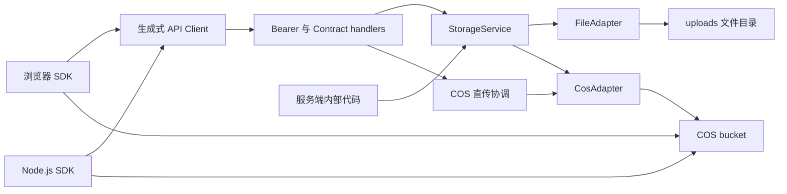

# RFC：通用内容存储与跨环境 SDK

状态：待评审；来源设计已获用户批准，本文不代表实现完成。

日期：2026-09-29

来源：`.notes/archive/content-storage/specs/2026-09-29-content-storage-design.md`。该设计在对话中获最终确认，原文件保持不变。

## 决策摘要

在 `apps/server/src/modules/storage/` 建立无数据库依赖的 StorageService，以 FileAdapter 和 CosAdapter 实现 `upload(key, data, options?) → Promise<string>`。默认介质由 env 指定，同 key 覆盖，只返回 URL。HTTP 调用使用现有 Bearer，内部调用不经过认证层。

新增 `packages/sdk/`，提供浏览器和 Node.js 两套环境入口，共享 `sdk.storage.upload()`。本地上传经过 Server；COS 上传先申请限定 key 的 STS 凭证，客户端执行 PutObject，再经 Server 确认并生成一年有效 URL。

此 RFC 是一个交付单元。HTTP 协议、服务端与 SDK 相互依赖，不拆成可独立交付的多个 RFC。

## 1. 范围、依据与兼容性

保留来源设计全部决策：默认 20 MiB、允许空文件、无分块、无文件表、无对象归属权限、无版本管理、无自动清理或 URL 续签、不迁移现有头像和申请附件。不改数据库模型或 migration。

已核实的实现约束：

- `apps/server/src/app.ts` 通过 Glue、serviceHandlers 和 Bearer handler 注册接口，全局 bodyLimit 为 4 MiB。
- 已安装 Glue 的路由生成器将 security handler 放在 preHandler；只声明 security 不能满足“读 multipart 前认证”。
- `apps/server/src/join/transport.ts` 已通过 onRoute 按 operationId 安装 transport hooks；其注释及处理指出 multipart 10 读取 raw，需要显式把计数流接入实际解析路径。
- `packages/api-client/src/index.ts` 使用源码别名导出，没有可直接在 Node ESM 运行的产物。
- `.ai/architectures/contract-tests/test-layers.md` 要求真实 app HTTP 检查、原始 handler 输出与双向 operation 覆盖；数据库用例只用隔离容器。
- 根目录当前没有 TESTING.md；贡献规则来自 CONTRIBUTING.md。

新增四个 operation 是增量变更；旧接口的 body 限制、响应、认证和存储不变。不引入 API 版本层。所有拟新增字段先写入 `api/openapi.yaml`，生成类型后实现；本 RFC 的类型示意不作为第二份 DTO 定义。

## 2. 结构和组装



拟新增模块文件职责如下；实现可以拆分较大的文件，但不得混入现有业务：

| 路径                                               | 职责                                                    |
| -------------------------------------------------- | ------------------------------------------------------- |
| `apps/server/src/modules/storage/index.ts`         | 内部创建工厂、StorageService 与输入类型出口             |
| `apps/server/src/modules/storage/config.ts`        | 环境变量解析及不可变配置                                |
| `apps/server/src/modules/storage/key.ts`           | 跨 Adapter 一致的 key 校验                              |
| `apps/server/src/modules/storage/service.ts`       | 介质选择、输入归一化、大小与 MIME 校验、上传与 URL 返回 |
| `apps/server/src/modules/storage/adapters/file.ts` | 本地写入、替换、受控读取                                |
| `apps/server/src/modules/storage/adapters/cos.ts`  | PutObject、HEAD、GET 签名以及可注入云端依赖             |
| `apps/server/src/modules/storage/direct-upload.ts` | prepare、STS 和 complete 协调                           |
| `apps/server/src/modules/storage/upload-ticket.ts` | 无状态 HMAC 凭据                                        |
| `apps/server/src/modules/storage/handlers.ts`      | 四个 operation handlers                                 |
| `apps/server/src/modules/storage/transport.ts`     | 当前上传 operation 的认证前移、multipart 限制及清理     |
| `apps/server/src/modules/storage/errors.ts`        | 固定错误分类，不包含原始云 SDK 消息                     |
| `packages/sdk/src/`                                | SDK 工厂、共享协调、浏览器和 Node COS 传输入口          |

`apps/server/src/server.ts` 在监听前解析存储配置并创建模块，再注入 createApp。createApp 接受显式 storage 依赖，测试使用临时目录和 fake COS。工厂不连接数据库、不读取登录状态；仅 HTTP 层通过已有 AuthService 获取用户 ID。

现有鉴权逻辑提取为 `apps/server/src/auth/bearer.ts` 的单一函数，由 Glue 与 storage onRequest 共用。提取仅移动已有 token 格式与 authenticateToken 行为，不另建认证协议。

## 3. 内部接口

下列签名为拟议内部代码接口，不是额外的 HTTP schema：

```ts
type UploadData = Blob | Uint8Array
type Medium = 'file' | 'cos'
interface UploadOptions {
  medium?: Medium
  contentType?: string
}
interface StorageAdapter {
  put(key: string, bytes: Uint8Array, contentType: string): Promise<void>
  getUrl(key: string): Promise<string>
}
interface StorageService {
  upload(key: string, data: UploadData, options?: UploadOptions): Promise<string>
}
```

File 是 Blob 子类，Buffer 是 Uint8Array 子类。输入 size/byteLength 先验证上限，再读取 Blob；Uint8Array 只复制其有效视图区间，不能上传底层 ArrayBuffer 的额外字节。复制后的内容为单次调用快照，调用方随后修改原数组不影响写入。

有效 MIME 优先级为显式 options.contentType、非空 Blob.type、application/octet-stream。首版接受无参数的 ASCII `type/subtype`，长度上限 127，禁止 CR/LF；不通过后缀推断真实格式。不执行媒体格式验证或转换。

medium 类型及 HTTP 输入输出类型优先从生成 Contract 推导，SDK 的 UploadOptions 引用生成 schema 的相关属性，不手写重复 HTTP DTO。Blob/Uint8Array 属于 SDK 的本地二进制输入类型。

COS 的 head、issueCredentials 与 File 的 openRead 为专有能力，不放入所有 Adapter 的基础接口。未知 medium 明确失败；不回退。

## 4. HTTP 精确契约

路径以下均不含 `/api` 前缀。所有 JSON 对象 additionalProperties=false，必填字段如下；可选字段明确标出。

### 4.1 POST /storage/uploads/prepare

operationId：prepareStorageUpload；security：bearerAuth；请求 application/json。

请求字段：key:string、size:integer（0 至 JS 安全整数上限）、contentType:string；medium 可选，枚举 file/cos。size 再受运行时 STORAGE_MAX_BYTES 限制，不能在 schema 把配置上限锁死为 20 MiB。

200 响应为 oneOf 两个封闭对象，用 medium const 区分：

- file：`{ medium: 'file', maxBytes: integer }`。
- cos：`{ medium: 'cos', maxBytes, bucket, region, key, credentials, uploadTicket }`。
- credentials：`{ tmpSecretId, tmpSecretKey, securityToken, startTime, expiredTime }`，时间均为 Unix 秒整数。
- uploadTicket 是有长度上限的字符串，最大 4096 字符，不作日志字段。

返回 Cache-Control: no-store。file 分支无需签发凭据。cos 分支先校验配置、key、size、MIME，再申请 STS，最后签发凭据；任一步失败不返回部分凭证。

### 4.2 POST /storage/uploads

operationId：uploadStorageContent；security：bearerAuth；请求 multipart/form-data。

字段：key 文本、data 二进制文件均必填；medium、contentType 文本可选。文件 part 的 filename 不参与路径选择。没有显式 contentType 时使用 part MIME，无有效 MIME 时使用 application/octet-stream。显式 contentType 优先，SDK 总是提交已解析的值。

拒绝重复字段、未知字段、多文件、没有 data、非法 MIME、非 multipart 请求；字段顺序任意。200 返回 `{ url: string }`，URL 为绝对 HTTP(S) 地址，响应 no-store。

服务端直接调用本接口可以指定 cos，经 StorageService 由服务器上传；SDK 本期仅在准备结果为 file 时使用此入口。

### 4.3 POST /storage/uploads/complete

operationId：completeStorageUpload；security：bearerAuth；请求 application/json，字段仅 key:string、uploadTicket:string。

凭据验证顺序：长度与结构 → 固定 HMAC 算法 → 签名 → 版本/有效时间 → 当前用户 → key 与当前 bucket/region → 当前大小上限 → HEAD。禁止使用凭据中未验证的 region/bucket 发起请求。

实际大小超限为 413；未超限但不等于申报大小为 409；不存在为 404。成功 200 `{ url: string }`，no-store。服务器不接受客户端自行提交 bucket、下载域名、URL 或对象存在标志。

### 4.4 GET /storage/files?key=...

operationId：getStoredFile；security：空数组；只有 key query 参数。不存在返回统一 404；非法 key 400；目录不作为文件返回。只解析 uploads 内路径。

200 响应为 application/octet-stream 二进制流，带实际 Content-Length、Cache-Control: no-store、Content-Disposition: attachment 与 X-Content-Type-Options: nosniff。filename 使用 key 最后一个经过校验的段，按 quoted-string 编码。首版不支持 Range；收到 Range 仍返回完整 200。

响应头发送前的失败返回 envelope；发送后读取失败终止连接，不二次写入 JSON。HEAD 未在 Contract 声明，因此需关闭该 GET 路由的隐式 HEAD 暴露，避免新增未登记入口。

### 4.5 公共 schema 与错误

新增 StorageKey、StorageMedium、StorageContentType、PrepareStorageUploadRequest/Response、StorageUploadRequest、CompleteStorageUploadRequest、StorageUploadResult 等 schema。key 由 pattern/maxLength 表达基本规则，保留设备名等跨字段外的语义在模块补充校验。

复用现有 ErrorEnvelope 和 Bearer schema，使用 Draft-07 兼容关键字。每个 operation 声明适用状态及 default；错误正文只含安全 code/message/requestId。

| code                           | 状态 | 含义                               |
| ------------------------------ | ---- | ---------------------------------- |
| STORAGE_INVALID_INPUT          | 400  | key、字段、MIME、ticket 非法或过期 |
| 现有 SESSION_INVALID 等        | 401  | 登录认证失败                       |
| STORAGE_TICKET_FORBIDDEN       | 403  | ticket 与当前用户不匹配            |
| STORAGE_NOT_FOUND              | 404  | 本地/COS 对象不存在                |
| STORAGE_CONFLICT               | 409  | 文件目录冲突或确认大小不符         |
| STORAGE_TOO_LARGE              | 413  | 文件或 wire 预算超限               |
| STORAGE_UNSUPPORTED_MEDIA_TYPE | 415  | HTTP 类型不支持                    |
| STORAGE_TIMEOUT                | 408  | 入站上传未在截止时间内完成         |
| STORAGE_UPSTREAM_FAILED        | 502  | COS/STS 依赖失败或超时             |
| STORAGE_UNAVAILABLE            | 503  | Adapter 未启用                     |
| STORAGE_BUSY                   | 503  | 上传容量用尽，Retry-After: 5       |
| INTERNAL_ERROR                 | 500  | 未知或本地 I/O 错误                |

408、容量错误是来源设计的传输边界细化。错误映射仍由现有统一 errors.ts 完成，不建立第二套 envelope。

## 5. 认证、multipart 与资源生命周期

registerStorageTransport 在 Glue 注册前安装 onRoute，仅匹配 uploadStorageContent，不影响 join transport。路由保留 Contract security，onRequest 另调用同一 authenticateBearer 函数提前验证。Glue preHandler 再复核一次会话，以处理上传过程中会话过期或撤销；内部 upload 不执行这些检查。

明确选用有界缓冲模式，适配本期 20 MiB 和非流式接口。单实例同时最多 2 个 HTTP 内容上传；文件字节限制为配置 maxBytes，wire 上限 maxBytes + 64 KiB，最多 1 文件和 3 文本字段，单文本字段最大 512 字节。容量不包含 SDK 到 COS 的直传流量。

单次入站上传截止时间 120 秒；云操作截止时间 120 秒；本地公开下载流截止时间 120 秒。截止时间是本期确定的资源保护值，不代表吞吐 SLO。SDK 的每次本站 HTTP 请求与 COS PutObject 设置 120 秒截止时间，不自动重传。

应用层同时限制解析文件流实际字节和原始 multipart wire 字节。复用现有 transport 的处理模式，确保 multipart 10 读到的 raw 是受控流；不能只返回 preParsing Transform 就假定所有字节已受限。截断标记也视为超限，不能保存部分文件。

解析后在 WeakMap 请求上下文保存 bytes 和经过验证的 part 类型，向 schema body 提供仅由解析器生成的 data 占位标识；handler 必须检查可信上下文存在，不能用伪造 JSON 占位绕过解析。JSON Content-Type 必须 415。

在 response、error、abort、timeout 和 socket close 路径幂等释放 slot、timer、buffer 和流。未解析完的异常请求关闭连接，不在可复用连接中遗留请求体。HTTP 超时后不得宣告对象一定没写入：云端可能已经完成；保留来源设计的非事务语义。

提高 maxBytes 将提高有界缓冲内存消耗，包括输入复制的临时额外占用。该配置只接受安全正整数，wire 加法也必须保持安全整数；操作方自行评估容量，本期不因调高阈值自动引入分块。

## 6. FileAdapter

目录从模块文件位置推导服务器包根目录，兼容 src 与 dist 层级；不依赖进程 cwd。对象根为 `apps/server/data/uploads/`，临时区为 `apps/server/data/upload-tmp/`，采用随机文件名与独占创建。

key 基本 pattern 为 `^[a-z0-9](?:[a-z0-9._-]*[a-z0-9_-])?(?:/[a-z0-9](?:[a-z0-9._-]*[a-z0-9_-])?)*$`，maxLength=240。逐段拒绝 Windows 设备名（包括带扩展名的 con、prn、aux、nul、com1–com9、lpt1–lpt9），不做清洗。

创建目录前后检查真实根路径与每个已有路径段；拒绝链接、junction、非目录父段。最终文件若为链接也拒绝。可信运行前提是 data 根目录不允许其他不受信任本地进程写入；HTTP key 检查不声称能防住具有本地文件系统写权限的并发攻击者。

完整写入并关闭临时文件后，以 rename 替换目标；不得先 unlink 旧目标。Windows 遇到文件被占用而替换失败，返回 500，清理自己创建的临时文件；已有内容保持可读。路径前缀冲突返回 409。

读取先安全打开文件描述符并确认普通文件，再用该描述符产生流与文件大小，避免检查后重新按路径打开。不增加元数据 sidecar，不存 MIME。并发 reader 可能读取替换前的已打开文件，后续 reader 读取新对象，不承诺强一致切换时点。

中断后的临时文件可能残留；本期不启动定时清理器。文件与临时目录均加入精确 ignore 规则，不能广泛忽略源码或其他 data 内容。

## 7. COS、STS 与上传凭据

服务端依赖 cos-nodejs-sdk-v5 和 qcloud-cos-sts；浏览器 SDK 使用 cos-js-sdk-v5，Node SDK 使用 cos-nodejs-sdk-v5。具体安装版本在实现时解析兼容版本并写入 lockfile，不在未安装前虚构版本号。

PutObject 使用配置的 Bucket、Region 和经过校验的 Key，Body 为字节/Blob，设置 ContentType、ContentDisposition=attachment、CacheControl=no-store；Node 显式提供 ContentLength。SDK 不调用 uploadFile 等可隐式分块的高级方法。关闭可配置的应用级自动文件重试；若依赖仍有网络层重试，应在测试中确认不改变公开的非 exactly-once 语义。

临时 policy 仅 allow `name/cos:PutObject`，resource 为配置 bucket 与精确 key 对应的 COS 资源标识，不使用通配符。APPID 从已校验的 bucket 后缀得到；不接受客户端 policy。DurationSeconds=1800。长期子账号拥有签发 STS、指定 bucket 的 PutObject/HeadObject/GetObject 所需权限；不使用主账号密钥。

uploadTicket 格式为 `base64url(payload-json).base64url(hmac-sha256(payload-part))`；算法固定，不允许客户端选择。签名数据为编码后的原始 payload part，比较使用等长 timing-safe 比较。

payload 封闭字段：v=1、userId、bucket、region、key、size、contentType、iat、exp。iat/exp 是 Unix 秒；exp 不晚于 STS expiredTime，且不超过 iat+1800。验证服务器当前时间未达 exp、iat 不晚于当前时间，size 非负安全整数，所有字段类型和长度有效。不含长期密钥或 STS 密钥。

凭据可重放、STS 在有效期内可重复 PUT；不声称一次性使用。complete 只验证当前对象存在与大小。对相同 key 同时上传的同大小内容不区分身份或摘要，遵循已批准覆盖语义。

一年 GET 签名使用服务端长期凭证生成，Expires=31536000；强制 HTTPS、配置区域的标准 COS 域名，且 response-content-disposition=attachment 参数参与签名，避免绕过 SDK 更改上传元数据后产生内联执行行为。签名值必须先准备完整参数再签发，不在签名后拼接修改。

一年是签名期限，不保证对象、密钥和云权限一年不变。使用 STS 签名会缩短实际有效期，因此不得复用客户端临时凭证签发下载地址。

浏览器 bucket CORS 至少允许目标 Web origin 的 PUT，以及实际使用的 Authorization、x-cos-security-token、Content-Type、Content-Disposition、Cache-Control 等请求头；按 COS SDK 的真实请求验证允许列表和 Expose-Headers。Node 不依赖浏览器 CORS。实现不自动修改 bucket 配置。

## 8. SDK 构建和使用契约

`createSdk({ baseUrl, getAccessToken })` 返回具有 storage.upload 的对象。baseUrl 在浏览器允许 `/api` 等相对地址，Node 要求绝对 HTTP(S) API 根地址。getAccessToken 可同步或异步返回 string，每次本站请求前调用；不持久化、不刷新、不提供登录界面。

流程：归一化输入 → prepare → 按返回 medium 固定本次介质 → file multipart，或 COS PutObject 后 complete → 只返回 response.url。prepare 的 maxBytes 用于客户端再次预检，但服务器仍是最终校验者。

每次调用独立持有 COS 临时凭证，不使用全局可变凭证缓存，避免不同 key 并发串用。COS SDK 签名使用 STS startTime/expiredTime；SDK 不将 Bearer 发送到 COS，不将云凭证发送到非配置的服务域名。

multipart 由 FormData 序列化，不手写 Content-Type boundary；通过 api-client 的请求 serializer 接入，不能新增直接 fetch 的本站调用。SDK 网络错误、超时和 COS 错误转换为稳定 StorageSdkError，包含 code、可选 HTTP status/requestId；错误文本不包含临时凭证或完整 URL。已过期 ticket 不自动申请新凭据或重传文件。

### 8.1 产物决策

使用 Vite library build 生成浏览器和 Node 两套 ESM JS，rollup-plugin-dts 生成合并声明，配置均限定于 packages/sdk。api-client 与 openapi-fetch 代码打包进入 SDK；COS 运行库按对应环境入口作为依赖引用。

api-client 继续维持现有源码导出，不改变现有消费者。SDK 构建解析 `@api-client` 源码别名；声明构建只从生成 schema 推导并合并所需类型，不人工复制 DTO。最终产物不得残留 workspace 包、源码别名或仓库绝对路径。

`@workspace/api-client` 是 SDK 构建期 workspace 依赖；外部产物不要求安装私有 workspace 包。COS 两个 SDK 为普通运行依赖。包 files 仅包含 dist 和必要说明文件。

主出口使用 types、browser、node、default 条件，default 指向 browser；同时提供 `/browser` 和 `/node` 明确入口，二者公开类型一致。浏览器入口不能导入 Node 专用 COS 库或 node:*。

根 build 增加 SDK 构建；需要消费 SDK 的开发命令先生成 SDK dist。新增 package 的 typecheck 纳入 pnpm -r typecheck。使用 esbuild/Rollup 的产物元数据核对环境隔离，并在临时仓库外目录安装打包 tarball 验证，不要求发布 npm。

## 9. 配置与错误观测

环境变量与来源设计完全一致：STORAGE_DEFAULT_ADAPTER 默认 file；STORAGE_MAX_BYTES 默认 20971520；STORAGE_PUBLIC_API_BASE_URL 默认 http://127.0.0.1:8080/api；启用 COS 要求完整的 TENCENT_COS_SECRET_ID/SECRET_KEY/REGION/BUCKET 和 STORAGE_UPLOAD_HMAC_KEY。

HMAC key 严格为 64 位十六进制，不能复用 AUTH_CODE_HMAC_KEY。任一 COS 配置出现即检查完整性；非法配置在监听前失败。默认 file 且全部 COS 配置缺席合法，显式选 cos 返回 503。public base URL 规范化末尾斜杠，不根据 Host/X-Forwarded-Host 生成地址。

修改 server.ts 当前通用启动报错，使它能输出安全的存储配置分类和缺失变量名，但不输出值或底层异常。日志记录 requestId、operationId、medium、安全 code 与耗时；不记录 key 原文、body、签名 URL、票据和凭证。SDK 不默认输出日志。

本地公开 URL 在服务器地址可达期间有效。COS 是 bearer-link 模式，拥有 URL 即可读；所有登录用户共享可覆盖 key 空间，这两项是已接受需求而非待实现权限系统。

## 10. 风险和检测

| 风险                              | 处理与检测                                                       |
| --------------------------------- | ---------------------------------------------------------------- |
| COS 完成确认失败但对象已上传/覆盖 | 明确非事务行为，不自动删除；故障注入覆盖上传成功后 HEAD/响应失败 |
| STS 无法硬阻止绕过 SDK 的超限 PUT | prepare 和 complete 校验；拒绝 URL，不声称对象未写入             |
| 同 key 并发改变 URL 对应内容      | 接受覆盖，无版本；并发测试验证返回对象始终完整                   |
| 一年 URL 过期及密钥撤销           | 文档明确期限，不提供续签；验证签名参数和当前访问，不伪称长期验证 |
| 本地 Windows 替换失败             | 不先删旧文件，专项占用与失败测试                                 |
| multipart 先解析后认证            | 原始 HTTP 慢流测试证明认证失败时不调用内容解析/存储              |
| 提高上限导致内存压力              | 固定 2 个上传 slot、wire 计数与 deadline；记录容量配置影响       |
| 包外消费仍依赖仓库源码            | tarball 在临时外部项目中实际导入、调用及类型检查                 |
| 浏览器 CORS、云端权限配置不符     | 真实 COS gate 单独记录 PASS/FAIL/NOT_EXECUTED                    |

## 11. 落地顺序、验证与回退

顺序按依赖执行，不能先实现未登记的 HTTP 路由：

1. 更新唯一 OpenAPI 的四个 operation 和 schemas，执行 api:lint、api:generate。
2. 实现无 HTTP 的 StorageService、配置、FileAdapter、CosAdapter、ticket；先验证内部上传契约。
3. 接入认证复用、transport、handlers、serviceHandlers 与启动组装；使用注入 COS 测试依赖。
4. 实现 SDK 双入口与产物构建，验证调用协议和外部消费。
5. 完成回归与真实 COS 联调；不接入现有头像/附件、不部署、不发布。

具体测试落点建议为 `tests/contract/storage.test.ts`、`tests/storage/`、`tests/sdk/`；沿用现有 fixture 创建真实 app，给新依赖显式注入临时目录，不能默认写开发 data。

必须覆盖：

- Contract 双向覆盖；JSON 原始返回值与序列化响应；额外字段/错误类型反例；二进制读取的真实字节和 headers。
- Blob/File/Uint8Array/Buffer 视图范围；0、maxBytes、maxBytes+1；default/explicit medium；未知配置。
- 全套 key 非法输入、Windows 设备名、前缀冲突、symlink/junction、失败保留旧文件、公开目录隔离。
- multipart 字段乱序、重复、多个文件、截断、缺失长度、超 wire、未认证慢流、abort/timeout 后 slot 回收；既有 join multipart 回归。
- STS 精确权限与 1800 秒；ticket 篡改、过期、用户/key/config 不符；HEAD 404、大小不符、超限；确认重放；一年签名。
- 浏览器/Node file 与 cos 流程，动态 token，错误映射，显式 PutObject，不额外自动重传。
- 外部安装构建产物，Node 执行、浏览器构建与真实浏览器上传，声明可用，无 node:* 或 workspace 运行引用泄漏。

执行 pnpm typecheck、pnpm test、pnpm build；数据库回归依赖隔离 PostgreSQL 容器，不可用则报告失败，不能使用开发库代替。

真实 COS 联调分别验证浏览器直传、Node 直传、服务器代传、覆盖后下载、失败传播。缺少凭证/bucket/CORS 时记录 NOT_EXECUTED，不能用 mock 结果补齐。联调对象采用专用测试前缀，清理需按显式确认的具体对象执行，生产接口不因此增加删除能力。

回退代码会撤销新接口与 SDK 能力，但不得删除 uploads、临时目录或 COS 对象。切换默认 Adapter 只影响新上传，不迁移旧内容；已有本地 URL 仍依赖保留读取路由，已有 COS URL 依赖原 bucket/密钥。代码回退后本地 URL 不再可用，应在回退说明中明确；对象内容不可通过代码回退恢复历史版本。

## 12. 评审结论与未执行项

本 RFC 已按来源 spec、当前模块边界、Contract-first、贡献要求和技术设计质量清单完成文档自检。无未决架构选择或占位条目。新增的精确协议、资源限额和构建接线属于本 RFC 的待评审细化，并非已经运行的能力。

当前仅编写文档，未修改 Contract、实现、依赖、生成物或数据库，未运行实现测试，未执行真实 COS 验证。后续实现不能把本文的验收列表当作已通过记录。

依赖条件：实现时解析云 SDK/声明构建依赖的兼容版本；真实验证需要云凭证和 CORS 配置。若云 SDK 无法支持一年签名或规定的精确权限，应报告与已批准 spec 的冲突，不静默缩短期限或放宽权限。

按 brainstorming 交接，本阶段止于 RFC；不创建实现计划、不开始代码实现、不自动提交。将稳定结论提炼进 `.ai/` 需要用户单独同意。

## 参考依据

- `api/openapi.yaml`、`apps/server/src/app.ts`、`apps/server/src/server.ts`、`apps/server/src/join/transport.ts`、`packages/api-client/src/index.ts`。
- `.ai/architectures/overview.md`、`.ai/architectures/contract-tests/test-layers.md`、`.ai/databases/data-model.md`。
- [腾讯云 STS 生成与使用指引](https://cloud.tencent.com/document/product/436/14048)：凭证字段、DurationSeconds 和资源授权规则。
- [腾讯云 COS API 授权策略](https://intl.cloud.tencent.com/zh/document/product/436/30580)：PutObject action 与对象资源范围。
- [腾讯云 Node.js 对象访问 URL](https://cloud.tencent.com/document/product/436/57421)：Expires、下载参数与签名 URL。
