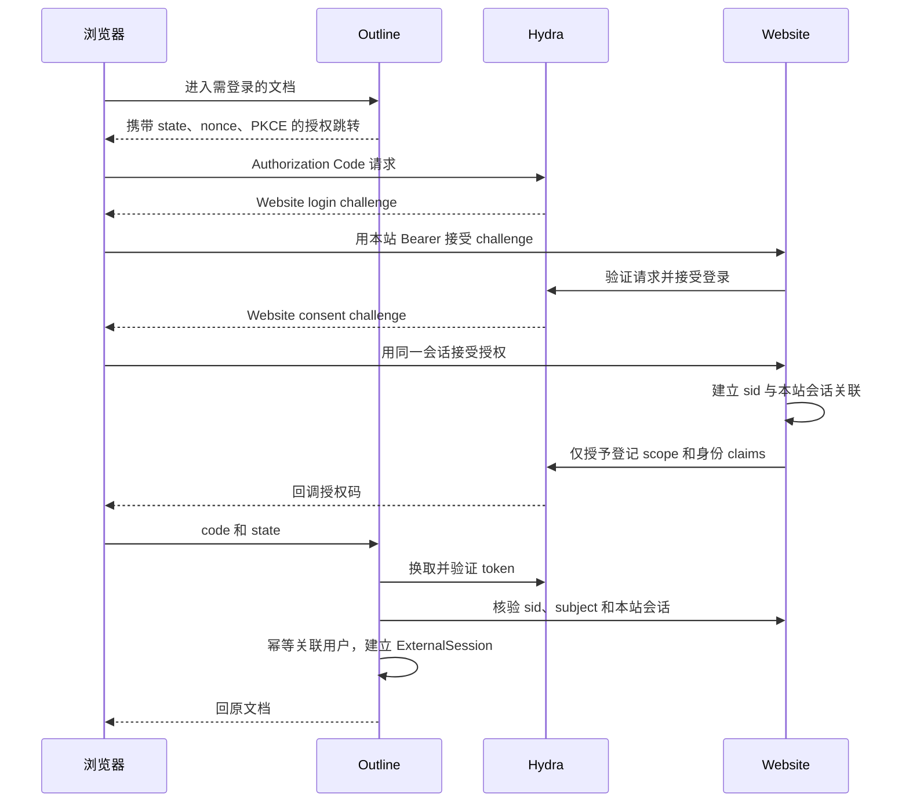

# RFC：Hydra 统一身份与浏览器会话生命周期

状态：架构预审已通过，实施中；实现审查与运行验收尚未完成。

日期：2026-09-30。来源：`.notes/archive/docs-integration/specs/2026-09-30-docs-integration-design.md`。环境依赖 `.notes/archive/docs-integration/rfcs/environment-and-subpath-rfc.md`；文档权限依赖 `.notes/archive/docs-integration/rfcs/outline-public-access-rfc.md`。Outline 文件使用接入后的 Website 根路径。

## 决策摘要

Website 保留密码、账号、资料与会话事实，Hydra 负责标准 OIDC。继续使用 Website 现有 localStorage Bearer，通过 Website 身份适配页面和 Contract operation 接受 Hydra challenge；本期不迁移为 Cookie 登录，不把现有 CLI SSO 当成 OIDC。

为本站会话增加非凭据的稳定 ID，以此关联 Hydra sid 和 Outline 本地会话。Outline 每次受保护请求同步核验 Website；实时连接使用通知加最长 4 秒租约，满足已批准的最多 5 秒撤销目标。关闭替代登录/token 旁路。现有账号权限和 Outline 文档权限互不自动映射。

## 实施前源码事实与协议基线

- `apps/server/src/db/schema.ts`：`auth_sessions` 主键为 tokenHash，没有独立会话 ID；`auth_users` 没有停用字段。
- `api/openapi.yaml`：已有 login、logout、本人资料和 CLI SSO 接收 operation；没有本 RFC 的 OIDC 或服务间核验 operation。
- `apps/outline/server/utils/authentication.ts`：默认登录生成三个月用户 JWT Cookie；`apps/outline/server/utils/jwt.ts` 以用户 jwtSecret 验证 JWT，缺少浏览器会话行。
- `apps/outline/server/commands/userProvisioner.ts`：存在邮箱匹配及 provider 自动迁移，不能直接满足固定 issuer/sub 的关联约束。
- 现有 OIDC 回调有 JWT.decode 取字段分支；`OIDCStrategy` 基于 passport-oauth2。此次不能把已存在插件等同于已验证完整 OIDC。

选定 Hydra 自托管 `v2.3.0` 作为协议基线。已从该 tag 的 [OpenAPI](https://github.com/ory/hydra/blob/v2.3.0/spec/api.json) 核实：login accept 支持 subject/context，consent request 返回 login_session_id，login session 删除支持 sid；consent session 删除使用 subject/client。普通退出禁止调用后者进行用户级批量撤销。

OIDC Token 验证遵循 [OIDC Core ID Token Validation](https://openid.net/specs/openid-connect-core-1_0.html#IDTokenValidation)。采用授权码、PKCE S256、state、nonce 和 JWKS 验签；用标准库完成验证，不自行实现加密算法。

## 接入配置

| 项目             | 选择                                                                                                   |
| ---------------- | ------------------------------------------------------------------------------------------------------ |
| issuer           | `http://identity.exwebsite.test:8090/`；配置、discovery、验证使用完全相同字符串                        |
| Outline client   | `ex-outline`，机密客户端，token endpoint 使用 client_secret_basic                                      |
| redirect URI     | `http://exwebsite.test:8090/docs/auth/oidc.callback`，精确匹配                                         |
| flow             | response_type=code；grant_types 仅 authorization_code；PKCE S256                                       |
| scope            | openid、profile、email；不申请 offline_access，不签发 refresh token                                    |
| subject          | public subject，值为 Website 稳定账号 ID                                                               |
| login/consent UI | Website `/identity/login`、`/identity/consent`，不是 Outline 独立登录页                                |
| logout UI        | Website `/identity/logout`，供协议退出确认/收尾                                                        |
| token 生命周期   | 授权码 60 秒，access token 与 ID Token 60 秒；Outline 会话有效期另受 Website 会话控制                  |
| Hydra remember   | login=false、consent=false，每次协议登录都经过 Website 当前会话核验；已有 Website 登录无须重新输入密码 |
| JWKS             | 验签键缓存可复用，未知 kid 刷新；不缓存账号/会话仍有效的结论                                           |

另一测试客户端固定为 `ex-oidc-probe`，使用独立随机 secret、精确回调 `http://127.0.0.1:18765/callback` 和同源退出回调 `http://127.0.0.1:18765/signed-out`；同样仅允许 authorization_code、client_secret_basic 和 openid/profile/email，不取得 Website 内部核验密钥，仅验证通用接入。通过显式 bootstrap 受控登记，不开放动态客户端注册或通配回调。Hydra admin 内网可达，不将其 SDK 或管理 secret 放到浏览器。

## 数据模型与迁移

先在 `.ai/databases/data-model.md` 中评审以下职责变化，再修改 Website schema/migration。本 RFC 不直接更新持久知识或 schema。

| 数据位置                       | 拟新增字段/实体                                                                                                    | 约束                                                                                                                              |
| ------------------------------ | ------------------------------------------------------------------------------------------------------------------ | --------------------------------------------------------------------------------------------------------------------------------- |
| Website `auth_users`           | `disabledAt` nullable epoch ms、`profileVersion` 非负整数默认 0                                                    | 禁用后所有会话无效；昵称/邮箱/头像更新事务内递增 profileVersion                                                                   |
| Website `auth_sessions`        | `id` UUID，unique/not null                                                                                         | 保留 tokenHash 原主键和 Bearer API；迁移为既有行生成唯一 ID，不外发摘要                                                           |
| Website `auth_oidc_flows`      | phase、challengeHash、sessionId、clientId、hydraSid、state、expiresAt、encryptedRedirect                           | phase+challengeHash 唯一；10 分钟内有效且不超过本站会话到期；状态 processing/completed/restart_required                           |
| Website `auth_oidc_bindings`   | clientId、hydraSid、sessionId、userId、createdAt、revokedAt                                                        | clientId+hydraSid 唯一；sessionId FK 指向本站会话 id；复合关联保证 userId 与会话拥有者一致                                        |
| Website `auth_identity_outbox` | eventId、kind、sessionId/userId、targetBindings、createdAt、attempts、nextAttemptAt、deliveredTargets、completedAt | 与撤销同事务写入；targetBindings 固化 clientId/hydraSid 快照；eventId 幂等；逐个 sid 和目标记录投递结果，全部完成才写 completedAt |
| Outline `ExternalIdentity`     | issuer、subject、userId、profileVersion                                                                            | issuer+subject 唯一，userId 唯一；不按邮箱回填或自动迁移 issuer；版本仅递增                                                       |
| Outline `ExternalSession`      | id、userId、websiteSessionId、hydraSid、clientId、expiresAt、revokedAt、encryptedAccessToken                       | id 随机 UUID；签名 JWT 携带此 id；有效期不超过 Website 会话，token 清理后置空                                                     |

Website OIDC tables 只保存身份关联和恢复状态，不保存用户密码副本。flow challenge 只存摘要，返回跳转为短期加密字段供同会话重试；过期清理不得删除撤销未送达 outbox。Outline access token 只用于 userinfo 和主动撤销，按本机密钥加密保存至撤销或到期，不出现在日志、URL、前端存储。

### 撤销记录保留与清理

现有 `apps/server/src/auth/service.ts` 的 `cleanup()` 会立即删除已撤销或到期的 `auth_sessions`，不能直接沿用。新增绑定采用限制删除的外键，禁止级联删除会话、绑定或未完成 outbox。撤销事务同时保存所有受影响绑定的 clientId/hydraSid 快照，worker 依据快照重试，不依赖之后仍存在的有效登录状态。

会话到期时，清理器先在事务内将仍未撤销的绑定标记失效并幂等写入同类 outbox；没有绑定的旧会话仍可按原到期规则清理。具有关联的会话和绑定保留为无效 tombstone，直到该会话所有撤销事件的 Hydra 逐 sid 清理与 Outline 投递均完成。完成后至少保留 24 小时供退出重试；待重试事件不受该保留期限制，不能因超过时间而删除。

清理在事务中按“过期 flow → 已完成且超过保留期的 outbox → 无待投递事件的已撤销绑定 → 无 flow/绑定引用的已撤销或到期会话”执行，并在删除前重新检查依赖，避免与新 binding/outbox 写入竞争。outbox 创建时锁定会话，binding 建立使用同一会话锁并复核有效性；已失效会话不能再增加有效绑定。停用的用户级事件必须保存全部受影响会话的目标快照。测试覆盖清理与撤销并发、投递失败后的 SSO 请求、进程重启重试，以及已完成记录的有序删除。

sessionId/subject/hydraSid 是关联标识，不是凭据。服务请求仍需独立的客户端密钥。Outline 本地 JWT 验签后必须找到有效 ExternalSession，不能缺字段时降级成旧 jwtSecret-only 会话。

## Website HTTP Contract

以下均为提议的新 operation，实施时先写入 `api/openapi.yaml`，运行 lint/generate 后才实现。表中路径不含 Glue 自动添加的 `/api`。字段名、类型和状态为本 RFC 的实现约束；对象使用 additionalProperties=false。UUID 均用已有 Uuid schema，时间用已有 SafeTimestamp。

| 方法 / 路径 / operationId                                        | 鉴权             | 请求                                                   | 成功响应                                                                                     |
| ---------------------------------------------------------------- | ---------------- | ------------------------------------------------------ | -------------------------------------------------------------------------------------------- |
| POST `/auth/oidc/inspect` / `inspectOidcRequest`                 | 无用户鉴权；限流 | `{phase: login或consent, challenge: string}`           | `{clientName: string, scopes: string[]}`，只返回批准客户端展示资料                           |
| POST `/auth/oidc/login/accept` / `acceptOidcLogin`               | 本站 bearerAuth  | `{challenge: string}`                                  | `{redirectUrl: string}`                                                                      |
| POST `/auth/oidc/consent/accept` / `acceptOidcConsent`           | 本站 bearerAuth  | `{challenge: string}`                                  | `{redirectUrl: string}`                                                                      |
| POST `/auth/oidc/logout/accept` / `acceptOidcLogout`             | 本站 bearerAuth  | `{challenge: string}`                                  | `{redirectUrl: string}`                                                                      |
| POST `/internal/identity/session/check` / `checkLinkedSession`   | integrationKey   | `{hydraSid: string, subject: string}`                  | 下述 SessionCheckResult                                                                      |
| POST `/internal/identity/session/revoke` / `revokeLinkedSession` | integrationKey   | `{hydraSid: string, subject: string, requestId: UUID}` | `{revoked: true}`；仅撤销调用方绑定所在 Website 会话组                                       |
| POST `/internal/identity/user/inspect` / `inspectIdentityUser`   | bootstrapKey     | `{userId: UUID}`                                       | `{id, nickname, email, avatarUrl: string或null, profileVersion: integer}`；禁用/不存在均拒绝 |

`SessionCheckResult` 为判别联合：

- 有效：`{active:true, sessionId:UUID, userId:UUID, expiresAt:SafeTimestamp, profile:{nickname:string,email:string,avatarUrl:string或null,version:integer}}`。
- 无效：`{active:false, reason:unknown或revoked或expired或disabled}`，无用户资料。

integrationKey 使用 Header `X-Integration-Key`（OpenAPI apiKey），按调用方配置映射 clientId；request body 不接受任意 clientId。bootstrapKey 使用单独 Header `X-Bootstrap-Key`，运行应用不持有它。gateway 拒绝公开 `/api/internal/`；服务端独立验证密钥，不能把网络位置当认证。

浏览器操作收到无效会话为 401；challenge 不合法/超时为 400，已处理但无法恢复跳转为 409；非法客户端/scope 为 403；Hydra/DB 不可达为 503。沿用统一 error envelope 和固定安全文案。全部身份响应 Cache-Control=no-store。传入 challenge 长度上限 8192，入口只接受单个非空且无空白的 challenge 参数；gateway 与完整模式的 Website 静态服务器请求行缓冲区单块至少 16 KB，容纳 challenge 与路径。inspect 不回显 subject、sid 或 request_url。

`login`、`logout`、`/auth/me` 保持现有响应形状。logout 增加同事务标记会话/绑定撤销和 outbox。已有 CLI SSO 不改变语义；也必须像普通密码登录一样拒绝已停用账号。不新增绕过 Contract 的 Fastify 路由。

## 登录和首次用户创建

Website login accept 读取 Hydra login request，校验 client、scope 和固定回调；用已验证 Website 会话建立 flow，再发送 subject，remember=false。若 Hydra skip 的 subject 与当前 Website 用户不同，拒绝旧 flow 并要求重新发起，不把旧账号接受到新会话。

consent accept 根据 `(Website sessionId, clientId, Hydra login_session_id)` 关联 completed 且未过期的 login flow；Hydra 返回的内部 login_challenge 与浏览器签名 challenge 不是同一标识，仍校验其非空与格式，并复核 bearer、subject、批准 client/scope/redirect 和 sid，再先建立唯一 binding，后调用 Hydra 接受授权。同 sid 并发授权仅允许同一会话同一客户端。ID Token 声明 nickname/name、email、picture 和额外 `ex_session_id`，userinfo 返回同一 subject；不通过 claims 授予文档角色。email_verified 只在 Website 存在验证事实时给 true，不能为了通过 Outline 校验伪造；专用 provisioner 不依赖邮箱合并。

接受 challenge 是外部调用，不能与 PostgreSQL 形成原子事务。flow 用唯一约束及行锁保证每次只处理一次；保存 completed 的加密 redirect 后同会话重试返回相同结果。若 Hydra 接受成功但响应/本地记录丢失，标记 restart_required、撤销已记录 sid、返回 409 并重新发起授权；不猜测 verifier 或重复创号。进行中的 call 超时后先阻止旧 flow 再重启。

Outline 新建专用 Website OIDC adapter，选用 openid-client 6 系列完成 discovery、code exchange 和 token 验证，替换此集成模式下的 decode 后备逻辑。明确启用 enableNonRepudiationChecks 执行 JWT 签名验证；本地 HTTP 仅在集成开发配置下启用 allowInsecureRequests。功能依据 [openid-client 官方文档](https://github.com/panva/openid-client/blob/main/docs/functions/enableNonRepudiationChecks.md)。具体补丁版本由实施安装固定到 Yarn 锁文件；Node 26.3 的最终 CJS/ESM 构建入口必须验证可加载，不能因模块格式问题退回 decode。独立 OAuth 流程状态存于短期 Redis，包含 nonce、PKCE verifier、原 `/docs` 相对路径和一次性 state，回调消费，拒绝重放。

userinfo.sub 必须与已验签 ID Token.sub 相同，sid 必须存在。服务端 check 返回的 sessionId 必须匹配 ex_session_id，userId 匹配 sub。无效则不发 Outline Cookie；即使授权码在退出前签发、退出后换取，也无法建立有效 Outline 会话。

仅在已完成初始化的固定工作区 provision 用户。ExternalIdentity 唯一约束竞争时读取胜出行；邮箱冲突返回人工处理错误，不合并用户。既有用户更新昵称、邮箱、头像引用和 profileVersion，不覆盖角色/成员权限；只接受不小于已保存 profileVersion 的资料，防止并发请求的迟到结果回退昵称/头像。头像直接使用 Website 公开头像 URL，避免 UploadUserAvatarTask 异步覆盖新版本；清除头像时同步清空。普通身份映射由权限 RFC 定义。

## Cookie 与本站浏览器状态

无 Outline 会话的公共页面在加载后嵌入同源 Website `/identity/status` 页面一次。该页面通过既有 AuthProvider/生成 Client 验证本地 Bearer，只向父窗口发送 `{type:identity-status,nonce,status:active或anonymous或unavailable}`，绝不传 token 或资料。双方校验 origin、source 和请求 nonce；探测 1 秒超时视为 unavailable，继续公开阅读。active 时才在顶层发起 Outline OIDC，携带安全的原文档路径；每次页面导航最多一次自动尝试，失败时保留公开页和手动登录入口，不循环跳转。Website 顶栏在已登录时可直接链接同一 OIDC 入口。这个页面没有新的 HTTP operation，仍使用既有本人资料 Contract。

同源 iframe 只是应用代码职责划分，不能视为对恶意 Outline 脚本的安全隔离：两个应用同域已共享浏览器 origin。本期保留既有 Bearer 模式，不承诺它能隔离任一应用的 XSS。

Outline Cookie 命名 `exdocs_access`，Path=/docs，HttpOnly=true，SameSite=Lax，本地 HTTP secure=false；生产配置不在本期。服务端 bootstrap 给前端提供只用于协作握手的 60 秒 JWT，保存在内存，携带 ExternalSession id，不把 OIDC token 或 Website Bearer 交给 Outline 前端。握手后由会话租约持续约束；重连时用有效 HttpOnly Cookie 重新取得短期协作 token，不能仅延长旧 token 的前端时间。

同一浏览器 Website 各标签页共享当前 Bearer。AuthFlow 替换已存在的有效账号会话前先显式退出旧会话组，再存新 token；失败时不静默替换。没有旧 token 的另一设备登录不受影响。已经被撤销的 Outline cookie 在下一次请求失效，不转移到新 Website 会话。

Outline 退出后跳转 Website `/identity/signed-out`。该页面用当前本地 Bearer 请求本人资料，仅在确认该 token 无效时清除；迟到跳转不能清除后来登录的新 token。Website 主动退出同样只清理匹配 token。Cookie 不清掉也不能继续操作，服务端撤销是权威。

## 请求核验与 5 秒实时撤销

Outline 增加单一 SessionGuard，HTTP auth middleware、私有文件、事件 socket 和编辑协作都调用它。HTTP 每请求调用 `checkLinkedSession`，timeout=1000ms，禁止跨请求有效状态缓存；一次请求内部允许复用结果，写入身份/权限等敏感数据前再核验。active=false 返回 401，依赖不可用返回 503，不能永久清除本地会话或触发自动无限重登录。

实时连接按 ExternalSession 合并在途复核，初次必须成功。每 2000ms 启动一次 check，1000ms 超时；租约从请求发送前的单调时钟时间计算，截止为该时间+4000ms，并受本站 expiresAt 限制。不能从迟到响应到达时重新计时，不能在失败后续租。

每次入站写操作、出站私有事件和协作数据发送前都检查截止时间。250ms watchdog 负责主动关闭过期连接；事件循环恢复后必须先检查再处理积压消息。这样租约兜底预算为 4 秒加主动关闭调度余量，小于批准的 5 秒；真实运行须实测，不以定时器配置值代替证据。

失效接收器支持 sessionId 或 userId 和 eventId。收到后递增本地校验 generation、标记 revoked 并关闭匹配连接；失效前发起的迟到 check 响应不得恢复租约。普通退出按 sessionId 投递；用户停用虽是用户级权威撤销，也按事务中快照的旧 sessionId 逐目标投递，禁止将延迟停用通知按 userId 广播到恢复后的新会话。扩展 `AuthenticationExtension` 的 scope，并覆盖 `server/services/websockets.ts` 的 Socket.IO 房间；不要只修编辑通道。

协作 mutation 在应用到共享文档之前检查租约，拒绝后不能广播或进入待持久化缓冲。撤销前已被合法接受的更改可以完成落盘；不能把 PersistenceExtension 的 debounce flush 当成用户新写入，也不能因关闭连接丢弃已确认变更。测试同时观察服务端文档状态、广播和持久化结果。

## 退出、停用、可靠传播

1. Website logout 或 Outline 经 `revokeLinkedSession` 请求退出，锁定对应本站会话，设置 revokedAt，标记其全部 bindings 撤销，写 outbox；重复请求幂等。
2. 数据库事务提交即为撤销生效点，之后新 check 必须 active=false。不等待 Hydra 或 Outline 清理才拒绝请求。
3. outbox worker 先即时处理，随后每 500ms 扫描到期任务；每次调用超时 1 秒，失败按 1/2/4/8/16/30 秒上限退避重试，重启继续未完成任务。它不承担 5 秒兜底，租约承担。
4. 对每个记录的 Hydra sid 调用 login sessions DELETE sid；不按 subject 删除普通退出。向 Outline 内部撤销接收器投递 `{eventId,sessionId}`；接收器标记 ExternalSession 并通知实时服务，重复 event 返回成功。
5. Outline 为相关 ExternalSession 保存的 access token 逐一调用 Hydra RFC7009 revocation；无 refresh token，短期 access token 到期也清除加密字段。Hydra 失败保持清理待重试，不恢复 Website 会话。

Outline 内部接收器拟定 POST `/internal/identity/revoke`（外部前缀后为 `/docs/internal/...`，gateway 必须拒绝），以独立反向密钥 Header `X-Identity-Delivery-Key` 鉴权，body 为 eventId 与恰好一个 sessionId/userId，返回 `{accepted:true}`。此路由由 Outline 自身 Koa schema 定义，不加入 Website OpenAPI。

本地停用 CLI 拟定 `pnpm auth:disable -- --user-id <id>`：核对数据库身份，在事务内写 disabledAt、撤销全部 auth_sessions/bindings、写用户级 outbox。恢复账号使用独立 `auth:enable` 清空 disabledAt，旧会话继续保持 revoked，必须重新登录。不新增公开管理入口。普通登录、CLI SSO 完成及现有会话 SSO 确认在创建会话或绑定前，同停用事务按用户行、会话行的顺序加锁，并重新核验 disabledAt；没有绑定的旧 Website 会话也必须撤销。

用户级 outbox 在停用事务中固化每个受影响绑定的 clientId、hydraSid、Website sessionId 和独立稳定 deliveryEventId；worker 按该快照清理 Hydra sid，并向 Outline 投递 `{eventId:deliveryEventId,sessionId}`。失败重试使用同一 eventId；账号恢复和新登录不扩充旧事件的目标。遗留目标缺失 sessionId 时保持待处理并报告错误，不回退为 userId 广播。待处理用户级事件同样阻止相关旧绑定 tombstone 提前清理，事件完成后再保留至少 24 小时；无绑定会话无需发送 Outline 通知。通知失败时仍由权威 check 和实时租约满足撤销预算，最终验收必须覆盖多设备、并发登录/绑定、恢复后的延迟投递和故障重试。

上述用户行锁使用 PostgreSQL `FOR NO KEY UPDATE`，足以串行停用、恢复与登录完成，又与 outbox 外键校验所需的 `KEY SHARE` 兼容；不能使用与外键锁冲突的 `FOR UPDATE`，否则普通退出先持会话锁再插入 outbox 时，可能与停用的用户行锁、会话行锁形成死锁。回归必须覆盖停用与退出/过期清理并发。

协议 logout challenge 的 sid 只能在与当前 bearer 绑定一致时接受，不能让一个浏览器代另一个退出。若 Website Bearer 已不存在，仍可通过有效 Outline 会话发起内部撤销；否则只显示已退出或需重试，不按可猜测 sid 撤销。

普通 Website 退出调用既有 `logout`，Outline 退出调用 `revokeLinkedSession`；两者均以权威撤销和后台按 sid 清理完成，不在撤销后再调用需要有效 Bearer 的 `acceptOidcLogout`。后者仅供 Hydra 发起的协议 logout challenge 使用：请求进入时验证仍有效的 Bearer 和匹配绑定，在该 operation 内先提交会话组撤销，再用本次已验证的 challenge 接受 Hydra logout；提交后不再次要求这个 Bearer 有效。接受动作与同一 sid 的 outbox 清理串行处理，防止后台删除使在途 challenge 失效；接受调用仍受 1 秒超时约束，失败后释放清理任务，不恢复会话。响应丢失或 Hydra 失败后的浏览器重试可能得到 401，此时进入已退出收尾页，后台继续清理，不使用旧凭据恢复协议授权。Hydra Cookie 收尾不作为 Website 权威撤销的前置条件。

Hydra 自身 access token 在清理失败时可能短期仍可读取其 userinfo 快照；它不是 Website/Outline 的业务凭据，任何业务入口必须 SessionGuard。此窗口最长为设定的 60 秒 token 生命周期；本期不提供 token 直接调用业务 API。若后续应用要使用 bearer 访问资源，必须额外实施实时绑定核验，不能只验证签名。完整退出验收还须确认 Hydra sid 已清理；仅入队不能标记跨服务退出全部完成。部分失败时业务访问已失效，但协议清理保留待重试状态并在验收报告明确记录。

## 故障、隐私与可观测性

| 故障                                  | 行为                                                                           |
| ------------------------------------- | ------------------------------------------------------------------------------ |
| Website/DB 不可达                     | Outline 新受保护请求 503、连接租约失效；匿名公开 GET 仍可读取 Outline 本地数据 |
| Hydra 不可达                          | 新登录/客户端初始化 503；已有绑定可继续按 Website 核验，退出权威撤销照常提交   |
| Outline 不可达                        | Website 可登录与撤销；outbox 重试，恢复时会话核验阻止旧凭据                    |
| Redis/通知丢失                        | 不依赖消息证明身份；租约过期断开，重连重新核验                                 |
| 已登录浏览器查看公开页而 Website 故障 | 显式降级为公共只读数据，隐藏评论/私有导航，不从旧用户缓存拼页                  |
| OAuth callback 与停用并发             | callback 提交前再 check，失败不建可用会话；绑定可留下撤销记录供清理            |

日志仅记录 requestId、eventId、客户端及脱敏错误类别，不记录 challenge、token、secret、完整 redirect query 或用户资料。记录 check 延迟/失败、租约到期断开、outbox 积压及按浏览器撤销结果；没有数据前不承诺吞吐容量。每请求网络核验的成本是已批准的即时撤销语义所带来的明确代价。

## 验证、落地与回滚

覆盖源规格 E05–E07、E11–E16，并与权限用例组合。必须包含：双设备同账号只退出一个；切换账号、旧 callback、重放 state、错误 aud/iss/nonce/kid、同邮箱不同 sub、并发首次登录、丢 outbox 消息、迟到 active 响应、断网、token 清理失败、服务器重启，以及协作截止后的入站/出站消息。

另用所选 Hydra v2.3.0 实测同一浏览器退出后再次登录、残留 Hydra Cookie 与 remember=false 的组合，以及协议 logout 接受与后台 sid 清理的并发和超时；不能仅凭管理 API 的 schema 认定浏览器收尾正确。

Website Contract 测试验证新 operation 双向登记、原始返回值及 HTTP shape；数据库用隔离 PostgreSQL。Outline 定向测试 session guard、JWT、provisioner、普通 socket 与协作租约。真实浏览器记录撤销提交与最后允许操作时间，5 秒约束不能只由 fake timers 证明。第二客户端完成标准 OIDC 并证明未经绑定核验不能访问 Website 业务。

落地顺序：新增数据结构及停用检查 → Hydra 固定客户端/适配 → Outline 验证与绑定 → 每请求 guard → outbox/租约/退出 → 实际验收。仅在环境 RFC 的 private 内网可用后开放服务间 operation；Contract 变更遵循既定 lint/generate/handler/client 顺序。

新增字段和表采用前向 migration，auth_sessions 回填 ID 不改 tokenHash。回滚优先关闭 `/docs` 集成入口、停止相关客户端授权并保留数据，不把受控工作区切回旧的仅用户 JWT 验证；否则会恢复被撤销的权限。旧 Website 代码不理解 disabledAt 时不能直接恢复对外认证，需保持维护状态或回滚到仍执行停用检查的兼容版本。

未决产品选择：无。实现门槛：所选 OIDC 库与镜像必须跑协议负向和单浏览器退出探针；若不支持本契约，换兼容实现或带证据回到 RFC，不按邮箱合并、不改为退出所有设备。当前仅静态/官方版本化 API 核对，所有运行验收为 NOT_EXECUTED。
