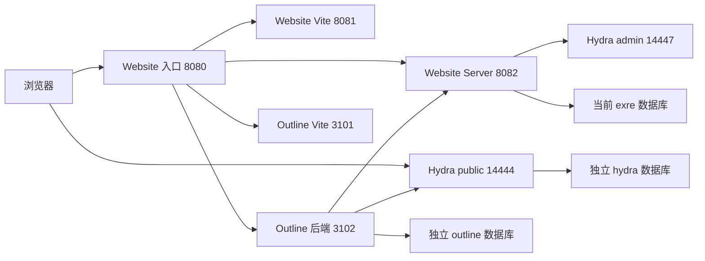

# RFC：pnpm dev 的公共文档与 Website 身份集成

日期：2026-10-05。

状态：基于已批准规格的实施 RFC，已完成文档自审；尚未实施、独立评审或运行验收。

来源：`.notes/archive/docs-integration/specs/2026-10-04-pnpm-dev-unified-docs-design.md`。用户已批准该规格；本 RFC 保留原规格，并在 `.notes/archive/docs-integration/rfcs/` 内固化实现决策。

## 1. 决策与范围

普通 `pnpm dev` 在 `http://127.0.0.1:8080/` 同时提供 Website 与 `/docs/`。访客直接阅读公共空间和已发布文档；主站已登录时自动完成现有 OIDC 流程，不重复输入密码，回到原文档。

采用现有 Website 身份适配、Hydra、Outline 公共阅读及 SessionGuard。新增 `local` 运行配置，复用现有准备命令体系；原 `integration:dev` 和 `integration:up` 的 8090 配置继续有效。Website 保留其当前 `exre` 数据源和头像目录，本地文档及 Hydra 使用独立持久资源。

本 RFC 覆盖启动、配置、准备、Outline 代码衔接、身份与公开访问及验收。沿用 `.notes/archive/docs-integration/rfcs/identity-and-session-lifecycle-rfc.md` 和 `.notes/archive/docs-integration/rfcs/outline-public-access-rfc.md` 的身份与授权语义；对普通开发入口和配置来源的变更以本文为准。不包含旧 Outline 工作区迁移、公网部署或框架升级。

采用现有 OIDC 而不另建本地身份桥接，以复用现有状态核验与撤销保证，代价是需要一次显式基础服务准备。直接使用现有 8090 入口虽可少改编排，但改变 origin，不能复用用户在 8080 的浏览器会话，也不满足批准规格。

以下新增文件、命令参数、配置和内部接口均为拟实现契约，不是已存在能力。

## 2. 源码约束

| 证据                                                                                                                                                                                                                 | 对实现的约束                                                                              |
| -------------------------------------------------------------------------------------------------------------------------------------------------------------------------------------------------------------------- | ----------------------------------------------------------------------------------------- |
| `scripts/dev-app.mjs`、`apps/web/dev-entry.ts`、`apps/web/vite.config.ts`                                                                                                                                            | 已有 8080 入口和 8081/8082 进程分离，保持同源及热更新。                                   |
| `apps/server/package.json`                                                                                                                                                                                           | Server 通过 Node env-file 加载 `apps/server/.env.local`，不得以编排生成的空库连接串覆盖。 |
| `apps/server/src/server.ts`                                                                                                                                                                                          | issuer、客户端与回调目前固定在 8090，需要集中配置。                                       |
| `scripts/docs-integration/hydra-client.mjs`                                                                                                                                                                          | 目前只允许固定客户端且 metadata issuer 写死，需要接收经过验证的模式配置。                 |
| `apps/server/src/identity/outbox.ts`                                                                                                                                                                                 | 当前回调只接收 sid，且只对 `ex-outline` 投递 Outline，必须支持按客户端选择目的地。        |
| 集成版 `apps/outline/server/identity/websiteOidc.ts`、`apps/outline/server/identity/websiteProvisioner.ts`、`apps/outline/server/scripts/integration-bootstrap.ts`、`apps/outline/server/routes/internalIdentity.ts` | 存在固定 issuer、clientId 或 origin；登录、关联、初始化和撤销必须统一配置。               |
| 集成版 `apps/outline/vite.config.ts`                                                                                                                                                                                 | 集成 HMR 和 origin 写死在 8090，不能仅启用集成开关。                                      |
| `infra/docs-integration/postgres/init.sh`                                                                                                                                                                            | 旧环境初始化创建另一套 `exre`；本地模式不能复用该初始化脚本来替换主站数据。               |

Outline 的集成版本与当前开发版本需要衔接。实现时先列出两者的模块差异与当前改动，以正常合并或有来源的模块移植保留 UI、挂载工具及开发修正；不得 reset、整库覆盖或丢弃本地修改。此衔接不授权提交。

## 3. 运行拓扑与端口

默认布局如下，所有宿主机端口仅绑定 `127.0.0.1`。使用独立 Compose 项目 `exwebsite-local-dev`，拟新增独立文件 `compose.local-dev.yaml`，不叠加会创建另一套 Website 库的旧 Compose 基础文件。

| 服务                | 默认地址                  | 责任                                                                 |
| ------------------- | ------------------------- | -------------------------------------------------------------------- |
| Website 公共入口    | `http://127.0.0.1:8080`   | Website SPA、身份适配、`/api` 与 `/docs` 代理。                      |
| Website Vite        | `http://127.0.0.1:8081`   | 开发服务；用户会话以 8080 为准。                                     |
| Website Server      | `http://127.0.0.1:8082`   | 原 Website 业务、OIDC 接受与内部会话核验。                           |
| Outline 后端        | `http://127.0.0.1:3102`   | 使用不迁移的集成启动脚本，公开 URL 为 `http://127.0.0.1:8080/docs`。 |
| Outline Vite        | `http://127.0.0.1:3101`   | 本地模式关闭证书自动启用，静态 base 为 `/docs/static/`。             |
| Hydra public        | `http://127.0.0.1:14444/` | 固定本地 issuer；仅发布 public 服务。                                |
| Hydra admin         | `http://127.0.0.1:14447/` | 受控准备与 Server 调用；与旧 14445 分离。                            |
| 本地文档 PostgreSQL | `127.0.0.1:17432`         | 独立 `outline`、`hydra` 数据库，无 Website `exre`。                  |
| 本地文档 Redis      | `127.0.0.1:17379`         | Outline 队列、协作和一次性认证状态。                                 |

基础服务使用 `infra/docs-integration/images.lock.json` 已锁定的 PostgreSQL、Redis 和 Hydra 镜像，不在本轮升级版本。Compose network 内 Hydra DSN 指向该项目的 PostgreSQL `hydra` 库。Hydra public/admin 是不同端口，浏览器及应用默认调用 public，管理端口不经 Website 代理。

Hydra 的 login、consent、logout URL 分别配置为 8080 的 `/identity/login`、`/identity/consent`、`/identity/logout`。应用与浏览器均运行在宿主机，直接使用固定 public issuer，无需系统 hosts；不能把容器内部主机名声明为浏览器 issuer。

端口变更只能通过重新显式配置完成，同时重新核对回调和 issuer；启动阶段的旧端口环境变量不得单独覆盖派生地址。已经登记的 issuer 不能原地改变，冲突应要求单独准备目标。端口被无关进程占用时直接报错。

## 4. 配置与模式契约

### 4.1 配置来源

拟新增 `scripts/docs-integration/local-config.mjs`，只负责解析、校验、派生本地配置；不启动进程或修改数据库。配置保存到忽略的 `.local/docs-integration/local-dev/`，与现有 full/dev 配置隔离。

`.local/docs-integration/local-dev/config.json` 保存 version=1、模式、公共 origin、各本地端口、issuer、客户端标识、附件目录和准备目标身份；`.local/docs-integration/local-dev/secrets.env` 保存生成的密钥及本地文档数据库密码。两者由显式 configure 写入。秘密不能提交、打印或传给浏览器。

Website `DATABASE_URL`、`AUTH_CODE_HMAC_KEY`、已有业务存储配置及头像目录继续由原环境和 `apps/server/.env.local` 提供；本地 configure 不复制或改写该文件。准备时记录不含凭据的 Website 目标指纹和连接后数据库身份，后续运行发现数据源变化时要求重新核对配置，不能静默选择新库。

拟新增 Website `apps/server/src/identity/config.ts` 及 Outline `apps/outline/server/identity/config.ts`，分别生成不可变配置。不同应用不共享运行时实现包，但遵守同一字段和值的配置契约。旧模式由旧配置显式注入；原有 8090 常量不作为本地模式的后备值。

| 进程配置                                                                                          | 本地模式取值或用途                                                      |
| ------------------------------------------------------------------------------------------------- | ----------------------------------------------------------------------- |
| `WEBSITE_INTEGRATION_ENABLED`                                                                     | `true`，启用身份与公共授权；不再用于判定一定是 8090。                   |
| `WEBSITE_INTEGRATION_MODE`（新增）                                                                | `local`；旧编排传 `dev` 或 `full`，兼容旧调用时明确解析为旧模式。       |
| `SERVER_PUBLIC_WEB_BASE_URL`                                                                      | `http://127.0.0.1:8080`。                                               |
| `SERVER_PUBLIC_AVATAR_BASE_URL`                                                                   | `http://127.0.0.1:8080/api/avatars`；只派生公开地址，保留头像存储目录。 |
| `WEBSITE_URL`                                                                                     | `http://127.0.0.1:8080/`，用于 Outline 返回主站和统一身份页面。         |
| Outline `URL`                                                                                     | `http://127.0.0.1:8080/docs`，不通过请求头修改。                        |
| `HYDRA_PUBLIC_URL`                                                                                | `http://127.0.0.1:14444/`，供各方一致校验 issuer。                      |
| `HYDRA_ADMIN_URL`                                                                                 | `http://127.0.0.1:14447/`。                                             |
| `OUTLINE_OIDC_CLIENT_ID`                                                                          | `ex-outline-local`；旧模式保留 `ex-outline`。                           |
| `OUTLINE_OIDC_CLIENT_SECRET`                                                                      | 稳定生成的本地客户端秘密，客户端登记与 Outline 一致。                   |
| `OUTLINE_INTEGRATION_KEY`、`IDENTITY_DELIVERY_KEY`、`IDENTITY_BOOTSTRAP_KEY`、`IDENTITY_FLOW_KEY` | 沿用现有编码要求，配置生成后稳定保存，普通启动不轮换。                  |
| `WEBSITE_INTERNAL_URL`                                                                            | `http://127.0.0.1:8082/`。                                              |
| `OUTLINE_INTERNAL_URL`                                                                            | `http://127.0.0.1:3102/`。                                              |

Outline 本地进程另外固定 `PORT=3102`、`INTEGRATION_OUTLINE_VITE_PORT=3101`、`FORCE_HTTPS=false`，禁用该模式的后端与 Vite 证书读取。`apps/outline/server/main.ts` 在 local 模式明确监听回环地址，不能沿用无 hostname 的全部接口监听；旧模式的 TLS 和 Docker 可达监听行为保持原契约。

配置只允许本地模式的回环 HTTP URL；验证协议、hostname、端口、path、凭据、query 和 hash。旧模式继续校验其明确的 8090 布局。不能靠放宽为任意 URL 来替代模式校验。

本地本机进程的环境注入优先于 Outline 本地 env 文件；验证环境读取代码确实保持这个顺序。Website 子进程只覆盖本轮派生端口、公开地址和身份参数，保留已有业务配置。Node/Corepack 按当前 Outline 基线及已有 `INTEGRATION_NODE_BIN`、`INTEGRATION_COREPACK_JS` 机制验证，不假设机器安装路径。

### 4.2 持久资源与模式隔离

本地 PostgreSQL、Redis 和 Hydra 使用独立项目、volume、秘密及 Outline 附件目录 `.local/docs-integration/local-dev/data/outline/`，不挂载旧工作区附件目录。`outline`、`hydra` 两个数据库名字保持各自校验要求，依靠不同 PostgreSQL 实例与旧库隔离。

本轮默认准备新的本地文档目标。重跑只能复用与本地配置一致的已准备目标；普通旧工作区、旧 issuer 或错误数据库身份均拒绝，不能清空或自动转换。不提供旧工作区导入功能。

在 `.local/docs-integration/` 下增加跨模式运行锁：local/dev/full 的应用运行及会修改资源的准备动作互斥，防止同一源码目录被不同环境同时热更新。锁包含 runId、模式、监督进程身份和目标指纹，原子取得；活跃锁不能覆盖。陈旧 PID 不构成终止进程的依据，核对进程身份后才释放旧记录。

独立基础服务可以保留运行，但不能因启动本地应用而重配旧基础服务。所有操作先检查 Docker Compose project labels、配置和既有运行状态，拒绝接管其他项目容器。

## 5. 显式准备命令

保留现有无 `--mode local` 的命令语义。为现有入口增加如下拟实现参数，不新增 Fastify HTTP operation：

| 命令                                                                        | 本地模式行为                                                                                                                           |
| --------------------------------------------------------------------------- | -------------------------------------------------------------------------------------------------------------------------------------- |
| `pnpm integration:configure -- --mode local`                                | 验证子模块能力、Node/Corepack、ExUI 产物和 Website 配置来源；创建本地配置与密钥。无数据库写入，不改变现有 ExUI links。                 |
| `pnpm db:migrate`                                                           | 用户显式迁移当前 Website `exre`；继续原 CLI 数据库身份校验。                                                                           |
| `pnpm integration:init -- --mode local`                                     | 显式启动独立本地 PostgreSQL/Redis，创建并验证 `outline`、`hydra` 及其角色，执行两者 migration，核对结构，记录准备状态；不创建 `exre`。 |
| `pnpm integration:migrate -- --mode local`                                  | 对已存在且验证一致的本地 `outline`、`hydra` 显式迁移；不修改 Website 数据源。                                                          |
| `pnpm integration:bootstrap -- --mode local --admin-user-id <Website UUID>` | 验证并登记本地客户端，显式建立唯一集成工作区和指定文档管理员。                                                                         |
| `pnpm dev`                                                                  | 只读校验准备状态，启动准备好的依赖与应用，不执行上述准备动作。                                                                         |
| `pnpm integration:down -- --mode local`                                     | 请求本地监督进程退出，停止该模式的受管基础服务；不删卷或数据。                                                                         |

普通开发的首次顺序为 configure、Website db:migrate、本地 init、bootstrap、dev。配置检查与初始化检查的报错须展示这个明确顺序及当前缺失项；不将容器第一次启动并创建数据库视为普通运行。

本地 init 使用拟新增 `infra/docs-integration/postgres/init-local.sh`，仅作用于专用实例。初次脚本负责创建 `outline`、`hydra`；重复 init 查询并核对 owner 与结构，不能对已存在的角色重置密码或重建数据库。迁移成功后原子保存 `.local/docs-integration/local-dev/prepared.json`，其中不含密码或秘密，只记录目标指纹和已验证阶段；该文件不能替代后续实际结构检查。

### 5.1 解决 bootstrap 与正常启动的依赖环

正常 `pnpm dev` 要求 bootstrap 完成，所以本地 bootstrap 不要求先启动正常 dev。它在准备锁内启动已准备基础服务和一个临时 Website Server，注入相同身份配置、保留当前 `exre`，监听保留的回环 API 端口。

临时 Server 必须完成现有数据库与 schema 校验，再通过现有 `/api/internal/identity/user/inspect` 和 `X-Bootstrap-Key` 检查指定账号。检查通过后，以固定配置登记 Hydra 客户端，并运行 Outline 的 `integration:bootstrap` CLI。账号不存在或已停用时失败，不生成资料或选择其他管理员。

临时 Server 只在准备动作期间存在；成功和失败均清理本次创建的进程。API 端口已经占用则失败，不复用不明服务或结束其进程。bootstrap 内不启动 Web、Outline 常驻服务或完整 gateway。

工作区初始化保留数据库锁、唯一记录、issuer/管理员冲突检查和提交前再次账号核验。Hydra 登记与 Outline 事务不能原子提交，按固定配置核对并幂等重试；部分成功不写运行就绪标记，不删除已成功资源。

## 6. 普通运行与退出

拟新增 `scripts/docs-integration/local-dev.mjs` 监督本地运行，根 `dev` 调用它；`scripts/dev-app.mjs` 保留为基于已验证配置的单服务启动适配器，不重复生成配置或秘密。

启动顺序：

1. 原子取得模式锁，解析本地配置，验证工具、Outline 专用脚本和依赖能力；检查准备记录及专用 volumes 确实存在。
2. 核对 Compose 项目与启动前服务状态；仅启动已准备的基础服务，等待就绪。volume 缺失时失败，不能用自动新建卷绕过显式 init。
3. 执行只读核对：Website 真实库为当前 `exre` 且 migrations 就绪；Outline 真实库为 `outline`、集成记录 issuer 与管理员一致且结构就绪；Hydra discovery、客户端回调及 metadata 一致，客户端秘密使用现有无效 code 探针验证。
4. 启动 Website Server、Website Vite、Outline `dev:watch:integration`，所有业务 readiness 成功后输出 8080 入口。Outline 继续使用 `--no-migrate`；集成标记存在时禁止关闭集成模式恢复宽松认证。
5. 监听 SIGINT/SIGTERM、停止请求及异常子进程退出，按 runId 清理进程树和状态。任一必需应用启动失败都退出本次运行，不留下部分应用继续提供错误登录页面。

配置加载阶段可读取预先配置的 Website env 来检查目标，但不输出其值，不将它写入新文件。启动就绪检查不需新公网 HTTP 路由，可在监听前或独立本地只读探针中使用已有 schema-check 和模型逻辑；数据库 CLI 入口不能被 import。

记录 `.local/docs-integration/local-dev/run.json` 的 runId、进程身份和本次启动的容器 ID，以及启动前已运行的基础服务集合。退出先停止本次应用进程，再 stop 本次从停止状态启动的基础容器；此前已经独立运行的容器继续运行。不执行 `down -v`、删除目录或清理其他模式。

状态核对失败、配置变动或密码冲突给出安全错误代码和下一步命令。不得输出 SQL、连接串、token、challenge、secret 或原始数据库异常。

## 7. OIDC 与撤销配置改造

### 7.1 固定客户端与验证

本地固定客户端 `ex-outline-local`，授权方式、scope 和令牌生命周期沿用现有集成。唯一回调为 `http://127.0.0.1:8080/docs/auth/oidc.callback`，退出回跳为 `http://127.0.0.1:8080/identity/signed-out`。不自动登记测试客户端，也不增加 wildcard 回调。

`ensureHydraClient` 接收明确的模式、issuer、clientId 和派生回调配置，保留 scope/grant/secret 指纹和已存在配置冲突检查；新增只读验证路径供 dev 使用，不能让正常启动调用创建分支。旧客户端仍使用原固定 8090 配置。

Website `OidcService` 使用模式派生的 issuer 和批准客户端表。`identityKeys.clients` 将本地 `OUTLINE_INTEGRATION_KEY` 绑定到 `ex-outline-local`；现有内部请求从密钥推导 clientId，不增加浏览器提供的 clientId 字段。

Outline discovery、state、PKCE、nonce、签名验证、userinfo.sub 比对、sid 和 ex_session_id 核对继续使用现有实现。provisioner、bootstrap 和 internalIdentity 使用同一个配置中的 issuer/clientId；Redis 一次性 state key 同时限定 clientId，避免配置切换的流程误用。安全 returnPath 校验使用配置 origin，并只接受 `/docs` 与 `/docs/` 下路径。

### 7.2 按客户端投递撤销

Website 可能保留其他模式的旧绑定和 outbox，运行模式互斥不能证明数据库只含当前 issuer 的记录。采用不同 clientId 来区分本地与原集成，不更新历史 binding。

拟调整 `IdentityOutboxWorker` 的内部依赖接口：Hydra revoke 接收 `{clientId, hydraSid}`；Outline deliver 接收 clientId 和现有 `{eventId, sessionId}`。增加受控配置目标表，按客户端选择 Hydra admin、Outline internal URL 和 delivery key；保留 `delivered_targets` 中含 clientId 的幂等键。不变更 HTTP 请求体或数据库模型。

当前模式始终配置自身目标；其他模式目标仅在具备其原配置时装载，不能借当前密钥或端口替代。对于未知客户端或缺失目的地，保留事件待处理并报告安全代码，不能将另一 issuer 的 sid 发送给当前 Hydra，也不能因未识别就标记完成。旧 probe 客户端仍按原策略只清理 Hydra。

目标表是固定客户端 ID 到 `{hydraAdminUrl, outlineInternalUrl?, deliveryKey?}` 的服务端映射；文档目标必须同时有 Outline URL 和 key，probe 目标只需原 Hydra admin。当前目标从模式配置生成，其他目标仅从显式提供的原模式配置装载。该映射不经 HTTP 或浏览器传入；缺少完整来源就保留待投递，不通过猜测地址补全。两边都按此策略运行，避免切回旧模式时错误处理本地事件。

所有原固定 `ex-outline` 的能力判断应改为批准客户端配置中的文档目标，而非字符串包含判断。当前 session check 和 revoke 仍按密钥认证出的 clientId 查询绑定；一个客户端不能检查另一客户端的绑定。

保留 sessionId 快照、用户停用迟到事件隔离、重试和租约撤销语义。依赖不可达时 outbox 可延迟，但主站事务撤销与同步 SessionGuard 立即拒绝有效核验，实时受保护操作的五秒目标仍由现有租约保证。

## 8. 代理、浏览器与公共阅读

`apps/web/dev-entry.ts` 与 Vite 代理顺序固定如下，8080 和直接 8081 的开发中间件均执行内部路径拒绝规则：

| 路径                                                | 规则                                                                                   |
| --------------------------------------------------- | -------------------------------------------------------------------------------------- |
| `/api/internal` 及其后代、`/docs/internal` 及其后代 | 在代理前返回 404，不转发。拒绝 query、尾斜杠或编码形式造成的绕过。                     |
| `/docs`                                             | 308 到 `/docs/`，保留 query。                                                          |
| `/docs/static/*`                                    | 定向本地 Outline Vite，保留完整 `/docs/static/` 前缀；集成 Vite base 与之匹配。        |
| `/docs/*`                                           | 去掉且仅去掉一个 `/docs`，转发 Outline 后端，支持 HTTP、polling 与 WebSocket upgrade。 |
| `/api/*`                                            | 保留 `/api` 转发 Website Server。                                                      |
| 其他                                                | Website SPA 与身份适配页面。                                                           |

本地模式 Web 和 Outline 的 HMR 地址从公共 origin 派生，不沿用 8090 host，也不因启用集成模式对外监听全部接口。当前 standalone 开发代理的 static rewrite 与集成模式分支分别处理，不共用错误的 strip 规则。

本地集成 Outline 使用配置的 `URL` 作为唯一公开地址，忽略用于旧并排开发的 `X-Website-Docs-Origin` 动态覆盖。上游 headers 由代理覆盖，不能接受浏览器伪造的 origin 推导身份地址。

Location 重写只处理明确属于 Outline 的未挂载本地路径，不能将 Website `/identity/*` 或 Hydra 跳转错误加成 `/docs/identity/*`。Cookie Path 沿用集成实现：`exdocs_access` 为 `/docs`、HttpOnly、SameSite=Lax；HTTP 的 CSRF 为 `/docs`。HTTPS `__Host-` 规则不通过全局 cookiePathRewrite 改写。

公共页使用 `WebsitePublic` 与 `WebsiteSessionProbe`，复用 Website `/identity/status`。匿名看目录/已发布文档；active 时最多尝试一次 OIDC；unavailable 或超时继续公共阅读。既有会话失效后的公开降级不能执行评论或写入。

自动登录尝试标记存于当前标签页 sessionStorage，只含安全 returnPath、随机 attemptId 和时间戳，在跳转前写入；认证回跳后若关联未成功，同一尝试不再自动发起。成功、用户显式前往另一文档或手动重试时清理；被动刷新失败返回页不清理。记录有效期沿用认证 state 的十分钟，到期可建立新尝试。恢复公共页时提供手动重试，不持久化敏感 token。

权限、附件、搜索投影和公共 404 沿用既有 resolver。登录身份不自动得到文档管理员、私有阅读或编辑能力；Website 退出与账号切换沿用现有 Token 匹配和会话撤销。

## 9. 改动归属与依赖顺序

| 位置                                                                                                                          | 变更职责                                                                           |
| ----------------------------------------------------------------------------------------------------------------------------- | ---------------------------------------------------------------------------------- |
| `scripts/docs-integration/local-config.mjs`、`scripts/docs-integration/local-dev.mjs`（新增）                                 | 本地配置、准备检查、监督与资源归属。                                               |
| `scripts/docs-integration/command.mjs`、`scripts/docs-integration/configure.mjs`、`scripts/docs-integration/hydra-client.mjs` | local 参数解析、显式准备、固定客户端配置及只读核验。旧无参数行为保留。             |
| `compose.local-dev.yaml`、`infra/docs-integration/postgres/init-local.sh`（新增）                                             | 独立基础资源及无 Website 空库的初始化。                                            |
| `package.json`、`scripts/dev-app.mjs`                                                                                         | 根 dev 接入监督进程、单服务使用统一配置。                                          |
| `apps/server/src/identity/config.ts`（新增）、`apps/server/src/server.ts`、`apps/server/src/identity/outbox.ts`               | 模式配置、批准客户端和按客户端投递；不新增 HTTP operation。                        |
| `apps/web/dev-entry.ts`、`apps/web/vite.config.ts`                                                                            | 代理拒绝规则、prefix、Location、HMR 与监听模式。                                   |
| `apps/outline/`                                                                                                               | 衔接完整集成代码、集中配置、HTTP 本地开发、公开页和一次自动登录。沿用其独立 Yarn。 |
| `.ai/architectures/docs-integration/integration-boundaries.md` 等现有知识位置                                                 | 实施并验证后更新运行边界；不提前把方案写成已实现事实。                             |

先完成 Outline 衔接与身份配置，再实现准备命令与跨模式 outbox，再接入监督及代理，最后联调公共阅读和浏览器验收。每阶段遵守已有 HTTP 与数据库模型，避免顺带重构 UI 或升级 ExUI。

Website 和 Outline 为独立仓库，交付时分别记录变更；本 RFC 不授权 commit 或 push。实现负责人按现有规则对照本文件执行，不能自行扩大为旧工作区迁移。

## 10. 验证

根目录目前没有 `TESTING.md`，实现时再次检查是否新增；存在则以其为准。Website 测试由 `vitest.config.ts` 限定范围，Outline 按 `apps/outline/AGENTS.md` 使用定向测试，数据库用独立容器。

### 自动检查

- 脚本测试：local 参数与旧参数兼容、配置幂等、密钥稳定、目标指纹、无隐式建库/迁移/bootstrap、卷丢失拒绝启动、模式锁、异常退出和容器归属。证明 Website 数据源与已有 ExUI links 不被覆盖。
- 代理测试：308 与 query、static base、深链接、HTTP 与 upgrade、内部路径含编码绕过、外部 Location、Cookie 前缀、local/dev/full 的 HMR 派生。
- 身份测试：两个客户端不能交叉核验；local issuer/回调有效，错误 issuer/回调/nonce/state/重放被拒绝；原配置仍有效；bootstrap 管理员冲突与部分失败幂等。
- outbox 测试：本地与旧客户端去各自目的地，未知/离线目标保留待处理，迟到停用只影响旧 sessionId，不能借当前模式误清另一个 issuer 的 sid。
- Outline 测试：公开目录和已发布内容、草稿/私有附件拒绝、身份状态探测、原文档恢复、一次自动尝试以及失败后的公开降级。

实现完成后执行 `pnpm api:lint`、`pnpm api:generate` 并确认未无故改变 Contract 生成物，随后 `pnpm typecheck`、`pnpm test`、`pnpm build`。脚本 mjs 测试按现有 node:test 命令单独运行；不假设根 Vitest 会扫描它们。

Outline 用其现有定向 app/shared 测试与 `pnpm integration:test:outline <文件> "<用例名称>"` 隔离入口运行相关服务端用例；该现有脚本接收文件及一个或多个字面用例名称，不支持 `--case`。执行其类型检查和构建。缺少 Docker 或运行环境时报告 BLOCKED/NOT_EXECUTED，不能回退真实开发数据库。

### 浏览器验收

执行规格 D01–D09：匿名目录；已登录无需密码；深链接恢复；私有/草稿/附件负向；主站和文档退出及另一设备隔离；身份服务运行中不可达；重启保留数据和热更新；准备冲突数据保留；账号切换及五秒实时撤销。记录实际结果和未执行项。

增加对旧 8090 模式的配置、登录、公共页、深链接和 outbox 路由回归；这些证明兼容性，不把旧模式通过替代 8080 浏览器证据。前后记录真实数据库身份及安全的账号/文档计数或指定对象存在性以证明原数据保留，证据不得包含凭据。

## 11. 落地、停止条件与回退

实施前核对当前代码与目标模块差异，保留用户改动。先以隔离资源验证新准备路径，再显式准备真实本地配置；普通运行只读检查。当发现需要修改 HTTP Contract、迁移旧工作区或替换当前 Website 数据源时停止相关变更，回到对应设计，不静默扩大范围。

准备失败不写完整就绪记录，保存可幂等复核的成功资源。原数据、密钥和 volume 不自动删除。运行失败先清理本次进程与受管容器，再输出缺失阶段和安全下一步。

回退只能停用本次运行并回退应用/配置代码，保留身份表、数据库和附件。已准备的集成库不能回退为关闭 SessionGuard 的原生认证；恢复兼容代码与原固定配置，或保持服务停止。无需本轮新的 Website 数据模型或破坏性 migration。

主要剩余风险为子模块衔接冲突、旧硬编码遗漏、真实环境的工具/端口不可用和浏览器撤销时延；分别由模块差异核对、双模式参数测试、准备与启动探针以及真实浏览器矩阵检测。所有端口和文件均为本文选择的拟实施决策，尚未验证本机占用或运行兼容性。

## 12. 文档审查结果与后续

已对照批准规格、现有 Contract、启动代码、数据库与认证边界完成自审，并检查无未完成占位项。关键运行决策、命令、故障路径、数据保留和验证标准均已明确。源规格及既有 RFC 保留；没有需要用户重新选择的产品决策。

本轮产物为一个本地实施 RFC，没有写生产代码、启动服务、修改数据库、commit 或 push。独立实现评审及运行测试均尚未执行；接下来的实施应按本 RFC 范围另行进入开发流程。
