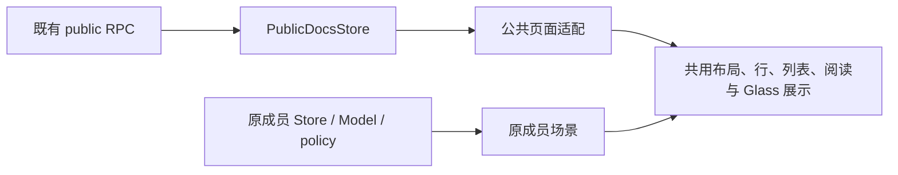

# RFC：Outline 公共与成员阅读界面对齐

日期：2026-10-08\
状态：前端实现已落地；自动验证与匿名浏览器检查通过，完整身份及成员业务验收 HOLD。实施证据见 `.notes/docs-integration/reports/reading-ui-alignment-verification.md`。\
模块根目录：`.notes/docs-integration/`\
输入规格：`.notes/docs-integration/specs/2026-10-08-reading-ui-alignment-design.md`\
交互预览：`.notes/docs-integration/previews/reading-ui-alignment-v3.html`

## 1. 决策

以现有成员界面为视觉基准，公共页面优先消费已经存在的展示组件。用户明确要求“能共用的组件，尽量共用”。这意味着每个新增展示实现都应先检查现有组件；受成员 Model、权限或上下文约束而不能直接复用时，记录原因，再使用轻量公共组合。

公共与成员数据仍分别来自 PublicDocsStore 和原成员 Store。复用布局、行样式、列表内容、富文本、标题排版和 Glass 材质；保留成员编辑、拖拽、菜单和协作的业务组件。本期不把成员场景改造成通用文档引擎，也不扩展公开 RPC/DTO。

导航移到主内容区左上角 Header；正文保持原共用阅读列。公共集合页由普通链接列表改为 Scene 与共用列表展示组件。每个可见页面恰好一个 Header。

## 2. 问题与当前证据

以下事实来自本次检查的工作区源码，实施前应核对现有未提交改动是否已经改变它们。

| 区域    | 当前事实及影响                                                                                                                      | 证据                                                                                                                                          |
| ------- | ----------------------------------------------------------------------------------------------------------------------------------- | --------------------------------------------------------------------------------------------------------------------------------------------- |
| Sidebar | 成员通过 DocsNavigation 插槽挂 Collections；公共使用另一套 NavigationRow。公共独立箭头列及逐级深度导致几何不同。                    | `apps/outline/app/components/Sidebar/App.tsx`、`apps/outline/app/components/Sidebar/DocsNavigation.tsx`                                       |
| 缩进    | 成员集合直属文档深度采用 `Math.max(depth + 1, 2)`；SidebarLink 用现有 token 和每级 16px 计算内边距。                                | `apps/outline/app/components/Sidebar/components/CollectionLinkChildren.tsx`、`apps/outline/app/components/Sidebar/components/SidebarLink.tsx` |
| 正文    | 最终富文本都使用 `~/components/Editor`；成员和公共页面的组合不同。成员已经消费 ReadingMain、ReadingBody 与共用标题样式。            | `apps/outline/app/scenes/Document/components/Document.tsx`、`apps/outline/app/scenes/WebsitePublic/PublicDocument.tsx`                        |
| 导航    | 公共面包屑和目录开关仍在 DocumentReadingFrame 标题区；成员使用 Header 左侧 Glass。                                                  | `apps/outline/app/scenes/Document/components/DocumentReadingFrame.tsx`、`apps/outline/app/scenes/Document/components/Header.tsx`              |
| 列表    | 公共目录使用普通 ul/li；成员 DocumentListItem 已使用 DocsSearchResultLink 和 DocsSearchResultContent。                              | `apps/outline/app/scenes/WebsitePublic/PublicDirectory.tsx`、`apps/outline/app/components/DocumentListItem.tsx`                               |
| Header  | WebsitePublic 为公共文档提供外层 Header；publicOnly 通过 showHeader 挂公共 Reader 自己的 Header。当前职责分散，迁移导航时容易重复。 | `apps/outline/app/scenes/WebsitePublic.tsx`、`apps/outline/app/scenes/Document/components/PublicOnlyGate.tsx`                                 |
| 数据    | 公开信息有集合描述和文档更新时间，缺少 icon/color/fullWidth。                                                                       | `apps/outline/shared/types/websiteIntegration.ts`                                                                                             |

因此正文问题主要是组合和导航位置问题，并非需要替换富文本内核。演示中的静态富文本仅用于布局评审，不能证明真实 Editor 的全部节点呈现。

## 3. 范围与成功条件

- 覆盖匿名公共阅读、登录 publicOnly 阅读、公共集合总览/详情、公共 Sidebar；成员阅读和编辑作为回归基准。
- 同一公开文档在不同身份下使用一致的基础行几何、标题排版、阅读容器和顶部导航定位。
- 公开树展开与导航分开操作；当前页面高亮唯一；至少三层文档正确缩进。
- 桌面目录开关不改变标准正文列的位置；移动目录使用顶部入口和底部 Drawer。
- 公开加载、空内容、失败、不可见状态保留同一外壳和单一 Header。

允许的数据差异：公开树条目范围与排序、默认图标、标准阅读宽度、公开更新时间；成员作者、访问记录、fullWidth、编号偏好、编辑与管理能力。公开页面不通过成员 Store 补齐缺失数据。

本期没有 Website HTTP Contract、数据库、OIDC、附件权限、依赖或 Outline 版本变更。搜索页面维持现有行为，只验证 Header 和公共布局接入。

## 4. 组件复用契约

| 现有组件                                                                          | 公共消费者及契约                                                                                                    | 不能直接复用的边界                                                                        |
| --------------------------------------------------------------------------------- | ------------------------------------------------------------------------------------------------------------------- | ----------------------------------------------------------------------------------------- |
| DocsLayout                                                                        | 保持公共和成员外壳，Sidebar 布局沿用原实现。                                                                        | AuthenticatedLayout 的身份、拖拽等成员生命周期不搬入公共页。                              |
| SidebarLink、Disclosure、Sidebar 分组 Header                                      | DocsNavigation 公共行直接消费既有样式与展开按钮；小型 wrapper 只负责同层组合、深度与定位。                          | 不挂 CollectionRow/DocumentRow，不伪造成员 Model。                                        |
| Header、GlassNavigationToolbar、Button                                            | 公共场景通过 Header.left 放 Glass 导航，Header 负责 Sidebar 开关与滚动标题。                                        | 不挂成员文档 Header 的 actions/policy/DocumentContext。                                   |
| Scene、CenteredContent                                                            | PublicDirectory 用 Scene 提供 Header 和居中内容；保持其默认容器契约。                                               | Scene 已提供 Header，不能外面再挂 Header；不再嵌套第二个 CenteredContent。                |
| DocsSearchResultLink、DocsSearchResultContent                                     | 公共集合与根文档列表复用链接行、标题和摘要样式；适配器提供 to/title/excerpt。                                       | 不拆 DocumentListItem 的选择、拖拽、收藏与菜单。                                          |
| Editor                                                                            | 文档 JSON 与集合 Markdown 描述使用现有入口，保留 readOnly/publicReader。                                            | 不挂成员 Editor wrapper 的保存、协作与 integration。                                      |
| ReadingMain、ReadingBody、ReadingTitle、ReadingContentsView、ReadingPrintContents | 公共 Reader 继续消费既有几何、标题及目录渲染，成员既有 imports 保持有效。                                           | 不新建第二套正文 CSS；不把成员可编辑标题改成静态标题。                                    |
| Drawer、DrawerTrigger、DrawerContent、DrawerTitle、DrawerHandle                   | 公共移动目录组合 `apps/outline/app/components/primitives/Drawer.tsx` 现有 primitives；DrawerContent 已封装 Portal。 | `apps/outline/app/menus/TableOfContentsMenu.tsx` 依赖 DocumentContext，公共页不直接挂它。 |
| DocsStatus、PublicFeedback                                                        | 页面与局部状态沿用既有 variant/retry。                                                                              | 不用单独裸错误页替代 DocsLayout。                                                         |

新增组件仅允许聚合公共展示，不访问 API、不导入成员 Model、不定义第二套权限判断。建议在 `apps/outline/app/scenes/WebsitePublic/` 内按需增加 PublicReadingNavigation、PublicReadingContents 等 named exports；名称不是架构要求，职责与依赖方向是要求。

### 4.1 公共 Sidebar

保留现有 DocsNavigationItem/DocsNavigationView 数据契约及 onToggle 回调。集合深度从零开始；集合直属文档采用现有成员最小深度规则，后续文档每级递增一。SidebarLink 继续计算行内边距和状态样式。

公共 Disclosure 与 SidebarLink 为同一个相对定位 wrapper 的兄弟节点。SidebarLink 不传 expanded/onDisclosureClick，避免它在锚点内部生成按钮。Disclosure 使用既有组件，单独设置含名称的 aria-label、aria-expanded 和 type=button，保持可聚焦；wrapper 仅将其定位到行已有的缩进预留区，不增加固定横向列。按钮点击只调用 onToggle，链接保留原生修饰键与新标签行为。

仅公共 items 非空时呈现公共“文档集”分组标题；成员 beforeCollections 路径不新增空标题。没有子项的文档不显示按钮，文字仍对齐同深度文档。

当前文档路由仅 activeDocumentId 对应行是当前页；所属集合只展开。集合详情仅 activeCollectionId 对应行是当前页。优先在公共 view 适配阶段收窄 activeCollectionId，确需修改 PublicDocsStore 时仅调整选中投影，保留排序、请求与 epoch/generation 行为。

### 4.2 Header 所有权

| 场景状态                                   | 唯一 Header owner                   | 左侧导航                                               |
| ------------------------------------------ | ----------------------------------- | ------------------------------------------------------ |
| 集成配置加载/失败、未初始化                | WebsitePublic                       | 安全的通用文档入口，无旧文档信息。                     |
| 就绪的集合总览/详情，包括各自局部加载/失败 | PublicDirectory 的 Scene            | 总览搜索；详情返回总览与 collectionId 范围搜索。       |
| 就绪配置下的公共搜索                       | 现有 PublicSearch 的 Scene          | 保持搜索原入口。                                       |
| 文档路由加载/失败/不可见                   | PublicDocumentView                  | 通用文档入口；仅使用已核验的当前路由信息，无目录开关。 |
| 文档路由 ready                             | PublicDocumentReader                | 已确认可见的集合入口和有效 headings 的目录开关。       |
| 登录 publicOnly 的文档                     | 同一 PublicDocumentView/Reader 分支 | 不额外挂成员文档 Header。                              |

WebsitePublic 仅在内容场景不能挂载时提供 Header。PublicDocumentView 移除 showHeader 选择权，始终负责公共文档分支；同步修改 WebsitePublic 和 PublicOnlyGate 两个调用点以及相关测试。文档状态切换为互斥渲染，Reader ready 时 View 不再渲染另一个 Header。

Header.left 接收 GlassNavigationToolbar。导航以 Header 内容边界定位，不能在 ReadingBody 内或以正文列宽居中。Header 已负责 Sidebar 开关；公共组合不得复制开关。Header.title 延续滚动后出现的原行为。

### 4.3 正文与目录

DocumentReadingFrame 仅承担静态阅读面：title、可选 metadata、editor、headings、navigateHeading、showContents 及既有几何 props。breadcrumb、标题区目录按钮和 actions 从该公共组合移走；必要的操作传到 Header。保留成员正在使用的所有 Reading 导出及其样式，修订公共组合和直接测试调用点。

metadata 放在标题之后，使用 PublicDocumentInfo.updatedAt 的真实值与现有日期格式工具；缺失或无效时省略。不得在公共页面展示模拟作者或成员浏览记录。

PublicDocumentReader 是 headings、桌面 showContents、移动 drawerOpen 和 navigateHeading 的唯一状态 owner。状态不写成员偏好；随 generation/documentId 变化重新初始化，离开路由或失权立即关闭 Drawer 并清除旧标题和目录。

| 事件              | 要求                                                                                      |
| ----------------- | ----------------------------------------------------------------------------------------- |
| Editor ref/onInit | 保留既有双时机初始化与 headings 等值比较，避免 ref 更新循环；排除表格内标题。             |
| 有效标题列表      | 复用 level <= 4 规则；没有有效标题时隐藏目录按钮。                                        |
| 桌面开关          | 只切换侧栏目录。标准阅读列由既有 ReadingMain/ReadingBody 定位，不能随着目录开关左右移动。 |
| 移动开关          | 按既有 useMobile/breakpoint 判定，打开 Drawer；同一时刻仅挂载一份可访问目录。             |
| 选择标题          | 保留当前位置 state，仅更新 hash，并调用既有 Editor scrollToAnchor；移动模式关闭 Drawer。  |
| 关闭/切换尺寸     | Escape、遮罩及关闭入口关闭并恢复焦点；退出移动模式关闭 Drawer，保留桌面显示偏好。         |
| 打印              | 使用 ReadingPrintContents 静态目录，隐藏 Header 交互和 Drawer。                           |

Drawer 容器滚动、焦点约束、遮罩与背景隔离交给既有 primitives。ReadingContentsView 通过 headings/navigateHeading 提供内容，不挂成员 TableOfContentsMenu。是否桌面布局须与 ReadingContents 的实际可见 breakpoint 一致，不能出现按钮切换了隐藏列表的状态却没有可见反馈。

### 4.4 集合展示

PublicDirectory 总览和详情使用 Scene；正常、加载与失败分支都由该场景提供唯一 Header。标题使用既有场景标题排版。总览用共用列表行展示名称、默认图标、可用描述摘要；详情显示集合名、非空描述与根文档列表。

完整集合描述传给现有 Editor 的字符串输入，使用 publicReader/readOnly，不使用 HTML 注入或新增 Markdown 库。摘要使用现有安全文本摘要方式，不能将 Markdown 字符串当 HTML。文档列表只渲染既有树根节点；子文档从 Sidebar 访问，不称作“全部文档”。

列表消费 DocsSearchResultLink 和 DocsSearchResultContent。该链接当前移动样式有 `width: calc(100vw - 8px)`；公共集合的居中容器需要局部 styled 包装将 width 设为 auto、max-width 为 100%、min-width 为 0。此适配限公共集合，不改现有成员列表全局宽度。图标与摘要布局使用现有组件/token。

保留更多集合分页、局部树加载与真实 retry。无描述不留大块空位；总数未完全加载时不宣称集合总量；不挂成员 Overview、标签排序与批量管理。

## 5. 数据与能力边界

PublicDocsStore 继续调用 public.collections.list、public.documents.list、public.documents.info、public.documents.search；UI 不直接请求服务端。公开 DTO 不扩展 icon/color/fullWidth。登录不等于成员授权：publicOnly 继续走 PublicDocumentView，评论仍受现有身份有效性和明确评论授权约束。

网络失败可 retry；不可见与不存在沿用既有不泄漏原因的呈现。保留身份代次、请求 epoch、leaveRoute 和晚到响应失效机制。Header、树选中、目录和 document title 不能继续读取上一条 ready 记录。详情状态展示须同时验证 documentKey/collectionKey 与当前路由。

复用 Editor 不得重新启用成员 integration、内部 mention 预取、写入和协作请求。公开描述渲染也必须符合这个限制。

## 6. 变更与落地依赖

| 边界                                            | 预期修改                                           | 依赖                                                |
| ----------------------------------------------- | -------------------------------------------------- | --------------------------------------------------- |
| DocsNavigation / PublicNavigation               | 公共分组、兄弟 Disclosure、深度与唯一高亮。        | 既有 SidebarLink、Disclosure、Sidebar Header 接口。 |
| DocumentReadingFrame                            | 移出导航/动作，提供 metadata 与静态/打印目录组合。 | 不改变成员共用 Reading exports。                    |
| PublicDocument / WebsitePublic / PublicOnlyGate | 原子调整 Header owner、公共导航与目录状态。        | 先完成 reading props 调整，同时更新所有调用点。     |
| PublicDirectory                                 | Scene、描述 Editor 与共用集合/根文档列表。         | 先完成外层 Header owner 切换，避免双 Header。       |
| 相关现有测试                                    | 加入新交互契约，保留权限与晚到响应回归。           | 使用现有 collocated 测试目录和测试工具。            |

建议按“公共 Sidebar → 文档 Header 与阅读组合 → 集合展示 → 身份及视觉验收”落地。Header owner 变更必须作为完整切片交付，不能留下部分调用点依赖旧 showHeader 的中间状态。无需数据迁移或 API 部署顺序。

成员 CollectionRow、DocumentRow、DocumentListItem、Document 场景、成员 Editor/Header 目标为零新增业务改动。现有 Header、Scene、SidebarLink、DocsSearch、Editor API 目标为直接消费。若实现不得不修改这些共享接口，须记录受影响调用方与必要性后修订 RFC；不应为减少少量公共 wrapper 扩大成员重构。

## 7. 替代方案与升级代价

| 方案                               | 收益                                                    | 代价与结论                                                          |
| ---------------------------------- | ------------------------------------------------------- | ------------------------------------------------------------------- |
| 仅复制样式                         | 初期改动较少。                                          | 继续维护第二份展示，容易漂移；不符合用户复用要求。                  |
| 统一整个成员/公共业务组件          | 展示和业务入口集中。                                    | 大量耦合成员 Model、policy、DnD、协作，扩大上游升级冲突；本期不选。 |
| 优先复用现有展示，公共数据分别适配 | 共享实际排版与交互 primitives，新增修改主要在公共边界。 | 仍需维护少量组合代码和接口适配；本期采用。                          |

后续升级重点核对六处：Header/Scene 定位、SidebarLink/Disclosure 几何、DocsSearchResult 展示、Editor publicReader、Reading exports、Drawer primitives。其余公共 RPC/身份生命周期按已有升级回归要求检查。

既有定制和本次新增复用接入须分别识别。类型通过或 Git 无冲突不等于兼容；目标版本仍要跑同一身份与交互矩阵。本期没有升级演练，不承诺零冲突或固定升级工时。

## 8. 风险与验证

| 风险                                           | 可能性/影响 | 缓解与检测                                                                 |
| ---------------------------------------------- | ----------- | -------------------------------------------------------------------------- |
| Header ownership 迁移遗漏                      | 中/中       | 配置、文档、目录、搜索、publicOnly 各状态断言唯一 Header 与 Sidebar 开关。 |
| 共享 SidebarLink 内嵌按钮或错误深度            | 中/中       | 公共按钮为兄弟节点；检查 DOM、键盘与三层几何，成员旧路径保持。             |
| 列表移动宽度造成溢出                           | 中/中       | 公共局部宽度适配；手机和 200% 缩放验收。                                   |
| Reader 生命周期导致 stale 标题或 headings 循环 | 中/高       | 保留 generation/key/epoch 与 ref 等值初始化；失权和晚到响应回归。          |
| 描述 Editor 带来额外成员请求                   | 低/高       | publicReader/readOnly；网络断言无内部预取、写入与协作。                    |
| 上游修改底层组件                               | 中/中       | 按复用接口清单逐项检查，保留真实身份与布局验收。                           |

### 8.1 实施后的自动验证

先核对根与 Outline TESTING.md 是否新增，遵守 `apps/outline/AGENTS.md` 的 Yarn 与定向测试规则。本次设计不执行生产测试，也不改变 lockfile。

| 现有测试落点                                                                | 必须验证                                                                                      |
| --------------------------------------------------------------------------- | --------------------------------------------------------------------------------------------- |
| `apps/outline/app/components/Sidebar/DocsNavigation.test.tsx`               | 分组不重复、展开不导航、链接不展开、兄弟按钮、正确深度、唯一当前行。                          |
| `apps/outline/app/components/Sidebar/components/SidebarLink.test.tsx`       | 既有成员行、菜单和修饰键行为继续通过；公共不传 disclosure props。                             |
| `apps/outline/app/scenes/Document/components/DocumentReadingFrame.test.tsx` | 静态阅读面无导航重复；metadata、目录开关与打印组合。                                          |
| `apps/outline/app/scenes/WebsitePublic.test.tsx`                            | 各路由/状态单一 Header；共用列表、描述只读、分页/retry；新增 Drawer 行为测试保持 collocated。 |
| `apps/outline/app/scenes/Document/components/PublicOnlyGate.test.tsx`       | 公开读者不挂成员场景，评论能力和 Header 契约正确。                                            |
| `apps/outline/app/stores/PublicDocsStore.test.ts`                           | 如修改选中投影则新增定向用例；保留 late response、失权和 route leave。                        |
| `apps/outline/app/components/DocsNavigationFocus.test.tsx`                  | 路由与状态后焦点恢复不受导航迁移破坏。                                                        |

在 Outline 目录使用 `yarn test <上述具体测试文件>` 的定向形式，随后按实际变更运行 `yarn tsc --noEmit`、定向格式检查、type-aware lint 和前端构建。命令/运行环境以实施时 package.json 与运行规范为准；不能对现有大量无关 dirty 文件执行写入式全仓 format。

### 8.2 真实浏览器验收

完整通过条件以输入规格 V01–V08 为准：用同一有内容的公开文档/集合对照匿名、publicOnly、成员读者、编辑者；覆盖浅深主题、Sidebar 展开/折叠、三层树、长标题、无标题正文、无描述/空集合、分页、失败重试、桌面及手机、200% 缩放、打印和退出后恢复。

重点测量 Header 左侧定位、标题/正文列与目录开关前后位置；键盘验证独立展开、目录焦点约束及关闭恢复。成员新建/重命名/拖拽/菜单/收藏/保存/协作与独立 Outline 模式单独回归。`tests/browser/docs-toolbar-geometry.mjs` 可辅助几何验证，不替代身份与业务验收。

Demo 使用静态样例数据，独立实现布局交互；其通过只证明方案可以展示和操作。真实 Editor、公开 RPC、权限撤销、OIDC、评论写入及成员业务均须在生产实现后重新验证。

## 9. 回退与后续决策

本期仅前端组合变更，无持久数据迁移。发现双 Header、公共成员请求、失权后 stale 内容或成员功能回归时停止交付，回退本次完整前端切片到实施前基线，保留其他工作区改动；Header owner 和 Reader 调用点必须一并恢复，不单独回退其中一个。

架构层面无待定决策。Demo 细节仍可依据用户视觉反馈修订；自定义图标/颜色/fullWidth 的公开 DTO 扩展以及 Outline 实际版本升级为后续独立范围。本期不提交、不推送、不部署。设计阶段未提炼未实施结论；实施后的 `.ai/` 更新仅记录已核实的代码行为。

## 10. 本次设计验证记录

日期：2026-10-08。以下为独立交互预览的证据，不是生产实现验收。

| 检查                                                  | 结果与证据范围                                                                                                                                          |
| ----------------------------------------------------- | ------------------------------------------------------------------------------------------------------------------------------------------------------- |
| 规格/RFC 自审                                         | PASS：占位符、组件职责、范围及路径引用检查；一份 RFC 对应本期完整展示切片。                                                                             |
| Demo JavaScript                                       | PASS：v3 内联脚本通过 node --check。                                                                                                                    |
| 四种身份的桌面布局                                    | PASS：匿名、publicOnly、成员、编辑者的标题位置/宽度一致；每页一个 Header、一个当前侧栏条目，无整页横向溢出。                                            |
| 桌面目录与树                                          | PASS：关闭目录后标题横坐标不变；展开按钮的 Enter 操作有效，展开不改变当前文档，子文档链接导航后高亮唯一。                                               |
| 集合列表                                              | PASS：总览和详情可切换，详情呈现根文档列表；仅样例数据。                                                                                                |
| 手机模拟布局                                          | PASS：约 390px 的内嵌手机预览中正文可见、无正文横向溢出，Sidebar 可打开。                                                                               |
| 手机目录                                              | PASS：底部目录可打开；Shift+Tab 从关闭按钮循环到最后链接；选择标题后 Drawer 消失，焦点回到目录按钮，正文跳到目标标题且未被 Header 遮挡；Escape 可关闭。 |
| 真实窄屏 override、深色与失败重试组合检查             | NOT_EXECUTED：操作过程中浏览器连接中断，未获得完整结果，不计通过。                                                                                      |
| 真实身份/OIDC、API、Editor、成员业务、200% 缩放及打印 | NOT_EXECUTED：本期仅设计和静态 Demo，留在实施验收。                                                                                                     |

已保存手机目录截图：`.notes/docs-integration/previews/reading-ui-alignment-evidence/mobile-contents.png`。交互预览以 v3 为当前版本，v1/v2 保留迭代记录；其中早期手机布局问题已在 v3 修正。预览内的身份、评论、编辑和分享操作均不会连接真实账号或文档。

## 11. 实施时的响应式修正

真实 Chromium 在 tablet 断点发现，共用标准正文列占满主区域时，右侧目录仅剩 32px。公共 Reader 因此读取共用网格实际右列宽度：不足既有 tocWidth 时使用 Drawer，足够时保留桌面侧栏目录。此判断不复制 em 正文宽度、不改变成员 Reading exports，也不改变正文列。目录按钮始终打开可用的展示面，桌面显示偏好在窄屏期间保留。

公共 Drawer 使用既有 DrawerTitle 的 hidden 分支提供真实可访问名称，再显示普通文本标题，避免现有可见标题 Fragment 丢失 aria-labelledby 目标。打印样式只匹配包含公共目录 ID 的 Drawer 与对应遮罩，覆盖关闭动画尚未结束时的 Portal。现有共享 primitive 接口没有变更。
