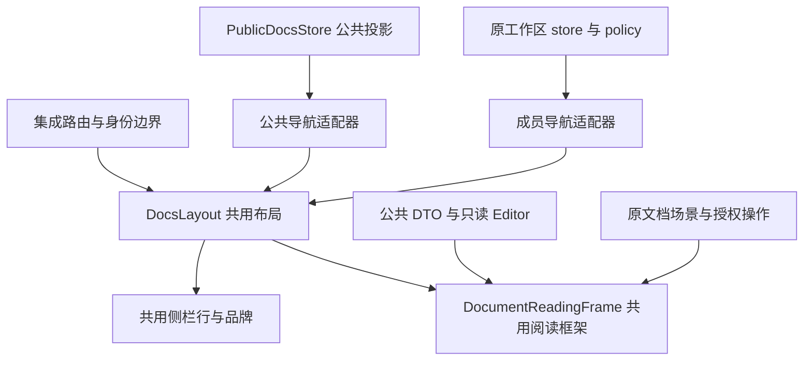

# RFC：统一 Outline 访客与登录界面

日期：2026-10-05。

状态：由已获用户确认的规格生成；已完成文档自检，待实施前技术评审。未实施，未进行运行验收。

源规格：`.notes/docs-integration/specs/2026-10-05-unified-docs-interface-design.md`。用户已在本次会话确认该规格，保留源文件原文。

模块根目录：`.notes/docs-integration/`；本 RFC 位于 `.notes/docs-integration/rfcs/`。

## 1. 决策与交付边界

访客 `/docs/` 使用 Outline 布局，主区域展示公开集合总览，左侧展示公开文档树。登录后共用布局、导航行和正文呈现，依据真实授权增加私有集合、个人功能和写操作；登录及退出均保持公开文档的阅读路径。

采用共用呈现组件加公共/登录数据适配器。公共数据继续经 Outline 四个现有 public RPC 读取，不新增 HTTP operation、数据库结构、公开 Share 规则或匿名用户。Outline 保留独立 Yarn、React 和数据库；Website 不加载 Outline 组件或复制其 DTO。

本 RFC 替代 `.notes/archive/docs-integration/rfcs/outline-public-access-rfc.md` 中独立公共页面的界面实现选择。既有身份、授权、附件、SSR、canonical、sitemap、CSRF 及协作规则继续有效。非集成 Outline 维持原路由与使用方式。

## 2. 当前实现与需要改变的边界

| 当前位置                                                          | 事实及设计约束                                                                                    |
| ----------------------------------------------------------------- | ------------------------------------------------------------------------------------------------- |
| `apps/outline/app/routes/index.tsx`                               | 匿名根路径进入 WebsitePublic，登录进入 `/home`；文档、搜索按身份分流。                            |
| `apps/outline/app/scenes/WebsitePublic.tsx`                       | 公共目录、搜索、只读正文、评论及身份探测集中在一个独立 PublicShell 中。                           |
| `apps/outline/app/components/Layout.tsx`                          | 使用 UI store 与可选侧栏，适合公共和工作区共用。                                                  |
| `apps/outline/app/components/Sidebar/Sidebar.tsx`                 | 用户可选，已有折叠、移动端抽屉、宽度调整；账号菜单可以关闭。                                      |
| `apps/outline/app/components/Sidebar/components/SidebarBrand.tsx` | 无强制身份依赖，使用既有 Website Logo 链接。                                                      |
| `apps/outline/app/components/Sidebar/App.tsx`                     | 强制读取当前用户和团队，并加载集合、草稿和个人功能，不能在访客状态挂载。                          |
| `apps/outline/app/components/Sidebar/components/DocumentRow.tsx`  | 已提供导航行、展开、可选编辑及拖拽插槽，可作为共用行基础。                                        |
| `apps/outline/app/scenes/Document/components/Document.tsx`        | 完整场景绑定 Document model、保存、历史及内部副请求，readOnly 本身不足以使其成为公共 DTO 阅读器。 |
| `apps/outline/app/scenes/Document/components/Contents.tsx`        | 已有目录交互，但部分参数来自 Document model，需要提取呈现输入。                                   |
| `apps/outline/app/scenes/Document/components/PublicOnlyGate.tsx`  | 在挂载完整文档场景前判断 member/publicOnly，可继续承接授权分流。                                  |
| `apps/outline/server/commands/publicAccess.ts`                    | 公共列表先过滤再分页，父节点关系已提升到最近公开祖先。                                            |
| `apps/outline/app/stores/AuthStore.ts`                            | 撤销成功后跳转固定 `/identity/signed-out`，清理缓存失败仍清除身份。                               |
| `apps/web/src/pages/IdentityPage/SignedOutPage.tsx`               | 仅删除已核验无效且仍匹配的 token，有较新会话或无法核验时保留状态。                                |

这次改动需要拆出数据读取与呈现边界，不能只去掉 Authenticated 守卫或给现有公共页面仿制侧栏。

## 3. 组件与状态架构

下列新增名称与位置是本 RFC 的拟定接口，不表示当前文件已经存在。



### 3.1 无身份布局与身份专属层

新增 `apps/outline/app/components/DocsLayout.tsx`，组合现有 Layout、RightSidebarProvider、PortalContext 和按页面需要提供的 DocumentContext。接收 `sidebar`、`children`、`title`，以及不读取身份的布局参数。不在这个组件中加载用户、团队、通知、policy 或 WebSocket。

公共路由与 AuthenticatedLayout 都通过 DocsLayout 使用同一 Layout 实例；后者继续负责工作区快捷键、个人设置与写操作上下文。DocumentContext 与 Portal/右侧栏 provider 必须各有一个明确所有者，不因登录包装产生嵌套 Layout 或重复右侧栏容器。编辑和分屏所需的每文档 context 仍由原文档边界管理。

工作区 WebsocketProvider、通知查询及 CommandBar 继续位于已验证的登录分支。公开页面可使用仅含阅读/搜索行为的快捷键，不能注册新建、导入、保存或恢复历史等动作。

WebsitePublic 改为公共路由的数据与内容组合入口，移除独立 PublicShell 和重复导航栏。普通 Outline 的 Shared 场景继续使用其 Share 上下文；本 RFC 不把公共工作区伪装成一个 Share。

### 3.2 共用侧栏呈现

新增 `apps/outline/app/components/Sidebar/DocsNavigation.tsx`，组合 SidebarBrand、总览/搜索链接、集合导航和账号区域插槽。工作区与公共分支都使用该组合；收藏、草稿、通知等工作区内容作为受保护插槽提供。

公共适配器只向现有 DocumentRow/SidebarLink 提供静态 label、to、active、depth、expanded 和展开回调。不提供 Document model、写 action、拖拽 handler、编辑菜单或成员信息。若 DocumentRow 的某个必经子组件仍要求工作区上下文，应从中提取现有静态呈现部分，供两个分支共用，不复制 CSS 或注入虚假上下文。

导航的共用视图数据以以下接口表达；它是 UI 数据，不是另一个 API DTO：

```ts
interface DocsNavigationItem {
  id: string
  kind: 'collection' | 'document'
  label: string
  to: string
  children: readonly DocsNavigationItem[]
}
interface DocsNavigationView {
  items: readonly DocsNavigationItem[]
  activeCollectionId?: string
  activeDocumentId?: string
  expandedIds: ReadonlySet<string>
}
```

公共 adapter 输入直接引用 `apps/outline/shared/types/websiteIntegration.ts`；成员 adapter 使用现有模型和树。写能力不放进公共条目，成员行通过原 policy 及动作插槽提供。公开条目缺少内部图标等字段时显示已有通用图标，不为补齐外观扩大 API 元数据。

访客账号区域显示本地化登录按钮，登录后使用原账号菜单。登录工作区仍可显示不同首页与个人分区，但品牌、布局、导航行、搜索入口和账号区域位置一致。

### 3.3 共用正文与搜索呈现

新增 `apps/outline/app/scenes/Document/components/DocumentReadingFrame.tsx`，提取标题/面包屑、页面边距与宽度、正文区域、目录开关及目录容器。接收 title、breadcrumb、editor 内容插槽、actions 插槽及目录呈现输入；不读取完整 Document model，不执行任何 API 请求。

原文档 Header/Editor/DocumentTitle 保留其编辑逻辑，但其中的静态标题及排版由共用呈现部分负责。公共读者用公共 DTO 加现有 `apps/outline/app/components/Editor.tsx` 的 readOnly 模式渲染，不实例化一个假的可写 Document，不挂载 useDocumentSave、MultiplayerEditor、成员菜单、访问记录、References 或 revision 请求。

Contents 提取仅依赖 headings、headingPrefix、activeHeading、navigateHeading 的呈现接口；工作区 adapter 保留现有 DocumentPreference。公共 adapter 从已公开正文的只读 Editor 取得 headings，采用既有默认 HeadingPrefixStyle.None，不读取未公开工作区偏好。所有目录跳转使用相同呈现及焦点行为。

PublicOnlyGate 继续在完整文档场景前分流；publicOnly 分支使用新的公共正文 adapter 和共用框架，有效身份下按现有评论授权挂载 PublicComments。匿名分支不读取或提交评论。

提取搜索输入/结果的呈现组件供公共搜索和原授权搜索使用：公开搜索只有 title/url/excerpt 等真实投影字段，成员 adapter 继续使用已有授权结果。能力差异以插槽表达，不能通过缺少字段构造作者、更新时间或集合摘要。查询路由统一使用已有 `/search` 及 `q` 参数；保留其他现有成员筛选参数，但匿名数据请求只取 public RPC 支持的参数。

## 4. 公共读取、分页与一致性

### 4.1 PublicDocsStore

新增 `apps/outline/app/stores/PublicDocsStore.ts`，作为非持久 store 在 RootStore 中注册。公共 DTO 不写入 DocumentsStore、CollectionsStore 或 IndexedDB；仅在当前应用内存中存放。

职责为集合分页、各集合树的分页聚合、公共正文/搜索、请求代次和去重。拟定方法：`loadNextCollections()`、`loadCollectionTree(collectionId)`、`loadDocument(idOrSlug)`、`search(query, collectionId?)`、`invalidate()`。读响应分别沿用真实 public RPC 的类型，不创建新的服务端 schema。

每种资源维护 idle/loading/ready/error 状态。404 类型另标记 unavailable；网络/5xx 保持 retryable error，不能变为空目录或自动跳回总览。每次 invalidate 递增身份/权限代次并清空数据，旧代次请求即使完成也不得写回。

每次路由进入或恢复阅读需重新读取对应集合/正文，不以此前树或登录 model 证明当前公开。展开和路由进入的同一 resource 请求共用 in-flight 结果。单个路由代次内可以共享读取；跨身份不得复用。退出、会话失效、账号切换、已确认授权撤销及工作区切换时调用 invalidate，并解除旧 editor/评论的挂载。

### 4.2 现有 API 契约

实际外部地址为 `/docs/api/<RPC>`，Outline Client 使用既有 base path：

| RPC                       | 请求字段                                | 返回投影                                                   |
| ------------------------- | --------------------------------------- | ---------------------------------------------------------- |
| `public.collections.list` | offset、limit                           | data: PublicCollection[]；pagination: offset/limit/hasMore |
| `public.documents.list`   | collectionId、offset、limit             | data: PublicDocument[]；含 parentDocumentId                |
| `public.documents.info`   | id，UUID 或已有合法 slug                | data: PublicDocumentInfo                                   |
| `public.documents.search` | query、可选 collectionId、offset、limit | data: PublicDocumentSearchResult[]；同类 pagination        |

继续遵守 `apps/outline/server/routes/api/public/schema.ts` 的严格字段及 limit 最大 100。RPC 沿用 Outline Client；Website 页面只经 `@workspace/api-client` 核验身份，不请求 Outline 文档 API。

公共读取中的失效 Cookie 不能让公开内容依赖身份服务。现有四个匿名读 RPC 的 CSRF 例外、no-store 和服务器可见性判定保持不变。

### 4.3 分页与文档树

集合页按 limit=100 加载，首页/侧栏显示继续加载入口。文档树按集合展开开始，逐页加载至 hasMore=false，再按完整 parentDocumentId 构建树。加载期间不绘制残缺树；仍保留集合导航和加载/重试状态。

offset 按接口返回的 offset 加本页条目数量前进，条目以 id 去重；hasMore=true 但页面无条目或没有分页进展时中止并显示重试，不无限请求。折叠或离开后可停止后续分页；重试从该集合第一页重新构建，不将失败前的部分数据标记 complete。

树按 title、id 做稳定排序。完整聚合后仍找不到的父节点不得泄露或虚构：将该公开条目作为根处理，避免环/异常 parent 导致递归失败。隐私过滤仍完全由服务端决定，客户端不主动查询不可见父节点。

直达文档先取得公开正文的 collectionId，逐页查找公开集合并加载该集合树，展开可见祖先、标记 activeDocumentId。若扫描期间集合消失，重新核验正文；404 清除不可读正文，网络错误保留明确失败状态，不拼出私有集合名称。

既有 offset API 不提供一致性快照。并发移动、发布或删除可能让一次跨页读取的树暂时不完整；本期接受该限制，通过路由重读、整集重试及去重恢复。不得声称客户端去重消除了漏页，也不新增快照 API。仅对展开/目标集合聚合，避免所有集合全量并发加载。

## 5. 路由与身份切换

### 5.1 路由矩阵

| 对外路径                                  | 访客                         | 登录                                        |
| ----------------------------------------- | ---------------------------- | ------------------------------------------- |
| `/docs/`                                  | 公开集合总览                 | 原工作区 `/home`，除明确的阅读恢复流程外    |
| `/docs/public/collection/:collectionId`   | 公开集合及其文档             | 同一公开场景，不强行转换为成员集合路由      |
| `/docs/doc/<slug>`                        | 公共 resolver + 共用阅读框架 | PublicOnlyGate 决定公共阅读或原授权文档场景 |
| `/docs/search?q=...`                      | 公共搜索                     | 原授权搜索，重新查询当前可读范围            |
| `/docs/collection/<slug>` 及编辑/管理路径 | 原受保护入口规则             | 原授权场景                                  |

共用身份边界从 WebsitePublic 移出探测与自动接入逻辑，继续使用 WebsiteSessionProbe 和 websiteOidcAttempt。新布局不能在每个 sidebar/body 中分别启动探测；每次导航最多一个自动接入流程，保留当前一秒探测与十分钟失败重试限制。

登录 returnTo 仍使用 docsReturnPath、现有 state/nonce/PKCE 与原安全 post-login 路径机制。认证成功后先恢复公开文档/集合/搜索路径，再按新身份获取能力；只有没有阅读返回目标时才进入 `/home`。主动登录失败显示统一布局内的可重试提示，公开阅读保持可用。

### 5.2 退出返回的具体契约

新增客户端导航查询 `docsReturnTo`，只用于 `/identity/signed-out` 的 Outline 阅读恢复。它不新增服务端 operation，也不修改 auth.delete 的固定响应 `{success:true, redirectUrl:"/identity/signed-out"}`；AuthStore 必须先验证原响应，再本地构造含查询的确认页 URL。

退出前在当前 Outline 页面捕获候选：

1. 账号菜单直接调用 AuthStore.logout 时，以当前 pathname/search 捕获。`/logout` 场景只读取进入该动作前保存的阅读目标；直接访问 `/logout` 且没有目标时使用 `/docs/`。
2. 文档候选先通过 public.documents.info 证明当时公开；公开集合通过 public.collections.list 定位核验。404 或其他检查失败时使用 `/docs/`，不把私有标题 slug 放进 Website 返回提示。
3. 返回检查失败不阻止用户退出；它只决定返回总览。页面在等待服务端撤销期间立即关闭写操作入口；撤销失败恢复明确错误及重试，不宣称匿名，不复用此前预检作为授权。
4. 服务端撤销成功后按现有逻辑清除 Outline 身份、缓存与协作状态，再到固定 Website 确认页。临时返回值只在该次退出尝试中使用，不写 localStorage、cookie 或长期历史状态。

新增两端各自的窄路径校验器：Outline 的 `apps/outline/shared/utils/docsReadingReturnPath.ts`，Website 的 `apps/web/src/pages/IdentityPage/docsReadingReturnPath.ts`。这是一项浏览器导航协议，两端需共用同一组测试向量；不让 Website import Outline 子仓库代码。

校验规则：

- 输入为不超过 2048 字符的根相对路径；同源检查使用可信配置的 Website origin。
- 只允许 `/docs/`、`/docs/public/collection/<UUID>`、`/docs/doc/<合法既有文档 slug>`、`/docs/search`，精确匹配到路径结尾。public.documents.info 可以接受 UUID，但当前页面路由不能，因此返回页面不接受裸 UUID。
- 文档路径以既有 route helper 的 slug 规则为准，显式拒绝 new、edit、history、auth、logout、额外路径段及任何动作 URL。集合必须为 UUID。
- 沿用 docsReturnPath 的编码穿越、控制字符、空白、反斜杠、双斜杠和外域拒绝规则；不能先 URL 规范化而丢失恶意原始路径证据。
- 文档/搜索仅保留公开阅读需要的 `q`，单值、长度不超过现有公共搜索的 200 字符；搜索可保留经 UUID 校验的 collectionId。移除其他查询和 hash，特别是动作/身份参数；总览和集合不传递任意查询。
- 拒绝或缺失时返回 `/docs/`。任何返回提示都不能证明身份、授权或公开状态。

Website SignedOutPage 对有且有效的 docsReturnTo 执行现有 token 核验：signed-out 才自动返回；active 不删除较新 token、不自动退出或导航，显示手动返回；unavailable 保留重试及手动阅读。自动与手动返回均通过下节的总览继续流程，不直接请求文档深链接。每次核验遵守请求代次，跳转前重新确认当前 token 没有被新的登录替换。没有 docsReturnTo 的既有 Website 退出确认保持当前行为。

### 5.3 返回前的匿名复核与 SSR 兼容

不能从 Website 直接返回一个可能已经私有的 `/docs/doc/<slug>` 再等待 SPA 回退：现有服务端会对匿名私有深链接返回无应用壳的 404。Website 也不能为了预检绕过自己的 API Client 边界。

因此 Website 在 signed-out 后先 replace 到始终可加载的 `/docs/?docsResume=<编码后的安全目标>`；这是公开总览路由的临时客户端继续流程。该流程使用共用布局中的加载态，Outline 在匿名公共 adapter 中再次核验文档/集合后 replace 到最终目标；总览和公共搜索无需文档预检。

- 公开目标：恢复地址与查询，加载共用阅读界面。
- 不可见目标：replace 到 `/docs/`，显示不含原标题的通用提示。
- 网络/5xx：留在共用加载/错误界面，允许重试或返回总览，不伪装成 404。
- 新会话已建立：不撤销或清除它，按当前经过核验的身份处理目标；docsResume 本身不强制匿名或登录。身份未知时公共预检可继续，不挂载成员内容。

读取 docsResume 后立即校验，并通过 Router history.replace 清除原查询，把仅含安全路径的继续状态放在该控制器内存中，再作预检，避免刷新或返回重放动作。控制器在该过渡完成前优先于根路径 `/home` 重定向；不能直接操作浏览器 history 而使 Router 状态不同步。

预检成功后用 Outline Router history.replace 导航到去除 `/docs` basename 的逻辑阅读路径，不能整页请求文档 URL。因此预检后发生公开状态变化也能由仍在应用壳中的公共 reader 处理 unavailable 并回到总览，不被服务端无应用壳的 404 卡住。普通直接访问/刷新文档的 SSR 与 canonical 行为保持原样。

## 6. 隐私、错误与交互要求

空公开集合列表、空集合、加载、接口错误和 unavailable 分别显示本地化状态；品牌、侧栏和登录按钮均保留。私有/草稿/缺失/撤销共享不可见语义，不展示被清理的标题、数量或历史评论。

身份/权限变化要先卸载受保护内容与副请求，再重新加载当前可见范围。公共 DTO、编辑器内容、树和评论均受请求代次保护；不能只隐藏旧数据对应的按钮。旧页面已传出的字节无法收回，本期不增加公共实时撤销协议。

公共只读 Editor 的链接建议、附件读取、嵌入及目录交互不得自动发起成员专属请求；必要功能用现有公共可见性路径，无法安全提供的内部预览不挂载。登录 publicOnly 允许现有受保护评论请求，但不允许内部成员与历史副请求。

复用原 Outline 主题与 ExUI 样式、Lucide 图标、侧栏尺寸/折叠和移动行为。新国际化文案通过既有提取流程产生，不人工添加翻译文件。访客不持久化个人配置；主题和公开 UI 偏好可以沿用现有本地机制，不持久化文档投影。

树展开按钮与链接保持独立键盘操作，当前项提供 aria-current，加载/失败使用正确状态角色。导航和身份切换后的焦点放到相应内容标题或状态区域，隐藏侧栏继续使用现有 inert 行为。抽取标题/正文时要同时验证桌面与移动断点，避免双标题、双滚动区域和重复目录。

## 7. 文件责任与依赖顺序

### Outline 子模块

- 共用呈现：新增 DocsLayout、DocsNavigation、DocumentReadingFrame；修改 AuthenticatedLayout、侧栏 App、DocumentRow 必要静态部分及原文档/目录呈现。
- 公共 adapter：新增 PublicDocsStore，调整 RootStore 注册/清理；拆分 WebsitePublic 的目录、正文、搜索与身份职责。
- 路由/身份：修改 `apps/outline/app/routes/index.tsx`、`apps/outline/app/routes/authenticated.tsx`、PublicOnlyGate；保留原认证守卫和工作区 provider 的身份边界。
- 退出导航：修改 `apps/outline/app/stores/AuthStore.ts`、`apps/outline/app/scenes/Logout.tsx`、`apps/outline/app/actions/definitions/navigation.tsx`，新增窄阅读路径校验与继续流程。

### Website 父仓库

仅 SignedOutPage 及其路径 helper/测试参与新的返回协议。其 `api.GET('/auth/me')` 继续经既有生成 Client 发起；保留新会话保护、SDK 和 AuthContext 的既有契约。当前其他认证/UI 改动需要实施时按最终源码适配，不能回退他人工作。

依赖顺序：先抽取共用呈现并维持登录回归，再接公共 store 与路由，随后连接身份/退出导航，最后联合浏览器验收。可以先交付仍兼容固定退出页的 Outline 新布局；阅读恢复协议应在 Website 与 Outline 两端具备后统一启用。无需新功能开关，仍限定在已有 websiteIntegrationEnabled 模式。

## 8. 验证计划

源规格 U01–U10 是验收基线。测试应断言实际可见行为和请求边界，而非组件名称或内部字段。以下都是实施阶段待执行项，本 RFC 没有宣称测试通过。

| 测试落点                           | 关键用例                                                                                                                                 |
| ---------------------------------- | ---------------------------------------------------------------------------------------------------------------------------------------- |
| PublicDocsStore 与公共导航组件测试 | 0/1/多集合、超过 100 文档、多页父子、缺失父节点/环保护、折叠停止、失败重试、分页无进展、深链接目标在后续集合页。                         |
| 共用布局/正文组件与路由测试        | 匿名无用户/团队仍挂载、工作区插槽受身份保护、公共正文无保存/成员/通知/历史请求、publicOnly 评论、移动侧栏及键盘。                        |
| 身份恢复测试                       | 自动 OIDC 单次与失败抑制、登录返回文档/集合/搜索、query 保留、旧代次请求不恢复私有内容、docsResume 优先于 `/home`。                      |
| 两端 reading-return helper 测试    | 外域、双斜杠、控制字符、编码穿越、反斜杠、new/edit/history/auth/logout、额外路径段、错误 UUID、未知查询、重复参数、超长输入及合法 slug。 |
| AuthStore/Logout 测试              | 公共预检成功/404/失联、撤销失败、固定 auth.delete 响应验证、缓存清理失败、新会话、直接 `/logout`，无私有 slug 返回提示。                 |
| SignedOutPage 测试                 | 无提示维持原行为；signed-out 返回继续路由；active/unavailable 不自动跳；迟到核验不清理或覆盖较新会话。                                   |
| 真实 Koa 现有公共访问测试          | 私有/草稿/撤销、父节点投影、附件、SSR/canonical/sitemap/no-store 和失效 Cookie 下公共阅读无回归。                                        |

Outline app/shared 测试在子模块目录通过 Corepack/Yarn 执行，对应 vitest app、shared-node/shared-jsdom project；TypeScript 使用其现有 tsc 配置，lint 使用其现有 oxlint 入口，构建使用原 vite/build-server 入口。实施时读取最新 package.json，避免把不存在的 typecheck script 写成执行结果；Windows 环境显式设置 TZ，不依赖 POSIX 环境赋值语法。

需要数据库的 Outline server 用例使用根 `pnpm integration:test:outline -- <server测试路径> <实际完整用例名> ...` 的一次性 PostgreSQL/Redis runner，按 `scripts/docs-integration/test-outline.mjs` 的真实 CLI 选择用例；禁止用本地开发库运行 server 全套测试。Website 使用根 Vitest 的 SignedOutPage/helper 用例及 `pnpm typecheck`、`pnpm build`；数据库用例继续隔离容器。

真实浏览器在已准备的 local 模式至少验证以下组合：访客/登录读者/集合编辑者、公开与私有文档、桌面与移动视口、身份服务不可用、公开状态撤销、退出后恢复。通过网络记录证明匿名不触发受保护个人请求；比较同一文档匿名与登录状态的布局、排版和侧栏，不能用 jsdom 宣称视觉一致。

原 dev/full 模式在其已准备环境分别验证子路径、登录返回及退出返回。若环境不具备则标注 NOT_EXECUTED，不将 local 证据外推为全部模式通过。公共内容超过一页、父子跨页与新会话保护是必需负向/边界验收，不只验证空目录。

## 9. 风险、发布与回退

| 风险                           | 影响                          | 缓解与检测                                                      |
| ------------------------------ | ----------------------------- | --------------------------------------------------------------- |
| 强制身份依赖进入共用组件       | 匿名崩溃或触发受保护请求      | 无 User/Team 测试与浏览器网络记录；保留身份专属层。             |
| 从完整 Document 场景复制副作用 | 匿名读取内部信息或历史        | 用纯阅读框架及公共 DTO adapter，mock/网络断言副请求缺席。       |
| 新旧布局 provider 重复         | 双侧栏、分屏/目录/portal 错乱 | 唯一布局 owner，组件与真实编辑回归验收。                        |
| 页面身份改变后迟到响应         | 私有内容重新出现              | store/route 代次与卸载顺序，延迟响应测试。                      |
| 退出后的文档已变为私有         | 深链接 SSR 404 阻止恢复       | 总览继续流程内先作匿名复核，再最终导航。                        |
| 返回路径扩大重定向面           | 外域或动作路由重放            | 两端精确白名单、同组测试向量、返回提示不参与授权。              |
| 新登录与迟到退出确认并发       | 清理或覆盖后来会话            | signed-out 核验代次与跳转前 token 匹配，active 不自动返回。     |
| 多页树成本及并发变更           | 长等待或暂时缺少条目          | 仅展开集合逐页加载、可取消/重试、明确接受现有 offset 快照限制。 |

本地验证通过后再更新父仓库的 Outline 子模块引用；只有明确授权才提交或发布。无 schema/migration/数据搬移，不重置 Website、Outline、账号、卷或附件。发现越权副请求、旧私有数据重现、退出新会话被清理或非集成回归时停止交付并修复。

回退恢复 Outline 组件/路由及父仓库对应版本，不撤销服务端权限规则或身份核验。Website 可保留能识别安全返回提示的确认页；回退到旧 Outline 时应一并撤回新继续流程的自动跳转，避免旧根路由无法处理 docsResume。完整回退两端代码后固定退出确认及原公共页面恢复，不涉及任何数据恢复。

## 10. 审阅结论与剩余工作

规格的产品方向已由用户确认；本 RFC 未独立评审，也未开始实现。文档自检要求为：真实 API 与目录边界匹配、接口无占位、身份/公开授权区分明确、异常和新会话覆盖、SSR 恢复可行、验收映射完整。

不存在阻止实施技术评审的待定产品决策。现有 offset 分页不保证并发快照，作为明确限制接受；大规模树专用 API、匿名实时撤销、主题跨应用统一均属于范围外后续工作。实施完成后按仓库规则补充实际 `.ai/` 知识，设计阶段不将提案写成既成事实。
