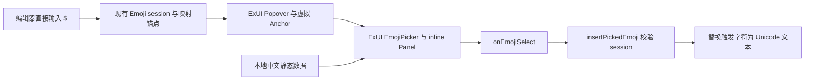

# RFC：ExUI 1.0 组件迁移与 Tiptap Emoji 替换

- 状态：Proposed，待审核后统一实施。
- 日期：2026-10-19。
- 模块根目录：`.notes/exui-v1-upgrade/`。
- 设计基线：`.notes/exui-v1-upgrade/specs/2026-10-19-exui-v1-upgrade-design.md`，原位保留。
- 用户已确认全面组件迁移范围，并明确要求删除 `emoji-picker-react`、使用 ExUI `EmojiPicker`。交付顺序为先完成 RFC，再整体实现。

## 1. 决策摘要

将 Web、共享组件与 SDK 的 ExUI 消费统一升级到 registry 的 1.0.0；迁移三个已删除的 `Modal` 用法、设置项展示、主题与组件样式，并以 ExUI 原生 EmojiPicker 替代 Tiptap 的第三方面板。保持现有黑白品牌、页面结构和业务流程。

依赖升级与全部消费端适配作为同一个完整变更交付。下述内部顺序用于控制验证成本，不发布仅升级依赖、仍保留不兼容组件的中间状态。

## 2. 现状与证据

本工程当前声明 `@exre/exui@^0.8.0`，三个安装消费者为 `apps/web/`、`packages/components/`、`packages/sdk/`。共享组件中的 `emoji-picker-react@5.0.0` 为独立依赖。

已比较上游 ExUI tag `@exre/exui@0.8.0`（`4b08c6c`）和 `@exre/exui@1.0.0`（`bcb20b4`）的源码、公开导出与 Token。以下上游路径相对 ExUI 仓库根目录：

| 上游证据                                                                                               | 核实结果                                                                                          |
| ------------------------------------------------------------------------------------------------------ | ------------------------------------------------------------------------------------------------- |
| `packages/components/CHANGELOG.md`、`packages/components/src/index.ts`                                 | 移除 Modal 及其类型，保留现有消费端其余导入；ExForm、ExMessage API 保留。                         |
| `packages/components/src/components/ui/dialog.tsx`、`packages/components/src/components/ui/dialog.css` | 直接子级 DialogBody 启用正文滚动；快捷组合、独立标题动作与可选全屏已公开。                        |
| `packages/components/src/hooks/use-mobile.ts`                                                          | `useIsMobile` 的阈值是 48 个当前根 rem，能够响应根字号变化。                                      |
| `packages/components/src/components/reui/emoji-picker.tsx`                                             | 支持 `hideSearch`、本地 `data`、`onEmojiSelect`、inline Panel；默认数据来自固定版本的第三方 CDN。 |
| `packages/components/src/hooks/use-file-upload.ts`                                                     | Hook 自有文件状态，不能直接代替本站受控 File[] 及累计字节校验。                                   |
| `packages/tokens/src/style.css`                                                                        | 存在当前反馈编辑器应使用的 focused/danger Token，原有两个名称不可解析。                           |

组件具体 props 在实施时还须对实际安装的 1.0.0 发行包声明复核。当前工程的 `.agents/skills/exui/SKILL.md` 与其公开导出、Dialog、EmojiPicker、Form、缩放参考用于组合指导。

## 3. 范围与责任

| 范围           | 文件与职责                                                                                                                                                                               |
| -------------- | ---------------------------------------------------------------------------------------------------------------------------------------------------------------------------------------- |
| 依赖           | `apps/web/package.json`、`packages/components/package.json`、`packages/sdk/package.json`、`pnpm-lock.yaml`、`pnpm-workspace.yaml`。                                                      |
| 反馈弹窗       | `apps/web/src/pages/Support/feedback/FeedbackModal.tsx` 及 CSS Module；保留 Provider、RHF、草稿、关闭确认和在途任务。                                                                    |
| 通知历史       | `packages/components/src/notifications/NotificationHistoryModal.tsx` 及 CSS Module；保留列表、详情、滚动恢复、确认、pending 和焦点归还。                                                 |
| 成员弹窗       | `apps/web/src/pages/AboutUs/MemberModal.tsx`；内容读取和原触发器归还不变。                                                                                                               |
| 设置           | `packages/components/src/SettingsPanel.tsx` 及 CSS Module；使用 ExItem 展示已有设置项。                                                                                                  |
| 编辑器         | `packages/components/src/tiptap/EmojiPickerPanel.tsx` 及 CSS Module、`emoji.test.tsx`；周边浮层与正文样式按消费面检查。                                                                  |
| 主题与表单表面 | `apps/web/src/styles/website-theme.css`、`apps/web/src/styles/index.scss`、`apps/web/src/pages/Support/feedback/FeedbackMarkdownField.module.scss` 以及实际发现冲突的消费方 CSS Module。 |
| 全站验收       | 现有 ExUI 消费端与 `tests/browser/`；覆盖检查不要求为每个通过检查的文件制造代码改动。                                                                                                    |
| 知识维护       | 实现验证后更新对应 `.ai/` 文档；设计阶段仅维护本模块的设计材料。                                                                                                                         |

所有共享组件继续只收 props 与回调；页面控制器、HTTP 调用、身份代次和外部操作继续留在原应用层。API Contract、数据库、反馈冻结载荷、恢复 key 和编辑器持久化 schema 均无变更。本次不增加业务页面或部署步骤。

## 4. 依赖与安装契约

1. Web 和共享组件的 ExUI dependency、SDK 的 optional peer 与 devDependency 均调整为 `^1.0.0`；本次 lockfile 必须解析到 1.0.0。
2. 删除 `packages/components/package.json` 的 `emoji-picker-react`，添加精确版本 `emojibase-data@17.0.0`。这是中文静态数据，不是另一套 Emoji UI 或浮层实现。
3. 使用 pnpm 更新 lockfile，保留无关依赖的既有解析。release-age 策略仅按实际安装要求调整 ExUI 精确版本条目。
4. 保持 React/React DOM 单一实例、Vite/Vitest dedupe、SDK external，以及 ExUI 单点样式和宿主挂载。0.8.0 与 1.0.0 不作为两个运行时实例共存。
5. 安装后分别核对三个消费者的 package version、公开入口和类型；验证 `EmojiPicker`、`EmojiPickerPanel`、`normalizeEmojibaseData`、`DialogBody`、`ExItem`、`useIsMobile` 的实际声明。

本工程继续使用 registry 包，不修改上游 ExUI，不恢复本地 link/portal，不手改 lockfile 中的完整性数据。

## 5. Dialog 迁移契约

### 5.1 原 API 映射

| 0.8.0 Modal 用法                   | 1.0.0 对应职责                                                                   |
| ---------------------------------- | -------------------------------------------------------------------------------- |
| `open` / `onOpenChange`            | 受控 Dialog 的同名状态入口。                                                     |
| `title` / `description` / `footer` | 复杂内容使用显式 Header/Title/Description/Body/Footer；成员内容使用快捷 Dialog。 |
| `size="md"` / `size="xl"`          | CSS Module 分别约束桌面宽度 32rem / 64rem，视口最大宽度优先。                    |
| `width` / `height`                 | DialogContent 的业务布局样式，成员快捷写法通过 `contentProps`。                  |
| `padding` / `bodyClassName`        | 分配到内容表面与直接子级 DialogBody；不得让表面和正文重复承担同一内边距。        |
| `mobileFullscreen`                 | `responsiveFullscreen`，逐弹窗显式选择。                                         |
| `dismissible`                      | 业务 guard + `closeButtonDisabled` + Escape/InteractOutside 的 preventDefault。  |
| `closeLabel` / autofocus 回调      | DialogContent 属性；快捷写法放到 `contentProps`。                                |

旧 `.ex-modal-*` 选择器全部迁移到传入的 CSS Module 类。浏览器检查优先按可访问角色和业务区域定位，确需定位正文时使用 `data-slot="dialog-body"`。

### 5.2 反馈弹窗

DialogContent 直接包含 DialogHeader、DialogBody 和有内容时的 DialogFooter。标题与说明由当前 confirmation/kind/area 决定；没有说明时不留下失效的 `aria-describedby`。表单仍在正文内，底栏通过原有 `formId` 提交。

保留宽度：普通类型与表单 48rem，放弃确认 26rem；表单阶段高度为 `min(85dvh, 52rem)`，最大宽度受视口限制。继续使用有外边距的窄屏弹窗，`responsiveFullscreen` 为 false。正文 padding 按当前阶段迁移，外层采用库的默认几何，避免重复头部与底部 padding。

关闭的唯一业务入口仍为 `changeOpen`：

| 条件                 | 关闭意图的处理                                            |
| -------------------- | --------------------------------------------------------- |
| 正在放弃确认         | 返回原表单，不关闭整个流程。                              |
| 已提交或已有冻结任务 | 隐藏弹窗，Provider 与原任务继续；重新打开规则沿用原流程。 |
| 有未提交草稿         | 在同一弹窗显示放弃确认，保留原草稿与附件。                |
| 空草稿               | 关闭并执行原清理。                                        |

关闭按钮、Escape 和外部点击均经过这一入口，不直接清理任务，也不引入通用 pending 禁止关闭。提交的 UI epoch、会话代次、命令认领和未知结果核对继续由现有逻辑负责。

### 5.3 通知历史

内容表面桌面宽度为 64rem，高度为 `min(48rem, calc(100dvh - 2rem))`。Header 保持库的标题/关闭布局；Body 为直接子级并采用可收缩 flex 区域，内部列表和正文各自拥有滚动容器。通过业务类清除 Body 的冗余内边距，保留库在大字号和低视口时的外层滚动兜底。

Body 内保持列表、详情与选中项状态。将原固定 768px 的 `useIsNarrow` 及 CSS 判断改为公开 `useIsMobile`，给业务布局节点设置 `data-layout="narrow" | "wide"`，让对应 CSS 与 Dialog 的 48 个当前根 rem 全屏判断同源。不能用 CSS media query 的 rem 代替此运行时判断，因为 media query 中的 rem 不跟随页面显式修改的根字号。

`detailMode`、窄屏返回列表、筛选滚动恢复、分页 sentinel 和选中详情聚焦均保持原职责。跨阈值和根字号变化不更换 Portal、Body 或 File/输入节点。

`bulk.pending !== null` 时，角落关闭按钮禁用；`onEscapeKeyDown`、`onInteractOutside` 阻止默认关闭；`onOpenChange(false)` 再复核 pending。恢复可关闭后仅调用既有 `onClose`。保留嵌套 AlertDialog 的模态与焦点规则，不自行接管全局键盘或点击事件。

关闭自动聚焦仍返回 `finalFocusRef`；从铃铛 Popover 打开历史弹窗时继续由原协调器避免抢回铃铛。新增 guard 不得使已取消的嵌套确认顺带关闭父弹窗。

### 5.4 成员及现有组合

成员弹窗采用快捷 Dialog，保留 32rem 桌面宽度，显式启用 `responsiveFullscreen`。`contentProps` 携带关闭文案、宽度约束和既有关闭 autofocus 回调。成员触发器不可聚焦时仍回到页面现有的兜底标题。

现有 AuthModal、SettingsModal、设置编辑/头像、身份授权及仍参与编译的 Join 组件逐一核对。仅对确需滚动的长内容引入 Body，保留认证隐藏标题和设置自有导航布局；不得批量插入新可见标题或改写业务步骤。

## 6. Tiptap Emoji 接入

### 6.1 结构与状态流

保留本站 `EmojiPickerPanel` 的 props：Editor、anchor 与 session。不改变 `packages/components/src/tiptap/emoji-trigger.ts` 的触发、事务映射、只读、组合输入与取消规则；只有发现迁移相关缺陷且具备回归证据时才调整该文件。

外层保留现有 ExUI Popover、PopoverAnchor 和 glass PopoverContent。内层显式组合 `EmojiPicker` 和其 inline `EmojiPickerPanel`，使用别名避免与本站组件重名。不得使用原生 picker 的默认无 children 写法，否则会额外生成 trigger 和另一层 popup。

### 6.2 组件与数据配置

| 设置           | 约定                                                                                                                                                        |
| -------------- | ----------------------------------------------------------------------------------------------------------------------------------------------------------- |
| 值             | 单选插入模式，`value={null}`；不把 Emoji 选择存为独立表单字段。                                                                                             |
| 回调           | `onEmojiSelect` 读取 `selection.value`，调用 `insertPickedEmoji(editor, value, expectedSession)`。                                                          |
| 关闭           | 外层 editor session 为唯一打开状态来源；内层不独立关闭。插入被文档门禁拒绝时保留有效面板。                                                                  |
| 搜索与附属区域 | `hideSearch`；保留分类与表情列表，采用默认不含 Footer/Preview/SkinTone 的面板。                                                                             |
| 肤色           | 受控默认肤色 0；不读取别处 picker 存储的肤色偏好。                                                                                                          |
| 中文数据       | 静态导入 `emojibase-data/zh/data.json` 与 `emojibase-data/zh/messages.json`，经公开 `normalizeEmojibaseData` 规范化，`locale` 为 zh，提供稳定 `data` 对象。 |
| UI 语言        | 在面板模块中提供稳定的中文 i18n，覆盖表情列表、分类、最近使用、加载、错误、重试与相关辅助技术公告。                                                         |
| 最近使用       | `recentMode="recent"`，专属 key `exwebsite.emoji.recent.v1`；不解释旧第三方库的存储结构。                                                                   |

数据与 i18n 放在按需加载的面板模块内或其局部数据模块，规范化只执行一次，不在组件 render 中重建。通过 `data` 跳过 ExUI 默认 CDN 加载。只引入中文数据，不导入完整的多语言数据集；不得增加业务 fetch 或新的 HTTP endpoint。

替换后删除 `emoji-picker-react` 的运行时导入、中文子路径导入、依赖、lockfile 条目、`.EmojiPickerReact` 与 `--epr-*` CSS；去除仅为第三方 theme prop 服务的 MutationObserver。原生面板继承当前 ExUI 主题。

### 6.3 焦点、键盘与异步边界

ExUI 的可聚焦表情区域是 `role="listbox"`；表情项是 `role="option"`，活动项由 `aria-activedescendant` 管理。本站适配将打开后的初始焦点交给 ready 且可聚焦的 listbox，后续方向键、Home/End、Enter/Space 和分类导航交给组件。

不再聚焦原库的 `gridcell`，也不向原生列表传入覆盖其内部滚动 ref 的 ref。若需等待实际列表挂载，只在外层面板内做有清理的就绪检查，聚焦前核对当前 session 仍有效；不得让迟到的面板夺走外部按钮或新会话的焦点。

现有外层 Escape 处理继续排除组合输入，再关闭匹配 session 并返回 Editor。选中时由原插入函数返回 Editor 焦点；外部点击保留外部目标焦点。原生组件内层的 recent 更新不产生第二次文档插入。

取消保留 `$`，选择插入 Unicode；文档替换、锚点删除、只读、失焦或 session 失效后，迟到选择无法写入新位置。JSON、Markdown 和已有 Emoji 文本继续使用原文本规则。

### 6.4 表面与尺寸

外层保留 `sideOffset={4}`、`collisionPadding={8}` 的显式 CSS 像素语义。面板宽度以 22.375rem 为优选值，并限制在视口及 Radix 可用宽度内；列表最大高度受可用弹层高度约束，保留其虚拟化滚动容器，避免直接裁掉不可滚动的外层。

面板及分类标题以公开材质变量和原生组件支持的样式入口适配 Glass。验证实际渲染、焦点可见性与无 backdrop-filter 时的降级，不用计算样式或 filter 字符串代替折射视觉证据。

## 7. 设置、表单与主题

### 7.1 ExItem

将 `SettingsPanel` 的自定义 SettingItem 展示壳替换为 ExItem 的水平布局、右侧内容对齐。内部可保留一个仅封装本站分隔线及布局 props 的局部业务函数，不复制 ExItem 的标题/说明 DOM 和响应式算法。

普通显示值使用展示标题；主题 Select、关联信息编辑按钮等交互项为实际 focusable 元素提供稳定 ID 与说明引用，通过 `controlId` 关联。包裹或非 Input 控件不依赖自动关联。保留既有按钮的可访问名称、编辑回调及焦点目标。

### 7.2 表单与附件

RHF/Zod 与 ExUI Form 继续各用原来的实例和提交入口。外部 RHF 不能传给 ExForm；不为统一外观重建表单状态。附件继续由表单受控 `File[]` 持有，不以 useFileUpload 的内部状态建立第二份文件集合。

保留 FileUploader 的整批原子接纳、数量、空文件、单文件、累计字节、MIME/扩展名、删除与同文件重选规则，以及冻结任务的补选约束。头像裁剪保留 react-easy-crop，外围使用 ExUI 1.0 控件与 Dialog。

### 7.3 Token 和消费样式

`apps/web/src/pages/Support/feedback/FeedbackMarkdownField.module.scss` 中的 `--exui-border-focus` 和 `--exui-feedback-error` 分别映射到真实的 `--exui-border-focused` 与 `--exui-feedback-danger`；富文本控件的 idle/focus/invalid 表面优先与普通 Input 的公开 recipe 对齐。

保留 `apps/web/src/styles/website-theme.css` 的单一品牌覆盖、`apps/web/src/main.tsx` 的样式导入顺序、ThemeProvider/GlassSeed/ExMessageContext 单实例及 system 偏好协调。不改变默认 html 字号。

核对 Card 的 spacing/gap、Input 透明默认边框、Tabs 轨道与选中阴影、Badge 变体与对比度、Button/ActionButton、Avatar、InputOTP、Alert、Skeleton、选择与导航组件。保留服务页面布局的覆盖，移除仅用于抵消旧库默认行为的覆盖。

## 8. 验证策略

### 8.1 自动回归

优先扩展现有测试，以实际消费结果和行为为断言，不以源码包含某个 import 或私有类名作为成功条件。

| 场景             | 必须验证                                                                                                    |
| ---------------- | ----------------------------------------------------------------------------------------------------------- |
| Emoji 真实组件   | 中文 listbox、Unicode 插入、光标位置、Markdown 导出、方向键/确认、Escape、外部焦点、延迟挂载与 StrictMode。 |
| Emoji 数据与隔离 | 浏览和选择无需远程数据；旧 session、文档替换、锚点删除和只读后不能插入。                                    |
| 反馈 Dialog      | 有草稿确认/取消、附件保留、提交时可隐藏、任务继续、已关闭失败不重开、原表单 ID 提交。                       |
| 通知 Dialog      | 三个关闭渠道在 pending 时受阻，解除后恢复；嵌套确认、最终焦点和滚动恢复仍有效。                             |
| 设置             | ExItem 标签与实际控件关联，原分类、编辑、主题、禁用和双宿主行为。                                           |
| 附件             | 原子拒绝无效批次、原 File[] 不受影响、重新选择相同文件与累计限额。                                          |

更新 `packages/components/src/tiptap/emoji.test.tsx` 的原库 DOM 假设：原 `gridcell` 焦点变为实际 listbox 焦点，选项按 role/label 查询。jsdom 只补测量、观察器等浏览器边界；不 mock 掉 ExUI Picker 的选择和键盘实现。

使用行为测试先证明关键回归能失败，再改生产实现。顺序执行 `pnpm typecheck`、`pnpm test`、`pnpm build`，避免 SDK 生成产物互相影响。完整测试需要 Docker/Testcontainers；缺失时报告该 gate 未通过，不回退开发库。

### 8.2 浏览器

复用 `tests/browser/notification-experience.mjs`，将 `.ex-modal-body` 查询更新为新正文 slot/语义区域；覆盖铃铛到历史的焦点、双栏、独立滚动、窄屏及 pending。`tests/browser/navbar-geometry.mjs` 仍作为浏览器 tab 接入的几何断言模块使用，不误当作直接执行就完成检查的 CLI。

为 Emoji、反馈和必要的设置组合补充现有 Playwright/Vite 模式的隔离 fixture；真实消费页面另外检查可达流程，避免 fixture 通过掩盖页面 CSS 和 portal 问题。

| 维度           | 必须覆盖                                                                               |
| -------------- | -------------------------------------------------------------------------------------- |
| 主题           | light、dark、system 跟随及实时切换。                                                   |
| 视口           | 1440×900、390×844、360×640；长短页、滚动条占位和打开/关闭弹窗。                        |
| 字号           | 16px、20px、24px 动态根字号；通知在 48 个当前根 rem 的阈值两侧。                       |
| 极端弹窗       | 640×320、32px 根字号，多行标题、正文和底部操作均可到达。                               |
| 输入与可访问性 | Tab、可见焦点、方向键、Escape、组合输入、外部点击、关闭归还；缩放不替换草稿/文件节点。 |
| 动效           | reduced motion；组件本身的运动交给 ExUI。                                              |

检查范围包含首页/顶栏、About、Join 介绍、支持中心、Docs 建设中页、错误页、登录/邀请/身份、设置、通知和编辑器浮层。按组件族记录结果及实际修复，不使用空白的全站“已兼容”结论。

### 8.3 验收边界

交付时分别报告静态检查、自动测试、隔离浏览器、真实页面及未验收项。本站 UI 验收不代表真实 ClickUp、身份提供方或部署通过；本次不部署。新增数据必须来自实际依赖或既有业务，不能为演示编造人物、记录或外部结果。

## 9. 实施顺序与回退

RFC 审核后统一执行以下依赖顺序：

1. 针对关闭策略、Emoji 键盘/焦点与本地数据建立回归；核对实际发行包声明与静态数据子路径。
2. 在同一工作分支升级三个消费者、处理三个 Modal，并替换 Emoji 和相应测试/样式；不交付依赖已经升级而消费端未迁移的状态。
3. 完成 ExItem、Token、主题与其余组件族检查，保持表单和业务状态的既有归属。
4. 执行自动与浏览器 gate，修复本次引入的问题；通过后再用 codebase-documenter 更新稳定 `.ai/` 事实。

停止条件为发行包缺失必要公开 API、组件迁移破坏业务关闭/恢复、正文变更、文件预算被绕过或核心浏览器验收失败。记录具体证据并调整本 RFC/实现，不以临时兼容层或换用开发库跳过 gate。

回退以这次升级的完整文件集为单位：消费端版本、lockfile、三个 Dialog、Emoji UI 与其数据依赖、样式和测试一起恢复。不得只回退 ExUI 版本而保留 1.0 原生 Emoji/Body 用法。没有数据库迁移或业务持久格式变化，不执行数据回滚、reset 或持久资源清理。

现有正文与反馈恢复数据仍可按原协议读取；新 Emoji 最近使用 key 在旧版中被忽略，允许保留。回退不需要解释或删除该偏好数据。

## 10. 风险、备选方案与决策状态

| 风险                                                | 处理与检测                                                               |
| --------------------------------------------------- | ------------------------------------------------------------------------ |
| DialogBody 的 min-height 与原局部 overflow 相互影响 | 保留直接子级和明确高度链，分别验证正常正文滚动与极低视口兜底。           |
| 反馈与通知错误共用 pending 关闭策略                 | 两套入口分别接线、分别回归；反馈允许隐藏，通知禁止关闭。                 |
| 原 Emoji 焦点假设与 ExUI listbox 不同               | 外层交接给 ready listbox，方向键由原生组件处理；真实组件与浏览器均验证。 |
| 数据 loader 默认连 CDN，或数据被提前打包到首屏      | 显式本地 data、保留 lazy 边界，检查浏览器请求和 build chunk 归属。       |
| 主题及根字号改变后布局或焦点断裂                    | 通知公开 hook 同源阈值、同节点布局调整与多字号验收。                     |
| 开发源码与 registry 产物有差异                      | 使用实际安装的 1.0.0 类型及产物验证，不能凭上游 HEAD 推断安装结果。      |

仅做版本号/编译修复的方案遗漏样式、滚动与交互；全站视觉重设计会扩大产品范围。本 RFC 采用已确认的完整组件迁移。新建旧 Modal 兼容壳或继续保留第三方 Emoji UI 会增加重复契约，均不采用。

当前没有需要用户另选的架构问题。发行包声明、中文数据子路径和浏览器几何属于实施时必须验证的技术条件，不作为已经通过的验收事实。RFC 仍待审核，生产实现、提交、推送和部署尚未完成或授权。
