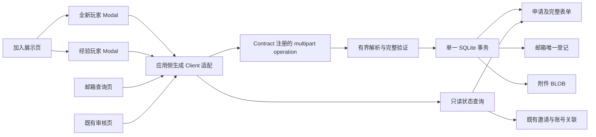

# RFC：完整加入申请、结果查询与审核资料扩展

> 迁移说明（2026-09-29）：本文件保留当时的业务与实现决定；其中旧 `apps/mock-server/` 路径、本地 SQLite Mock 与未来 PHP/MySQL 接管的基础设施描述，已由 `.notes/archive/server-promotion/specs/2026-09-29-server-promotion-design.md` 和 `.notes/archive/server-promotion/rfcs/server-postgresql-migration-rfc.md` 取代。当前唯一 Server 位于 `apps/server/`，使用独立 PostgreSQL `exre`；正文中的旧路径和目标仅作历史记录。

- 日期：2026-09-27。
- 状态：技术提案，待 RFC 评审；产品范围已由用户确认。
- 已批准来源：`.notes/archive/join-registration/specs/2026-09-27-join-application-pages-design.md`。用户在完整文档审阅后回复 `y`；保留源文档原文。
- 模块：`.notes/archive/join-registration/`。
- 接线前置：邀请注册后端及前端基线，见 `.notes/archive/join-registration/rfcs/join-registration-rfc.md`。
- 本文只交接设计，不执行代码开发、数据库迁移、Git 合并、提交或发布。

## 1. 问题与决策

旧加入页包含全新玩家和经验玩家两套完整资料与问题。当前邀请注册设计只接收邮箱、名字、QQ，不能支撑实际审核，也没有申请状态查询。本次采用新的展示页和两套分步 Modal，保留旧表单全部业务内容，以一次 multipart 请求和 SQLite 事务保存资料、承诺与可选证明文件。

同一规范化邮箱只能申请一次，跨类别且覆盖拒绝、邀请过期和注册完成。用独立邮箱登记保留旧重复历史；新增只读、最小结果查询。审核详情扩展为完整资料和附件下载，审批与邀请生命周期继续使用已有实现。

技术选择摘要：

| 事项 | 本文提案                                                                              |
| ---- | ------------------------------------------------------------------------------------- |
| 前端 | `/join` 展示页、两类独立 Modal；`/join/result` 邮箱查询页                             |
| 表单 | RHF + Zod + ExUI Field；两套完整 schema，共用字段配置与控件                           |
| 提交 | `POST /join/applications` 改为 multipart：JSON application part + 0–5 个 proofs parts |
| 保存 | 申请、结构化表单 JSON、邮箱唯一登记、附件 BLOB 同一 SQLite 事务                       |
| 查询 | `POST /join/applications/query`，仅返回状态及下一步，完全只读                         |
| 审核 | 现有列表及详情增加类别、完整表单和附件元数据；新增附件下载 operation                  |
| 版本 | 邀请基线 `0.4.0` → `0.5.0`，一次切换；此版本方案须在技术评审中明确批准                |
| 历史 | 保留已有账号、申请、审核、邀请和投递记录；三字段历史显示为 legacy                     |
| 边界 | 不新增申请密码、查询验证码、面试系统、生产权限或 ExUI 公共 API                        |

成功标准是两套资料完整可审、原子保存与唯一性经数据库竞争验证、六种结果正确且查询无业务写入，以及窄屏一列可完成整个流程。真实邮件、PHP/MySQL 和生产验收不属于本地成功标准。

## 2. 已核对事实与兼容基线

本工作区 `api/openapi.yaml` 仍是 `0.3.0` 直接注册基线。ExWebsite 主工作区的同路径已是 `0.4.0`，有邀请申请、公开本地临时审核、邀请资格检查、发码、验码、完善注册等 operation。主工作区仍有并行未提交开发；本文不把它当作已合并、已测试或已发布的依赖。

主工作区当前 `apps/mock-server/src/join/service.ts` 的提交只接收 email/nickname/qq；遇到已有账号或 pending/approved 申请仍返回 `202 received`，拒绝历史可再申请。当前邮箱部分唯一索引仅覆盖 pending/approved。这些行为必须由本 RFC 显式替换，不能混用。

保留的邀请基线包括：

- 注册入口 `/register`；先调用 `POST /auth/invitations/check` 检查资格，该调用不发邮件。发码、验码、完善账号沿用邀请设计。
- 审核入口 `/admin/join-applications`，现有“申请资料 / 审核与邀请”两个 Tab，以及同意、拒绝、重发。
- 邀请 7 天、验证码 10 分钟、发送冷却 60 秒、10 分钟内最多 5 次错误、完善凭证 30 分钟且不超过邀请有效期。实际落地以核对后的邀请 Contract 和服务为准。
- 临时审核 operation 使用 `security: []`，审核人为空；这是本地回环 Mock 方案，不提供生产权限。

当前 Fastify 全局 bodyLimit 为 4 MiB，尚无 `@fastify/multipart`。Glue 根据 Contract 注册路由，并使用 `serviceHandlers` 显式映射。ExUI 现有组件可用于表单，但没有可依赖的 `@exre/exui/forms` API。

实施者先整合已完成并经验证的邀请基线，再复核 operation、迁移序号、前端路径和依赖版本。不覆盖并行任务，不为衔接方便重写邀请生命周期。

## 3. 分层与数据流

| 层                                                                 | 责任与拟落点                                                                            |
| ------------------------------------------------------------------ | --------------------------------------------------------------------------------------- |
| `api/openapi.yaml`                                                 | 完整输入、multipart encoding、查询、详情与下载 Contract，错误和资源限制描述             |
| `packages/api-client/`                                             | 只重新生成类型，保留 `createApiClient` 工厂                                             |
| `packages/components/src/join/`                                    | 两类表单、摘要、文件输入、Modal 与结果视图；props/回调，不 import API Client            |
| `apps/web/src/`                                                    | 路由、页面文案/链接、Modal 流程、生成 Client 调用、multipart serializer、下载与查询代次 |
| `apps/mock-server/src/join/`                                       | 输入语义验证、事务、邮箱登记、详情和只读结果计算                                        |
| `apps/mock-server/src/handlers/join.ts`                            | operation handler、no-store、调用业务层                                                 |
| `apps/mock-server/src/app.ts`                                      | 仅对指定 operation 接入 multipart 传输 hooks；所有 HTTP 路由仍由 Glue 注册              |
| `apps/mock-server/src/db/schema.ts` 与 `apps/mock-server/drizzle/` | 经模型评审后新增结构与显式 migration                                                    |
| `tests/contract/`                                                  | 真实 Glue 路由、原始 handler 输出与 coverage 验证                                       |

通用配置式表单交接位于 ExWebsite 主仓库的 `.notes/todos/2026-09-27-configurable-forms-and-join-handoff.md`。可先在 `packages/components/src/forms/` 提供少量配置能力；本 RFC 不设计动态表单平台，不要求修改或发布 ExUI。组件内的输入类型从 Zod 推导，表示含 File 的 UI 草稿；HTTP DTO 从生成类型取得，应用侧做映射并用类型检查约束，不维护手写 HTTP DTO 副本。

## 4. 前端行为与完整字段

### 4.1 页面、Modal 与表单生命周期

`/join` 位于 RootLayout，保留站点顶栏、主题和 Join 导航。宽屏左侧说明、流程、FAQ，右侧两类申请卡及查询入口；`52rem` 以下变一列，顺序为标题简介 → 申请卡与查询 → 条件/流程 → FAQ/联系方式。颜色、圆角、边框使用 ExUI token，CSS Modules，不引入本地 token 或旧视觉组件。

全新玩家五步：联系 → 基本资料 → 玩法认知 → 时间来源 → 确认。
经验玩家六步：联系 → 基本资料 → 过往经历 → 笔试证明 → 时间来源 → 确认。

每类独立完整 schema 和 RHF 实例，共用原子字段定义。RHF 管理值、错误、校验及提交状态；流程层只管理类别、步骤和成功视图。用 `shouldUnregister: false` 保留前面步骤；当前步 trigger 只验证该步，最终 handleSubmit 校验完整 schema。当前步 schema 与完整 schema复用规则，不能因以后未填的字段阻止前进。最终全量错误跳到最早错误步骤并聚焦字段。

Modal 头部标题/进度和底部按钮保持可见，内容区滚动；使用动态视口高度，窄屏全部字段单列，短高度和虚拟键盘下仍可触达操作。焦点限制及关闭恢复由 ExUI 对话框能力完成并经浏览器检查。

后退保留值和文件；关闭、刷新、卸载清空内存草稿。切换类型销毁旧实例，附件不串入另一类。只在最终提交请求；在途禁用提交、关闭、Esc、遮罩关闭及类型切换。失败保留值和 File；成功仅在事务完成后显示“申请已收到”和查询入口。响应丢失后重试得到唯一冲突时显示已有申请并查询，不声称新申请成功。

表单组件输出校验后的值，应用侧负责 HTTP。服务错误通过 setError/root 展示；现有 ErrorEnvelope 没有字段路径，不新增第二套 envelope，只有明确可映射的固定错误映射到字段，其他错误留在表单层。

### 4.2 输入结构

下述名称是拟写入唯一 Contract 的精确字段。JSON application part 为 `JoinApplicationPayload`：

- `email`、`nickname`、`qq` 为顶层共用字段。
- `form` 是 `JoinNewForm | JoinExperiencedForm`；以 `applicationType` 的 const 分支。
- 每一层对象 `additionalProperties: false`；必填见表。不允许任意 details/answers 字典。
- 两类 schema 用 Draft-07 兼容的 oneOf/const/required/properties/$ref/数组规则；每个具体对象完整声明属性，避免 allOf 与 additionalProperties 的封闭对象扩展陷阱。

| JSON 字段              | 类型、范围与业务内容                                                                       |
| ---------------------- | ------------------------------------------------------------------------------------------ |
| email                  | 当前 Email schema；trim/lowercase，3–254，既有邮箱语法                                     |
| nickname               | 当前 Nickname schema；trim，1–32 Unicode 码点，禁止控制字符，允许重名                      |
| qq                     | string，`^[0-9]{5,13}$`；保留前导零。新申请专用 schema，不改变账号 QQ 或历史摘要的 1–20 位 |
| form.applicationType   | `new` 或 `experienced`；与成年/未成年等身份类别分开                                        |
| form.birthDate         | string `YYYY-MM-DD`，实际合法日历日期且不超过服务时钟的 UTC 当日，不转换为 timestamp       |
| form.applicantCategory | string enum `100                                                                           | 101    | 102a    | 102b`  |
| form.department        | enum `leo                                                                                  | ems`   |
| form.freeTime          | trim 非空 string，1–256；选择“每晚都有空 / 每周三天以上 / 每周三天以下”或自填              |
| form.discoveryChannels | 非空数组，1–4 个 uniqueItems；enum `bilibili                                               | douyin | friends | other` |
| form.answers           | 下述类别专属封闭对象，全部字段必填                                                         |
| form.commitments       | 下述类别专属封闭对象，每个值必须 boolean const true                                        |

全新玩家 `form.answers`：

| 字段                         | 必答内容与上限                                              |
| ---------------------------- | ----------------------------------------------------------- |
| fiveMExperience              | 接触 FiveM / 其他 RP 服务器情况，含“没有接触过”选项；1–4000 |
| emergencyRoleplayKnowledge   | 了解紧急职业模拟情况，含“了解 / 不了解”或自填；1–4000       |
| emergencyProceduresKnowledge | 美国执法、救援或医疗流程理解；1–4000                        |
| rpUnderstanding              | 对 RP 的理解；1–4000                                        |
| frpUnderstanding             | 对 FRP 的理解；1–4000                                       |

全新玩家 `form.commitments` 为 `informationAccurate`、`obeyCommunityRules`、`acceptAcademyAttendanceConsequences`，全部 true。

经验玩家 `form.answers`：

| 字段                     | 必答内容与上限                                                  |
| ------------------------ | --------------------------------------------------------------- |
| previousServer           | 以前服务器；1–256                                               |
| leaveReason              | 离开原因；1–4000                                                |
| previousDepartment       | 以前部门；巡逻、交通、特殊、警探、飞机、医疗、消防或自填；1–256 |
| lawEnforcementExperience | 执法生涯经历；1–4000                                            |
| highestRank              | 最高警衔/等级；1–256                                            |
| punishmentHistory        | 处罚经历，无处罚也明确回答；1–4000                              |
| deescalationEssay        | 是否需要遵循武力降级、为什么；150–4000                          |
| discretionEssay          | 何时可以使用自由裁量权；150–4000                                |
| transferReason           | 为什么接受调转；1–4000                                          |

经验玩家 `form.commitments` 只有 `informationAccurate: true`。证明文件在 multipart proofs 中，不放入 answers、JSON 或 base64。

以上字符串长度均在 trim 后按 Unicode 码点计数；Zod 中使用 refinement，不依赖 JS UTF-16 length。服务端也独立执行同一语义；HTTP schema 明示上下限。日期语义和“不晚于今日”由服务端时钟验证；客户端验证只作反馈。身份类别不自动推断年龄，高中、英文、100 小时经验是说明与人工审核依据，不新增证明字段。可选/自由填写控件始终保存实际文本，不新增隐藏的选择模式 DTO。

旧题目、提示和承诺全文参考 ex-face 仓库的 `src/Pages/Join/Newbie/index.tsx` 与 `src/Pages/Join/Senior/index.tsx`，不能只保留精简标签。展示说明参考其 `src/Pages/Join/index.tsx`，FAQ 删除“拒绝后重申”建议，不承诺固定审核时限。社区链接由站点配置提供，落地前核对旧 QQ/KOOK 链接；无手册地址时说明阅读社区置顶指引，不生成不存在的 /guide 入口。

## 5. HTTP Contract 与附件传输

### 5.1 operation 变更清单

OpenAPI 路径不含 /api；运行时由 Glue prefix 注册 /api。所有 operation 均声明 no-store 成功/错误语义。

| 方法与 OpenAPI 路径                                                     | operationId                             | 请求与成功响应                                                                   |
| ----------------------------------------------------------------------- | --------------------------------------- | -------------------------------------------------------------------------------- |
| POST /join/applications                                                 | submitJoinApplication，变更             | 必需 multipart envelope；成功仍 202 `{status: "received"}`，仅事务提交完成后返回 |
| POST /join/applications/query                                           | queryJoinApplicationResult，新增        | JSON `{email: Email}`；200 `JoinApplicationResult`，未找到也是 200               |
| GET /admin/join/applications                                            | listJoinApplications，扩展              | 保留 view/limit/offset、分页与排序，摘要新增 applicationType                     |
| GET /admin/join/applications/{applicationId}                            | getJoinApplication，扩展                | 保留 application/invitation/serverTime，增加 formVersion/form/attachments        |
| POST /admin/join/applications/{applicationId}/approve                   | approveJoinApplication，扩展            | 返回同一扩展详情；审批与投递仍分离                                               |
| POST /admin/join/applications/{applicationId}/reject                    | rejectJoinApplication，扩展             | 返回同一扩展详情；拒绝不释放邮箱名额                                             |
| POST /admin/join/applications/{applicationId}/invitations               | resendJoinInvitation，扩展              | 返回同一扩展详情；沿用邀请重发与冷却                                             |
| GET /admin/join/applications/{applicationId}/attachments/{attachmentId} | downloadJoinApplicationAttachment，新增 | 两个 Uuid 参数；200 application/octet-stream binary，附件下载头                  |

继承本地公开方案：以上新匿名申请/查询和临时审核/下载均 `security: []`。该方案不应对外网部署；本地服务继续回环绑定。生产权限必须统一保护审核列表、完整详情和下载，这一后续工作不能通过知道邮箱或 UUID 代替。

申请新增状态错误：已存在任意申请历史 → 409 `JOIN_APPLICATION_EXISTS`；无申请但已有正式用户 → 409 `EMAIL_IN_USE`。两者同时存在时优先返回已有申请。重复请求不更新资料、附件、状态、冷却或审核时间。格式错误 400；不支持请求/文件类型 415；数量/大小超限 413；限流 429；上传容量耗尽 503；未知数据库错误 500。全部沿用 ErrorEnvelope，业务码及固定安全文案集中定义；413/415/503 必须写入本 operation responses，不靠未声明状态。

下载不存在申请或附件、或 attachment 不属于该申请统一 404 `JOIN_ATTACHMENT_NOT_FOUND`。查询只有 400/429/500 错误和 200 六状态，无“未找到”的 404。

### 5.2 multipart envelope 与 Client

requestBody 只接受 `multipart/form-data`，不保留可绕过完整资料的 JSON 三字段提交：

- `application`：必需且恰好一个 JSON part；encoding contentType 为 application/json，内容是 JoinApplicationPayload。浏览器以 JSON Blob，固定 part 文件名 application.json 发送。
- `proofs`：可选 array，items 为 string/format binary；多个文件以同名 proofs part 重复，encoding 明确 explode。经验最多 5 个；全新必须 0 个。
- envelope 用两个完整对象分支 oneOf：application 分别引用全新/经验 payload，proofs 的 maxItems 分别为 0/5。其它字段禁止。
- application JSON part 最大 64 KiB；未知 part、重复 application、错误 JSON、类别错配都拒绝。JSON part不作为业务证明文件。

应用侧用生成 Client 的 POST 与 bodySerializer，传入生成的 application 类型及与所选 File 数量对应的 binary 占位字符串；serializer 从当前 RHF 文件值组装 FormData，先 append JSON Blob，再 append proofs。占位字符串仅是 openapi-typescript 对 binary 的静态类型表示，不发到线路；禁止用 any 绕过输入类型，也不复制 DTO。serializer 只在该 operation 使用，返回 FormData；不手设 Content-Type/boundary。文件不是另一次 HTTP 上传。

openapi-fetch 支持 bodySerializer 返回 FormData，由浏览器生成 multipart Content-Type。该接法须通过实际生成 Client 与服务器互通测试，不能仅测试手写 FormData。[官方 Client 文档](https://openapi-ts.dev/openapi-fetch/api)

### 5.3 Glue 接入与运行时验证

新增 Fastify 5 兼容的 `@fastify/multipart` 直接依赖，锁定实际安装版本；保留 serviceHandlers，禁止新增 app.post 或改成第二套路由/schema。Glue 与 operationResolver 互斥，x-fastify-config 只进入 route config，不会自动设置顶层 bodyLimit。[Glue 官方说明](https://github.com/seriousme/fastify-openapi-glue)

在 Glue 注册前安装 onRoute hook，通过 Contract operationId `submitJoinApplication` 识别唯一上传路由，为它附加 onRequest/preParsing/preValidation hooks；保留原有 hooks 的顺序和其他路由。资源参数来自 Contract 的 x-fastify-config 中的 joinUpload 配置；启动验证配置，缺失/非法时失败，不静默采用无限上限。

preValidation 使用 request.parts 有界读取全部 parts，application 解码为对象；proofs 字节放在请求私有上下文，验证后的 body 中使用与文件一一对应的 binary 字符串标记。Contract/Glue 的 validator 仍验证完整 application 与 envelope；binary format 本身不能验证实际字节，所以类型、文件数量、真实长度和关联都对私有原始文件独立验证。标记与原文件数量必须一致，不能接受外部伪造标记，也不能把 Buffer 直接交给 string schema。不修改 Contract schema、不替换 Ajv compiler、不采用插件 isFile 私有关键字。

JSON 解码后、Contract validator 前，规范化嵌套 application.email/application.nickname，并 trim 已声明的自由文本字段；不把 qq 转数字，不改变日期、枚举或承诺类型，不删除未知字段。现有顶层 email/nickname hook 不会自动处理 application 内部，必须明确接入；查询 email 同样先规范化再验证。

验证分三层：multipart 结构与字节预算 → Contract schema → 服务端日期、trim 后码点、文件类型和业务唯一。handler 只接收已经成功消费至结尾、未 truncated 的输入与私有文件。不写上传中草稿，不使用 saveRequestFiles 或任何临时附件目录。

官方 multipart 插件支持流式 parts 和显式限制；multipart 聚合大小不能靠 Fastify bodyLimit 自动保证。[官方 multipart 文档](https://github.com/fastify/fastify-multipart)

### 5.4 资源预算与文件类型

| 限制         | 提案值与执行点                                                                                                 |
| ------------ | -------------------------------------------------------------------------------------------------------------- |
| 业务证明文件 | 0–5；仅经验玩家；每个 1–10 × 1024 × 1024 字节，总量 ≤50 MiB                                                    |
| JSON part    | ≤64 KiB，严格 UTF-8 JSON，无未知属性                                                                           |
| parts        | 最多 6，只有一个 application 与最多 5 个 proofs；字段名最多 64 字节，每 part 头部最多 32 对且总计不超过 16 KiB |
| wire 总量    | ≤64 MiB，包含 multipart 头及边界；preParsing 计数流执行，不能只查 Content-Length                               |
| 同时处理     | 单进程最多 2 个完整上传，从解析前占位至响应/失败清理；超出返回 503 和 Retry-After: 5                           |
| 时间         | 解析总期限 120 秒，超时 408 固定安全错误；408 加入 Contract，取消流并释放预算                                  |
| 内存         | 活跃附件原始字节 ≤100 MiB；每请求合并 Buffer 的暂时副本使上传缓冲峰值预算约 200 MiB，额外 JS/SQLite 内存另计   |

全局 4 MiB bodyLimit 不提高；仅上传路由设置 64 MiB 防御值，并通过计数流和 parser 每 part 限制实际执行。JSON Blob 虽以 file part 传输，单独应用 64 KiB，而不是给予 10 MiB。容量门在读取 body 前执行；429 的共享真实 request.ip 限流也在此执行，不能重复计数。沿用邀请基线 60 次/分钟和有界 IP 集合，不信任 forwarded header；查询共用该限制但不占上传容量。容量拒绝/限流后不缓冲请求，及时结束连接并处理流错误。

所有成功、验证失败、流断开、超时、事务错误都在 finally/onResponse/onError/onRequestAbort 的幂等清理路径释放槽位与 Buffer 引用。没有证明该路径和内存预算有效前，不接受“大附件支持完成”。

扩展名白名单：png/jpg/jpeg/gif/bmp/svg/pdf/doc/docx/xls/xlsx/ppt/pptx/txt/zip/rar/7z。服务器从安全文件名提取扩展名，按格式家族检查字节签名，不能只信用户 MIME：

- 图片与 PDF、RAR、7z 按对应头部特征验证；jpg/jpeg 是同一格式。
- doc/xls/ppt 检查 OLE 容器；docx/xlsx/pptx 与 zip 检查 ZIP 容器头，不解压内容。
- txt 要求严格可解码 UTF-8 且没有 NUL；svg 同样严格 UTF-8，并要求惯用 XML 声明/注释/空白后的 svg 根标识，拒绝 DTD/实体声明；不渲染、不解析外部实体。
- OLE/ZIP 校验只保证容器家族，不能证明具体 Office 文档结构，签名也不证明安全性。这是保留旧宽格式集合且不解包的限制，审核只能下载，由人工判断资料是否有效。不能宣称已扫描或已消毒。

原文件名 1–255 码点，拒绝路径分隔符、控制字符、NUL、点目录与 header 注入字符；浏览器使用安全 basename，服务端再次验证。记录 SHA-256 和真实 byteLength，不相信提交的大小。全部下载为 application/octet-stream、Content-Disposition: attachment，使用安全 ASCII fallback 与 UTF-8 filename*、X-Content-Type-Options: nosniff；不提供预览或公开静态文件地址。

下载也避免无限 BLOB 缓冲：只对下载 operation 使用独立的 2 个响应槽位，在读取 BLOB 前占位，最大并发读取 20 MiB；容量失败 503/Retry-After: 5，纳入该 operation Contract。响应期限 60 秒，已开始发送后超时终止连接而不再发送 JSON 错误，结束/断开/超时均释放槽位；不让长连接占用上传槽位。

## 6. 数据结构、原子性与历史

### 6.1 业务模型先行

实施前先更新并评审 `.ai/databases/data-model.md`，新增“一次完整申请 / 持续占用的邮箱名额 / 完整表单 / 附件”职责及关系。PHP/MySQL 保留唯一性、资料完整性、审核读取边界和附件一致性；生产物理存储另行设计。本 RFC 不修改该持久文档，不把设计提案写成已实现事实。

现有 join_applications 保留所有已有字段并增加 form_version 标记；邀请/投递/用户结构保持。新增三表：

| 表                              | 字段与约束提案                                                                                                                                                                                                |
| ------------------------------- | ------------------------------------------------------------------------------------------------------------------------------------------------------------------------------------------------------------- |
| join_application_email_registry | email TEXT PRIMARY KEY（规范化）；canonical_application_id NOT NULL FK → join_applications.id；每个历史邮箱一行，pointer 指向最近历史。无状态释放、无用户重申覆盖                                             |
| join_application_forms          | application_id PRIMARY KEY/FK → join_applications.id；version INTEGER CHECK =1；application_type CHECK new/experienced；form_json TEXT NOT NULL。JSON为上述 form 对象，不重复持久化 email/nickname/qq         |
| join_application_attachments    | id UUID PRIMARY KEY；application_id NOT NULL FK；ordinal INTEGER 0–4；original_name、extension、sha256、byte_length、bytes BLOB；UNIQUE(application_id, ordinal)，CHECK byte_length=length(bytes) 且 1–10 MiB |

表单 JSON 必须在保存和读取时依据 Contract 对应版本验证，不是允许任意 details 的逃生口。version1 全新/经验类型与 JSON const 一致；已有三字段记录没有 forms 行，视为 legacy，而不是补造生日、回答或承诺。未来要新增表单版本必须另行评审、迁移或读兼容，不静默用新 schema 否定旧记录。

附件外键和查询通过 application_id 约束，审核列表只查元数据/类型，不 SELECT BLOB。attachments 独立索引支持 application/ordinal，application 历史索引支持 email/created_at/id。所有外键采用 RESTRICT，不为删除历史引入级联清理或删除接口。

保留现有 pending/approved 邮箱部分唯一索引维护旧状态约束；新规则由 registry 邮箱主键和受控事务执行。registry 不是可复用名额，也不是申请人可修改的记录。

### 6.2 提交事务

解析和完整验证成功后，使用短的同步 SQLite immediate 写事务：

1. 查询 registry/历史，已有历史抛 JOIN_APPLICATION_EXISTS；没有历史但有用户抛 EMAIL_IN_USE。历史兜底也防止不一致数据绕过登记。
2. 插入 form_version=1 的 pending join_applications；插入 registry；插入 version1 form；逐个插入 BLOB 与元数据。
3. 所有写入成功才提交并返回 received。不调用邀请 cleanup、发邮件或创建用户。
4. 唯一竞争只捕获明确的 registry/现有申请唯一冲突并映射固定重复错误；其他约束或存储错误保持内部错误，不能全部伪装为重复。
5. 任意步骤失败回滚所有表；释放内存预算，不占用新邮箱。并发两个请求必须只有一个新申请和一套对应数据。

应用不存在“更新后再提交”的逻辑。已提交的内容、附件和承诺不可由申请人编辑。批准、拒绝、过期或完成都不删除登记；邀请重发只改变邀请记录。

### 6.3 迁移与兼容读取

在整合邀请基线后新增独立 Drizzle migration；不修改 baseline 或已存在 migration，不预分配与并行任务冲突的编号。迁移事务内增加 form_version、创建三表并回填 registry：

- 对 join_applications 按已经保存的规范化 email 分组，canonical 指向 created_at DESC、id DESC 的第一条。
- 不修改旧记录邮箱、QQ、状态、账号或邀请关联，不删除同邮箱 rejected 历史。
- 迁移前核对历史邮箱是否符合现有规范化语义、用户邮箱唯一和 FK。发现大小写/空白异常或无法建立合法引用时停止，记录数量与记录标识供定向修复；不静默改邮箱或丢历史。
- 验证 registry 数量等于历史 DISTINCT email；每个 pointer 属于对应 email 且为规定最近记录。
- 旧记录详情 formVersion=0、form=null、attachments=[]、applicationType=legacy。审核可继续处理旧记录；不得用缺少完整资料阻断已获批用户的邀请完善。
- version1 form 缺失、损坏或 type 不一致是数据错误，返回安全 500 并停止验收，不降级成 legacy 掩盖损坏。识别 version1 需要稳定写入标记：新增 join_applications 的 form_version INTEGER NOT NULL DEFAULT 0 CHECK IN (0,1)，新提交强制写 1；与 forms.version 在服务/测试校验一致。

新增 form_version 标记是为了区别“真实旧记录”与“新申请资料丢失”。所有新申请必须 version1 + forms 行；受控写服务保证该关系，验收 SQL 检查，不能仅凭“有无详情行”判断。

同邮箱旧历史的 query 不只相信 pointer：已完成邀请关联优先，再取最近申请；registry pointer 不随审批改变，不作为完成状态的唯一来源。

## 7. 查询状态、审核与下载

### 7.1 最小只读结果

JoinApplicationResult 是六个封闭对象的 oneOf，每个只有必需的 status/nextAction 两字段：

| status             | nextAction        | 页面含义                              |
| ------------------ | ----------------- | ------------------------------------- |
| not_found          | apply             | 核对邮箱或返回申请                    |
| pending            | wait              | 等待人工审核/社区安排，用户可主动再查 |
| approved           | register          | 获批，进入 /register；不等于邮件送达  |
| rejected           | contact_community | 未通过且不能重申，联系社区            |
| invitation_expired | contact_community | 联系社区重新签发，不能重填            |
| registered         | login             | 已通过关联完成注册，进入 /login       |

响应不回显邮箱、不含 id、姓名、QQ、生日、类别、答案、附件、承诺、审核人、邀请标识、投递错误、验证码、token 或授权凭证。页面文案由 status 固定映射，nextAction 不接受服务器任意 URL。所有结果和错误 no-store；日志不记录邮箱或完整 body。

查询在一个只读 SQLite snapshot 内计算，使用服务注入时钟：

1. 若该邮箱任一历史申请具有 completed invitation 且 completed_user_id 指向实际存在的用户，返回 registered。
2. 否则取该邮箱 created_at DESC、id DESC 最近申请；没有记录返回 not_found。只有正式账号、没有申请历史的旧用户仍是 not_found，不为公开申请查询新增“账号存在”的响应；申请时账号冲突另引导登录。
3. pending/rejected 直接映射；approved 读取该申请最新邀请，按 issued_at DESC、id DESC 稳定排序。
4. 最新邀请已过期或 active 但 expires_at ≤ now 返回 invitation_expired；未过期 active 返回 approved，投递 pending/failed 不改变此结果。
5. approved 但邀请不存在、或 completed 关联损坏，属于违反邀请基线的不一致数据，返回安全 500，不伪造 approved/registered。验收覆盖此边界。

禁止复用会调用 cleanup 的 list/get helper；结果查询不写过期状态、不消费码、不碰邮箱冷却/失败计数、不创建记录、不发邮件。IP 内存限流属于请求控制，不是业务数据库修改。只读测试比较业务表快照，含邀请与发送记录；用过期时钟案例证明计算过期无需写入。

前端只有用户提交时查询；不自动查询或轮询，不存 localStorage/sessionStorage，不把 email 放 URL。输入编辑立即清空旧结果并增加请求代次；提交捕获邮箱与代次，迟到结果丢弃，卸载取消显示。AbortSignal可取消网络，但代次检查仍是正确性保障。未知状态/错误作为重试失败，不自动拼接成功结果。

register/login/apply 的 URL 固定为站点已有路由，不附验证码或凭证，不将查询变成资格验证。未收到邀请的发码入口沿用 /register 既有检查和冷却。

### 7.2 审核详情

JoinApplicationSummary 新增必需 applicationType enum new/experienced/legacy，保留当前 qq 的历史宽规则和现有分页字段。JoinApplicationDetail 新增：

- formVersion：integer enum 0/1。
- form：JoinNewForm / JoinExperiencedForm / null；与 applicationType/formVersion 严格配对，响应 Contract 用明确分支校验。
- attachments：0–5 个元数据对象，仅 id、originalName、extension、byteLength、sha256、ordinal；不含 BLOB、路径或 URL。
- 现有 application、invitation、serverTime 保留，审批/拒绝/重发也返回同一扩展详情。

申请资料 Tab 根据类别按表单分组显示全部回答、来源与承诺，长文本按纯文本渲染并保留换行。legacy 明示“历史简版申请”，只展示现存三字段，不填“已承诺”。审核与邀请 Tab 保持生命周期、投递状态与过期重发区分。

附件按钮调用生成 Client GET、parseAs blob，得到返回字节后创建短期 object URL 触发下载并释放。组件只接收 onDownload(id)，应用侧形成已声明的路径参数，不使用任意服务端 URL，不直接 fetch。对下载失败有明确反馈；不在页面 iframe/img 内预览 SVG、Office、压缩包或 PDF。

下载 handler 返回 Buffer 及固定头，Contract 声明 binary response。原始 handler 测试校验 Buffer 类型、长度/摘要、归属与 headers，不能把 binary Buffer 当 JSON DTO 交给 Ajv；HTTP 测试核对真实字节和 Content-Disposition/nosniff/no-store。

## 8. 影响、替代方案与风险

三字段 JSON 请求与静默重复成功被完整 multipart 和显式 409 替换，是破坏性 Contract 变更。建议将邀请基线 0.4.0 切为 0.5.0，本文的版本及切换方式仍须技术评审批准；不能因为产品 spec 已批准就宣称公共契约已评审。切换前端、生成 Client、Mock handler、schema 与测试一起落地，不保留绕过完整申请的旧 route/content type，不重新开放直接注册。

| 替代方案                   | 不采用的原因 / 当前代价                                                   |
| -------------------------- | ------------------------------------------------------------------------- |
| 复制旧 UI 和请求           | 保留内容但违反新视觉、RHF 和 Contract 边界                                |
| 仅三字段                   | 缺完整审核资料，违反已批准范围                                            |
| 全局 email unique 并删历史 | 会丢旧拒绝/审核/邀请历史；registry 保留历史但多一张表和回填验证           |
| JSON base64 文件           | 体积与内存增大，仍需大 body 解析；multipart 需要额外 adapter 与端到端验证 |
| 提前上传/文件目录          | 不符合无草稿、同一事务及 SQLite 业务数据边界                              |
| 查询先验证码               | 已批准邮箱直查；保留最小状态曝光，不扩大到资料读取                        |
| 使用新 ExUI forms 包       | 包尚不存在，主线不依赖其开发/发布                                         |

| 风险                              | 处理与检测                                                                                 |
| --------------------------------- | ------------------------------------------------------------------------------------------ |
| 大文件内存、慢上传和下载          | 限额、两个上传/两个下载槽、计数流、超时、断流清理；容量边界测试                            |
| 邮箱枚举与资料可见                | 用户已接受最小状态直查；no-store、限流、响应字段白名单；完整资料仅本地临时公开，不外网部署 |
| 容器签名不保证内容安全            | attachment 强制下载、不解包/执行/预览，明确无杀毒保证；实际文档由审核判断                  |
| 文本 XSS                          | 所有回答/文件名按普通文本显示，不 dangerouslySetInnerHTML                                  |
| 数据历史重复、损坏或缺详情        | 保留历史 registry、form_version 标记、迁移审计和不一致返回安全失败                         |
| SQLite 文件增长、备份包含个人资料 | 每申请最多 50 MiB；关闭服务后受控备份固定库，备份不提交；不新增自动删除/保留期策略         |
| 并行邀请代码漂移                  | 先确认整合基线，复核最新 Contract 与 migration，再实施本 RFC                               |

申请资料按审核历史保留，无本期自动清理或删除入口；查询未命中与限流不留申请数据。备份同样包含资料和 BLOB，仅本地开发使用。生产存储、权限、保留/删除规则必须另行设计，本 RFC 不宣称任何合规或生产保护已完成。

## 9. 落地顺序、迁移和回退

1. 技术评审明确接受完整 Contract 0.5.0 切换、multipart adapter、资源限制、registry/form_version/BLOB 结构及历史策略；确认邀请基线已合入并通过原验证。
2. 按 `AGENTS.md` 先更新数据模型并评审 SQLite/MySQL 目标业务影响，再修改 `api/openapi.yaml`；执行 `pnpm api:lint` 和 `pnpm api:generate`。
3. 新增 schema 与 migration、输入解析/语义验证和事务；注册 serviceHandlers。先以真实 Glue 路由和生成 Client 验证 multipart，再完成详情/下载/只读查询。
4. 实现完整两类 Modal、展示页与结果页，扩展既有审核 UI；更新可用的社区链接配置。
5. 完成契约/组件/迁移/邀请回归、类型检查及构建，再进行浏览器视觉与键盘验收。
6. 开发库升级前停止相关本地服务，固定库路径备份并记录表数量、重复邮箱、邀请关联；显式 `pnpm db:migrate`，核对 integrity_check/foreign_key_check、历史数量及新关系。不执行 reset。
7. 升级后用新邮箱进行本地完整提交、查询、审核、邀请完善与登录演练；测试邮箱与测试数据明确标识，不把终端投递日志当真实邮件送达。

迁移夹具先证明旧拒绝重复、已完成注册与较新拒绝并存、所有邀请状态和旧 1–20 位 QQ 可保留。若 registry 无法一致回填、丢历史、缺新详情/BLOB、唯一竞争失败、查询写库或邀请回归，停止切换。

回退区分数据与功能：新结构是增量，可保留数据并关闭申请写入；不能直接启动旧 0.4 三字段提交服务，否则重新允许拒绝重申并产生 version0 新记录。保留新读兼容/唯一规则修复并前滚是首选。必须恢复旧快照时，先停止写服务并另存切换后的完整 SQLite 备份，明确恢复会撤销切换后记录，由实际维护者决策；不通过逆向删除表或 reset 回退。本文不自动授权删除、快照覆盖或生产切换。

## 10. 验证计划与证据边界

实施前重查 `TESTING.md`，存在时以其为准；目前不存在，沿用 Vitest/Testing Library、隔离 SQLite、Fastify inject。测试不读写开发库。

| 层级       | 可执行验证与必要案例                                                                                                                                  |
| ---------- | ----------------------------------------------------------------------------------------------------------------------------------------------------- |
| Contract   | 每个变更/新增 operation 的真实 HTTP、原始注册 handler、serviceHandlers 双向 coverage；禁止未声明字段、旧三字段和 JSON 提交                            |
| 传输互通   | 用生成 Client + bodySerializer 连接临时真实 Fastify server；两类/零文件/多文件；实际 multipart JSON encoding/同名 array，与浏览器一致                 |
| 文件限制   | 0/5/6 个证明，10 MiB 与 +1 字节、总 50 MiB、JSON 64 KiB、wire 限额（含无 Content-Length）、truncated、未知 part/重复 application、MIME 伪装、家族不符 |
| 类型与文本 | 新 QQ 5–13 位且前导零，生日闰年/未来，Unicode 149/150/4000/+1，选项+自填，来源唯一，承诺必须 true，另一类别字段被拒                                   |
| 事务与并发 | 对每个插入阶段注入错误，四类记录均回滚；不同 SQLite 连接竞争同邮箱及跨类型，仅一条完整新申请；重试不覆盖                                              |
| 历史与迁移 | 从邀请 0.4 实际迁移链夹具升级，保留全部历史/账号/邀请/投递；重复邮箱 registry、form_version、legacy、integrity/FK，无 reset                           |
| 结果查询   | 六种结果，完成优先于较新拒绝、同时间稳定排序、到期瞬间、投递失败仍 approved；异常关联安全 500；响应无敏感字段，全业务表无变更                         |
| 审核下载   | 两套全文与承诺、legacy、五附件元数据；跨申请 id 拒绝、真实字节/hash/头、容量限制；列表无 BLOB                                                         |
| 组件       | 当前步不验证未来字段、最终全量、返回保留、类型隔离、关闭清空、在途保护、失败保留文件、选择/拖放/粘贴/移除；查询迟到结果丢弃                           |
| 邀请回归   | 审批与投递分离、7 天期限、检查不发码、冷却、验码、凭证与完成幂等、登录/退出/资料/SSO                                                                  |
| 容量与断流 | 两上传满额/第三503、超时/断开释放、有效重试；两个下载及断开释放，上传下载不互相占槽                                                                   |

必须运行 `pnpm api:lint`、`pnpm api:generate`、`pnpm typecheck`、`pnpm test`、`pnpm build`。现有组件测试若未包含根 test 命令，按其已配置脚本补跑并列明证据。生成后确认没有手改 `packages/api-client/src/generated/schema.d.ts`。

浏览器检查 320px、375px、52rem 边界两侧和桌面，覆盖浅/深/system、长题目/文件名/错误、全步填写、内容滚动、短高度/虚拟键盘、键盘焦点与恢复。视觉草图只表达方向，不能代替真实组件验收。开发库显式迁移检查独立于夹具；本地 Mock、终端邮件或浏览器通过均不证明真实邮件、生产 PHP/MySQL 通过。

## 11. 评审结论入口与资料

没有待补的产品字段或独立子项目。以下是技术提案的明确评审点，并非已批准事实：0.5.0 破坏性切换；multipart 规范化与真实 Glue/Client 接法；容量预算；registry + form_version + JSON/BLOB 结构与历史回填。若依赖整合后证据发生冲突，先修订本 RFC，不能静默改变源 spec。

本文已依据源 spec、当前及主工作区 Contract/服务、前端 Form 规则、数据模型、生成 Client 工厂、Glue 安装源码与官方依赖文档做静态自查。尚未编写实现、执行测试或迁移，不存在实现 PASS 或生产验收结论。

仓库资料：`.notes/archive/join-registration/specs/2026-09-27-join-application-pages-design.md`、`.notes/archive/join-registration/rfcs/join-registration-rfc.md`、`.ai/rules/frontend-forms.md`、`.ai/databases/data-model.md`、`.ai/architectures/contract-tests/test-layers.md`、`api/openapi.yaml`、`packages/api-client/src/client.ts`、`apps/mock-server/src/app.ts`。主仓库接线证据位于同一根路径约定下的 `apps/mock-server/src/join/service.ts`、`apps/mock-server/src/handlers/join.ts`、`packages/components/src/join/` 和 `apps/web/src/App.tsx`；其并行状态仅是本次核对时的事实。
