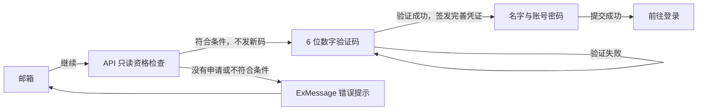
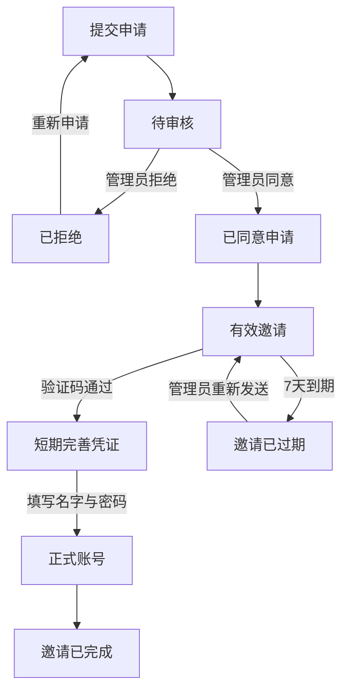

# 申请审核与邀请注册设计

> 迁移说明（2026-09-29）：本文件保留当时的业务与实现决定；其中旧 `apps/mock-server/` 路径、本地 SQLite Mock 与未来 PHP/MySQL 接管的基础设施描述，已由 `.notes/archive/server-promotion/specs/2026-09-29-server-promotion-design.md` 和 `.notes/archive/server-promotion/rfcs/server-postgresql-migration-rfc.md` 取代。当前唯一 Server 位于 `apps/server/`，使用独立 PostgreSQL `exre`；正文中的旧路径和目标仅作历史记录。

- 日期：2026-09-27
- 状态：完整修订已获用户确认；已交接既有 RFC
- 模块根目录：`.notes/archive/join-registration/`
- RFC 目录：`.notes/archive/join-registration/rfcs/`
- 范围：加入申请、临时管理员审核页、邀请验证码、注册完善，以及旧直接注册流程的统一切换。

## 1. 目标与范围

关闭直接开放注册，改为：提交申请 → 管理员同意 → 投递邀请邮件 → 验证邮箱验证码 → 完善注册 → 登录。

本期实现完整的本地 Mock 闭环。邀请邮件仍输出到 Mock Server 终端，保留正式邮件投递适配点；不接入真实邮件服务，不实现生产 PHP/MySQL。

普通登录和 SSO 登录的认证行为保持现状。登录组件中的加入入口、站点注册入口以及注册流程需要调整。注册完成不自动登录。

本次修订保留 NavBar 注册按钮与注册 Modal，独立 `/register` 页复用同一流程。邮箱步骤先通过只读 API 检查申请及注册资格，不发送或替换验证码；只有审核通过、尚未注册且邀请仍有效时才进入六位数字码步骤。本文同时纳入既有 RFC 已确认的修订：本期临时审核页和审核 API 不做身份验证或权限检查，不增加管理员 CLI 或权限系统。

## 2. 已确认的产品决定

| 项目         | 决定                                                                                               |
| ------------ | -------------------------------------------------------------------------------------------------- |
| 方案         | 申请与邀请分别保存状态，不扩展旧注册尝试来混合审核职责                                             |
| 加入页       | `/join` 是带站点导航的独立页面，不使用 Modal                                                       |
| 页面结构     | 左侧详细说明完整加入流程，右侧使用分步申请表单                                                     |
| 申请字段     | 邮箱、名字、QQ，全部必填                                                                           |
| 申请步骤     | 联系方式（邮箱）→ 基本信息（名字、QQ）→ 确认提交                                                   |
| 站点入口     | 保留桌面 NavBar 注册按钮和移动端注册选项，打开注册 Modal；已有 Join 导航保留                       |
| 登录入口     | “还没有账号？注册”改为“还没有账号？加入我们”，跳转 `/join`                                         |
| 审核入口     | 站内临时审核页，本期不做身份验证或权限检查；审核人不伪造为管理员                                   |
| 审核详情     | 从整页列表打开 Modal，包含“申请资料”和“审核与邀请”两个 Tab                                         |
| 邮件内容     | 同一封邮件包含注册链接和 6 位数字验证码                                                            |
| URL 参数     | `email` 是申请邮箱；`code` 就是 6 位数字验证码，不是长随机邀请令牌                                 |
| 注册状态 1   | 只填写邮箱，点击“继续”调用只读资格检查 API；成功后进入状态 1.1，不发送新码                         |
| 资格门槛     | 申请已同意、尚无正式账号，且存在未完成、未过期的有效邀请；检查结果不是完善注册凭证                 |
| 没有申请     | 停留邮箱步骤，用 `ExMessage.error` 提示“未找到该邮箱的申请，请先申请加入”                          |
| 注册状态 1.1 | 输入 6 位数字验证码，满 6 位自动校验，支持粘贴                                                     |
| 注册状态 2   | 只有数字码通过服务端验证后才进入；只提供名字、账号密码两个输入项，已验证邮箱作为不可编辑的文字显示 |
| QQ 与头像    | 账号 QQ 沿用获批申请中的 QQ；注册时头像为空，不提供头像输入                                        |
| 昵称规则     | 保持现状，不新增英文字符限制                                                                       |
| 完成注册     | 创建账号并完成邀请，显示成功提示，再前往登录                                                       |

## 3. 页面与组件

### 3.1 加入申请页

`/join` 位于站点布局中。说明区展示提交申请、等待审核、查收邀请、完善注册四个阶段，不承诺尚未确定的审核时长。

申请表三个步骤与完整加入流程分别标识，避免把填表步骤误认为审核阶段。前进时校验当前步骤，后退保留已填值；确认步骤显示邮箱、名字和 QQ，并允许返回修改。只有最后的“提交申请”写入服务端。

提交成功显示申请已收到、等待审核及查收邮箱的提示，不创建账号。刷新页面清空未提交的草稿，不把申请个人信息写入浏览器持久存储。

步骤、字段和校验按职责拆分，以便以后插入新步骤或字段；本期不显示空字段、不创建未定义的业务字段，也不实现通用表单编辑器。新增字段仍须先更新 Contract 和相应数据模型。

### 3.2 注册组件与完善流程

NavBar 注册按钮及移动端注册选项保留现有 Modal 入口。`/register` 仍是独立的邀请注册完善页，沿用认证页背景与容器，不呈现站点导航。Modal 与独立页复用同一个邀请注册流程和三份输入表单，容器只决定关闭与成功后的登录入口，不复制 API 或业务状态。

状态 1 只显示邮箱输入项、“继续”以及加入申请/登录入口，不提前显示名字、账号密码或数字码。用户点击“继续”后，先进行邮箱格式校验，再由应用层调用只读资格检查 API。该 API 只读申请、账号、有效邀请及发送冷却：不发邮件、不生成或消费数字码、不更新冷却或错误次数、不签发完善凭证、不创建账号。请求期间禁用重复提交；仅成功且邮箱上下文仍匹配时进入状态 1.1。

没有申请时停留状态 1，通过 `ExMessage.error` 显示“未找到该邮箱的申请，请先申请加入”。待审核、已拒绝、邀请缺失/过期或已有账号时同样停留状态 1，使用固定文案“该邮箱暂不符合注册条件，请确认申请已通过且邀请仍有效”，不返回申请资料或细分这些状态。页面保留前往 `/join` 和重试的入口。邮箱格式错误在 Form 字段中显示；网络失败提示“检查失败，请重试”，保留邮箱输入。

状态 1.1 显示目标邮箱和六位数字验证码 InputOTP；这里的数字码是邮件验证码，不是账号登录密码。支持前导零、粘贴，满六位自动提交一次验证；失败时留在本步骤，显示字段错误，允许更正或明确重试。只有验证 API 成功签发短期完善凭证后才进入状态 2，前端资格检查成功不能替代这项证明。

| 入口                            | 行为                                                                        |
| ------------------------------- | --------------------------------------------------------------------------- |
| 没有 `email`、`code`            | 状态 1，输入邮箱                                                            |
| 单个合法 `email`，没有 `code`   | 状态 1，预填邮箱；点击“继续”检查资格，通过后进入状态 1.1，不自动发送新码    |
| 单个合法 `email` 和 6 位 `code` | 读取并清除 URL 数字码后，先自动检查资格；通过后验证该码，验证成功进入状态 2 |
| URL 自动资格检查失败            | 留在状态 1，保留邮箱、丢弃捕获的数字码；按检查错误提示，不能继续提交该码    |
| 自动验证失败                    | 留在状态 1.1，清除已提交数字码，展示错误，允许重新输入或重发                |
| 只有 `code`，没有邮箱           | 不自动提交；移除数字码并显示状态 1                                          |
| 邮箱或验证码格式非法、参数重复  | 不自动提交，清除数字码并展示入口参数错误；允许重新填写邮箱                  |

页面读取 URL 中的数字码后，立即通过替换浏览器历史记录移除 `code`，再发起资格检查及后续验证请求；保留正常导航所需的邮箱上下文。整个自动检查与验证链必须去重，组件重渲染不得重复消耗验证码。

状态 1.1 默认使用审核邀请邮件中的原数字码；检查邮箱不会使它失效。只有用户明确点击“重新发送验证码”，才调用独立发码 API；重发沿用 60 秒冷却，并提示“如邮箱符合邀请条件，将发送验证码”，不宣称实际送达。发送失败或资格变化仍由验证 API 再次判定。验证码过期或已消费时可以重发，邀请资格过期只能由审核者重新签发邀请。

状态 1.1 可返回邮箱步骤。返回时丢弃数字码、完善凭证及密码，重新检查新邮箱；异步迟到响应不得推进旧邮箱流程或发送通知。状态 2 的名字从获批申请带入，可修改；密码没有确认密码输入。邮箱与完善凭证绑定，客户端不能修改账号邮箱。

验证成功后不立即创建账号。状态 2 依赖服务端签发的短期完善凭证；凭证与密码只留在内存。刷新或关闭后须重新验证邮箱。

完善提交成功后清空数字码、密码与完善凭证，显示注册成功。独立页提供“前往登录”，并在 1.5 秒后 replace 到 `/login`；Modal 提供同一动作，并在 1.5 秒后于原 Modal 切换到登录。只在内存中预填邮箱，不创建登录会话。关闭 Modal 恢复注册触发项焦点。

临时通知遵守 `.ai/rules/frontend-notifications.md`：统一使用 `ExMessage`，不增加宿主或直接调用 toast；邮箱/数字码格式和服务端字段错误仍使用 React Hook Form 的字段错误。注册请求进度优先在按钮和表单中显示，不重复弹出成功通知；完成注册的临时反馈使用 `ExMessage.info`。如采用 loading 通知，同一句柄负责成功、失败和取消，不能再重复发一条通知。

### 3.3 登录入口

登录 Modal 中点击“加入我们”关闭 Modal 后跳转 `/join`；独立登录页直接跳转。申请是普通站点流程，不把短期 SSO 请求绑定到持续数日的审核流程。既有普通登录、SSO 确认、会话保存和退出行为不变。

### 3.4 临时审核页

使用独立站内路由 `/admin/join-applications` 展示申请列表。提供待审核和全部申请视图、刷新及逐条查看详情，不实现批量审核、申请编辑、完整后台导航或通用身份组管理。

详情 Modal：

- “申请资料”：邮箱、名字、QQ、提交时间。未来申请字段按分组扩展。
- “审核与邀请”：审核状态、审核人、审核时间、邀请有效期、完成状态和最近投递结果。
- Tab 与底部操作区域固定，内容区可滚动。
- 待审核申请提供“同意并发送邀请”和“拒绝申请”。
- 已同意且未完成注册的申请提供重新发送邀请；已完成注册的申请不可再发送。
- 关闭后恢复原列表状态、滚动位置和触发项焦点。手机端仍以 Modal 展示，尺寸适配可视区域。

## 4. 业务状态与数据职责

申请记录保存申请资料和审核事实，状态为待审核、已同意、已拒绝。邀请记录关联已同意申请，管理验证资格、验证码、完善凭证及完成账号；投递结果与邀请资格分开保存。审核同意不等于邮件已投递，也不等于账号已创建。

同一规范化邮箱最多有一条待审核申请；重复提交不覆盖原资料。已同意但未注册的邮箱沿用既有申请，由管理员管理邀请，不产生第二条并行申请。拒绝后可提交新的申请，旧审核记录保留。已有正式账号的邮箱不能再次建号。

公开申请提交对重复申请和已有账号返回一致的接收提示，不公开已有账号或审核状态。申请阶段没有站内登录身份，不能由匿名提交修改既有申请或审核结果。

正式账号仅在完成注册的事务中创建。事务再次校验邀请与完善凭证、邮箱唯一性，并写入用户、完成邀请、消耗凭证。并发或重复请求只能创建一个账号；同一凭证的成功重试在其原有效期内返回相同完成结果，不创建登录会话。完成后保留到原到期时间的凭证摘要和成功结果，仅用于证明同一请求方的幂等重试，不能重新修改名字或密码。

账号名字采用完成表单的最终值，QQ 采用申请原值，头像为空。普通身份沿用当前隐含身份规则，不写入管理员成员关系。

## 5. 邀请、验证码与完善凭证

| 项目     | 规则                                                                                                       |
| -------- | ---------------------------------------------------------------------------------------------------------- |
| 邀请资格 | 从管理员签发邀请的数据库提交时间开始有效 7 天，不以邮件投递成功时间为准；验证码重发不延长它                |
| 数字码   | 随机生成的 6 位数字，允许前导零；10 分钟有效                                                               |
| 重发冷却 | 同一邮箱至少间隔 60 秒；审核首次发送、申请人主动重发及审核者重发共用冷却；邮箱“继续”只检查资格，不改变冷却 |
| 旧码     | 新码签发即失效，验证成功后也失效                                                                           |
| 错误窗口 | 从首次错误校验开始计算 10 分钟窗口，累计 5 次错误后暂停验证至窗口结束；重发不清零                          |
| 完善凭证 | 长随机不透明凭证，最长 30 分钟有效，且不超过邀请资格的截止时间                                             |
| 完善用途 | 只能读取绑定的初始名字和完成注册，不能登录或访问本人资料 API                                               |

验证码与完善凭证均只在数据库中保存摘要，数字码使用带服务端密钥的 HMAC，绑定具体邀请。只有当前有效邀请的正确数字码可以换取完善凭证。邮件链接和数字码提供同一邮箱访问证明，不作为两个独立验证因素。

一个邀请最多有一个当前有效的完善凭证；新的成功验证替换旧凭证。仅发送新码不会撤销已经签发的完善凭证。完成注册后，所有验证码与完善资格失效；已完成结果只供有限幂等重试。

过期邀请只能由管理员重新发出，新邀请重新获得 7 天有效期，并撤销旧邀请的验证码及未完成凭证；无需再次审核。有效邀请的普通重发只替换验证码。邀请到期后，申请人不能自行续期。

邮箱资格检查为公开的最小注册资格查询：没有申请时明确报错，其他不符合条件的情况合并报错；成功不返回申请 ID、名字、QQ、审核人或凭证。它不等于邮箱所有权证明，也不授予建号资格。验证码验证和完成注册都必须独立复核当时的业务条件。

申请人主动请求发码时，无邀请、未获批、邀请过期、已有账号等情况仍不公开具体状态；统一提示如邮箱符合邀请条件会发送验证码。验证接口使用固定、安全的错误文案，不返回申请详情或内部异常。

验证码过期不计作错误猜测；格式合法但与当前码不匹配的校验计入错误窗口。完成表单失败不会创建半成品账号；凭证仍有效时可重试，过期或被替换后须重新验证。

## 6. 投递与临时审核边界

管理员同意和邀请签发先提交数据库状态，再经注入的适配器投递。适配器接收收件邮箱、注册链接、数字码和有效期所需信息。注册链接以受控配置的站点基础 URL 构造，不使用请求 Host 头。本地实现只输出到 Mock Server 终端；服务端 HTTP 响应不返回数字码，页面只可读取申请人收到的链接参数。

投递失败保留已同意申请与邀请记录，并记录失败结果。审核页明确显示失败，允许冷却结束后重试；不能把审核回滚成待审核，或假称邮件已送达。每次投递有独立标识，迟到的投递结果不能覆盖更新一次投递的结果。适配器的原始异常只写服务端日志，不回显给申请人。正式适配器不得把验证码记入普通应用日志。

按既有 RFC 中已确认的后续修订，本期临时审核页和审核 API 不做身份验证或权限检查，operation 使用 `security: []`，审核人字段固定为 `null`；不增加管理员初始化、授予身份 CLI 或权限系统。Mock Server 维持现有回环监听范围。这里的“管理员/审核者”表示操作角色，不表示已实现的授权身份；后续权限系统需另行同步页面、服务端与 Contract。本地流程验收不证明生产权限实现。

注册链接中存在邮箱和数字码，浏览器清理参数只能减少后续暴露，不能清除邮件或原始入口请求的记录。未来部署方必须避免在访问日志、分析服务及 Referer 中收集验证码；真实邮件和生产部署不属于本期验收范围。

## 7. 分层与 Contract 切换

- `packages/components/`：加入表单步骤、邮箱表单、验证码表单、完善表单、认证 Modal、申请列表及带 Tab 的详情 Modal；通过 props 与回调工作，不调用 API、不保存浏览器凭证。
- `apps/web/`：路由、共享注册流程控制、URL 参数处理、生成 Client 调用、临时审核请求、短期完善凭证及成功后的登录切换。
- `apps/mock-server/`：申请服务、只读注册资格检查、临时审核、邀请与验证码生命周期、投递适配器及账号创建事务。
- `api/openapi.yaml`：定义新申请、审核、资格检查、发码、验证与完成注册 operation 的唯一 HTTP 契约。具体 HTTP 路径、DTO 和错误码由本模块 RFC 固化，不从组件反推。
- `packages/api-client/`：只重新生成类型并维持既有 Client 工厂边界。

所有 Form 使用 React Hook Form、Zod 和 ExUI Field；验证码采用既有 InputOTP 组件语义，Modal 和 Tab 使用已安装 ExUI 的公开组件。邮箱、昵称、QQ 和密码复用已核对的当前规则：邮箱 trim 并转小写；昵称 trim、1–32 个 Unicode 码点、不能含控制字符、允许重名；QQ 为 1–20 位数字；密码 8–64 个 Unicode 码点，不 trim 或归一化。

Contract 进行一次显式破坏性切换，版本由 `0.3.0` 升至 `0.4.0`。移除旧的 `startRegistration`、`resendRegistrationCode`、`cancelRegistration`、`verifyRegistration` 直接注册契约与对应 handler，不保留兼容别名或可绕过审批的实现。

旧未完成直接注册记录作废并清除密码哈希、验证码摘要等敏感材料；保留既有正式账号、资料、会话、SSO 及身份组关系。使用新增 migration，不重写 baseline、不自动 reset。

实现时先更新并评审 `.ai/databases/data-model.md`，再修改 schema/migration。服务启动仍只检查结构，不建表、不修复、不授予身份。所有 HTTP operation 经 Contract Glue 注册，并与 serviceHandlers 双向一致。

## 8. 验证与验收

设计草图用于确认交互结构，不证明真实浏览器、服务端或邮件交付通过。

后续实现须覆盖：

1. 申请三步前后切换、最终校验、重复提交、拒绝后重新申请。
2. 桌面与移动端注册入口保留，Modal/独立页共用邮箱 → 数字码 → 完善流程；无参数、仅邮箱、邮箱加数字码、重复或非法参数的行为；自动资格检查与验证链去重及数字码地址清理。
3. 资格检查无申请报错；待审核、拒绝、过期邀请及已有账号被阻止；成功不发码、不变更码/冷却/失败窗口、不返回申请资料或凭证；资格变化时验证与完善再次阻止非法建号。
4. 未获批不可换取完善资格，验证码到期、60 秒冷却、重发替换、累计错误窗口及一次消费。
5. 申请 QQ 沿用、名字可修改、邮箱不能替换、只有名字和密码输入、完成后不自动登录；Modal 切换登录及独立页导航正确。
6. 过期与被替换凭证、并发完成、响应丢失后的幂等重试、邮箱唯一性竞争及事务回滚。
7. 临时审核公开行为、审核人固定 null、重复审核冲突、投递失败保留审批和重试、Modal Tab 与关闭焦点恢复。
8. ExMessage 失败提示、字段错误、明确重试、迟到响应不通知、不推进流程，关闭容器清理敏感材料。
9. 旧注册接口不可用；现有账号登录、退出、本人资料和 SSO 无回归。
10. 每个新 operation 的 HTTP 响应及注册 handler 原始返回值均符合 Contract，operation 覆盖双向一致。

测试使用仓库 Vitest、Testing Library 和真实 Fastify inject 约定；夹具不得读写开发数据库。当前仓库没有 `TESTING.md`。正式验证顺序包括 `pnpm api:lint`、`pnpm api:generate`、`pnpm typecheck`、`pnpm test`、`pnpm build`，并单独检查桌面与移动端实际页面。

不把本地终端投递或模拟失败测试当作真实邮件送达验收。

## 9. 选择理由与范围排除

采用独立申请和邀请状态，是为了让人工审核、邮件投递、验证资格和账号创建各有明确职责；它比扩展旧注册尝试需要更多契约与数据变更，但避免把“填写密码后发码”与“获批后建号”混为同一生命周期。

未选择只用管理员临时发码，因为它不能保留可核对的申请与审核记录。未选择通用动态表单系统，因为本期只有三个申请字段，步骤组织已经满足后续扩展需要。

本次选择方案 A：只读资格检查与主动重发分开，保留 NavBar 注册 Modal，让申请人继续使用审核邮件中的原数字码。未选择“检查通过立即发码”的方案 B，因为它会让原码失效、重新触发投递与冷却，超出邮箱检查职责。明确提示没有申请意味着公开最小申请存在性与注册资格，这是本次交互的既定取舍；仅返回固定状态、通过现有限流控制查询频率，不开放申请资料查询。

本期排除真实邮件服务、生产 PHP/MySQL、权限系统、管理员 CLI、通用后台、批量审核、申请资料编辑、公开申请详情查询、注册时头像上传、第三方登录及昵称字符规则修改。

## 10. 仓库证据与设计草图

- `api/openapi.yaml`：当前 Contract 0.3.0、直接注册 operation、基础字段规则、登录与 SSO 分离。
- `apps/web/src/App.tsx`、`apps/web/src/auth/AuthFlow.tsx`、`apps/web/src/pages/AuthPage/index.tsx`：当前认证路由与流程。
- `packages/components/src/AuthArea.tsx`、`packages/components/src/SiteHeader.tsx`、`packages/components/src/auth/LoginForm.tsx`：桌面、移动端与登录表单的注册入口。
- `apps/mock-server/src/auth/service.ts`、`apps/mock-server/src/db/schema.ts`：当前验证码服务、账号事务、身份组数据及投递适配点。
- `.ai/rules/frontend-forms.md`、`.ai/architectures/web/authentication-flow.md`、`.ai/architectures/server/authentication-lifecycle.md`、`.ai/databases/data-model.md`：仓库边界和当前业务规则。
- `.ai/rules/frontend-notifications.md`：本次错误与完成通知的 ExMessage 接入规范。
- `tests/contract/auth.test.ts`、`.ai/architectures/contract-tests/test-layers.md`：HTTP 与原始 handler 双层测试约定。
- `.superpowers/brainstorm/336-1790245329/content/join-wizard-v2.html`：已确认的 Join 页分步布局。
- `.superpowers/brainstorm/336-1790245329/content/invited-registration-v2.html`：已确认的注册三状态草图。
- `.superpowers/brainstorm/372-1790495701/content/admin-review-tabs-v3.html`：已确认的详情 Modal 与 Tab 草图。

上述草图保留作为布局参考；注册入口、邮箱检查、URL 入口和通知行为以本文本次修订为准，旧草图不能覆盖新流程。

## 11. 后续交接

本次按用户确认的方案 A 修订设计，并同步更新既有 `.notes/archive/join-registration/rfcs/join-registration-rfc.md` 的注册入口、只读资格检查、通知及验证项，不再创建第二份 RFC。完整修订已获用户确认，以本文作为正式交接的产品范围来源；`technical-design-doc-creator` 已核对既有 RFC 的实施契约与本文一致。本次 brainstorming 交接完成，停在设计交付，不开始实现。

设计与草图不自动提交。设计结论在另行获得用户同意后才能提炼到 `.ai/`；当前不修改持久知识。
