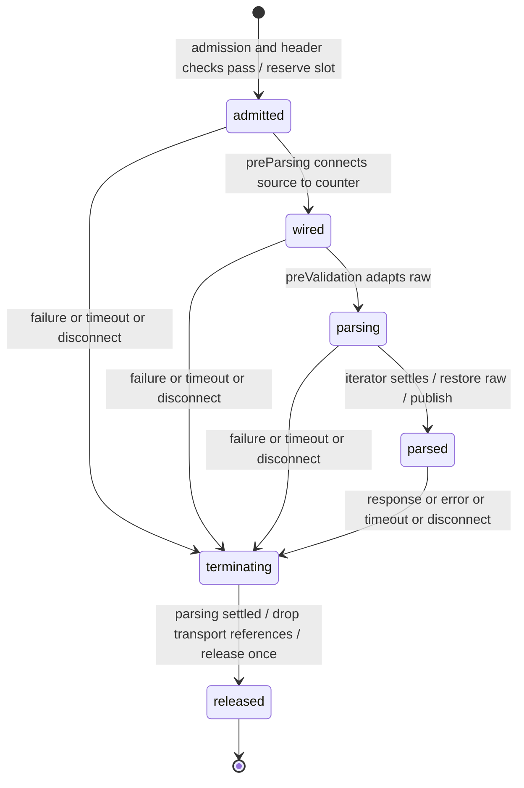

# Multipart 上传生命周期设计

推荐将两条上传路径的连接时序收进一个共同 implementation，保留独立 payload parser。收益是调用方不再维护 raw 适配、流连接、deadline、abort 与槽位释放之间的顺序，而不是仅减少重复行数。

## 候选身份与审批范围

- 版本：`v1.1`，日期：2026-10-11；替代 v1.0，旧版本由 Issue 附件保留。
- 源码基线：`cf6a81ac5b814faac40dd1ccee3f793a42c83b20`。
- 模块根：`.notes/multipart-upload-lifecycle/`；本文件是 architectural handoff spec，不是 RFC、PRD 或已接受 ADR。
- 状态：`DESIGN_REVIEW_REQUIRED`；v1.0 独立评审有条件通过，本次改动段落待 Reviewer 确认；用户未批准，`implementation_authorized=false`。
- 内容摘要：新增仅供加入申请和存储使用的 HTTP lifecycle module；每条 operation 独立容量、每请求私有 session；共同管理实际计数流、受控 parts/readFile、临时 raw、取消和幂等终结；各模块继续定义前置策略、解析规则、可信标记及错误分类。
- 提议审批范围：只覆盖 `submitJoinApplication` 与 `uploadStorageContent` 的上述结构调整和本文件列出的竞态保证、测试补充。包含提前终结响应的 Fastify hijack/Node 输出适配与 `apps/server/src/errors.ts` 内既有安全错误映射的共用提取；包含 join 在响应头已发出、尚未结束时，从尝试 send（可能抛 ERR_HTTP_HEADERS_SENT）改为停止 Fastify 链并销毁连接的可观察变化。没有其他子项目。
- 非范围：下载、COS 直传 prepare/complete、业务事务取消、数据库模型、路由/授权策略、SDK/Web UI、通用上传框架、依赖升级、部署。
- 本轮只写设计，不编写生产或测试实现，不生成 Contract、不提交或推送；未接受结论不写入 `.ai/`。

### v1.1 内容增补摘要

- 修正“response-issued 即可停止 Fastify”的错误推论：将正常错误交还 Fastify、外部提前终结接管响应分开，明确 hijack 的调用时机、统一 envelope 的输出方式与迟到 rejection 的消费。
- 将 join 的 headersSent 行为变化和提前终结时不执行普通发送 hooks 的边界列入审批范围；说明 hijack 清掉 Fastify 的 timer/abort 监听但不清 session 的原始连接监听。
- 明确 controller 独占 route.bodyLimit 赋值，调用方拥有预算求值/安全整数核验；补 UTF-8 字段名显式复核归 parser，以及 storage 容量测试须已认证。
- 方向 B、payload interface、预算、业务/授权和下载边界不变。以下关于 Fastify 的论证来自本机锁定版本读码，尚未执行运行验证。

## 证据与现状

已读 `AGENTS.md`、`.ai/README.md`、`README.md`、`.ai/architectures/runtime/runtime-boundaries.md`、`.ai/architectures/monica-team/workflow.md`、`.ai/architectures/overview.md` 和 `.ai/CONTEXT.md`。设计遵守 `.ai/architectures/server/request-lifecycle.md`、`.ai/knowledge/server/multipart-lifecycle-traps.md`、`.ai/knowledge/storage/lifecycle-traps.md` 以及 Contract 注册、原始 handler 输出两份 ADR。测试计划依据 `.ai/architectures/contract-tests/test-layers.md`；当前没有根 `TESTING.md`。

Issue 架构报告已通过附件 ID `01a12b00-d6b6-759e-9d3e-f0ba9d9b5d02` 下载并读取 multipart 部分。报告提出的是候选，不证明重复代码存在故障。

| 证据                                                                                              | 当前行为与设计影响                                                                                                                                                                                                                                                                                                                                          |
| ------------------------------------------------------------------------------------------------- | ----------------------------------------------------------------------------------------------------------------------------------------------------------------------------------------------------------------------------------------------------------------------------------------------------------------------------------------------------------- |
| `apps/server/src/domains/join/api/transport.ts`                                                   | `onRequest` 限流、boundary、容量、Content-Length 预检后占位；`preParsing` pipe；`preValidation` 临时 raw 与双层迭代；响应/错误/abort 各自释放                                                                                                                                                                                                               |
| `apps/server/src/modules/storage/api/transport.ts`                                                | 上传先 Bearer 验证，后 boundary/容量/长度；同样 pipe/raw/计时/释放；下载和非上传验证必须保持原位                                                                                                                                                                                                                                                            |
| `apps/server/src/http/shared/multipart-counter.ts`                                                | 已经具有 depth：计 wire 与 multipart header 预算、扫描 boundary；保留并由共同 implementation 使用                                                                                                                                                                                                                                                           |
| `apps/server/src/domains/join/api/handlers.ts`、`apps/server/src/modules/storage/api/handlers.ts` | getter 核对可信上下文后调用业务服务；body 字符串标记不代表文件字节                                                                                                                                                                                                                                                                                          |
| `api/openapi.yaml`、`api/paths/join.yaml`、`api/paths/storage.yaml`                               | 单一 HTTP Contract、operation 与 x-fastify-config 预算来源                                                                                                                                                                                                                                                                                                  |
| `apps/server/src/http/foundation.ts`、`apps/server/src/http/plugin.ts`、两模块 `api/plugin.ts`    | 应用级 multipart、共享 API 作用域、按 operation 筛选 hook、一次 Glue；不另注册路由                                                                                                                                                                                                                                                                          |
| 当前安装的 `@fastify/multipart` `10.1.2`                                                          | 实际源码 `const request = this.raw`，随后 `request.pipe(bb)`；request error/close 与文件 close 会结束迭代。必须使用现有 adapter 并保留真实 socket 验证                                                                                                                                                                                                      |
| 当前安装的 `fastify` `5.12.5`                                                                     | `lib/reply.js` 的 sent getter 是 hijacked 或 writableEnded，send 检查 sent、hijack 同步设置标记并拆框架 timer/abort；`lib/hooks.js` 的 hookIterator/preParsing runner、`lib/handle-request.js` 的 preValidation/preHandler callback 根据 sent 停止；`lib/wrap-thenable.js` 忽略 hijacked 的成功值，但迟到 rejection 仍可能记录原始错误，需由 lifecycle 消费 |

源文件 SHA256（完整值，供候选漂移核对）：

| 文件                                               | SHA256                                                             |
| -------------------------------------------------- | ------------------------------------------------------------------ |
| `apps/server/src/domains/join/api/transport.ts`    | `ba10f2df4cafd348bba974f07e4bdf09b80e9035389751b16d1354e6dc7d67e4` |
| `apps/server/src/modules/storage/api/transport.ts` | `73ed852182c852adea14966723e8174a5a1d0c67e40076fe128fc89dd3ebd039` |
| `apps/server/src/http/shared/multipart-counter.ts` | `c0762050975c850d4d09117844ac9a07b530778afce2c1e4df35476e857a8563` |
| `tests/contract/join-upload.test.ts`               | `44347619ed5655867dc6c70a6bf384f3e7c99078e1686182a3944f4a9ec6cb23` |
| `tests/contract/join-upload-sockets.test.ts`       | `571c002237e2090d37064052d25d683d4cbcb7fbda4a06f9ed790977b419d9c6` |
| `tests/contract/storage.test.ts`                   | `2d2221b47bc3808654d4c2a1145b3a5bfa7969255134fb524e483736877e988a` |
| `tests/contract/storage-sockets.test.ts`           | `fada84f77d192d1a08a59709034fedb6ad8cb88128d3dd521d666716ef399b72` |
| `api/paths/join.yaml`                              | `fe4b12f367df58ee6af18e48a3914cacb458e4376763db13955bcfc51d51d448` |
| `api/paths/storage.yaml`                           | `9677367fd99ecc3f3bf60957430aa21d3a40d28364a4599273bdfd30877d0348` |

安装的 multipart adapter SHA256 为 `a873ef07d6785cc7266041d409ab50ddad946ad113ae0b86ead636b3c54d3bee`。这是当前环境的读码证据，不代表 frozen install 已验证；本轮不改依赖树。实施时如锁定安装行为不同，必须重新核对取消与迭代终结，不修改 node_modules 来通过验收。

v1.1 新增响应适配证据 SHA256：

| 文件                                                     | SHA256                                                             |
| -------------------------------------------------------- | ------------------------------------------------------------------ |
| `apps/server/node_modules/fastify/lib/reply.js`          | `55c860c723df28a22bf051310c4688f0cfe962b4bc06ade17e6b818f52fdb1fb` |
| `apps/server/node_modules/fastify/lib/hooks.js`          | `02b428780d90101e5329e693121ebaf8bfe4a88f506ed1ae0d63687a774d5d67` |
| `apps/server/node_modules/fastify/lib/handle-request.js` | `e98cbe20b027674622456e4af53aa08fa064c8dd76a1cfe7b41fe60711d1ed71` |
| `apps/server/node_modules/fastify/lib/wrap-thenable.js`  | `23e41424f4a19f947c0fe58cb21ee3fa97d15917d7d6dc668f375d71d8bf786b` |
| `apps/server/src/errors.ts`                              | `39494853f64de114e89a4220939a0a2c30a78f4013318a53f8bc99c15c24bb52` |
| `apps/server/src/http/cors.ts`                           | `88b799cb91e9d917169c751738dbb43e02c0f3ea5f244c468aca60fb2ddf78f0` |

本次复核的九个上传源码/测试/Contract 指纹与 v1.0 全部一致。共享工作区其他模块已有未提交修改，不作为本候选的修改或验收证据；实施前按当时整体源码重新验证组装。

## 方案比较与深化收益

| 方案                                                        | 收益                                                                    | 成本与判断                                                                                    |
| ----------------------------------------------------------- | ----------------------------------------------------------------------- | --------------------------------------------------------------------------------------------- |
| A：维持现状                                                 | 无迁移风险；已有 counter 和真实连接测试；两份实现仍可独立维护           | 每次修改取消顺序都要核对两套 raw/timer/stream/buffer/slot；是可接受退路，不因重复就宣称有 bug |
| B：共同生命周期 implementation，独立 payload parser（推荐） | 时序知识有单一归属，两条真实 operation 共用一次修正；payload 变化仍局部 | 必须实证减少调用方时序，新增受控读取与终结状态；先迁移一条再迁移另一条，保留全部行为测试      |

不采用仅抽取 `release()`/`destroyUpload()` 的浅包装：它仍让调用方安排 raw 替换、timeout、错误响应与读取退出。不采用策略注册表/可插拔存储框架：只有两种既有 payload，第三方 parser、持久化驱动和下载没有进入此 seam 的证据。

Deletion test：删除拟议 module 后，两个 transport 必须重新知道 multipart 直接消费 raw、如何挂原始连接监听器、如何让等待中的 file/parts 迭代退出、何时恢复 raw、何时放弃 buffer、何时释放容量，以及 deadline 如何避免二次响应。这些知识不能由一个 `release` 转发函数承载。相反，字段顺序、proofs 标记、key 规则和认证仍可完整留在各调用方。

实施成功标准：两条上传分支均删除自身 `activeUploads`、`UploadContext` 的流/失败/计时字段、`destroyUpload`、raw 类型强转及 finally、pipe/source error listener、timer/abort/close listener、release 幂等旗标及 upload cleanup hooks。调用方仅保留配置核验、admission、payload parser 和 getter。若 caller 仍直接操纵 counter/raw 或手工 release，则 B 未实现 depth，不应为“复用”放行。

## Module、interface 与 seam

拟议位置为 `apps/server/src/http/shared/multipart-upload-lifecycle.ts`。它是现有 HTTP 接入层的内部实现，不增加业务插件、decorator 或公共 SDK。依赖方向是两个 transport → lifecycle → counter、Fastify/Node；lifecycle 不 import join/storage 服务、错误类或 DTO。Module 内部只有两类既有 payload 的参数化结果，不提供扩展插件系统。

对调用方的 interface（设计签名说明，不是生产实现）：

| interface                             | 责任                                                                                                                                                                                                    |
| ------------------------------------- | ------------------------------------------------------------------------------------------------------------------------------------------------------------------------------------------------------- |
| `createMultipartUploadLifecycle<T>()` | 每次 transport 注册创建一个 controller，拥有该 operation 的独立活动容量及私有请求 WeakMap；不能是进程级 singleton                                                                                       |
| `controller.attach(route, policy)`    | 在已经筛选出的上传 route 追加既有 hook，保留前序 Glue/consumer hook 顺序；独占 bodyLimit 赋值，并在内部包装既有 handler 以消费终结后的迟到结果/rejection；安装一次，保留 handler this、参数与正常返回值 |
| `controller.getParsed(request)`       | 无 session 时返回 undefined；失败/取消时抛已分类失败；只有 parsed 且未终结时返回可信 `T`；不创建上下文、不信任 body 标记                                                                                |
| `scope.parts(options)`                | 包装现有 `request.parts({ preservePath: true, limits })`；检查取消、跟踪当前文件，早退销毁未读文件；parser 不直接持有 raw/counter                                                                       |
| `scope.readFile(part.file, maxBytes)` | 按当前 payload 给出的有效字节上限读取，检查每 chunk 与 truncated，返回 Buffer；共同持有 chunks/活动流和取消检查，结束时丢弃 chunks 引用                                                                 |

`policy` 是固定的一组输入：wire/header limits、slots/deadline（来自既有受校验 config）、`admit(request, reply)`、`parse(request, scope)`、错误策略。`parse` 返回 `{ body, value: T }`，不直接发布 body/可信结果；module 在 raw 已还原且 session 活跃时一次发布两者。`admit` 只完成本模块已有认证或限流，不消费 body。错误策略含已有 `MultipartWireErrors`、busy/timeout 构造器及 parse/stream 错误分类器；不允许替换 timer、cleanup 或连接 adapter。

预算求值与配置一致性核验仍属调用方：join 将 Contract 的 wireBytes 传给 policy；storage 先计算 runtime maxBytes+wireOverheadBytes 并做 Number.isSafeInteger 核验，失败时拒绝注册。controller.attach 对已核验 wireBytes 设置一次 route.bodyLimit，两个 caller 不再赋值；controller 同时拒绝非正安全整数，不能接受无 bodyLimit 的注册。该值也是 Content-Length 和 counter 的同一预算，不能重新计算第二份上限。

`scope` 生命周期仅限 parse 回调；不得捕获到后台任务、并行读取 parts/file 或调用业务存储。取消检查由 scope 负责，不向 caller 暴露 `release/cancel/restoreRaw`。Parser 仍拥有字段去重、JSON 解码、文本格式、文件名及累计预算等业务知识；这是有意保留的 seam。

每请求捕获一次 deadline 值，计时从 admission 和 header 预检通过、占位成功时开始，一直保留到响应完成/失败/断开。注册时不要把可被现有测试覆盖的 route config deadline 提前冻结为另一份常量；测试对下一次请求恢复默认 deadline 的机制仍有效。

## 两种 payload 与真实调用路径

| 规则          | 加入申请                                                                                                                                        | 存储                                                                                                                                                                          |
| ------------- | ----------------------------------------------------------------------------------------------------------------------------------------------- | ----------------------------------------------------------------------------------------------------------------------------------------------------------------------------- |
| admission     | `invitationServices.limit(request.ip)` 恰好一次，先于读体；保留实际 IP 与代理规则                                                               | `authenticateBearer` 先于读体与传输校验；Glue preHandler 再复核，handler `requireSession` 保留                                                                                |
| 顺序          | no-store → limit → boundary → 容量 → Content-Length → 占位                                                                                      | no-store → Bearer → boundary → 容量 → Content-Length → 占位                                                                                                                   |
| payload       | 恰好一个 file part `application`，MIME application/json、严格 UTF-8/JSON；重复 file parts `proofs`；非文件、未知字段拒绝                        | `key/medium/contentType` 文本、任意顺序；恰好一个 `data` file；未知/重复、缺失或多文件拒绝                                                                                    |
| parser 预算   | 原 parts/files/fields、fileSize=max(fileBytes,jsonBytes)、名称/header 限额不变；每 part 保留 Buffer.byteLength(part.fieldname, 'utf8') 显式复核 | 原 parts=fields+files+1、files=files+1；保留第二文件由显式规则报 400 的行为；每 part 保留 Buffer.byteLength(part.fieldname, 'utf8') 显式复核，不能仅信任 busboy fieldNameSize |
| readFile 预算 | JSON 用 jsonBytes；proof 用 min(fileBytes, totalFileBytes-total)，成功后累计长度；proof 数仍单独检查                                            | data 用运行时 maxBytes；readTextField 及 key/medium/type 校验保留                                                                                                             |
| 可信结果      | parser 返回 normalized application、proofs；body 只发布 `join-proof-i`                                                                          | parser 返回 validated key/bytes/medium/type；body 只发布 `storage-content`                                                                                                    |
| 业务边界      | getter 核对标记顺序/数量；附件扩展名/签名、新玩家禁附件、事务保存仍由既有 service 校验                                                          | getter 核对标记与私有 bytes；filename 不选 key；显式 type > part type > octet-stream；service 选介质/写入                                                                     |

Join 成功路径：API plugin 按 operation 安装 controller → admission/占位 → preParsing source 经 counter → preValidation 适配 raw 并由 join parser 消费 scope → 恢复原 raw、发布 body/value → Contract validator → 注册的 `submitJoinApplication` → `getJoinProofs` → `joinServices.submit` → 原始结果、202 和 Contract 序列化 → onResponse 终结。

Storage 成功路径：相同 lifecycle hook 链，但 admission 先认证 → storage parser → 恢复 raw/发布 → Contract validator → Glue security → `uploadStorageContent` 的 requireSession/getStorageUpload → storage service.upload → 原始 `{ url }`、200 和序列化 → onResponse 终结。

保留 getter 的既有外部形状。Join 在直接 handler 调用中无 parser context 且 proofs=[] 的旧行为继续允许；非空伪造标记仍 BAD_REQUEST。Storage 无真实上下文一律拒绝。共同 module 不承担这些 fallback 与标记知识。

## 状态转换与资源归属

主状态只允许 `admitted → wired → parsing → parsed → terminating → released`，任一非终态可进入 terminating。占位前拒绝没有 session、不递减容量。内部记录首个失败、终结原因（正常响应/错误/timeout/abort/close）及 parse 是否仍在运行。终结请求一次锁定，后续事件只加入同一清理过程，不能覆盖失败或再减容量。

| 资源                                                                  | owner 与释放条件                                                                                                                             |
| --------------------------------------------------------------------- | -------------------------------------------------------------------------------------------------------------------------------------------- |
| 原 IncomingMessage、reply.raw                                         | Fastify/Node 拥有；session 只借用监听/响应。拒绝时停止消费、成功输出前不销毁原 socket；头已发送后 timeout 才终止连接                         |
| source、counter、当前 file、parts iterator                            | session 拥有连接/读取租约；失败 unpipe/pause，销毁 counter 和活动 file，使迭代退出；不把 source 等同于原 raw                                 |
| request.raw 临时替换                                                  | session 独占，进入 parse 时设置 counter.headers 并替换；正常 finally 或提前终结都恢复同一 original；恢复函数幂等，finally 不重新安装 counter |
| chunks 与 parser staging                                              | readFile 管当前 chunks；parser 局部组装 T，仅通过返回值发布。取消时清 chunks、拒绝读取、等待 parser unwind，拒绝迟到结果                     |
| parsed T 的 Buffer/Uint8Array 引用                                    | session 拥有 transport 引用，终结时丢弃整个 T；不把 byte array 清零或修改已交给业务服务的数组                                                |
| timer、source error/counter error、原 raw aborted、reply close 监听器 | session；终结时取消 timer/拆接入监听，流 error listener 保留到其销毁错误被消费，避免未处理 error；released 后全部卸除                        |
| slot、WeakMap entry                                                   | controller/session；只在 parse settled、raw 还原、transport 引用解除后单次减容量，删除 entry                                                 |

counter 内部扫描 pending buffer 在结束/销毁时也须解除引用；若现有 Transform.destroy 不清该字段，允许仅在 counter 的销毁实现补资源清理，不改变扫描算法或 wire 预算。不能宣称调用 destroy 就已证明 pending 不再被引用。

“清理 buffer”是解除 transport 持有的引用，不是立即 GC、内存清零或中止已开始的数据库/介质写入。handler 已交给 service 的 bytes/attachments 由既有业务调用持有直至其 settle；timeout/abort 不撤回既有事务，也不保证已写入对象被删除。这个现状边界必须保留，不能将失败响应描述为原子取消业务写入。

## 失败、中止与重复清理的顺序

共同终结入口必须同步完成以下前半段，再异步收束 parse：锁定 terminating/首个失败 → 停 timer，禁止发布 → source.unpipe(counter) 且 pause → 给等待中的 counter/file 注入已分类失败并 destroy（正常完成不注入失败）→ 立即恢复 request.raw → 按响应规则发错误/结束连接 → 等 scope/parser 完全 unwind → 清局部/parsed/counter 引用并拆监听 → 单次释放 slot 和 WeakMap。不能只 Promise.race 后丢弃仍在运行的 parser。

解析正常完成由唯一 try/finally 恢复 raw，随后检查状态与 failure，再发布；终结期间完成的 parse 必须被拒绝。scope 每次 next/yield/read 都检查状态；取消后插件迟到的 file 直接 destroy，不能新增 buffer 或继续业务校验。所有 early return/throw 走同一终结，不留独立释放分支。

raw 提前恢复的具体前提已核对：multipart 的 handleMultipart 不是 generator，`request.parts()` 调用时便捕获 `const request = this.raw` 并接 pipe；其内部继续持有 counter，因此恢复 FastifyRequest.raw 不会把插件读取转移回 original。销毁 counter/file 仍能结束同一个 parts 消费。不能把这一结论外推到未核对的依赖升级。

| 场景                                                               | 指定顺序与可观察结果                                                                                                                                                          |
| ------------------------------------------------------------------ | ----------------------------------------------------------------------------------------------------------------------------------------------------------------------------- |
| 认证/限流/boundary/长度/容量拒绝                                   | 不接 pipe、不调用 parts、不占 slot；原错误分类和前置次序不变                                                                                                                  |
| counter 在 parse 前失败                                            | 分类并锁定失败，停止 source、还原 raw，外部响应入口同步 hijack 后输出统一 envelope；后续 preValidation 不再消费 body；释放，不等不存在的 parser                               |
| 结构/JSON/字段/文件限额或 counter 在 parse 中失败                  | parser 主动发现的错误在 raw 恢复后由 preValidation 抛给 Fastify；counter 的外部 error 若先赢则 hijack 并输出统一 envelope，parse 退出被消费；两者共享响应归属，不能各发送一次 |
| stalled field / stalled file                                       | deadline 构造本路径 408，销毁 counter 及活动 file，恢复 raw 后立即发安全 envelope；不等待 socket 自然 EOF；slot 只在 parse unwind 后释放                                      |
| timeout 在部分 proof 已完成、下一文件/part 正等待时                | 已完成 staging 不发布；等待读取退出，丢弃 staging；后续 HTTP 上传必须成功，业务 submit/upload 不能被调用                                                                      |
| timeout 在 parsed/handler 阶段                                     | 原 raw 已恢复，丢弃 transport 引用并单次释放；统一错误或断连接；业务持有引用与可能完成的写入沿用现状，不能伪装已取消                                                          |
| 原 raw aborted / reply close                                       | 锁定终结，停止读体、恢复 raw；非正常响应完成的断开同步 hijack 以停止后续 hook，收束 parse 后释放；断开的连接不发送 JSON；不依赖已被替换的 request.raw 监听                    |
| Contract validator、Glue security 或 service 失败                  | onError 调共同终结，保留 Fastify 原错误和统一 envelope，不把所有业务错误改成 malformed；Connection: close 避免继续接受被拒 body                                               |
| timeout → 流 error → onError → close → onRequestAbort → onResponse | 首个失败稳定，终结 Promise/flag 共享，raw 恢复幂等、slot 只减一次；没有负数容量、二次 reply.send 或迟到成功发布                                                               |

### 停止 Fastify 链与唯一响应归属

session 将响应归属区分为尚未决定、Fastify 正常错误处理、外部终结接管；response-issued 只用于阻止本 module 重入，不能作为 Fastify 的停止机制。以下选择与动作都在第一次输出前同步完成，不把标记放在 send 返回之后。

1. 普通 admission/parser/Contract/Glue/service 错误继续 throw 给 Fastify。session 存在时，parser/handler wrapper 在发现错误、销毁流或抛错之前同步锁定正常错误归属并停自有 timer；其他框架错误由 controller 的 onError 做同一动作，再收束资源，不调用 reply.send、不 hijack。这样由既有 setErrorHandler 和发送 hooks 输出一次原错误 envelope，不能在 onError 内发第二份响应；不能等注入 destroy(error) 的事件回调先发出一份外部响应。
2. timer/counter error 在正常错误归属尚未锁定时先到，或非正常断开先到：先锁定外部归属与 response-issued，停流并恢复 original raw，再调用公开 reply.hijack()。这一步同步使 reply.sent=true，hookIterator/preParsing runner/preValidationCallback/preHandlerCallback 的停止守卫生效；无需等待 raw.writableEnded，尚未开始的校验/security/业务 handler 不继续执行。已经开始的异步操作只能消费迟到结果，不承诺取消。
3. 外部归属在 hijack 后不再调用 reply.send(Error) 或 reply.send(envelope)，因为 send 此时会直接返回。错误输出使用现有 Fastify/Node 的 raw 响应适配：`apps/server/src/errors.ts` 共用提取现有安全错误映射、固定消息、envelope、Retry-After 与安全日志分类，供原 setErrorHandler 和提前终结 adapter 使用；不复制错误表、不新增 envelope/DTO。controller 设置共享映射给出的 status，使用公开 reply.serialize(envelope) 获取本 route 的 Contract serializer 结果，再通过 reply.raw.writeHead/end 完成已接管的响应。
4. 写入前核对 raw.headersSent/writableEnded/destroyed 和 original.socket 可写状态。头未发且连接可写时，复用 reply.getHeaders() 中已设置的 X-Request-Id/CORS/Vary，并设置 no-store、Connection: close、application/json; charset=utf-8、准确 Content-Length 以及共享映射要求的 Retry-After；清掉先前 payload 的 Content-Length/Transfer-Encoding 后建立这份长度。头已发且未结束时只能 destroy；已结束/断开不写任何 body。序列化或 raw 写入失败只记录安全分类并 destroy，不回到 Fastify 再试一次发送。
5. 外部归属下 preValidation 捕获 parser rejection、完成 finally/清理后返回，不再 throw 到 Fastify；controller 的 handler wrapper 同样捕获已开始业务调用的迟到 rejection、解除自己引用并只做安全分类记录。正常归属下仍原样返回/抛错。不能让 wrap-thenable 把迟到异常的原始 message 写进日志；不能丢弃未观察的 Promise。它们没有额外 byte output，后续成功值也不能发布可信结果。

Fastify 正常错误归属一旦锁定，后到的 timer/counter error 只触发同一资源清理，不接管正在输出的正常错误；外部归属一旦锁定，后续 onError/abort/close/onResponse 只清理，不另发送。不要通过读取或写入 Fastify 私有 symbol 实现以上逻辑。

hijack 必须在 raw 还原之后调用：该版本会清 Fastify 自身 request timeout，拆 request.raw 的 kOnAbort close listener，并清 socket._meta；这些框架行为不代替 session 的清理。session 的 original.once('aborted', ownAbort) 和 reply.raw.once('close', ownClose) 是独立函数引用，hijack 不会移除它们；自有 timer 已停，监听保留至 parser unwind/单次释放。接管之后不依赖 Fastify onRequestAbort/onResponse 才能释放，ownClose 与终结 Promise 负责；正常发送仍使用原 hooks。

提前接管输出不走 Fastify 的 onError/preSerialization/onSend hooks，需明确作为异常路径变化验收。当前 CORS/请求 ID 在 foundation onRequest 已设置，controller 保留这些 header，Contract 仍用 reply.serialize；不得因跳过 hook 丢失安全响应头。未来新增必需发送 hook 时必须重新核对此 adapter。本设计不保留无限等待的异步发送 hook，也不将 hijack 后再 reply.send 作为解决方案。

停止链的保证限于尚未开始的阶段以及 session 内已观察的 parse/handler Promise，不能把 hijack 称为取消已经执行中的 onSend pipeline。当前生产代码仅 foundation 注册同步 onSend，没有 preSerialization hook；正常 JSON 结果从 handler settle 到 raw.end 的发送过程没有本项目新增的异步等待。若接管前已有普通发送 pipeline（例如以后新增异步发送 hook），禁止再输出替代 envelope，只能终止连接；其迟到 hook 与 Fastify onSendEnd 的安全退出须另行设计/验证，不能沿用本 spec 宣称全局“无二次发送”。这属于明确的 adapter 适用前提，不通过测试准备新增异步发送生产实现。

join 的可观察变化明确为：旧 !reply.sent 在 headersSent=true、writableEnded=false 时仍可能尝试发送并抛 ERR_HTTP_HEADERS_SENT；新方案停止 Fastify 后续链并 destroy 连接，不追加 JSON。storage 原有头已发则 destroy 的外部行为保留。首个失败不被后到 timeout 覆写、取消后禁止发布、解析完成后再放 slot 也是拟议竞态保证；这些机制有源码依据，但运行证据必须在获批实施后补齐，不声称现有测试已证明。

错误策略保留：join 已有 AuthError、插件 413 → JOIN_UPLOAD_TOO_LARGE、其余解析异常 → BAD_REQUEST；storage 已有 StorageError、插件 413 → STORAGE_TOO_LARGE、其余解析异常 → STORAGE_INVALID_INPUT。timeout 分别 JOIN_UPLOAD_TIMEOUT/STORAGE_TIMEOUT；busy 分别 JOIN_UPLOAD_BUSY/STORAGE_BUSY，Retry-After=5。非 multipart 为各自 415、非法 boundary 为各自 400。应用错误仍由 `apps/server/src/errors.ts` 输出固定安全消息；不新建 envelope，不回显 Node/SQL/SDK 原始消息。

## 兼容性与实施边界

- Join wire=67108864、JSON=65536、file=10485760、total=52428800、proofs=5、parts=6、slots=2、deadline=120000；名称/header 预算保持 Contract 值。
- Storage wire=运行时 maxBytes+65536，必须安全整数；fieldBytes=512、fields=3、files=1、名称/header/slots/deadline 保持 Contract 值。两条路径分别计容量，不做全站共同池，不提高缓存预算。
- Content-Length 预检不能取代 chunked counter；counter 必须在真实 parts 输入上。preservePath、header 扫描、文件字节/累计限额仍覆盖。
- route.bodyLimit、operationId、`api/operations.ts`、serviceHandlers 导出、API_PREFIX=/api、单次 Glue 注册、validator/serializer 与生成式 Client 不变；不改 Contract 或生成产物。
- bodyLimit 数值不变，赋值责任归 controller.attach；调用方保留预算求值/一致性和安全整数守卫。额外可观察错误路径变更为上述 join 头已发后 destroy 与两条上传的外部终结 hijack/raw 输出；普通成功和正常错误响应仍走 Fastify。
- onRoute 按现有 operation 分流；join 的下载/查询和 storage 的下载/prepare/complete 留在原 transport。内部 interface 不跨到 service，业务核心不依赖 HTTP。
- 不修改账号、IP、代理信任、数据库或存储授权。存储认证在计时占位前的现有行为保留；异步认证自身无新增上传 deadline。

## 获批后的迁移顺序与退路

1. 独立 Reviewer 确认 v1.1 的改动段落及摘要后交 Lead；Lead 提交具体版本给用户。记录用户原始批准来源与范围后才由 Engineer 实施；任何结构/响应实质变更重新核对。
2. Engineer 核对同一源码与 adapter 基线，读取 TESTING.md（届时如存在）/既有测试约定。先保留原测试，并建立下表缺口用例；不得降低旧断言来适配重构。
3. 加共同 lifecycle 与受控 file 读取，先迁移 join 上传分支；其下载/查询不动。验证 join payload、socket、原始输出。storage 此时继续旧路径，不共用半迁移状态。
4. 迁移 storage 上传，保留 key/text/media/parser limits 与认证链；验证两条独立容量和 storage socket/HTTP/原始输出，再删除两份上传时序实现。
5. 检查 deletion test、source/adapter 归属与失败清理；运行必要完整检查，独立代码复审及按风险测试后交 Lead。知识只能在结论被接受、行为验证后按 `codebase-documenter` 更新相关 `.ai/`，不复制本 spec。

退路为按 operation 恢复原 transport，保留原 counter/Contract/业务 service。无需数据迁移、运行时双写或特性开关；不让同请求两套生命周期同时拥有 slot/raw。Git 操作由 Engineer 按届时授权执行，本设计没有提交/推送授权。

## 测试保留与补充计划

| 测试面                                                      | 保留的证据入口                                                    | 必须补充的行为断言                                                                                                                                                                                                           |
| ----------------------------------------------------------- | ----------------------------------------------------------------- | ---------------------------------------------------------------------------------------------------------------------------------------------------------------------------------------------------------------------------- |
| join payload、字节、预算、UTF-8/MIME/签名/原名、真实 Client | `tests/contract/join-upload.test.ts` 全部                         | 不削弱已有 exact-limit 和 rollback 重试；原始 submit 输出成功样例补从真实 parser context 获取的断言                                                                                                                          |
| join 真实连接                                               | `tests/contract/join-upload-sockets.test.ts` 全部，含下载独立性   | 部分 proof 已完成后 stalled file/part；timeout/abort 与 close/error 同时触发后重试；观察 raw 恢复及无迟到业务调用                                                                                                            |
| storage payload/前置认证/伪造标记、Nginx 边界、真实 HTTP    | `tests/contract/storage.test.ts` 全部                             | 直接 handler 无 context 且伪造 data 明确 STORAGE_INVALID_INPUT；现有伪造 HTTP 用例只有 >=400，不能当作 getter 充分证据                                                                                                       |
| storage 真实连接                                            | `tests/contract/storage-sockets.test.ts` 全部，下载用例保留       | chunked 无 Content-Length 恰好 wire 与 +1；截断、主动 abort、parser/adapter 失败后真实成功上传；容量满第三请求携带有效 Bearer、只发 headers 即 503（未认证请求仍先401）                                                      |
| readFile/parts 挂起及取消                                   | 两条真实 operation，各用缩短测试 deadline                         | stalled 文本、文件内、两 part 之间；清理多次后仍仅两 slot，填满再第三个拒绝，确保过量释放没有扩大容量                                                                                                                        |
| admission 先于读体                                          | 保留 storage 401、join IP 429 原用例                              | 真实 socket 只 flushHeaders 不送 body，未认证 storage 立即401、耗尽 join IP预算立即429；业务调用=0，之后合法请求仍成功                                                                                                       |
| raw 与资源                                                  | 原 socket 成功/失败后重试                                         | 以测试 hook 保存 onRequest 的 raw，晚于 transport 的 onError/onResponse 核对对象 identity；timeout/abort 的 observer 核对原 raw；没有未处理 stream error/悬挂迭代；transport getter 终结后不能拿到 bytes                     |
| 成功原始 handler 输出与 schema 反例                         | 原 join query/detail 与 storage prepare/complete 原始输出断言保留 | 对两条上传 operation 在测试 onRoute 中包装 Glue 已登记 handler，调用原 handler 一次并捕获其 await 返回值，在 serializer 前用 Contract schema 校验，断言准确 key 集合；不通过伪造成功 session 或重复执行业务 handler 验证     |
| v1.1 响应归属/停止链                                        | 两条真实 socket operation 的 timeout/counter/abort 用例           | counter 在 parsing=false 窗口失败及 timeout 在 parse 内失败后，后续 preValidation/preHandler/业务未启动；终结先到后的 parse/service rejection 被消费、无二次 envelope 或原始异常泄漏；普通错误先到仍只有既有 envelope        |
| v1.1 头已发后的变化与 header 保留                           | 真实 socket、测试侧控制响应写入/异步业务 barrier                  | join headersSent=true 且 writableEnded=false 时终结只关闭连接，不触发 ERR_HTTP_HEADERS_SENT/追加 JSON；提前接管的408/413仍符合 Contract、no-store、X-Request-Id、CORS/Vary，单次槽位回收后成功重试；正常请求的 onSend 仍执行 |

测试应从真实 multipart 流和两种业务调用路径进入，helper mock 只能补特殊事件交错，不能替代真实 socket/HTTP。资源释放不靠 heap 数字或 GC 时间判定；用 session 生命周期可观察结果、后续合法上传及满容量拒绝证明，禁止为测试增加生产 HTTP 诊断入口。

时序用可观察 hook/barrier 控制，短 deadline 仅用于挂起请求；成功重试恢复 Contract deadline。覆盖 timeout 后迟到 chunk/part、重复清理、handler 已进入后的 timeout（不声明事务取消），并检查 failed request 不启动尚未开始的 service 调用。

实施验收需要 `pnpm typecheck`、相关 Contract/socket 测试和项目要求的 `pnpm test`、`pnpm build`；Contract 无变化仍核对 operation 双向一致及生成产物无内容漂移。数据库测试只用 Testcontainers/逐例 schema，Docker 不可用明确 FAIL，不改用开发库。Nginx 用既有隔离夹具；不启动或改动用户的 runtime。

## 自主决定、风险与证据缺口

- 已自主选 B、内部 HTTP module、controller 按 operation 独立、固定 policy、私有 session、raw 幂等恢复、parse unwind 后释放。这些是本次提议，均尚未批准。
- 假设 scope 的 parse 回调只执行既有流消费和同步 payload 校验，不执行外部 await/业务写入；通过 interface、评审及调用方代码保证。若出现永久不 settle 的第三方迭代，不以释放 slot 掩盖漏流，应判迁移失败、保留 A。
- 当前安装 adapter 的错误/close 终结路径已读，但 clean install、真实取消调度及 response 竞争本轮均未执行验证。不能仅据 destroy API 推断所有 pending iterator 已完成。
- 两种 payload 的 Buffer 类型和 storage Uint8Array 对服务保持兼容；若复用 Buffer 可消除 storage 的额外复制，需先验证 adapter 不依赖具体构造类型，不把该优化作为本设计必做项。
- 两条 controller 合计仍允许各自两份上传。业务已接手后延续现有资源与写入语义；没有进程总内存硬上限或 timeout 事务回滚承诺。
- 实证收益门槛是 caller 删除时序知识、两条 socket 失败后恢复以及旧行为完整保留。缺其中一项就不能称深化成功；不预报性能提升。
- 文档内占位/一致性/范围/歧义自检已完成；这不是独立评审 PASS。自动测试、真实浏览器、部署验收均 `NOT_EXECUTED`。无 UI 变化，不要求交互 Demo；不开展部署。

下一位 owner 为独立 Reviewer：核对 interface 是否仍泄漏时序、取消/响应/parse unwind 是否可实现、预算/错误兼容、测试缺口及证据基线；通过后由 Reviewer 有效交接 Lead 提交用户核对。作者不得自行批准或启动实施。
