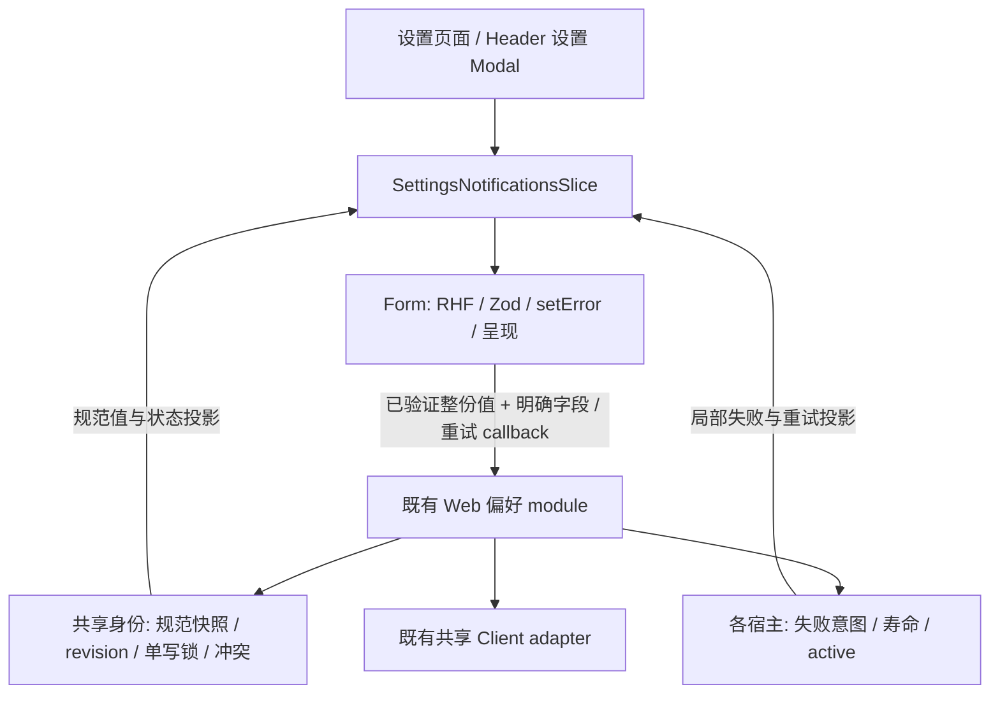

# 通知偏好即时保存编排设计 v1

状态：**DESIGN_REVIEW_REQUIRED**。候选版本：`notification-preferences-v1`。日期：2026-10-11。源码基线：`cf6a81ac5b814faac40dd1ccee3f793a42c83b20`。用户设计批准来源：`none`；开发未授权。模块根目录：`.notes/notification-preferences/`，按调用方明确指定的 module 解析。本文是 `brainstorming --handoff --module=notification-preferences` 的 architectural 设计产物，不是已接受 ADR 或实施授权。

建议深化既有 Web 偏好 module：它同时拥有规范快照、字段保存意图、失败重试、revision、冲突恢复、共享单写锁及身份接受权。Form 仅校验与呈现字段，设置宿主仅选择分类和传递 slice。保留两种寿命：共享写入跨关闭结算；失败意图属于发起它的设置宿主，跨切分类保留，关闭并卸载后清除，不转交另一宿主。

## 1. 证据与问题

这是一项内部结构调整。未复现现有功能缺陷，不以修复 bug 为理由改变交互。扫描附件只能支持探索方向，不能代表方案被批准。

| 当前证据                                                                                       | 当前职责或缺口                                                                                                           |
| ---------------------------------------------------------------------------------------------- | ------------------------------------------------------------------------------------------------------------------------ |
| `packages/components/src/notifications/NotificationPreferencesForm.tsx:40`                     | `confirmed`、`failed`、局部提交 guard 与 `saveField` 共同处理回退和重试；Form 必须理解失败字段与最新另一字段的合并规则。 |
| `apps/web/src/notifications/useNotificationPreferencesController.ts:76`                        | `save` 接收整份 draft；共享 runtime 处理 PUT、revision、409 重读和身份接受权，却不知道本次只意图改变哪个字段。           |
| `packages/components/src/SettingsPanel.tsx:30`                                                 | `SettingsNotificationsSlice` 是既有 seam；组件通过 props/callback 接入 Web，不访问 API。                                 |
| `packages/components/src/SettingsPanel.tsx:150`                                                | 通知 Form 始终挂载，`active` 只控制可见性。切分类保留局部意图；Modal 关闭时整个设置实例卸载。                            |
| `apps/web/src/settings/SettingsExperience.tsx:22`                                              | 页面和 Modal 各拥有一个 controller，进入对应来源才读取；effect cleanup 清除 entered 标记以支持 StrictMode。              |
| `NotificationPreferencesForm.test.tsx:52`、`useNotificationPreferencesController.test.tsx:257` | 两端分别 mock callback 或 Client，已有重要回归；未见真实 Form/controller 共同覆盖失败后另一宿主更新规范值的测试。        |
| `apps/web/src/settings/SettingsExperience.test.tsx:24`                                         | mock 整个 `SettingsPanel`，能验证分区读取，不能证明真实 Form 与 controller 的保存联动。                                  |

文件名为简写的两项测试位于上述 Form/controller 相同目录。完整源码文件摘要与 SHA256 见同目录 `2026-10-11-notification-preferences-baseline-v1.json`；摘要用于审查候选的一致性，不充当测试结果。

已读取 `AGENTS.md`、`.ai/README.md`、`.ai/CONTEXT.md`、`.ai/architectures/overview.md`、`.ai/architectures/monica-team/workflow.md`、`.ai/architectures/runtime/runtime-boundaries.md`、`.ai/knowledge/notifications/request-lifecycle.md`、`.ai/rules/frontend-forms.md`、`.ai/rules/frontend-notifications.md`、`.ai/decisions/web/04-settings-state-separate-from-auth-context.md`、`.ai/architectures/contract-tests/test-layers.md` 和 `README.md`。根目录无 `TESTING.md`，以后执行验证沿用现有 runner。相关 Web/components 目录未发现子级 `AGENTS.md`。未修改 Outline 或 docs。

## 2. 方案比较与收益

| 方向                                           | depth / locality                                                                                 | 成本与取舍                                                                                                      |
| ---------------------------------------------- | ------------------------------------------------------------------------------------------------ | --------------------------------------------------------------------------------------------------------------- |
| 维持现状                                       | 已有共享锁与身份保护有 depth；保存行为仍要求同时理解 Form 与 controller。                        | 无迁移风险，但新增字段或恢复路径仍要协调两处编排，联动测试缺口仍需补。可作为收益未实现时的回退。                |
| **深化既有 Web module（推荐）**                | 单字段意图、最新规范值与 revision 在同一个保存边界组合；两宿主通过同一 interface 获得 leverage。 | slice 增加明确字段意图与局部失败投影；需迁移测试 callback，并保留宿主寿命。实现文件可以增长，但调用方知识减少。 |
| 在 UI 包抽出“通用即时保存”或把失败意图全局共享 | 抽 UI helper 仍无法独立掌握 Web revision/身份；全局失败意图让另一宿主获得不属于它的重试。        | 引入新的 shallow module 或改变错误/关闭交互；没有当前需求支持，排除。                                           |

depth 的验收不以文件变短为标准：删除 Form 的 `confirmed`/`failed` 编排后，单字段重试、规范回退、409 恢复仍由 module 独立完成。locality 的验收是修改这些策略仅需定位偏好 module；Form 的改动应只涉及字段 schema 和展示。保留 RHF 自身的 `isSubmitting` 与实例 guard 不构成另一份 HTTP 写锁。

## 3. 职责、依赖与范围

module 仍是 `apps/web/src/notifications/useNotificationPreferencesController.ts` 及其私有 runtime；首版不新增 service factory、通用 store、事件总线或第二份偏好缓存。`notificationsConfig.preferences.snapshot` 仍是规范快照唯一来源，其类型继续从 `@workspace/api-client` 生成 schema 派生。controller 内增加宿主 slot，与现有共享 runtime 协作；不要把 UI 包依赖反向引入 API Client。

| 所有者                                 | 拥有                                                                                                 | 不向调用方泄漏的实现知识                                                  |
| -------------------------------------- | ---------------------------------------------------------------------------------------------------- | ------------------------------------------------------------------------- |
| Web 偏好 module / 共享身份资源         | 规范快照、读取状态、读接受权、独立 writeVersion、单 PUT run、共享 conflict、是否仍需冲突后规范读取。 | `expectedRevision`、readId、run 身份、409 分类、锁释放和旧 finally 规则。 |
| Web 偏好 module / 每宿主 slot          | 当前身份、存活代次、active 投影、原字段/目标值失败意图、失败标识。                                   | 失败何时失效、如何构造重试、重试如何采用最新另一字段。                    |
| Form                                   | RHF/Zod、全部字段校验、临时待验证值、`setError`、错误文本与控件呈现、实例级异步回调保护。            | 不保存 confirmed 副本、失败字段或 revision；不处理 HTTP 分类。            |
| `SettingsExperience` / `SettingsPanel` | 分类、来源读取触发、slice 的透传、Form 可见性。                                                      | 不编排保存和重试，不复制 module 规则。                                    |
| 共享 Client adapter                    | 已有 `api.GET` / `api.PUT`，transport 与会话绑定。                                                   | 无新增 wrapper；两种请求继续 `alert: false`。                             |

AuthContext 仅提供现有认证能力；偏好不并入资料缓存，不刷新顶栏资料。偏好 writeVersion 不采用收件已读/清理的 seq，不改它们的 API 或流程。Contract、Server、数据库、生成 Client 均不变。必要服务通知继续固定且无开关。成功采用服务器规范值，无成功 ExMessage；持续错误与保存中仍在现有 Form 展示。



## 4. interface：调用方只表达字段意图并验证

下列 TypeScript 只定义设计 interface，不是生产实现。`Draft` 沿用现有 `NotificationPreferencesDraft` UI 输入类型；它不是新的 HTTP DTO。其字段继续是两个 boolean。

```ts
type PreferenceField = keyof NotificationPreferencesDraft
type CanonicalFormValues = NotificationPreferencesDraft | null

interface PreferenceSaveFailure {
  kind: 'save-failed'
  retryValues: NotificationPreferencesDraft
  onRetrySave: (validated: NotificationPreferencesDraft) => Promise<CanonicalFormValues>
}

interface PreferenceFormBinding {
  identityEpoch: number
  saved: NotificationPreferencesDraft | null
  status: 'idle' | 'loading' | 'ready' | 'error'
  saving: boolean
  conflict: boolean
  failure: PreferenceSaveFailure | null
  onRetryRead: () => void
  onSaveField: (
    field: PreferenceField,
    validated: NotificationPreferencesDraft,
  ) => Promise<CanonicalFormValues>
}
```

`SettingsNotificationsSlice` 使用这些语义，沿用当前字段 `preferences` 映射 Form 的 `saved`；保留必要类别只读信息。旧整份 `onSave(draft)` 被 `onSaveField(field, validated)` 替代；旧 `onRetry` 明确为读取重试。`message` 目前不在 Form 渲染中使用，可随此次 interface 原子迁移删除，安全冲突/保存文案由 Form 固定呈现。没有生产消费方的 `onRefresh` 与 controller `refresh` 从公开 binding 删除，读取重试与用户新调整分别承担恢复职责；不添加“刷新”按钮。仓库检索只发现 slice 定义与 controller 提供方，迁移时仍重新检索。

`onSaveField` 只把 `validated[field]` 当作本次意图值，另一字段在 module 取得锁的同一同步段内从最新规范快照取值；读取该快照的 revision 并立即发送完整 PUT body。Form 为新切换构造临时候选 `{...saved, [field]: value}`，经 `handleSubmit` 和完整 Zod schema 校验后调用它。这是 UI 输入组装，失败意图的保存与规范快照合并策略归 module。

重试按钮不记忆原字段：Form 将 module 投影的 `failure.retryValues` 放入 RHF，经同一完整 schema 校验，调用该 failure 的 `onRetrySave(validated)`。callback 闭包绑定失败标识、宿主存活代次与身份；module 验证它仍是当前失败，且 `validated[原字段]` 等于原目标值，再在同步取得锁时重新读取最新规范快照。旧 retryValues 的另一字段即使过时也不会写入；不从 values diff 猜测字段，不保存整份旧 body，不沿用旧 revision。

当前 Zod 规则仅逐字段 boolean，没有跨字段约束；来自已接受 Contract 响应的最新另一字段也满足该规则。因此“整份输入先 Zod 校验”和“发送时最新规范快照合入原字段”一致。如果以后加入跨字段约束，必须同步重新设计此 seam 的验证与重基规则，不能无声沿用本设计。

Promise 结算值只用于 RHF reset：成功返回已接受服务器规范值；普通失败返回 module 当前规范值；409 重读成功返回新规范值；失去宿主/身份接受权或无法得到可用规范值返回 `null`。预期 HTTP 失败由 module 转为共享状态或局部 failure，不以抛异常要求 Form 分类。同步竞争被拒绝时，在仍属于该活宿主/身份且有可用规范值的前提下返回规范值，否则 `null`，不新建 failure。Form 不以返回值推断业务成功、不合并规范值，只将非 null 返回值再次按 schema 解析并 reset；规范快照投影始终是长期来源。

Form 依 `failure.kind` 用 `setError('root.server', 固定文案)`，root 错误不另建 useState；恢复或重试时依 failure 投影清除。failure 投影对象在失败标识和规范输入未变化时保持稳定；新失败产生新对象，避免瞬时失败被批处理后丢失错误 effect。reset 不无条件清除 root 错误，须与最新 failure 投影协调。异步返回只在原 Form 实例、identityEpoch 与局部提交 guard 仍有效时 reset；仍以 `key={identityEpoch}` 创建 RHF 所有者。局部 guard 只压住同一事件周期的重复验证，不拥有跨宿主 HTTP 锁。

`useNotificationPreferencesController` 接收当前 `active`，由 `SettingsExperience` 从分类投影；它不能触发加载或保存。分类变为 inactive 时既不卸载 slot，也不清失败，但尚未发送且仍在 RHF 异步校验中的提交不再发送。已发送 PUT 不受 active 影响。两个设置宿主不需掌握 epoch/run/readId 的操作方法。

## 5. 状态归属与寿命

宿主 slot 使用 controller 私有 Valtio proxy，hook 订阅其状态；runtime 登记活 slot 以便身份变化和 409 时清空全部失败。卸载时移出登记集合并清空局部意图，避免保留已关闭 Modal 的失败；在途 PUT run 可暂时持有原 slot 引用，但只能结算共享资源，结算后释放。slot 不放进 localStorage，不进入 AuthContext，也不成为第二份规范快照。

| 事件                                  | 共享资源                                                       | 发起宿主失败意图                                          |
| ------------------------------------- | -------------------------------------------------------------- | --------------------------------------------------------- |
| 切设置分类，Form `active=false`       | PUT/GET 既有接受权继续；不自动提交。                           | 保留，返回通知分类时仍可重试。                            |
| 新字段事件成功获得写锁                | 同步占用唯一 run，禁用所有宿主开关；失效旧读。                 | 清除此宿主旧失败，以新字段事件替代；其他宿主失败保留。    |
| 普通失败且身份仍有效                  | 不修改规范快照，释放当前 run；显示确认值。                     | 仅原活宿主保存本次字段/目标值；关闭的宿主不建立 failure。 |
| 另一宿主成功保存或已接受 GET 改变快照 | 全宿主采用新规范值。                                           | 保留原字段意图；retryValues 的另一字段随规范值投影更新。  |
| 409                                   | 共享 conflict=true，进入必须重读阶段；不自动 PUT。             | 全部宿主立即清除，防止任何旧意图跨冲突重发。              |
| Modal 关闭 / 页面离开导致卸载         | 已发送 PUT 的 run 不释放、不取消；其返回仍能更新同一身份缓存。 | 清除且不转移；重新打开产生新 slot。                       |
| 换号、退出、SESSION_INVALID           | epoch 递增，规范快照及共享 run 接受权失效。                    | 全部清除；旧 callback 不能写入新身份。                    |

同一身份最多一个在途偏好 PUT，不排队、不自动合并连点。新账号可以开始自己的 PUT，而旧账号网络请求仍在途；旧请求不得影响新账号逻辑锁。这符合现有身份隔离，不能把物理网络并发误称共享单写锁违规。

假设：产品当前没有“关闭后再打开仍恢复失败重试”或“另一宿主接管重试”的要求。源码的局部 ref 和 Form/Modal 挂载边界支持这个选择。若要求跨关闭/跨宿主接管，应视为交互寿命变化，重开受影响设计审批，不能作为本次内部重构顺带实现。

## 6. 请求、冲突与接受权

### 6.1 发送与结算

读取沿用独立 readId/writeVersion，普通 GET latest-wins。保存入口在任何 await 之前核验当前 token、认证、captured epoch、宿主存活代次、active、ready 规范快照、无需冲突重读与共享 run 为空。随后组合 body、占锁、递增 writeVersion/readId，并以 `alert:false` 调用既有 `api.PUT('/notification-preferences', ...)`。

run 持有身份 epoch 和唯一对象身份；不以宿主 mounted 作为共享结算条件。共享写响应、错误处理与 finally 必须同时满足 `notificationsConfig.epoch === run.epoch` 和 `runtime.save === run`；局部 failure/返回值另需宿主仍活、相同 epoch 和相同存活代次。成功结算前再次失效已开始的 GET；API 响应是规范值，不假定等于提交目标。普通错误保持最近已确认快照和固定安全文案，不回显 `error.message`。

SESSION_INVALID 也先通过原 run/read 的身份接受检查，才可调用现有 `invalidateSession`；旧身份 401 不能令新账号退出。只有当前 run 的 finally 能释放共享锁。RHF 旧 handleSubmit finally 只能更新其旧实例，不能清新账号 isSubmitting。

### 6.2 409 与重读失败恢复

1. 在同一接受段设置共享 conflict，清空全宿主失败意图，记录内部 `needsCanonicalRead=true`。拒绝所有 PUT，直到接受冲突后的规范读取。冲突本身不是可重试写失败。
2. 原 PUT 保持锁，启动 module-owned GET；其接受权不依赖原宿主继续挂载。该读取拥有当前 epoch/readId/writeVersion。同一阶段其他 `load` 调用加入该读取 Promise，不抢走其 owner 或解除错误门控；这里仅协调偏好冲突读取，不建立通用请求去重框架。
3. GET 成功：采用新规范快照，`needsCanonicalRead=false`、status=ready，保留 conflict 提示；PUT finally 释放锁。用户看到新值并重新切换，才产生新字段意图和新 PUT。
4. GET 普通失败：status=error，保留缓存仅供内部参考，`needsCanonicalRead` 仍为 true；PUT finally 释放锁。界面沿用“通知设置暂时无法读取 / 重试通知设置”，不展示可操作旧开关或“重试保存”。
5. 读重试只 GET；成功后清 needsCanonicalRead，恢复新值与冲突提示，不自动 PUT、不恢复原失败意图。恢复 GET 同样由 module 拥有，可跨发起宿主关闭结算。失败继续 error，退出/换号按 epoch 清空。
6. 冲突提示在下一次有效新字段意图取得锁时清除；普通读重试不把用户未重新调整解释成写批准。

module-owned 的冲突/恢复读取不能因普通宿主卸载而被 `discardOwnedReads` 恢复成旧缓存 ready。普通 GET 原宿主卸载仍沿用当前策略：有缓存恢复 ready，无缓存提供 error/retry；若仍 needsCanonicalRead 则始终保留 error/必要重读资格，不使用缓存恢复写能力。

新字段事件在其他普通 GET 尚 loading 时不保存；若 GET 在 PUT 期间被其他已进入分区的宿主触发，保持已有独立 read 规则，PUT 成功/失败结算提升 writeVersion/readId，迟到读不覆盖规范结算。冲突读取归属变化是内部防护，不增加按钮、网络轮询或自动写入。

### 6.3 重试例子

初始规范值 revision=3、`{announcement:true, personal_update:true}`。宿主 A 切 `announcement=false` 失败，module 留下 A 的原字段/目标值。宿主 B 成功保存 `personal_update=false` 后，规范值为 revision=4、`{announcement:true, personal_update:false}`。A 点击重试，经 RHF/Zod 校验后只重试公告意图，PUT 为 `expectedRevision:4`、`{announcement:false, personal_update:false}`。若验证过程中规范值又更新，以取得锁时的最新规范值/revision 重新组合；原字段仍然固定。

即使最新原字段已经等于失败目标，显式“重试保存”仍按最新 revision 发送一次完整 PUT，保持当前重试语义，不加入无声 no-op 优化。若期间发生 409、换号、卸载或失败被新意图替代，旧 retry callback 返回 null（或活身份规范值用于 reset）并不发 PUT。被共享锁拒绝的操作不排队、不留下新的失败意图。

## 7. deletion test 与调用知识核验

迁移后从 Form 删除 `FieldIntent`、`failed`、`confirmed`、根据 conflict 判断能否保存失败字段的分支，以及 catch 中建立重试/重组两字段的规则。Form 保留的 latest/mounted/实例 guard 只能保护 RHF 状态，不能成为偏好策略。

检查点：用最薄的已验证调用方替换 Form，module 仍能在 A 失败、B 更新、A 重试时发出正确 body/revision，并独立完成 409 后读恢复、关闭结算和换号隔离。这个 module 行为测试只证明策略归属；真实 Form/controller 联动测试另外证明 RHF 与 props 时序。

反向删除 Web module 会使每个设置宿主必须重新实现共享锁、身份接受权、规范快照、409 与失败合并，说明它的 interface 隐藏了实际复杂性。若迁移后 Form/宿主还要操作 revision、失败字段或猜测 HTTP 类别，则 deletion test 不通过，不能仅因新增文件宣布深化成功。

## 8. 迁移顺序与文件边界（批准后才执行）

1. 开始实现前核对用户对本候选具体版本的批准来源；重新核对基线文件摘要及 API Contract。如相关实现已有变化，先标明设计证据差异；重大设计变化重新审批。共享目录与 Git 写入串行，保留其他任务工作。
2. 在现有 controller 内加入宿主 slot、原字段保存入口、retry callback 投影与冲突必要读取状态；保留唯一规范缓存和现有 Client。迁移 controller 测试为单字段意图，API 完整替换的 body 断言仍保留。两字段同时改变的旧 controller 测试属于旧内部调用形状，改为分次明确字段事件，不保留第二条未校验保存入口。
3. 一次原子源码变更完成 `SettingsNotificationsSlice`、Form props、`packages/components/src/index.ts` 类型导出、SettingsPanel 透传与 `SettingsExperience` active 输入。删除旧 Form 编排，不留兼容双轨或旧 full-draft save。类型迁移暂态不作为可交付候选。
4. 同步更新 Form 展示/校验测试与 `tests/browser/notification-fixture.tsx` 的模拟 adapter。模拟 fixture 在测试侧自己提供 failure/retry binding，仅保持 UI 几何、焦点和静默保存测试；不得把测试用假 adapter 加入生产模块。新增真实 seam 联动测试。
5. 独立 Reviewer 审查新代码头，按下节验证；交 Engineer 在既有 Git 授权内交付，再交 Lead 验收。本设计轮不提交、不推送、不创建 PR。不可用新增测试或脚手架绕过批准门禁。

预期生产修改仅涉及 controller、必要的 preferences 复位配合、上述共享 UI/slice 与 Web 设置接线。`notificationsConfig.ts` 若需复位配合，只修改 preferences/身份复位相关部分；收件状态不扩展。Contract、schema.d.ts、Server、数据库、Outline、依赖树、lockfile、主题和 CSS 无预期修改。

回退以整体恢复原 seam 和 Form/controller 配套实现为单位，不混合新 module 失败语义与旧 Form 编排。无数据库或 Contract 迁移，不新增本地持久状态，因此无数据回滚步骤；Git 回退仍沿用届时明确授权。

## 9. 保留测试与真实联动验收

保留当前行为断言，允许随 interface 更新 fixture，禁止用删除危险时序用例换取绿灯：

| 测试入口                                                                     | 必须保留的含义                                                                                                                                                                                                                                                     |
| ---------------------------------------------------------------------------- | ------------------------------------------------------------------------------------------------------------------------------------------------------------------------------------------------------------------------------------------------------------------ |
| `packages/components/src/notifications/NotificationPreferencesForm.test.tsx` | 两个可选开关；全值 Zod/handleSubmit；仅用户事件提交；同步抑制连点；加载/读失败；规范值 reset；安全 root 错误；静默成功；换号新 RHF；旧回调不影响新提交；inactive 不自动写。失败合并策略移到 module/联动测试，Form 测试改验 retryValues 经校验并调用指定 callback。 |
| `apps/web/src/notifications/useNotificationPreferencesController.test.tsx`   | 多宿主共享锁；latest GET；与收件 seq 独立；PUT 前后迟到读；关闭成功/409/重读失败；读 owner 卸载恢复；SESSION_INVALID；旧账号成功/错误/finally；完整 PUT body/revision；必要类别只读；普通错误安全文案。另增宿主失败寿命及 retry 过时 callback。                    |
| `apps/web/src/settings/SettingsExperience.test.tsx`                          | 分类首次读取、关闭再开重读、通知/资料失败隔离、认证恢复触发。不得把 mock SettingsPanel 的测试称为保存联动证据。                                                                                                                                                    |
| `apps/web/src/settings/SettingsProfileLoading.test.tsx`                      | 真实 Panel/Modal、StrictMode 清理重新挂载和迟到读不回退；补充通知分区相同 lifecycle 证据，不改资料语义。                                                                                                                                                           |
| `tests/browser/notification-experience.mjs`                                  | 现有 UI fixture 的真实 Chromium 几何/焦点/控件状态；更新 interface adapter。它不证明真实账号/API、移动设备或跨宿主 controller 联动。                                                                                                                               |

新增 `apps/web/src/settings/NotificationPreferencesExperience.test.tsx`，使用真实 `SettingsExperience`、`SettingsPanel`、`NotificationPreferencesForm`、controller 和 Valtio 状态；不 mock 这些 seam。只 mock 已有 `@web/src/api/client` transport 边界、现有 auth hook 和 DOM 必需环境；以两个容器/真实 Modal 分别查询开关，deferred 控制 GET/PUT 次序，userEvent 触发。断言可见值、pending/error/重试入口、最终规范快照和发出的 body，不固定私有 helper 调用次数。

| 联动场景                                                        | 必须观察的结果                                                                                      |
| --------------------------------------------------------------- | --------------------------------------------------------------------------------------------------- |
| A 普通失败 → B 更新另一字段 → A 重试                            | A 回退；B 不获得 A 失败入口；A 重试仅原字段、另一字段和 revision 来自最新规范快照；成功无提示。     |
| 验证过程中规范快照变化 / 连点 / 过时 retry callback             | 最多一个有效 PUT；重试采用取得锁时快照；旧失败标识不能复活；被拒绝不排队。                          |
| A 失败 → A 切 general → 返回通知                                | 失败意图仍可重试；分类切换及读取不产生 PUT。                                                        |
| A 失败 → A 关闭卸载 → 重新打开                                  | 新宿主无旧重试意图；规范值仍共享；B 局部失败不被清掉。                                              |
| A PUT 在途 → 关闭 → B 或重开 A 操作 → 原 PUT 成功/普通失败      | 返回前无第二 PUT；成功全宿主采用规范结果，失败仅原活 slot 出入口；原 slot 已销毁不恢复失败。        |
| A PUT 409 → 关闭 → reconciliation 成功                          | 一次 PUT、一次有效规范 GET；surviving/reopened 宿主显示新值和冲突，无保存重试；用户新调整才再 PUT。 |
| 409 GET 失败 → 点击读取重试 → 失败/成功                         | 旧缓存开关不可写；重试仅 GET，成功后新值/冲突提示，无旧意图；再次明确调整才提交最新 revision。      |
| 冲突恢复期间其他宿主 load/卸载                                  | module-owned 读取不被 ordinary owner cleanup 撤销；不能通过缓存 ready 绕过恢复；没有自动 PUT。      |
| 旧账号 PUT 成功/普通错误/401/409/finally，发生在新账号 PUT 期间 | 新账号 pending 与锁保持，新规范值不回退，不被旧 401 登出；旧 Form finally 不清新 RHF 状态。         |
| 收件写代次变化、资料失败、StrictMode、普通读 owner 卸载         | 偏好接受权独立；真实 Form 可见值保持正确；重新挂载有效读取，不永久 loading。                        |

批准后先执行相关 Vitest 文件，再执行工程要求的 `pnpm typecheck`、`pnpm test`、`pnpm build`；无需因内部调整手改/重生成 Contract 类型，但现有 runner 生成/核对行为沿用。完整测试若 Docker 不可用，明确 FAIL/BLOCKED，不回退开发库。实际命令与结果由实现者记录，不在设计轮执行。真实浏览器另验页面与 Modal 的保存、重试、关闭和换号，无“已保存”临时消息；需要故障时使用受控测试环境，不改开发数据制造故障。部署不执行。

## 10. 自主决定、风险与审批

已自主决定：复用既有 seam 与 Client；失败按宿主局部寿命；共享冲突清全部旧意图；明确字段命令而非 diff；重试不排队；冲突恢复 GET module-owned；当前 boolean schema 下发送时重基；不引入抽象框架。`confirmed_scope` 是上述偏好内部结构、必要接线和配套测试；`remaining_subprojects` 为空。原始任务未批准，术语 confirmed_scope 仅界定这份候选可被批准的范围。

风险与证据缺口：

- slice/interface 迁移涉及浏览器 fixture，单看生产 typecheck 可能漏掉该消费者；必须显式检索并验证 fixture。
- Valtio 发布与 RHF reset/setError 时序需要真实联动证明；仅 Form mock callback 或 controller hook 测试不能替代。
- 宿主局部 slot 不得因 controller 文件“集中”就改成全局失败；关闭寿命是兼容性验收重点。
- 冲突读失败后恢复资格必须单独保留，不能由缓存非 null 推断 ready。本文给出恢复规则，尚无新实现测试结果。
- 目前没有新增交互页面、布局、按钮、成功反馈、跨关闭恢复或自动重试，因此不要求额外交互 Demo。若设计/评审推动这些重大变化，先列出影响范围，由 Interaction Designer 提供可实际操作 Demo 并由 Lead 核对具体版本，不能以本文文字代替。

设计自检：无待填写段落；共享与局部寿命、409 恢复、接口验证和 identity guard 已对照；适用测试列出但未执行。此自检不是独立评审，也不是用户批准。

| 当前证据                         | 状态                      |
| -------------------------------- | ------------------------- |
| 源码/知识/扫描附件核对与设计自检 | PASS（仅文档和静态证据）  |
| 独立设计评审                     | NOT_EXECUTED，交 Reviewer |
| 用户对 v1 设计批准               | NOT_EXECUTED，来源 `none` |
| 自动测试 / typecheck / build     | NOT_EXECUTED，未授权实现  |
| 真实浏览器 / 部署验收            | NOT_EXECUTED              |

下一执行者：独立 Exre Reviewer 审查本候选与 baseline 摘要，重点核对 interface 知识是否减少、失败寿命、409 恢复及联动测试是否可证伪；评审后交 Exre Lead 向用户呈现具体版本。本文与 baseline 未提交；本轮不建立 PR、不修改生产实现、不把候选写入 `.ai/`。人工批准必须在 Issue 保留原始消息/评论来源和批准范围，团队评审不等于批准。
