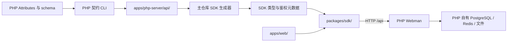

# RFC：接入 PHP 原生契约并完整退役 Node 后端

日期：2026-10-20。状态：依据已批准设计完成的实施 RFC，尚未实施。

设计依据：`.notes/php-backend-transition/specs/2026-10-20-php-backend-transition-design.md`。用户已批准该设计；本 RFC 保留源文档，不修改其历史状态文字。模块根目录固定为 `.notes/php-backend-transition/`。

## 决定与结果

`apps/php-server/` 成为唯一业务后端和 HTTP 契约所有者。本站 SDK 直接消费其内部版契约，前端适配 PHP 原生响应；删除 `apps/server/`、根 `api/`、Hydra/OIDC 及所有仅服务旧系统的接线。旧业务数据不迁移、不备份、不维护历史兼容读取。

完成后，主仓库只编排前端和 SDK 工具链，PHP 自行管理 PostgreSQL、Redis、初始化和业务测试。不得以 mock、兼容网关、旧 Node fallback 或修改 PHP 模拟旧响应来完成替换。

本 RFC 覆盖一个完整替换单元，不拆成可独立上线的多个后端。实施顺序用于控制本地改动依赖，不构成部署计划或新增提交授权。

## 事实、约束与证据

| 事实                                                                                                 | 当前来源                                                                                                   | 对实施的约束                                                                                                 |
| ---------------------------------------------------------------------------------------------------- | ---------------------------------------------------------------------------------------------------------- | ------------------------------------------------------------------------------------------------------------ |
| PHP YAML 由 Attributes 和公共 schema 生成，公开和内部版互斥。                                        | `apps/php-server/AGENTS.md`、`apps/php-server/config/openapi.php`、`apps/php-server/scripts/openapi.php`。 | 不手改生成 YAML，不重新建立主仓库 HTTP 定义。                                                                |
| 内部版路径包含 `/api`，服务根为 `/`。                                                                | `apps/php-server/api/internal/openapi.yaml`、`apps/php-server/api/generated/openapi.internal.yaml`。       | 生成类型保留完整路径；SDK base URL 表示服务根。                                                              |
| 旧 41 个 operation 中，34 个方法与路径在 PHP 存在；缺失 7 个全部属于旧身份协议。                     | 旧 `api/generated/openapi.json` 与 PHP 两版完整 YAML。                                                     | 同名接口逐项适配；缺失的旧身份接口直接退役。                                                                 |
| 普通成功为 `{msg,data}`，业务错误为 JSON `{msg}`；未知异常可能是 text/html 类型的 `{message}` 文本。 | `apps/php-server/app/functions.php`、`apps/php-server/app/common/exception/`。                             | SDK 不回显未知异常、不伪造业务码、不直接展示原始响应。                                                       |
| 资料为 `AccountMeData`，ID 为 integer，显示名为 `username`，头像为 `avatar`。                        | `apps/php-server/api/internal/schemas/account.yaml`、`AccountController::mePayload()`。                    | 替换旧 `CurrentUser` wire 类型；UI 映射不成为第二套 DTO。                                                    |
| 当前存储只返回 file 计划；反馈快照仅有 receiving/completed。                                         | PHP storage、feedback schema 及对应 Controller。                                                           | 删除旧 COS 执行器、ClickUp 完成状态及维护接线。                                                              |
| `/oauth/authorize` 可返回自带登录步骤的 HTML；`/oauth/device` 当前要求 Bearer 才能返回 HTML。        | PHP `AuthorizeController`、`DeviceController` 与公开契约。                                                 | 代理不能伪造成功页面；设备入口目前的 401 是上游行为，Website 的 `ssoRequestId` 接收链独立验证。              |
| 子模块在设计期间继续更新。                                                                           | 设计核对时 HEAD 为 `99bb410`；本 RFC 核对到后续 `93ffe6c`，新增 PHP CI。                                   | 实施前读取当前 HEAD 和差异，消费最新工作树；交付时固定可获取的提交。不得 checkout 较旧默认分支覆盖本地进展。 |

PHP 文档中的相对路径在实际执行时均以子模块为工作目录；本 RFC 的项目文件路径以主仓库为根。当前没有安装主仓库 Node 依赖，也没有运行应用或 PHP 行为验证。源码核对不代表真实 HTTP 验收。

### 范围边界

- 业务切换覆盖现有 Website 的登录、资料、邀请注册、通知、file 上传、反馈、PHP 已支持的 SSO 接收流程及其测试。
- 删除旧 OIDC 页面、内部身份调用、后台依赖编排、旧数据库维护和旧部署材料。
- PHP 管理端不并入 Website；不新增空间、插件等管理页面。
- 不迁移旧用户、邀请、会话、通知、反馈、文件或浏览器指针，不恢复 ClickUp/COS 的旧实现。
- “不保留旧数据”限于本次退役的 Node/Hydra。PHP 自身的现役配置、安装状态、业务数据和其他项目资源不是删除目标。
- 代码审查发现与当前 PHP 契约不符的行为，只修正在本次接入路径中得到复现的缺陷；权限政策重设、协议扩展和无关修复不混入。

## 契约生成与运行元数据

### 文件及命令

| 文件或命令                                            | 新责任                                                                                                |
| ----------------------------------------------------- | ----------------------------------------------------------------------------------------------------- |
| `apps/php-server/api/internal/openapi.yaml`           | 本站业务接口的模块化查阅入口。                                                                        |
| `apps/php-server/api/public/openapi.yaml`             | 第三方、插件和公开 OAuth 接口查阅入口，不合并进本站 SDK。                                             |
| `apps/php-server/api/generated/openapi.internal.yaml` | SDK 类型和运行元数据的共同输入。                                                                      |
| `packages/sdk/src/generated/schema.d.ts`              | 从 PHP 内部契约生成的唯一 wire 类型，仍由现有 SDK 类型出口交付。                                      |
| `packages/sdk/src/generated/operation-policy.ts`      | 拟新增的内部运行元数据：按 method 和完整路径模板索引 operation 的本站会话鉴权要求。不是手写端点清单。 |
| `scripts/api/generate.mjs`                            | 改为消费 PHP 契约，生成、核对 SDK 两项产物；删除旧根 JSON 发布步骤。                                  |
| `scripts/api/read-contract.mjs`                       | 改为读取 PHP 完整内部 YAML并提供生成所需枚举/引用解析；删除默认旧 JSON 路径与 Fastify 专属校验假设。  |
| `pnpm api:lint`                                       | 检查 PHP 两版模块化入口及引用；Redocly 配置适配 PHP OpenAPI 3.0.3。                                   |
| `pnpm api:generate`                                   | 生成 SDK 类型与 operation policy，不生成 PHP YAML。                                                   |
| `pnpm api:check`                                      | 只读核对上述 SDK 产物；陈旧时失败，不写入。                                                           |

在子模块工作目录执行的 `composer api:generate/api:lint/api:check` 继续负责 PHP 定义、路由覆盖、受众归属和 YAML 产物一致性。主仓库不重复实现这套验证，不声称仅通过根 `api:check` 即证明 PHP 定义未变化。

生成器复用现有受控发布原则：先生成所有预期字节，再发布两项 SDK 产物；失败时恢复已更改的目标。内容相同不重写，临时目录限于当前任务创建的范围。缺少子模块或完整 YAML、非法引用、重复 operationId 等均明确失败，不使用旧产物代替失败结果。

### operation policy 的派生规则

元数据直接来自与类型生成相同的文档快照，包含每个 operation 的 method、路径模板和 `requiresSession` boolean。每个有效 method/path 对只出现一次。

计算 security 时先使用 operation 自身声明，未声明时继承文档顶层声明；两处都未声明时按无鉴权要求处理。只有有效 security 列表非空，且每个可选方案均要求 `sessionAuth` 时，才标记 `requiresSession: true`；`security: []` 或存在匿名方案时为 false。未能解析的引用、未声明的 scheme 引用或未支持的 security 结构须在生成阶段失败，不默认为需要或不需要会话。

SDK 在替换 path 参数前，用 method 和请求模板查询元数据。非契约 operation 作为配置错误拒绝，不靠路径前缀猜测鉴权。SDK public API 不新增允许调用方随意标记 `requiresAuth` 的开关。

公开 PHP OAuth HTML 页面不在本站 SDK 中，仍由 PHP 自己实现和维护。

## SDK 行为

### URL 组合

`setBaseUrl` 的公开名称保留，语义统一为服务根。Browser 默认规范化为当前 origin；Node 仍须显式设置绝对 HTTP(S) 根。保留拒绝凭据、query、hash、路径穿越、编码斜杠和跨 root 发送凭据的校验。

| 服务根                            | 契约路径       | 最终 URL                                      |
| --------------------------------- | -------------- | --------------------------------------------- |
| 当前 origin `/`                   | `/api/auth/me` | 当前 origin `/api/auth/me`                    |
| `https://service.example`         | `/api/auth/me` | `https://service.example/api/auth/me`         |
| `https://service.example/backend` | `/api/auth/me` | `https://service.example/backend/api/auth/me` |

表中域名仅为 URL 规则示例。实现必须拼接服务根路径和契约路径，不能用会丢弃 `/backend` 的绝对路径解析，也不能额外增加 `/api`。保留现有 path 参数替换、query 序列化、重定向拒绝、不发送 cookie、HTTP 超时与取消语义。

返回 PHP 原生响应，成功结构不做全局 unwrap。Web 所属适配函数可以返回 `response.data` 并使用生成的 Data 类型；这不是保留旧响应的兼容层。

相对头像和文件资源 URL 按选中的服务根解析，包含部署前缀；不能误指向 SPA 的不同 origin。合法的绝对资源 URL 可按 PHP 返回值展示，但不向第三方资源附加本站 Bearer。

### 错误与 401

保留 `ExAxiosError` 的传输错误分类。HTTP 错误使用 SDK 自己的通用分类码和真实 `status`，业务分支使用状态码，不从中文消息反推旧业务码。网络、超时、取消和配置错误仍使用工具侧分类。

只解析 JSON Content-Type、最多 64 KiB 且匹配契约业务错误形状的 `msg`。HTML、未知 `{message}`、无效 JSON、过大错误体使用固定兜底文案；不把 PHP 原始异常带入通知或日志。Retry-After 仅从实际 header 解析，不从文案推导；PHP 没有返回的 requestId 不生成假值。

以下条件全部满足才处理会话失效：

1. HTTP 状态为 401，生成的 operation policy 标记 `requiresSession`。
2. 请求快照捕获了非空本站 token，当前 root/token 代次仍与快照一致。
3. 若调用方显式传入 Authorization，它必须与该快照的 token 一致。
4. 持久凭据来源可核验；条件删除确认成功后，才继续该来源的退出通知和导航。

保留同一失效代次仅处理一次的机制。匿名登录、验证码、邀请和 SSO 密码登录失败不触发全局退出；403 是权限拒绝；旧 root、旧 token 或其他显式 token 的迟到 401 不清理当前会话。`alert: false` 继续只关闭临时通知，不关闭符合条件的失效处理。

### Browser 存储

新 token key 定为 `exwebsite.php.auth.v1:` 加 `encodeURIComponent(normalizedServiceRoot)`；所有服务根均使用同一规则，不保留旧默认 key 特例。规范化根使用 SDK 已验证的 URL，去除尾部斜杠；当前 origin 根的键由 SDK Browser 入口和 Web 计算为相同值。

SDK 仍只对默认 Browser 根自动读取该根的凭据，自定义根由 Web 显式恢复到 SDK 内存。保留存储不可读、条件删除、跨标签替换、写入失败与退出抑制的现有保护。

首次进入新客户端时定向删除旧 `exwebsite.auth.token` 及其带冒号的分根变体、旧 `exwebsite.auth.sso-success`、已知旧反馈恢复键。删除幂等，存储不可读时不读取或迁移旧值；不调用整站 `localStorage.clear()` 或 `sessionStorage.clear()`。

新的 SSO 成功指针和反馈指针使用 PHP 命名空间。反馈指针按服务根、真实 PHP user ID 和 area 隔离，仅保存 key/ID；不在存储键或指针里写原始 token、密码、数字码、文件字节或完整表单。服务根切换和用户切换继续作废相关在途请求与内存快照。

### 上传

`storage.upload` 保留现有输入、超时、取消和 root/token 阶段校验，操作改为完整 `/api/storage/...` 路径。

prepare 读取 `response.data.medium` 和 `response.data.maxBytes`，file 分支使用原生 FormData，字段为 `key`、`medium=file`、`contentType`、`data`。上传成功返回 `response.data.url`；不手写 multipart boundary。

删除 `packages/sdk/src/storage/browser.ts`、`packages/sdk/src/storage/node.ts` 的旧 COS 传输及其注入，仅在它们仍专门承载 COS 时删除对应文件；同步移除两套 COS SDK 依赖与 Vite external 配置。`medium: cos` 作为 PHP 契约仍允许提出的请求，通过 prepare 得到 PHP 当前的 503；不执行云传输或自动切回 file。

## Web 接口与展示映射

全部调用路径增加契约自身的 `/api` 前缀，method、path 参数、body 和成功类型从新生成声明推导。下表是适配责任清单，不成为另一份运行时 endpoint 定义。

| 当前消费者                                                | PHP wire 来源                                                              | 必须完成的适配                                                                                                                                               |
| --------------------------------------------------------- | -------------------------------------------------------------------------- | ------------------------------------------------------------------------------------------------------------------------------------------------------------ |
| `apps/web/src/auth/AuthFlow.tsx`                          | `/api/auth/login`、`AccountLoginResponse`                                  | 读取 `data.token`、`data.expires_in` 和 `data.user`；失败按 HTTP 状态/表单根错误处理；普通登录才保存本地 token。                                             |
| `apps/web/src/auth/AuthContext.tsx`                       | `/api/auth/me`、`AccountMeData`                                            | `username` 映射为 UI 昵称、`avatar` 映射为头像；保留实际 numeric ID 供应用身份隔离。不伪造旧 UUID 或不存在字段。                                             |
| `apps/web/src/settings/`                                  | `AccountMeData`、`AccountProfileRequest`、`AccountAvatarRequest`           | 更新生成类型别名；写入仍使用 `nickname`、`qq`、`avatar`，读取使用 `username`、`qq`、`avatar`；头像上传保留 2 MiB 与支持格式校验。                            |
| Website 的 Settings/Profile UI                            | PHP profile 无可编辑 FiveM ID；非 null `fivemId` 被拒绝                    | 移除 Website 的 FiveM ID 直接编辑入口，最小调整共享组件 props；不向 API 提交不可用字段或填造绑定资料。主题继续使用现有 ExUI 本地机制。                       |
| `apps/web/src/invitations/InvitationRegistrationFlow.tsx` | `AccountInvitation*Data`                                                   | 读取信封内的数据；资格、验证码和完成令牌按 PHP 行为处理，不继续把“旧申请已审批”作为新服务注册前置政策。                                                      |
| `apps/web/src/notifications/`                             | `NotificationListData`、`DetailData`、`SummaryData` 与各命令/偏好 Data     | 替换旧 schema 名称并读取 data；保留实际 revision、readThroughToken、clearSnapshotToken、requestId 请求字段，不把它们与已退役的错误 envelope requestId 混淆。 |
| `apps/web/src/pages/Support/feedback/api.ts`、`flow.ts`   | `FeedbackPrepareRequest`、`FeedbackSnapshotData`、`FeedbackAdvanceRequest` | 端口返回原生 data；按 receiving/completed 与 upload/continue/done 推进，不保留旧 ClickUp 核对状态。                                                          |
| `apps/web/src/main.tsx` 的开发连通性检查                  | `/api/health`、`SystemHealthData`                                          | 读取 data.status；健康检查失败不隐式执行安装、迁移或 Redis 初始化。                                                                                          |

表中 `DetailData`、`SummaryData` 指完整的 `NotificationDetailData`、`NotificationSummaryData` schema；实际类型引用必须使用完整生成名称。

### 时间与表单

| 字段范围                                                                 | PHP 单位或格式       | Web 处理                                                                |
| ------------------------------------------------------------------------ | -------------------- | ----------------------------------------------------------------------- |
| captcha expiresAt、邀请 serverTime/resendAvailableAt/completionExpiresAt | Unix 秒              | 仅在进入 UI 的 Date.now/倒计时运算前乘 1000，不能全局修改 wire 类型。   |
| SSO inspect expiresAt/serverTime                                         | Unix 毫秒            | 直接参与毫秒运算。                                                      |
| 通知列表、摘要和批量命令 serverTime                                      | Unix 毫秒            | 保持对应 UI 时间预算。                                                  |
| 通知偏好 serverTime、反馈 createdAt/receiveExpiresAt                     | Unix 秒              | 显示或有效期判断时转为毫秒。                                            |
| AccountMeData.last_login_time                                            | 可空数据库时间字符串 | 不擅自当作带时区 ISO 时间或编造浏览器本地转换；无相关展示时不增加展示。 |

昵称、密码、QQ、验证码和附件限制按各 operation 的 PHP schema/运行选项更新 RHF/Zod。业务错误不再按旧 `error.code` 填造字段错误；没有结构化字段信息时显示表单根错误。验证码继续遵守现有 UI 范围，不凭空新增强制验证政策；PHP 接口允许可选凭证，提交真实凭证时必须按真实格式校验。

### PHP SSO 与 OAuth 页面

`/login?ssoRequestId=...` 接收 PHP 43 字符 base64url 请求 ID。inspect、login、confirm 均读取 PHP 信封；inspect 若为 completed，按当前请求完成处理，不额外创建会话。

SSO 密码登录只确认设备请求，不签发或覆盖浏览器本站 token；已有会话确认失败为 401 时回到凭据输入，404/409 等按 PHP 终态处理，网络故障保留显式重试。成功页只读取新命名空间中当前服务根的成功指针，不显示 OAuth token 或恢复旧 Node 记录。

开发入口精确转发 `/oauth/authorize` 和 `/oauth/device` 到 PHP，含各自 query；当前 HTML 的 CSS/脚本内联，不需要开放额外静态目录。保留 PHP 的 sessionStorage `exre_oauth_token` 独立登录，不把 Website token 复制到该 key。未知 OAuth 路径不得被误当作已实现的 Website 授权页。

`/oauth/device` 无 Bearer 的顶层导航当前收到 PHP 401，代理保留该状态和响应；本 RFC 不静默修改其鉴权或宣称该顶层流程验收成功。已有 Website `ssoRequestId` 流程不依赖此页面。该上游限制记录在交付说明，若后续要改页面访问政策，作为独立需求处理。

删除 `apps/web/src/pages/IdentityPage/`、App 中四条 `/identity/*` 路由和专属 SDK 失效导航例外，旧地址返回 404。`/docs` 与旧深路径政策保持现有约定。

### 反馈与通知

PHP `FeedbackForm` 明确定义 kind/title，其余字段允许原样保存；options 的 fields 当前为空。删除 Website 对 ClickUp Type/Domain 字段 UUID 的必填和可用性依赖。保留有内容价值的正文、Bug 信息、匿名选择及附件输入作为 UI 草稿，发送内容由生成类型约束，不宣称 PHP 已执行旧 Node 的全部 Markdown/业务字段校验。匿名选择不承诺向 PHP 管理员隐藏账号，除非 PHP 另有明确权限行为。

表单标题上限、附件数量和总量等读取 PHP options；大文件补充信息采用 PHP 当前限制。仅被旧 Node 使用的 Common 常量与字段解析器随消费者清理；仍有前端用途的解析和安全呈现继续保留，不宣称它们由 PHP 共用。

prepare 使用一个 submissionKey；同 key 未知结果先 lookup，不因网络故障产生新键。上传核对 attachment 的 ID/长度/SHA-256，advance 使用 expectedRevision。409 后重新读快照再决定下一步；网络失败保留当前 key/快照并允许读取确认。只有 completed/done 才显示“反馈已接收”并清理当前表单，不显示任务链接、ClickUp 同步或人工核对能力。

通知保留前端 HTML 白名单、fail-closed 及纯文本回退；删除与 Node sanitizer 对比的测试实现，改为固定行为样例和 PHP 接口输出的安全呈现验证。偏好和批量命令保留实际 revision、幂等请求和代次保护，冲突用 HTTP 409 处理。

## 运行、配置与清理清单

### 当前入口的替换

| 对象                                                                                                                                                                          | 处理                                                                                                                                                                                        |
| ----------------------------------------------------------------------------------------------------------------------------------------------------------------------------- | ------------------------------------------------------------------------------------------------------------------------------------------------------------------------------------------- |
| `package.json`                                                                                                                                                                | `dev`、`dev:web` 均指向 SDK 准备后的前端入口；删除旧 service/infra/db/start/stop/logs 命令；保留 format、test、build、typecheck 与新 API 消费命令。                                         |
| `scripts/runtime/frontend.mjs`                                                                                                                                                | 默认前端端口 8080；支持 `--port`；准备与监听 SDK，然后启动 Vite。                                                                                                                           |
| `scripts/runtime/sdk-preparation.mjs`、`scripts/runtime/sdk-watch.mjs`                                                                                                        | 监听 `apps/php-server/api/generated/openapi.internal.yaml` 和 SDK 源；该 PHP 生成文件是消费源，不能被旧“忽略 generated”规则过滤。SDK 输出仍忽略。                                           |
| SDK 重建控制                                                                                                                                                                  | 先使旧就绪状态失效并停止本轮前端，再串行生成和构建；合并连续变化，失败保持停止，后续变化可重试；Ctrl+C 取消准备并回收当前任务进程。                                                         |
| `scripts/runtime/build.mjs`                                                                                                                                                   | SDK 生成/构建后仅构建 Web，不构建 Server，不读 PHP 秘密或连接服务。                                                                                                                         |
| `scripts/runtime/typecheck.mjs`                                                                                                                                               | 删除 server-types 项，仅检查当前 workspaces 和 SDK 类型夹具。                                                                                                                               |
| `scripts/runtime/tests.mjs`                                                                                                                                                   | 更新实际测试登记和 watch 目录；移除旧根 api、Server、Hydra 等范围，保留两级测试入口。                                                                                                       |
| `scripts/runtime/settings.mjs`、`scripts/runtime/shared.mjs`、`scripts/runtime/local-config.mjs`、`scripts/runtime/ownership.mjs`、`scripts/runtime/output.mjs` 与平台 helper | 保留仍被前端、SDK 或测试使用的纯工具与子进程保护；清掉旧业务配置解析。ownership 当前依赖 local-config 的纯 I/O/摘要/错误工具，必须先保留或迁出这些依赖，不能直接删除该文件造成悬空 import。 |
| `apps/web/vite.config.ts`、`apps/web/dev-entry.ts`                                                                                                                            | PHP API 代理、精确 OAuth HTML 代理、前端公共入口；删除 `@server` 和旧 Hydra 逻辑。保留 no-referrer、可信转发与拒绝内部路径等仍有效的边界。                                                  |

根配置只读取公开前端/工具设置，进程变量优先于根 `.env.local`：

| 配置                  | 定义                                                                                                                                                                |
| --------------------- | ------------------------------------------------------------------------------------------------------------------------------------------------------------------- |
| `VITE_API_BASE_URL`   | 沿用名称但改为服务根；缺省 `/`，远端填写绝对 HTTP(S) 服务根，可带部署前缀。旧 `/api` 值必须显式改正，不提供静默转换。                                               |
| `PHP_SERVER_ORIGIN`   | 拟新增的开发代理目标，仅 origin，缺省 `http://127.0.0.1:8787`；拒绝凭据、query、hash 与路径。只传给开发工具，不进入 Browser bundle。                                |
| `--port`              | 前端开发端口，缺省 8080；端口冲突明确失败，不自动改端口。                                                                                                           |
| 子模块 `USER_WEB_URL` | 当前 PHP 生成 Website 登录地址使用该键；公开示例和 `apps/php-server/config/userweb.php` 默认值与新的 8080 对齐。更改前端端口时同步显式配置，不自动重写 PHP `.env`。 |

根 `.env.example` 删除旧 Website/Hydra 秘密和资源配置，说明新公开设置。PHP 自己的 `.env.example` 和 README 只同步必要公开地址说明；真实 `.env` 和安装标记不覆写。工具环境白名单不能把 PHP 数据库、Redis 或 JWT 秘密转交 Vite。

### 删除对象

以下为明确的旧实现删除范围，实施前仍须读取最新版本并核对是否混有新增消费者：

| 范围                                                                                                      | 删除内容                                                                                                                                                                                                             |
| --------------------------------------------------------------------------------------------------------- | -------------------------------------------------------------------------------------------------------------------------------------------------------------------------------------------------------------------- |
| `apps/server/`                                                                                            | 全部旧源码、包声明、Drizzle/migrations、CLI、构建和旧本地业务数据。                                                                                                                                                  |
| 根 `api/`                                                                                                 | 旧 OpenAPI 源、片段与生成 JSON；消费者已切换后整体删除。                                                                                                                                                             |
| 根 `compose.yaml`、`infra/runtime/`                                                                       | 旧 Website/Hydra Compose、版本锁、PM2 和 Nginx 模板。PHP 自己的 `compose.yaml` 保留。                                                                                                                                |
| `scripts/runtime/` 旧专属模块                                                                             | services、infrastructure、hydra-client、convert、deployment、nginx、pm2-process、native、server、logs、retire-outline，以及只服务这些功能的 application orchestration/证明逻辑与用例。共同工具按存活引用保留。       |
| `scripts/clean-server-build.mjs`、`scripts/rewrite-server-imports.mjs`、`scripts/copy-support-fields.mjs` | 旧 Server 构建与字段复制；同时删除无消费者的 `scripts/support-field-definition.mjs`、`scripts/probes/clickup-fields.mjs`。                                                                                           |
| `packages/common/src/node/identity-config/`                                                               | 旧 Node/Hydra 配置和包 exports；删除对应无消费者测试，保留 feedback-content 及其真实公开边界测试。                                                                                                                   |
| 旧集成测试                                                                                                | `tests/contract/`、`tests/db/`、`tests/server-types/`、`tests/server-plugins/` 及 auth/join/storage/support/clickup 下仅验证旧业务的用例与 helper。纯前端、Common 或安全呈现行为测试迁接到现役消费者，不按目录盲删。 |
| 配置和依赖                                                                                                | TS/Vite/Vitest 的 `@server` 别名、Server workspace 依赖、无消费者的 Fastify/Glue/Drizzle/pg/Testcontainers/COS/PM2 等包、旧 ignore 项和 generated 忽略规则。真实仍用于隔离测试的依赖按消费者保留。                   |

不能通过删除失败的现役 SDK/前端用例来降低接入门槛。删除候选以源码引用和职责核对为准；lockfile 由 pnpm 更新，不手改解析结果。

### 数据和外部资源

工作区内旧 Node 文件按批准范围直接删除；Windows 操作前核对绝对目标仍位于当前 checkout，拒绝逃逸的链接或 junction。无旧数据备份和回填。

在移除旧资源归属代码前进行一次只读外部盘点：根据旧配置、容器标签、exact ID/config proof、实际数据库连接和共享消费者确认旧 Node/Hydra 的资源。已证明属于旧系统且无共享消费者的资源按本次退役授权停止和清理，最后再删维护代码；不要先删证明再按名字猜。

当前 checkout 仅发现旧 data 中 `.gitkeep`，未发现根 `.env.local` 或 `.local/runtime/`。因此本 RFC 没有可直接执行的外部删除目标。若实施盘点仍无可核实目标，交付记录“未识别可清理的外部旧资源”，不得宣称整个主机数据已清空，也不得为满足文字上的“完整退役”清空全机 Docker、PHP 数据或共享 PostgreSQL。

## 测试、CI 与证明边界

根 `TESTING.md` 继续控制执行时机：开发按变更运行定向检查，不自动执行根整套 test/typecheck/build/api:check；PR 和 CI 按各自规则集中验证。本文定义必须覆盖的行为，不把所有命令串成开发结束固定流程。

| 所属位置                                                                                           | 需要的行为覆盖                                                                                                                                                                                                                                                |
| -------------------------------------------------------------------------------------------------- | ------------------------------------------------------------------------------------------------------------------------------------------------------------------------------------------------------------------------------------------------------------- |
| `scripts/api/generate.test.mjs`                                                                    | PHP 输入路径、两项 SDK 产物一致发布、缺失/陈旧/非法契约、只读 check；失败保留原产物。                                                                                                                                                                         |
| 拟新增 `scripts/api/operation-policy.test.mjs`                                                     | 从同一契约派生匿名、sessionAuth、继承、可选匿名和非法 security；method/path 模板准确，避免手写业务判断。                                                                                                                                                      |
| `tests/sdk/config.test.ts`、`tests/sdk/request.test.ts`                                            | 服务根/部署前缀、原生信封、匿名失败、带 token 的 protected 401、403、显式其他 token、迟到请求、存储失败与跨 root。纯 mock 用例纳入显式轻量组。                                                                                                                |
| `tests/sdk/http-core.test.ts`、`tests/sdk/storage-sdk.test.ts`、`tests/sdk/public-package.test.ts` | 真实传输、file multipart、只读字节范围、COS unavailable、公开包与 Browser/Node 条件入口；需要真实 HTTP/编译/Chromium 的保留 fullOnly。                                                                                                                        |
| `tests/sdk/types/types.fixture.ts`                                                                 | 只接受 PHP 完整路径和新 DTO；拒绝旧路径、旧字段、错误 method 和错误 path 参数。                                                                                                                                                                               |
| `apps/web/src/auth/`、`apps/web/src/invitations/`、`apps/web/src/api/`                             | 信封映射、ID/时间单位、账号切换、跨标签同步、旧数据清除、SSO 不创建本站 token、失效和根切换的迟到结果。                                                                                                                                                       |
| settings、notifications、feedback 现有用例                                                         | 真实 PHP schema fixtures、资料字段能力、通知 revision/批量命令冲突、接收流程 key/上传/advance/未知结果和账号隔离。                                                                                                                                            |
| runtime 现役脚本用例                                                                               | 新配置白名单、代理目标、SDK 准备顺序、契约 watcher、取消/重建失败/端口冲突和进程退出。                                                                                                                                                                        |
| PHP 现有测试                                                                                       | `apps/php-server/tests/openapi.php`、`apps/php-server/tests/registration_email.php`、`apps/php-server/tests/sso_flow.php`、`apps/php-server/tests/feedback_upload.php` 按实际改动执行；既有脚本含直接 Controller/中间件断言，不把它们都称作真实 Webman HTTP。 |
| PHP 拟新增 `apps/php-server/tests/website_http.php`                                                | 用实际 Webman 路由和中间件验证接入涉及的账号、邀请、资料、通知、file、反馈以及 401/403/409/413/422 等适用分支，结构断言来自生成契约。mail 使用替身，不向外部发信。                                                                                            |

新 PHP HTTP 夹具必须使用测试进程自己的配置、随机临时 schema、Redis 前缀、签名密钥和文件目录；在 finally 中核验并清理。复用 `sso_flow.php` 已有的配置隔离思路，但真实路由验证必须实际经过 Webman，不能用测试专用 router 代替后声称真实 Webman 通过。

本地执行 PHP 数据库测试前核对来源和隔离配置；CI 连接其临时 PostgreSQL/Redis。缺少兼容 PHP、服务或安装依赖时明确失败或记录未执行，不回退开发库、不自动执行安装向导或导入整份带删表的 schema。

根 CI checkout 启用递归子模块；保留 SDK/前端 api:check、typecheck、build 和 full 测试。移除仅为旧 Node 容器集成所需的 Docker 步骤；现役测试仍需要容器时才保留对应步骤。PHP CI 维护其元数据和业务验证，并接入新增 website_http 夹具；主仓库 CI 不因 PHP 独立 CI 存在而声称自己验证了该子模块版本的全部业务。

文档变更仅做内容和格式核对。浏览器、真实服务和公网部署仍分别报告；本 RFC 不新增自动页面浏览器验收或部署任务。

## 文档与知识更新

实施后使用 `codebase-documenter` 更新 `README.md`、`AGENTS.md`、`TESTING.md`、`CONTRIBUTING.md`、`.agents/rules/package-common.md`、`packages/sdk/README.md` 和 PHP README 中的现行入口。SDK 请求示例全部使用完整 PHP 路径；根与 Composer 命令的不同证明范围明确列出。主仓库的 TypeScript SDK 规则面向 Website 消费者；PHP 自有 HTML 页遵守子模块规则，不为满足旧主仓说明而重写其现有原生请求。

`.ai/` 按事实唯一归属维护：

| 知识位置                                                                                             | 最终内容                                                                                                            |
| ---------------------------------------------------------------------------------------------------- | ------------------------------------------------------------------------------------------------------------------- |
| `.ai/README.md`、`.ai/architectures/overview.md`                                                     | PHP 后端、内部/公开契约、SDK、Web、PHP 自有资源拓扑。                                                               |
| `.ai/architectures/api/contract-layout.md`、`.ai/architectures/sdk/client-boundaries.md`             | PHP 定义与生成物、SDK 消费、operation policy、服务根和新凭据来源。                                                  |
| `.ai/architectures/runtime/runtime-boundaries.md`、`.ai/architectures/contract-tests/test-layers.md` | 前端工具链与 PHP 运行/测试的分工，删除旧 Node/Hydra 启停与验收承诺。                                                |
| `.ai/architectures/web/authentication-flow.md`、相关 Web knowledge                                   | PHP 字段、邀请政策、SSO、状态码、时间单位与浏览器隔离。                                                             |
| storage、notifications、support-center 的架构/知识                                                   | 当前 file 上传、本地反馈接收、通知命令及安全呈现，不再描述旧外部流程为现役。                                        |
| `.ai/databases/data-model.md`                                                                        | PHP 现役模型职责，引用 `apps/php-server/database/schema.sql`；Node 数据模型退出当前指南。                           |
| `.ai/decisions/README.md` 与旧决策                                                                   | 标记被取代的 Fastify/Glue、Draft-07 限制、错误 envelope、Hydra 与数据库生命周期决策；历史理由保留，不指挥现役实现。 |

移除纯旧 Server/identity 的现行架构页，或在有历史引用需求时明确标为退役并指向当前结构；不留下有效入口指向不存在的文件。`.notes/archive/` 和源设计保留历史背景，不做全量路径替换。

## 实施顺序与退出条件

| 顺序 | 落地范围                                                                | 进入下一步的条件                                                           |
| ---- | ----------------------------------------------------------------------- | -------------------------------------------------------------------------- |
| 1    | 核对主仓库/子模块最新状态；建立实际引用与旧资源清单。                   | 没有覆盖无关改动；已记录子模块基线；外部清理对象有证明或明确无可执行目标。 |
| 2    | PHP 契约消费者生成器、SDK 类型/policy、服务根、错误、凭据和 file 上传。 | 新定向 SDK/生成器断言通过；产物完整；不依赖旧 Contract。                   |
| 3    | Web 账号、资料、邀请、通知、反馈与 SSO 的原生适配；退出 OIDC UI。       | 使用 PHP fixtures 的行为断言通过，旧业务码与 wire 类型无消费者。           |
| 4    | 前端 runtime、代理、配置、构建、test/watch、CI 和 PHP 接入夹具。        | 现役命令及消费者不依赖旧服务；生成和构建仍串行；失败、退出路径有证据。     |
| 5    | 先执行已核实旧资源清理，再删除旧代码/数据/依赖/测试，更新文档知识。     | 旧目录和有效引用退出；现役测试保留；所有删除目标在批准范围。               |
| 6    | 按当前开发或 PR 阶段执行适用验证并提交实际结果说明。                    | 自动检查、PHP HTTP、浏览器和外部清理的通过/未运行/限制分别报告。           |

各阶段在同一替换变更内串联，不发布中间不兼容状态。源码删除前可以暂留被替换文件供比对，但不能启动旧后端作为隐式依赖。旧资源清理无法核实的外部部分单独报告，不用猜测删除阻塞或伪装代码接入的完成。

最终有效代码和配置中不得存在指向旧 `apps/server`、根 `api/openapi.yaml`、根 `api/generated/openapi.json`、`@server` 或 `@workspace/server` 的活跃引用。历史文档中明确的退役记录可以保留；扫描结果须按用途逐条解释，不维护掩盖现役依赖的全局忽略列表。

## 失败、回退与剩余风险

| 风险或失败                            | 处理与检测                                                                                                                             |
| ------------------------------------- | -------------------------------------------------------------------------------------------------------------------------------------- |
| PHP 契约与真实行为不符                | 由 PHP HTTP 夹具复现，在所属模块修正定义/行为并重新生成；不绕回 Node。                                                                 |
| 新子模块提交尚不可远端检出            | 本地可基于当前工作树实施；交付时先完成获授权的子模块交付，再更新主仓 gitlink。当前无提交/推送授权，不能声称 fresh clone 或 CI 已验证。 |
| YAML 改变但 SDK 未重建                | watcher 和只读 api:check 检测，准备失败停止消费者；不沿用失败轮次的陈旧产物。                                                          |
| URL 前缀或时间单位错误                | 服务根组合、秒/毫秒边界与相对资源 URL 定向断言。                                                                                       |
| 错误退出新会话或恢复旧数据            | 生成 policy、token/root 栅栏、新存储命名、已知旧 key 清除和跨用户指针隔离。                                                            |
| 新 PHP OAuth 设备 HTML 的现有访问限制 | 代理保留真实 401；Website 使用已支持的 SSO 接收链；交付披露，不冒称完整 OAuth 页面验收。                                               |
| 旧数据删除不可恢复                    | 用户明确选择不保留旧数据，不提供备份/恢复承诺；删除前核对归属，避免扩大范围。                                                          |
| 混入其他在途改动                      | 每次写子模块文件前核对当前差异；已完成的其他测试/CI工作原样保留，不回滚或代为提交。                                                    |

代码回退使用聚焦的文件恢复或后续反向变更，保留用户其他工作；不运行 `git reset --hard`。数据删除后，代码回退不能恢复旧账号、文件或卷；重新使用旧后端也只能另行准备空环境，不能把 Git 回退称作数据恢复。PHP 目标数据不参与旧系统删除，因此不需要为本次代码回退设计 PHP 数据迁移。

没有剩余产品决策。环境可用性、真实 PHP 行为、外部资源归属和子模块远端可获取性属于执行时需验证的条件，不是已通过的事实。本 RFC 交接完成后停止设计工作；实际实施另按用户后续指令启动。
