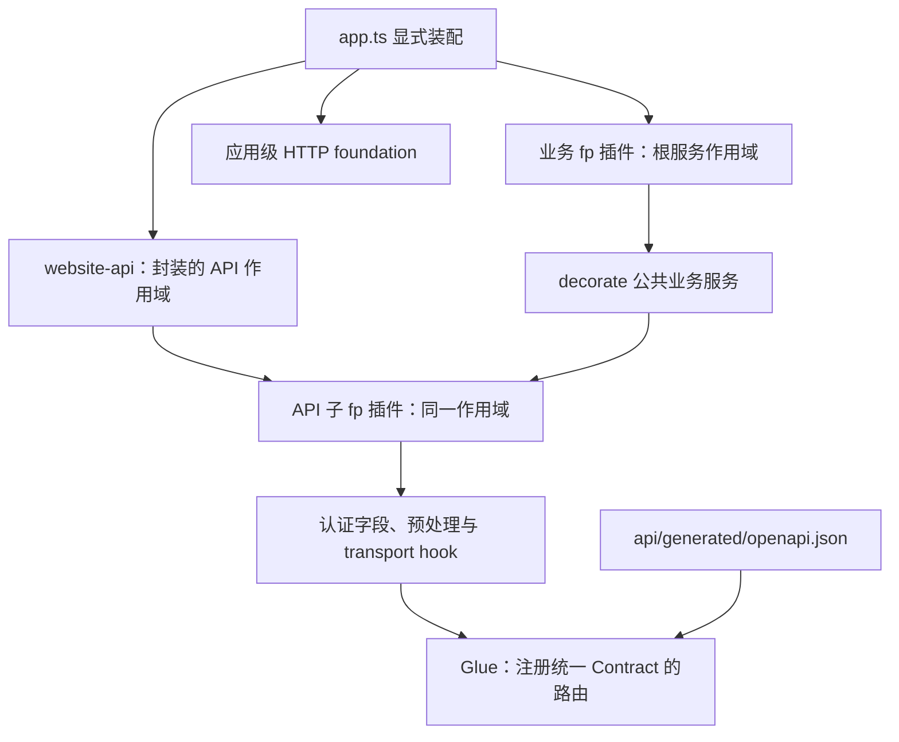

# RFC：Fastify API 接入与业务插件模块化

- 状态：实施 RFC 草案；设计方向已由用户确认，代码实现尚未开始。
- 日期：2026-10-11
- 模块根目录：`.notes/server-modularization/`
- 批准的设计来源：`.notes/server-modularization/specs/2026-10-11-fastify-modularization-design.md`
- 审批证据：用户在复审模块内聚、modules/domains 边界及插件作用域后回复“同意的”，并明确要求将简明开发规范写入 AGENTS.md；本版替代早期集中 API 目录方案。

## 决策摘要

公共能力放在 `apps/server/src/modules/{name}/`，网站具体业务流程放在 `apps/server/src/domains/{name}/`；各模块内部包含 API 接入，`apps/server/src/http/` 只负责公共 HTTP 处理与统一装配。业务和 API 两类入口都以 fp 显式注册，业务插件提供 service decorator，API 消费业务服务。各层仅在自己的 fastify.d.ts 声明所拥有的字段；简单参数可就地定义，不机械拆分插件和文件。

独立 OpenAPI 仍是唯一 HTTP 定义。模块化源文件打包为 `api/generated/openapi.json`，Server、Client 类型生成、测试和运行工具消费这一单文件。Glue 在 API 总入口注册一次，不建立第二份手写 endpoint 表。

本 RFC 将已批准设计细化为一个相互配套的改造，分两个阶段验收。不涉及新 endpoint、数据库模型或 migration、业务策略、事件总线、插件自动发现、发布和部署。

## 已验证的现状与实现约束

| 现状证据                                                                                                      | 对实施的约束                                                                                        |
| ------------------------------------------------------------------------------------------------------------- | --------------------------------------------------------------------------------------------------- |
| `apps/server/src/app.ts` 集中 serviceHandlers、decorate、hook、securityHandlers 和 Glue                       | 新 app 只保留实例创建、选项传递和显式注册；保留 createApp 同步返回 Fastify 实例                     |
| `apps/server/src/auth/fastify.d.ts` 集中所有 service/request 字段                                             | 按字段拥有者拆分，不能保留重复声明                                                                  |
| `apps/server/src/auth/create-services.ts` 已创建 Auth/Invitation/Join，JoinService 构造注入 InvitationService | 综合工厂迁入应用组装层，保留创建行为及资源所有权；首轮插件接收已创建服务，公共 auth 不反向依赖 join |
| `apps/server/src/auth/bearer.ts` 接收 FastifyRequest 并写 authSession                                         | 移至 API 认证层；AuthService.authenticateToken 留在业务层                                           |
| join/storage transport 通过 onRoute 调整上传、下载配置                                                        | API 模块共享同一个 API 作用域，先安装 transport，再加载 Glue                                        |
| `apps/server/src/join/form-validation.ts` 直接读取根 YAML，校验输入和已存表单                                 | 继续作为业务校验，改用中立 Contract reader；不能只将其移至 HTTP 层                                  |
| `apps/server/src/http/cors.ts` 从 Contract 枚举允许方法                                                       | 改读统一 JSON，同时保留 OPTIONS、未知路径及错误响应的应用级 hook 行为                               |
| `scripts/runtime/nginx.mjs` 读取 join/storage 的 x-fastify-config 上传预算                                    | 同步迁移 reader，保留预算计算；拆源文件不能让代理限额缺失                                           |
| 部分 Contract tests、Client tests 直接解析根 YAML                                                             | 全部切换单文件 JSON 和共享枚举/校验辅助逻辑                                                         |
| Server 为 NodeNext、rootDir:src，并经 rewrite-server-imports.mjs 改写产物别名                                 | 类型入口只导出声明，运行时 import 必须能由 Node 正常加载                                            |
| Client 包根 exports 指向 src/index.ts，同时导出 runtime client                                                | 增加类型专用子路径，避免 NodeNext 把客户端源码带入 Server 编译                                      |
| lockfile 已解析 fastify-plugin 6.0.0，但 Server 未直接声明它                                                  | Server 添加直接依赖并锁定现有版本，不依赖 pnpm 隐式提升                                             |
| 当前源 Contract 有 43 个 operationId，未发现重复                                                              | 实施时固定当次完整基线；43 是本次观察值，不是长期硬编码上限                                         |

本地没有根 TESTING.md，沿用 `.ai/architectures/contract-tests/test-layers.md` 和现有测试入口。本文只做源码和文档核对，不声称插件启动或测试已经通过。

## 最终目录与迁移映射

完整目录见批准的 spec。本文补充可执行的迁移归属：

| 当前路径                                                                 | 目标路径 / 处理方式                                                                                                                                              |
| ------------------------------------------------------------------------ | ---------------------------------------------------------------------------------------------------------------------------------------------------------------- |
| `apps/server/src/auth/`                                                  | 业务内容移至 `apps/server/src/modules/auth/`；bearer.ts 转入 `apps/server/src/modules/auth/api/security.ts`；集中声明拆分；create-services.ts 单独迁入应用组装层 |
| `apps/server/src/auth/create-services.ts`                                | `apps/server/src/create-services.ts`；保留综合工厂的行为及 shared passwordHasher，依赖公共模块和 join 领域，避免反向依赖                                         |
| `apps/server/src/invitations/`                                           | `apps/server/src/domains/join/invitations/`                                                                                                                      |
| `apps/server/src/join/`                                                  | 业务内容移至 `apps/server/src/domains/join/applications/`；transport.ts 转入 `apps/server/src/domains/join/api/transport.ts`                                     |
| `apps/server/src/profile/`                                               | `apps/server/src/modules/profile/`                                                                                                                               |
| `apps/server/src/identity/`                                              | `apps/server/src/modules/identity/`，保留配置、OIDC、outbox、就绪与诊断职责                                                                                      |
| `apps/server/src/community/`                                             | `apps/server/src/domains/community/`；只有 schema-check，不虚构空 service/plugin                                                                                 |
| `apps/server/src/handlers/auth.ts`                                       | `apps/server/src/modules/auth/api/handlers.ts`                                                                                                                   |
| `apps/server/src/handlers/profile.ts`                                    | `apps/server/src/modules/profile/api/handlers.ts`                                                                                                                |
| `apps/server/src/handlers/join.ts`                                       | `apps/server/src/domains/join/api/handlers.ts`，原有邀请操作继续同组维护                                                                                         |
| `apps/server/src/handlers/identity.ts`                                   | `apps/server/src/modules/identity/api/handlers.ts`                                                                                                               |
| `apps/server/src/handlers/health.ts`                                     | `apps/server/src/http/system/handlers.ts`                                                                                                                        |
| `apps/server/src/modules/storage/handlers.ts`、transport.ts              | `apps/server/src/modules/storage/api/`                                                                                                                           |
| `apps/server/src/modules/notifications/handlers.ts`                      | `apps/server/src/modules/notifications/api/handlers.ts`                                                                                                          |
| `apps/server/src/http/query-coercion.ts`、对应单测、multipart-counter.ts | `apps/server/src/http/shared/`                                                                                                                                   |
| app 中的预处理/security 配置                                             | `apps/server/src/http/shared/request-normalization.ts`、`apps/server/src/http/security-handlers.ts` 和所属模块 API 的 security.ts                                |
| app 中的 Contract 路径与前缀                                             | `apps/server/src/contract/document.ts`                                                                                                                           |
| app 中的 serviceHandlers                                                 | `apps/server/src/http/service-handlers.ts`，app 继续 re-export 同一个映射                                                                                        |

所有调用方 import、mock 路径、测试 fixture、CLI 和产物路径同步迁移。旧目录不留转发层，避免形成两套公共入口。根路径别名 `@server` 不改变；`db/`、`cli/` 与 runtime 入口保留原职责。

模块内部可复用的输入校验留在业务层；HTTP header、FastifyRequest/Reply、multipart wire 解析、响应状态与 header 留在 API 层。业务核心不 import API 层，不保存 Fastify 实例。模块 plugin.ts 可以 import Fastify/fp，负责接入，不承载业务算法。

## 插件接口与依赖图

### 业务插件

各模块定义具名参数接口；复杂或复用参数放在 plugin-options.ts，简单参数可在 plugin.ts 就地导出。首次迁移公共模块接收 `{ services: ExistingServiceType }`，identity 的 services 保留可选值；join 的选项为 `{ services: { joinServices: JoinService; invitationServices: InvitationService } }`，同一插件暴露这两个已创建服务。实现先声明 `FastifyPluginAsync<Options>`，再用 fp 包装；fastify 元数据为 5.x。

| 插件 name              | 提供 decorator                   | dependencies / 必需 decorator                      |
| ---------------------- | -------------------------------- | -------------------------------------------------- |
| business-auth          | authServices                     | 无其他业务依赖                                     |
| business-join          | joinServices、invitationServices | 无其他业务插件前置依赖；两者在领域内部完成构造注入 |
| business-profile       | profileServices                  | 无其他业务依赖                                     |
| business-identity      | oidcServices                     | business-auth / authServices                       |
| business-storage       | storageServices                  | 无认证业务依赖                                     |
| business-notifications | notifications                    | 无其他业务依赖                                     |

依赖表只反映实际跨业务服务关系；数据库、时钟、适配器等仍由现有工厂注入。不要为了统一插件写法额外注册数据库服务或让 storage 业务依赖 HTTP 认证。

同一实例按表中的依赖顺序显式 register。依赖检查不是排序器；未加载、反向顺序或不可见 decorator 应令 ready/listen 失败。oidcServices 在集成关闭时仍声明和 decorate 为 undefined，消费者必须按现有语义判断值。

业务核心不导入自身或其他模块的 API；公共模块不导入 domains；HTTP 公共工具不导入总入口或具体业务。跨模块使用公共服务接口及构造注入。首轮不会为了 fp 重构既有 Join/Invitation 共享事务与数据访问方式；新增依赖不得据此扩散到对方私有 repository。将来迁移服务创建到插件时，插件可以 getDecorator 取得依赖并交给工厂，需单独确认资源生命周期。

### API 插件

`apps/server/src/app.ts` 先注册所有业务服务插件，再注册应用级 HTTP 基础插件，最后注册 `apps/server/src/http/plugin.ts`。不要在循环中为每个模块紧接着注册 API，避免 API 初始化时其他业务依赖尚未加载；目录归属与运行时装配顺序分别维护。

应用级 http-foundation 使用默认 fp，安装错误、CORS、multipart；website-api 使用 `fp(..., { encapsulate: true })` 创建统一 API 作用域。

API 子插件使用默认 fp，在 website-api 内共享作用域，并用唯一 name 声明依赖：

| API 插件          | 必需依赖                                                                            |
| ----------------- | ----------------------------------------------------------------------------------- |
| api-system        | 无业务服务                                                                          |
| api-auth          | business-auth、business-profile；在插件内 decorateRequest(authSession)              |
| api-profile       | business-profile、business-auth、api-auth；需要 authSession                         |
| api-join          | business-join、api-auth；检查 joinServices/invitationServices 并安装 join transport |
| api-identity      | business-auth、business-identity、api-auth；声明 identityClientId                   |
| api-storage       | business-storage、business-auth、api-auth；安装 storage transport                   |
| api-notifications | business-notifications、api-auth；需要 authSession                                  |

自己的 decorator 在插件体中创建，不能在该插件的前置 metadata 中把自己尚未创建的字段声明为必需依赖。其他插件通过 decorators.fastify/request 显式检查所消费的字段。

总 API 插件的顺序固定为：安装通用预处理 → register 并等待 api-auth → 其他模块插件按依赖完成 → 双向 Contract/map 检查 → register Glue 一次。Glue 接收同一解析后的 JSON 文档、显式 `/api`、完整 serviceHandlers 与 securityHandlers。

join/storage 的 onRoute 按 operationId 过滤，在 Glue 注册前安装；transport hook 不扩散修改其他接口。Bearer security 和上传认证前移共用 `apps/server/src/modules/auth/api/security.ts` 的 authenticateBearer；上传期间在 Glue preHandler 再复核的现有行为保留。

createApp 保持同步返回值，decorate 的完成边界改由 Fastify boot 保证。HTTP inject/listen 已触发 boot；直接调用 handler 并使用 app 作 request.server 的测试，必须先 await app.ready。raw handler tests 不得因 decorator 尚未加载而改用复制 handler 的替代映射。

server.ts 保留现有数据库检查、service 创建调度和 worker 所有权；综合 Auth/Invitation/Join 工厂的位置迁移不改变运行生命周期。业务插件不启动第二个 worker、不打开第二个池、不关闭传入资源。app 根级 onClose 及启动失败清理保持现状，不扩大本轮到生产生命周期重设计。

## handler 映射与类型接口

每个 API 目录的 operations.ts 显式导出本组 operationId→handler。中央 mergeOperations 拒绝重复键，并保持具体函数类型；禁止通过 object spread 静默覆盖，也禁止把 map 放宽成 Record<string, any>。

聚合后的 serviceHandlers 原对象继续通过 `@workspace/server` 导出。map 的键与 Contract operationId 在两个方向上相等；缺失、多余、重复和同一 method/path 重复均在启动前失败。operation 归属按现有 handler 与业务边界确定，不通过路径前缀自动推断，例如 `/auth/me` 的 GET 与 PATCH 可以属于不同 API 模块。

HTTP JSON 请求从生成式 operations 派生参数，不再用手写 DTO 或未经校验的断言维持提示。增加 `apps/server/src/http/handler-types.ts`，提供：

- ApiRequest<OperationId>：FastifyRequest 的 Body、Querystring、Params；不存在的部分保持无可用字段。
- ApiJsonResult<OperationId>：该操作 JSON 成功响应的联合类型。
- TypedApiHandler<OperationId>：关联请求与 JSON 结果；具体 HTTP code/header 仍由 handler 与 Contract tests 校验。

上传 wire 输入与 parser 产物不是同一类型。join/storage transport 明确导出自身生成的内部 input 类型；handler 使用生成式元数据类型加实际 parser 产物，不把二进制伪装成 JSON/string。stream、空响应与 FastifyReply 终止请求的 handler 使用明确的传输签名，不纳入只返回 JSON 的通用类型。

Glue 的 serviceHandlers 参数本身为 object，具体 handler map 可以保留严格类型传入，不需要为了匹配一个泛化 resolver 把请求类型擦成 any。Glue 会 bind handler 的 this，因此继续通过 request.server 取服务，不引入依赖 Fastify this 绑定的新代码。

对当前分页等“HTTP 已转为 number、service 参数声明仍写 string”的位置，API 层使用明确的参数适配保持 service 既有校验语义，例如已校验的 number 转为 String 后传入现有 list。不要用双重断言掩盖类型差异，也不在结构迁移中改写分页业务规则。

## 模块声明与 Client 类型入口

| 声明拥有者                                           | 唯一字段                                                          |
| ---------------------------------------------------- | ----------------------------------------------------------------- |
| `apps/server/src/modules/auth/fastify.d.ts`          | FastifyInstance.authServices                                      |
| `apps/server/src/domains/join/fastify.d.ts`          | joinServices、invitationServices；各自引用该领域内部 service 类型 |
| `apps/server/src/modules/profile/fastify.d.ts`       | profileServices                                                   |
| `apps/server/src/modules/identity/fastify.d.ts`      | oidcServices: OidcService 或 undefined                            |
| `apps/server/src/modules/storage/fastify.d.ts`       | storageServices                                                   |
| `apps/server/src/modules/notifications/fastify.d.ts` | notifications                                                     |
| `apps/server/src/modules/auth/api/fastify.d.ts`      | FastifyRequest.authSession: SessionIdentity 或 undefined          |
| `apps/server/src/modules/identity/api/fastify.d.ts`  | FastifyRequest.identityClientId: string 或 undefined              |

声明引用真实业务接口，含顶层 import type，按 NodeNext 使用 `.js` 相对 specifier。src include 自动纳入这些声明；不得 runtime import 声明文件、添加中央重复声明，或把可选身份声明为已认证。

声明合并对编译上下文全局可见，不模拟 runtime encapsulation。API 子插件使用 metadata、getDecorator 边界检查与 boot tests 保证依赖。getDecorator<T> 不是对象结构验证器；服务真实性由工厂/选项静态类型与运行时业务验收共同保证。

为 `packages/api-client/package.json` 增加类型专用 exports 子路径 `./types`，其 types 条件直接指向现有 `src/generated/schema.d.ts`。不配置可运行 default 入口。Server 直接声明 `@workspace/api-client: workspace:*`，只通过 `import type { components, operations } from '@workspace/api-client/types'` 使用它。现有包根 runtime client 行为不改变。

Server 添加 `fastify-plugin: 6.0.0` 直接依赖并更新 pnpm lockfile；采用已解析版本，实施时核对实际安装元数据和 Fastify 5 兼容性。不增加 Zod/TypeBox 或另一份 schema 生成来源。

增加 `tests/server-types/tsconfig.json`，NodeNext、strict、noEmit、skipLibCheck:false，包含类型 fixture 和全部 Server 扩展。fixture 使用 createApp 的返回类型取得 app 类型，避免测试目录依赖隐式提升的 bare fastify 包。正例检查 service 方法、参数和 Promise 返回值；反例用 @ts-expect-error 检查拼错字段、错误参数、插件选项和未收窄身份。冲突声明应产生编译诊断，不能通过恢复 skipLibCheck:true 屏蔽。

## Contract 文件组织、生成与读取

### 源文件和统一产物

根 `api/openapi.yaml` 保留 info、servers、tags、securitySchemes、公共 headers/responses，以及命名 schema/path 入口。paths 按 system/auth/profile/join/identity/storage/notifications 分组；各 path item 保留多 method 的完整定义，例如 `/auth/me` 的 GET/PATCH 不拆成两份冲突 path。

模块文件中的引用按其文件位置改写为有效 `$ref`；不能机械移动后继续把当前文件当根文档。公共 schema 在根 components 保留原名，不由 bundler 自动生成另一套名称。

Redocly bundle 输出 JSON，schema 命名冲突按 error 处理。生成结果必须只含文档内引用，paths 的 path item 输出为可直接枚举的对象；若 bundler 保留内部 path-item 引用，只对 path item 做受控展开，拒绝循环、冲突和无法解析的引用。保留 schema 的内部图引用，不执行整份文档的 blanket dereference。

统一 JSON 保留现有 OpenAPI 3.1.1 和 Draft-07 兼容约束。operationId、method/path、security、request/response schema、header、status、x-fastify-config 的值不得变化。

### 脚本契约

新增 `scripts/api/generate.mjs`，负责 lint、bundle、产物验证和 openapi-typescript。命令入口为：

| 命令              | 行为                                                                      |
| ----------------- | ------------------------------------------------------------------------- |
| pnpm api:lint     | lint 根源 Contract 与引用文件                                             |
| pnpm api:bundle   | 打包并校验统一 JSON，不生成 Client 类型                                   |
| pnpm api:generate | lint、bundle、生成 Client 类型；生成成功后才替换正式文件                  |
| pnpm api:check    | 在临时目录生成 JSON/types，比较正式文件，过期或缺失时报错，不覆写正式文件 |

临时目录属于当前任务工作区，失败清理只作用于已核验归属的目录。两份产物先完整生成，成功后写入；发生写入错误恢复原文件并失败。内容未变化则不写，避免产生 watch 循环。禁止安装依赖、读取 `.env.local`、连接数据库或启动 Fastify。

api:check 可用于 CI 与只读检查，本轮不创建新 CI 平台。缺失或过期不能静默回退旧 YAML、手写 schema 或另一份运行时定义。

### 消费者迁移

Server 的 `apps/server/src/contract/document.ts` 统一解析 JSON，校验结构，并提供 method/operation 枚举与命名 schema。它以自身 import.meta.url 解析文件位置，兼容 src/contract 与 dist/contract，不依赖 cwd。Contract 解析错误是启动装配错误，不监听。

join 表单校验通过该中立 reader 获取 schema；继续包含严格字段保留、输入归一化、出生日期和已存表单验证。模块依赖 Contract 层不等于依赖 HTTP API 层。

CORS 的 method 枚举改用同一 Server reader。测试增加 `tests/helpers/contract.ts` 复用 Server 的文档语义；引用解析正确处理 JSON Pointer 的 ~0/~1，拒绝外部引用、缺失目标和循环 path-item 链，不能静默跳过 operation。

运行脚本增加 `scripts/api/read-contract.mjs` 读取相同 JSON，并做所需最小结构检查，供 Nginx 配置生成使用。该脚本不从 TS Server runtime 导入 CLI 或连接池。两种 reader 仅适配执行环境，不复制 Contract 数据或维护 endpoint 表；统一产物保证语义来源一致。

更新所有直接读取旧 YAML 的消费者，包括 Client 参数序列化测试、join/notifications/health Contract tests、CORS、join 业务校验与 Nginx 上传预算；实施时用引用清单检查遗漏。

## runtime 与生成流程接线

开发、测试、构建入口使用同一个 API 生成脚本；源文件与产物的一致性由构建/CI 的 api:check 保证。production start 只读校验已生成 JSON 的结构及 operation 映射，不依赖 Redocly/类型生成器，不改写产物。集成检查和纯数据库 CLI 不因本次改造启动 API 或执行 schema 迁移。

| 入口                           | 接线位置与要求                                                                                 |
| ------------------------------ | ---------------------------------------------------------------------------------------------- |
| 根 pnpm dev                    | 在应用检查/启动前生成 Contract/types，失败时不启动应用；复用现有监督和资源归属规则             |
| Server 单独 dev                | `scripts/runtime/server.mjs` 的 dev 分支使用同一生成流程；避免根入口重复无效写入               |
| pnpm test / test:watch         | `scripts/runtime/tests.mjs` 在每轮 Website 测试前生成；watch 纳入 api 源文件，生成内容不变不写 |
| pnpm build                     | `scripts/runtime/build.mjs` 的构建阶段先生成，保持无需数据库、Docker和后端秘密                 |
| Server 单独 build/typecheck    | 显式使用同一生成/有效性检查入口，不能漏掉统一产物                                              |
| pnpm typecheck                 | 接入 server-types 编译检查；现有 workspace 与 Client 类型检查保留                              |
| 直接 vitest                    | 先运行 api:generate 或 api:check；测试缺产物/结构错误明确失败                                  |
| production start、Nginx render | 消费已生成 JSON，校验读取所需结构，缺失或非法即失败；新鲜度在构建/CI 先由 api:check 验证       |

不新增 Contract 开发热重启机制；修改 Contract 后生成并重启 Server，沿用现有显式流程。test:watch 的源变更会触发完整生成与验证，不能监听生成物导致无限自触发。

## 兼容与验收

### 插件与类型门禁

| 门禁           | 必须证明的行为                                                                                                      |
| -------------- | ------------------------------------------------------------------------------------------------------------------- |
| 服务插件 boot  | 正确顺序可用；缺前置插件、缺字段、反向顺序在 ready 前失败                                                           |
| API 封装       | 根级测试 route 不受 API 请求字段/hook 影响；API 子插件能看到根服务及前置 auth 字段                                  |
| onRoute        | join/storage 的配置仍命中其 Glue operation，不覆盖其他 operation                                                    |
| mapping        | 重复 map 键、Contract 漏实现、多余实现和重复 operation 均被发现                                                     |
| 类型正反例     | 参数/返回类型提示正确；错误参数、字段拼写、optional 身份和声明冲突不被放宽                                          |
| NodeNext build | 类型子路径无需 frontend runtime；dist 没有源别名和 runtime .d.ts import                                             |
| 依赖方向       | 业务核心没有 FastifyRequest/Reply 或 API import；公共模块不导入 domains；综合工厂位于应用组装层，新增跨业务依赖无环 |

插件测试使用真实 Fastify 与轻量服务替身验证装配，不能以这些替代数据库/HTTP行为验收。原业务类涉及 private 成员时不要双重断言伪造完整实例；优先采用可实例化的轻量依赖或明确的公共 service 接口。

### Contract 与 HTTP 门禁

实施前记录当前候选的完整 method/path/operation/security/schema/extensions 清单；转换后比较解析语义而非 YAML/JSON 排版。兼容性比较允许表示格式变化，不允许实际值变化。记录 Fastify 的实际注册清单，若基线存在隐式 HEAD 也纳入比较，storage 关闭隐式 HEAD 的行为保留。

保留现有 HTTP 与原始 handler 输出两层校验，尤其是额外字段、const、错误类型被序列化掩盖的反例。继续覆盖异步 Bearer、集成关闭模式、服务间密钥、CORS/OPTIONS/未知路径、查询串强制、错误日志脱敏、multipart 超限/认证前移/断开连接回收、头像和文件响应 header，以及通知相关行为。

针对隐藏消费者增加 JSON reader、join 已存表单 schema 和 Nginx 预算读取的回归用例。更新测试 fixture 只改变读取位置与 import，不复制 schema。

正式实现完成后执行 api:lint、api:generate、api:check、pnpm typecheck、相关插件/Contract/传输用例、pnpm test 和 pnpm build。数据库测试仍使用 Testcontainers；Docker 不可用时失败，不回退本机库。新增文件要接入现有 Vitest include，noEmit fixture 不作为 runtime test 执行。

自动检查、真实浏览器与部署分别报告；本阶段不部署上线。文档交付阶段这些运行门禁为 NOT_EXECUTED，不将代码核对表述成测试通过。

## 风险与控制

| 风险                                      | 控制与检测                                                             |
| ----------------------------------------- | ---------------------------------------------------------------------- |
| 目录移动漏改 import/mock，产物无法加载    | 全量引用清单、workspace typecheck、Server build、dist 静态 import 检查 |
| 全局类型提示掩盖未注册 decorator          | dependencies/decorators 检查与真实 ready 负向测试                      |
| API 子插件隔离导致 transport hook 无效    | 子插件共享 API 作用域、先于 Glue；实际上传/下载测试                    |
| 模块源文件 ref 改写错误，schema 名称漂移  | bundle 严格验证、schema 名称与语义基线比较、Client 类型差异审查        |
| 只迁移 Server，遗漏 form/CORS/Nginx/tests | 所有旧 YAML reader 清单逐项收敛，回归测试覆盖读取链路                  |
| NodeNext 编译拉入 Client 实现             | 只导出生成声明的 types 子路径、type-only import、实际 Server build     |
| 多处创建/关闭资源或启动 worker            | 保留 server.ts 所有权，插件只接收现有服务，生命周期回归检查            |
| 生成物陈旧或 watch 反馈循环               | api:check、内容不变不写、源文件触发与生成物排除                        |
| 重构同时改变验证或身份语义                | 冻结基线；业务变更另行设计，测试不能靠放宽 schema/类型通过             |

## 落地顺序与回滚

一个 RFC 的两阶段落地：

1. 阶段 A：公共模块与具体领域目录迁移、模块内部 API 接入、综合工厂归属、声明与业务/API 插件、map 聚合、类型子路径和类型门禁。仍消费现有单文件 Contract；完成插件与现有 HTTP 验收后进入下一阶段。
2. 阶段 B：Contract 源拆分、统一 JSON、所有 reader/生成/runtime 入口迁移，完成产物一致性、Contract 语义与全量验收。

阶段 A 中 handler-types 使用当前生成式 operations；阶段 B 只切换其生成输入，不另写 DTO。不得交付 JSON reader 已切换而 JSON 尚未生成，或部分消费者仍读取拆分根 YAML 的中间状态。

实施前核对当前改动归属，保留用户已有修改；文件移动必须携带其当前内容，不从旧版本覆盖。将必要依赖变更与 lockfile 一起交付；不触碰 Outline 子模块的实现和 lockfile。

回滚恢复本次目录/import/插件装配和对应版本的 Contract/type 生成链路，不关闭不归本任务所有的资源，不执行 database reset，不删除头像、存储或持久卷。阶段 A/B 的代码与生成物必须配套回退。

根 AGENTS.md 已按用户要求加入迁移目标与现有入口的过渡说明。实现验收后同步 `.ai/architectures/overview.md`、API Contract 布局、Server 生命周期、Client 类型决策与 Contract tests 知识中的真实路径和流程，并收敛 AGENTS.md 的过渡说明；使用 codebase-documenter 按事实归属更新，避免重复存放。当前不提前改写 `.ai/` 运行事实，不生成 commit 或 PR。

## 方案取舍与公开项目对照

选择模块内聚：维护一个业务时，其 service、类型扩展和 HTTP 接入集中在所属目录；HTTP 公共处理与 Glue 仍集中装配。公共能力与具体流程分目录是本项目的维护约定，不宣称是通用 DDD 标准或独立包边界。模块/API 两个入口分开，使 service 可供 CLI、任务及测试使用；内部 helper、repository、adapter 不机械套 fp。

不采用顶层集中所有 API 实现的早期方案；不采用业务核心依赖 Fastify 实例；不采用 API 子插件全部隔离后在兄弟作用域统一注册 Glue；不采用代码反向生成 Contract、插件自动发现、额外 DI 框架或事件总线。

公开项目提供了两种可行组织方式：Infisical 的业务工厂和 HTTP router 分目录，以显式依赖组装服务；Docmost 的同一业务模块内含 controller/service/module，但依赖 NestJS，不能直接复制其注册机制。Fastify 官方 Demo 分开公共插件和 routes，并规定加载顺序。这些证据支持职责分离与模块内聚均可行，不证明本项目的中央 Glue 与 hook 组合已通过运行验收；必须执行前述真实 boot、上传及 Contract 门禁。

## 未决事项与交接

没有需要重新选择架构方向的未决问题。实际依赖安装兼容性、NodeNext 编译、第三方声明检查、插件 boot 与 Contract 语义等由实施门禁验证，当前未执行，不能视作验收完成。

交接范围为本文与批准 spec 定义的 Website Server 模块化及统一 Contract 生成。brainstorming 的本次终点是实施 RFC；后续实施需要单独启动开发流程，不能把 RFC 生成视为代码已经交付。

## 依据

- `.notes/server-modularization/specs/2026-10-11-fastify-modularization-design.md`
- `apps/server/src/app.ts`、`apps/server/src/server.ts`、`apps/server/src/auth/fastify.d.ts`
- `apps/server/src/auth/bearer.ts`、`apps/server/src/auth/create-services.ts`、`apps/server/src/join/form-validation.ts`、`apps/server/src/http/cors.ts`
- `packages/api-client/package.json`、`packages/api-client/src/generated/schema.d.ts`、`apps/server/tsconfig.json`
- `scripts/runtime/server.mjs`、`scripts/runtime/tests.mjs`、`scripts/runtime/build.mjs`、`scripts/runtime/nginx.mjs`、`scripts/rewrite-server-imports.mjs`
- `tests/helpers/auth.ts`、`tests/contract/health.test.ts`、`tests/contract/notifications.test.ts`、`tests/api-client/client.test.ts`、`vitest.config.ts`
- [Fastify：插件、声明合并与 getDecorator](https://fastify.dev/docs/latest/Reference/TypeScript/#plugins)
- [fastify-plugin：依赖与作用域](https://github.com/fastify/fastify-plugin)
- [TypeScript：类型导入与 package exports 解析](https://www.typescriptlang.org/docs/handbook/modules/reference.html)
- [Redocly：bundle](https://redocly.com/docs/cli/commands/bundle)

- [Infisical：业务工厂与依赖组装](https://github.com/Infisical/infisical/blob/main/backend/CLAUDE.md)
- [Infisical：HTTP router 调用业务服务](https://github.com/Infisical/infisical/blob/main/backend/src/server/routes/v1/auth-router.ts)
- [Docmost：模块内 controller 与 service](https://github.com/docmost/docmost/blob/main/apps/server/src/core/page/page.module.ts)
- [Docmost：Fastify adapter](https://github.com/docmost/docmost/blob/main/apps/server/src/main.ts)
- [Fastify 官方 Demo：插件与 routes 装配](https://github.com/fastify/demo/blob/main/src/app.ts)
