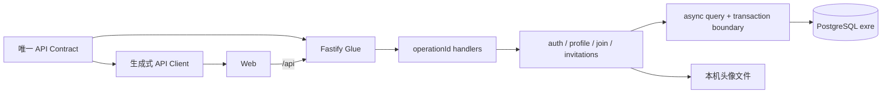

# Server 正式化与 PostgreSQL 迁移 RFC

- 状态：已获用户批准实施（开发阶段，不授权部署）
- 日期：2026-09-29
- 依据：已获用户确认的 `.notes/archive/server-promotion/specs/2026-09-29-server-promotion-design.md`
- 范围：`apps/mock-server/` → `apps/server/`；SQLite → 独立 PostgreSQL 数据库 `exre`

## 决策摘要

本仓库仅保留一个 Fastify Server，按 `api/openapi.yaml` 提供现有 `/api` 行为。将 `apps/mock-server` 改为 `apps/server`、包名改为 `@workspace/server`，用 `pg` 连接池和 Drizzle PostgreSQL 迁移建立空库业务模型。服务层通过异步参数化查询和显式事务客户端访问数据库。保留开发期测试、终端邮件、临时审核和占位人机验证。此 RFC 描述开发改造，不授权公网发布。

当前开发环境已在 `127.0.0.1:5432` 创建独立 `exre`，创建后检查 `public` 下业务表为零；该状态需要在执行迁移前重新确认。任何脚本都不能推导或使用 `outline` 作为默认数据库。既有 SQLite 内容及旧头像引用不导入，新库从当前有效业务模型开始。

## 事实、目标与约束

当前 `apps/mock-server/src/app.ts` 用 `fastify-openapi-glue` 注册 Contract 的 `operationId`，其中 `securityHandlers.bearerAuth` 同步读取会话；`apps/mock-server/src/auth/service.ts`、`apps/mock-server/src/join/service.ts`、`apps/mock-server/src/invitations/service.ts` 与 `apps/mock-server/src/profile/service.ts` 直接使用 `better-sqlite3`。`tests/helpers/auth.ts` 每例创建 SQLite 内存库，很多行为测试直接观察 SQL 行。`apps/mock-server/src/server.ts` 只在监听前检查固定 SQLite 文件及表结构，`apps/mock-server/src/db/migrate.ts`、`apps/mock-server/src/db/reset.ts` 是显式 CLI。现有 schema 与跨表规则见 `.ai/databases/data-model.md` 和 `apps/mock-server/src/db/schema.ts`。

验收要求：HTTP 方法、路径、`operationId`、输入/输出 schema、错误 envelope 与 `/api` 前缀不变；Web 继续只用 `@workspace/api-client`；空 `exre` 经显式迁移后可提供当前功能；启动不会创建或改写数据库；自动化测试绝不连接本机 `outline` 或本机 `exre`；开发期模块继续存在。不同数据库的数值与并发语义必须由测试证明等价，不以 `pnpm typecheck` 代替行为验证。数据库 schema 变化必须先对照 `.ai/databases/data-model.md`；实现完成后再同步该持久知识库、相关决策和根 `AGENTS.md`。

不包含 SQLite 数据导入、生产上线、其他 Server、真实邮件/人机验证、管理员权限重做、跨实例头像/限流、备份恢复系统。单实例 + PostgreSQL 是本阶段目标拓扑；当前本机头像和进程内限流仅按单实例行为验证。

## 组件与接口



### 路径与构建

用 Git 跟踪的移动保留 `apps/mock-server/src/` 中服务与开发模块，在 `apps/server/` 建立最终包。调整 `pnpm-workspace.yaml`、根及包 `package.json`、`pnpm-lock.yaml`、`tsconfig.base.json`、根 `tsconfig.json`（若含旧路径）、`vitest.config.ts`、`apps/web/vite.config.ts` 和 `scripts/rewrite-server-imports.mjs` 的包/目录引用；`@server` alias 名保持不变，只换目标。`scripts/rewrite-server-imports.mjs` 继续确保编译后 Node ESM 引用为产物内相对路径。`apps/web/src/api/client.ts` 的运行时 Client 边界不变。环境键 `MOCK_PUBLIC_WEB_BASE_URL`、`MOCK_PUBLIC_AVATAR_BASE_URL` 改为 `SERVER_PUBLIC_WEB_BASE_URL`、`SERVER_PUBLIC_AVATAR_BASE_URL`，示例、实际读取点和测试同步迁移，不保留含 Mock 名称的双配置入口。

新 `apps/server/.env.example` 给出带占位凭据的 `DATABASE_URL=postgres://<user>:<password>@127.0.0.1:5432/exre`，以及现有 HMAC 和公开 URL 配置。`apps/server/.env.local` 为本机未跟踪配置；`dev`、`start`、`db:migrate`、`db:reset` 和 SSO CLI 要有一致的环境加载方式，不能出现开发启动读到配置而迁移 CLI 读不到的情况。不得在文档、日志、测试快照或源码中记录真实连接串。服务继续绑定当前本地地址和端口，Web 的 `/api` 代理无需改语义。

### Contract 与异步调用链

只修改 `api/openapi.yaml` 的旧 Mock/PHP 描述，执行 `pnpm api:lint`、`pnpm api:generate`；生成文件只能由命令产生。保持 `serviceHandlers` 双向覆盖检查及 handler 原始返回值断言。`securityHandlers.bearerAuth` 必须 `await authServices.authenticateToken(...)` 后再把身份写入 `request.authSession`；已安装的 `fastify-openapi-glue@4.11.4` 实现会等待 security handler 的 Promise，仍需通过带有效/无效 token 的真实 `app.inject()` 用例验证未认证请求不会进入 handler。HTTP handlers 逐个等待服务异步结果，尤其是 `submitJoinApplication`、`downloadJoinApplicationAttachment` 需要取得结果后再设置状态码或附件 header，不能对 Promise 读取字段。资料上传的 `assertSessionCurrent` 回调改为接受事务查询上下文的异步验证，并在提交头像引用前完成；确认会话失效时删除刚写的新文件。

对外错误仍由 `apps/server/src/errors.ts` 生成固定 envelope。只按 SQLSTATE 和已知约束名映射业务冲突，例如邮箱登记唯一冲突映射现有 `JOIN_APPLICATION_EXISTS`；未知 `pg` 错误不回显 SQL、参数、连接 URL 或 `error.message`。认证、申请、邀请的现有 4xx/重试语义和不可缓存 header 由 Contract Test 验证。数据库不可用若当前 Contract 没有专门的错误定义，继续由统一错误处理返回安全的服务器错误，不在迁移中发明新 endpoint 或响应字段。

### 数据库访问边界

`apps/server/src/db/client.ts` 定义单一运行时连接池和窄接口，语义如下；这是待实现接口，不是现有代码：

```ts
interface SqlExecutor {
  query<Row>(
    sql: string,
    values?: readonly unknown[],
  ): Promise<{ rows: Row[]; rowCount: number | null }>
}
interface AppDatabase extends SqlExecutor {
  transaction<T>(
    run: (tx: SqlExecutor) => Promise<T>,
    mode?: 'read-committed' | 'repeatable-read-read-only',
  ): Promise<T>
  close(): Promise<void>
}
```

业务 SQL 使用 `$1` 等参数标记和 `pg` 参数数组；动态列名与排序片段只能由代码中封闭的白名单构造，值一律参数化。事务由边界模块 `pool.connect()` 取得**同一个**客户端，依次 `BEGIN`、运行回调、`COMMIT`；出错 `ROLLBACK`，最后释放客户端。回调及其下游服务、`apps/server/src/join/records.ts` 中的 helper 都接收 `tx`，事务内不得调用池级 `query`。对状态更新必须断言 `rowCount` 非空并符合预期。只读单语句可用池查询；申请状态/邀请/账号等跨多语句快照用 `REPEATABLE READ READ ONLY`，有写入的事务默认 `READ COMMITTED` 并靠行锁、条件更新、唯一约束保证状态转移。以 PostgreSQL 的语义为准，`READ COMMITTED` 的相继 SELECT 可看到不同提交快照。[node-postgres 事务说明](https://node-postgres.com/features/transactions)、[PostgreSQL 隔离级别](https://www.postgresql.org/docs/current/transaction-iso.html)。

`pg` 默认把 `bigint` 作为字符串读取。数据库边界对所有毫秒时间列和 `count(*)` 明确调用安全整数转换，拒绝超出 `Number.MAX_SAFE_INTEGER` 的值；不全局修改所有 PostgreSQL 类型解析器。`bytea` 映射 Buffer；表单 JSON 仍存 `text`，按既有 Contract 在读写时校验。服务侧禁止依赖 SQLite 的 `rowid`、`?` 参数、`GLOB`、`BEGIN IMMEDIATE`、`sqlite_master`、`PRAGMA`、`changes` 计数；行数统一从 `rowCount`/`RETURNING` 取得。`apps/server/src/db/client.ts` 只有可复用纯配置、连接与查询方法，CLI 模块仍禁止 import 触发写入。

## 数据模型与迁移

`apps/server/src/db/schema.ts` 使用 Drizzle `pg-core`。`apps/server/drizzle/` 建立**新的 PostgreSQL 迁移历史**，第一条迁移一次创建当前有效模型及保留的 `admin` 社区身份组；不移植 SQLite 旧注册表、旧 `general` 组或历史数据回填。旧 `apps/mock-server/drizzle/` 作为仓库实现历史移除，不在新库执行。schema 与生成 SQL 必须逐项核对下表，特别是 Drizzle 是否实际生成所有 check 与部分唯一索引；生成工具不能替代 SQL 审阅。

| 数据范围         | PostgreSQL 表达      | 必守规则                                                                                       |
| ---------------- | -------------------- | ---------------------------------------------------------------------------------------------- |
| 标识、邮箱、表单 | `text`               | 邮箱在应用侧沿用当前规范化，再由唯一键/邮箱登记主键裁决；表单 `form_json` 保持文本和版本校验   |
| 时间             | `bigint` 毫秒        | 不变更 HTTP 的毫秒数字；读出必须安全转换，数据库不以时区时间戳悄悄改变语义                     |
| 申请附件         | `bytea` + 整数长度   | `octet_length(bytes)` 与记录长度相等，摘要匹配小写 64 位十六进制，应用读出仍复核真实摘要       |
| 关系             | 主键、外键、限制删除 | 申请/表单/附件/登记、邀请/投递、账号/会话/身份组关系与现有有效模型一致                         |
| 唯一性           | 普通/部分唯一索引    | 邮箱登记每邮箱一行；同申请最多一条 active 邀请；附件 ordinal、投递版本、账号邮箱和头像引用唯一 |
| 状态             | `CHECK`              | 申请审核时间、邀请完成账号与时间、投递结束时间、验证码失败次数等现有状态约束保留               |

`db:migrate` 的顺序为：解析 `DATABASE_URL` 并拒绝非 `exre` 路径 → 连接并确认 `current_database() = 'exre'` → 检查已有 schema 与 migration journal 是否属于受支持状态 → 显式运行 Drizzle migrator → 再检查表、关键索引/约束及 `admin` 种子。`db:generate` 只生成候选 SQL，不连接或写目标库。`apps/server/src/server.ts` 在监听前仅做连接、数据库身份、完整结构与配置检查；缺库、缺迁移、半迁移、错误 HMAC 等均失败并提示显式命令，不调用 migrator。迁移前不自动创建数据库。Drizzle PostgreSQL 迁移默认有独立的 migration schema，测试用例需同时隔离业务 schema 与 journal。[Drizzle 迁移文档](https://orm.drizzle.team/docs/migrations)、[Drizzle 配置](https://orm.drizzle.team/docs/drizzle-config-file)。

开发专用 `db:reset` 要求显式输入数据库名 `exre`，且只接受回环地址上的 `exre` 连接；与 `db:migrate` 一样核验连接后的真实库名。本机开发实例使用 `127.0.0.1:5432`，隔离测试容器可映射到其他回环端口。先以目录查询确认待清理的 `public` 业务表、索引、序列、视图及迁移 journal 属于应用清单；出现未知对象立即终止，不能 `DROP DATABASE` 或无条件 `DROP SCHEMA public CASCADE`。仅清理明确列出的应用对象和迁移记录，然后重跑基线；头像目录不在清理范围。CLI 的直接执行校验必须在任何写入前发生。测试要覆盖错误 URL、误指向 `outline`、未知表/对象和缺少确认值时**零写入**，并在隔离容器验证成功重置后的完整基线。

`apps/mock-server/data/avatars/` 属于旧工作区本地文件，不随 Git 的目录移动。空库没有其引用，新 Server 从 `apps/server/data/avatars/` 开始；实施前清点旧目录，保留旧文件，不自动删除或拷贝到新目录。申请附件随新库为空；没有备份/转储/回填路径。

## 并发与副作用

| 操作            | PostgreSQL 事务规则                                                                           | 可观察结果                                                            |
| --------------- | --------------------------------------------------------------------------------------------- | --------------------------------------------------------------------- |
| 提交申请        | 同一事务插入申请、邮箱登记、表单及全部附件；登记主键作为并发裁决                              | 一份完整申请或整体回滚；重复邮箱返回既有冲突                          |
| 审核与重发      | 先锁申请行，再按申请关联锁邀请，最后锁/更新邮箱控制行；更新状态使用条件谓词并检查行数         | 同一申请仅一次状态转换，重复同意保持幂等；冷却与投递事实不丢失        |
| 请求/验证验证码 | 对已有申请按申请 → 邀请 → 邮箱控制顺序锁定；未知邮箱仅对控制行执行原子 upsert                 | 验证码只消费一次，失败次数/冷却不会丢更新；重发不错误地重置已签发凭证 |
| 完成注册        | 先读取凭证定位申请，再锁申请 → 邀请，重新读取并验证凭证及期限，然后插入唯一邮箱账号并完成邀请 | 同凭证重复完成返回原结果，竞争请求不能创建两名账号                    |
| 资料与头像      | 锁账号行；上传文件成功后在同一数据库事务中复查会话与更新头像引用；事务后处理旧文件            | 新引用不指向半写文件；失败清理新文件，孤儿旧文件可显式核查            |

上表锁顺序约束同一业务对象的路径；清理过期记录不得在事务中无界扫描并锁住无关申请/邀请。过期判断首先以请求时服务端时间完成，持久化清理使用受控、幂等更新；如清理会触碰正在转换的记录，必须遵守相同锁顺序或改成条件更新并验证结果。密码哈希、图片转换、邮件投递保持在事务之外。审批事实及投递尝试先提交，再调用现有邮件适配器；迟到投递结果只能以 `status='pending'` 条件写入自己的尝试记录。上传文件与数据库不能原子提交，保留现有“可产生待清理孤儿文件、不可留下未完成引用”的边界。

只在确认事务回调不含外部副作用时，对 PostgreSQL `40001` / `40P01` 以有上限的**整笔事务**重试；单独重放最后一条 SQL 会破坏状态校验。`23505` 仅根据已知约束名映射为既有业务冲突或按操作重新读取幂等结果，不做盲重试。[PostgreSQL 序列化失败说明](https://www.postgresql.org/docs/current/mvcc-serialization-failure-handling.html)。

## 测试隔离与验证

`pnpm test` 对涉及数据库的用例启动临时 PostgreSQL Testcontainers 容器，容器内数据库名为 `exre`；测试进程持有容器句柄，无法启动时显式失败，绝不回退到本机 URL。每例使用新建 schema 和独立连接池，并把连接的 `search_path` 指向该 schema；Drizzle migrator 使用同名 `migrationsSchema` 以免多个用例共享 `drizzle.__drizzle_migrations`。测试清理自己的 pool、schema 和容器；两连接竞争测试在同一用例 schema 内使用独立客户端。`tests/helpers/auth.ts` 变成异步夹具，既有用例等待 `setup`、服务返回值和清理；与 SQLite 结构绑死的历史迁移测试改为 PostgreSQL 基线/约束/安全 CLI 用例，而不是删除整个测试模块。[Testcontainers PostgreSQL 模块](https://node.testcontainers.org/modules/postgresql/)。

验证分层如下：

1. `pnpm api:lint` 与 `pnpm api:generate`；比较生成的 `packages/api-client/src/generated/schema.d.ts`，不得手改。
2. `pnpm typecheck`、`pnpm test`、`pnpm build`；Contract Test 继续覆盖真实 Fastify 路由和原始 handler 返回值，尤其是异步 bearer 认证、错误 envelope、附件响应 header、上传失败回滚。
3. PostgreSQL 集成测试覆盖全部关键约束、空库迁移、重复迁移、错误目标拒绝、半迁移启动拒绝、未知对象 reset 拒绝、附件字节/摘要、毫秒 bigint 边界。
4. 双连接并发测试覆盖相同邮箱申请、审核/重发、验证码消费与失败计数、同一完成凭证、头像会话失效及投递迟到结果；检查最终数据库事实和响应语义。
5. 在本机 `exre` **再次确认为目标库后**显式运行迁移，启动单实例 Server/Web，做健康、登录/会话、申请→邀请→完成、资料头像与附件的本地冒烟；记录每项 PASS / FAIL / NOT_EXECUTED，不能把静态测试算作真实服务冒烟。

基线曾在独立 worktree 的未修改状态运行 `pnpm test`：50 个测试文件、365 个测试通过；这只证明迁移前基线，不证明本 RFC 的迁移实现。若测试规模改变，需按行为覆盖关系说明原因，不以总数量直接代替语义验收。

## 落地顺序、回退和文档

先保留旧实现作为可比较基线；完成新包命名与构建接线，再写 PostgreSQL schema/显式 CLI/测试隔离；随后按账号与 SSO → 资料头像 → 申请附件 → 邀请投递的依赖顺序迁移异步调用链。每段验证通过后继续下一段，最终移除 SQLite 运行依赖与旧迁移目录，核对根命令、配置和 lockfile。该顺序是实施依赖，不表示对外分批启用两个 Server。

切换前停止旧服务；新数据库从空库迁移，没有双写或数据回填窗口。若本地验证失败，停止新 Server、保留 `exre` 供诊断、在原 worktree 使用旧 SQLite 开发环境继续工作；新的 PostgreSQL 测试/开发数据不会自动恢复到 SQLite。`db:reset` 属于显式破坏性开发命令，不能作为启动或失败回退动作。旧头像文件保留在旧目录。

更新当前代码与配置文案、`README.md`（若存在）、根 `AGENTS.md`、`.ai/databases/data-model.md`、`.ai/architectures/`、`.ai/decisions/`、`.ai/knowledge/` 及相关 `.notes/` 档案中“另接 PHP Server / MySQL”“本包只是假服务”的过期断言。归档只删改已过时目标说法，保留需要解释历史决策的事实；表单字段如 `previousServer` 的业务含义保留。数据库与 Server 已验证的长期事实按 `codebase-documenter` 写入 `.ai/`，同一事实只在一个知识位置维护并更新索引。文档、注释内仓库路径均用根目录相对路径的行内代码。

## 风险与验收停止条件

| 风险                                                  | 缓解与发现方式                                                                       |
| ----------------------------------------------------- | ------------------------------------------------------------------------------------ |
| 同步到异步时遗漏 `await`，认证或附件 handler 过早返回 | 类型检查 + 带真实 Glue 的认证/附件 Contract Test；检查每个 handler 字段读取点        |
| 事务内误用 pool，写入分散到不同连接                   | 事务接口只暴露 `tx`；双连接竞争与故障回滚测试；代码审阅查询调用链                    |
| SQLite 与 PostgreSQL 约束、排序、整数或二进制语义不同 | 审阅生成 SQL；专门的约束、排序、bigint、附件边界测试                                 |
| 过期清理与并发转换交错导致死锁或状态回退              | 固定锁顺序、条件更新、有界重试；双连接阻塞/迟到测试                                  |
| 误连或误清理 `outline`/其他对象                       | URL 与 `current_database()` 双核验、reset 本机/显式确认/对象清单、拒绝用例           |
| 测试串库或 migration journal 串例                     | 测试容器 + 逐例 schema 与 journal 隔离，禁止环境回退；验证容器停止后本机库表数未变化 |
| 本地旧头像被目录更名掩盖                              | 迁移前清点旧目录并保留，不自动复制或删除                                             |

停止本阶段验收的条件：Contract 意外破坏、任一关键行为/并发用例失败、迁移/启动安全守卫失效、测试碰触本机其他数据库、`exre` 空库无法按显式命令构建、或构建/类型检查未通过。环境导致的未执行项如实记录，不宣称全部通过。生产发布另开设计，不从本 RFC 的开发验收自动推导上线许可。

## 待跟进

本 RFC 没有未定的实现前置架构选择。实施时若库的实际 API 与上述隔离或事务接口不符，应先以安装版本的代码及隔离测试验证并修订 RFC，再改实现；不能降低“同连接事务”和“测试不碰本机库”的要求。公网权限、邮件、人机验证、备份及多实例共享方案属于后续独立议题。
