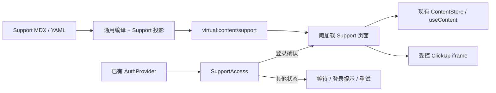

# 支持中心：受控页面、常见错误内容与 ClickUp 嵌入 RFC

- 日期：2026-10-12
- 状态：RFC 草案；来源设计已由用户确认
- 模块目录：`.notes/support-center/`
- 来源设计：`.notes/support-center/specs/2026-10-12-support-center-design.md`

本文保留 2026-10-12 的初始 RFC。2026-10-13 后续需求已调整反馈入口、3D 图标和 ClickUp 双视图；当前已接受边界与实现状态见 `.ai/decisions/support-center/01-authenticated-support-and-clickup-view.md`，实际接线见 `.ai/architectures/web/content-rendering.md`。下文的未开放卡片、单视图及未提供 ClickUp 来源等描述属于初始基线。

## 决策摘要

在 Website 增加仅登录用户可进入的支持中心。首页依次展示简洁介绍、三个未开放的反馈入口、可快速展开的精选错误案例、具体成员联系方式，以及底部 ClickUp 官方面板。常见错误另有站内列表和详情页。

复用现有会话状态与通用 MDX/YAML 内容管线，新增 Support 业务适配器。ClickUp 使用经过核对的单 iframe 视图配置，不接入 API，不执行任意嵌入 HTML。本期不新增 HTTP operation、数据库结构或 Outline 能力。

来源设计于本次会话中获得用户明确确认。本 RFC 保留来源文件，细化实现所需的文件格式、组件接口、异常语义和验证边界；RFC 生成不代表功能已实现或真实外部面板已验收。

## 已核实的工程基础

| 事实                                                                                             | 依据                                                                                                                   |
| ------------------------------------------------------------------------------------------------ | ---------------------------------------------------------------------------------------------------------------------- |
| `App` 位于统一 `AuthProvider` 下；普通业务页面通过 `RootLayout` 展示导航与登录弹窗。             | `apps/web/src/App.tsx`、`apps/web/src/routes/RootLayout.tsx`                                                           |
| 认证状态有 `loading`、`anonymous`、`unavailable` 和 `authenticated`，会话恢复经过 `/auth/me`。   | `apps/web/src/auth/AuthContext.tsx`、`packages/components/src/AuthArea.tsx`                                            |
| 普通弹窗登录成功后重新加载当前地址；独立登录页则返回首页。                                       | `apps/web/src/auth/AuthFlow.tsx`                                                                                       |
| 桌面和移动导航在同一个 `SiteHeader` 中实现，当前尚无 Support 项。                                | `packages/components/src/SiteHeader.tsx`                                                                               |
| 通用 `ContentDefinition` 已提供分类、schema、业务投影，虚拟模块导出数据、资源和正文加载器。      | `apps/web/build/content/compiler.ts`、`apps/web/build/content/plugin.ts`                                               |
| 通用加载器只承诺 `ContentModule.default`，没有声明 `toc` 导出。                                  | `apps/web/src/content/store.ts`                                                                                        |
| `useContent` 拒绝过时的页面加载结果，失败 Promise 可重试；浏览器模块缓存失败还需要整页重新加载。 | `apps/web/src/content/useContent.ts`、`.ai/architectures/web/content-rendering.md`                                     |
| Website 测试由 Vitest 文件模式发现；已有内容编译和真实 Fumadocs/Vite 集成测试。                  | `vitest.config.ts`、`scripts/runtime/tests.mjs`、`tests/content/`、`apps/web/src/content/compiler.integration.test.ts` |

用户指定的视觉参考是已审阅的本地 About 页面，而不是本工作树任意版本的 About CSS。实施时依据来源设计和 `.superpowers/brainstorm/13166-1791802386/content/support-about-v3.html` 的简洁方向使用 ExUI token，不复制预览中的独立主题变量或全局 CSS。

## 范围与成功条件

- `/support`、`/support/errors` 和 `/support/errors/:slug` 均受现有登录状态控制。未确认登录时不显示业务内容、不请求 ClickUp iframe。
- 桌面和移动主导航只有登录确认后显示 **Support**，其子路由保持该项选中。
- 首页精选案例最多三个，默认折叠；快速说明、完整详情链接和查看更多入口均来自同一条错误内容。
- 正文、联系人和嵌入配置通过构建校验，草稿不进入发布投影。
- 反馈卡片只有用途说明与“即将开放”，不创建表单或伪造提交。
- ClickUp 面板位于首页最后一个业务区块。未知或缺少真实数据时展示实际空态。

不包括独立开发页、反馈提交、附件、投诉处理后台、搜索、热度统计、投票、ClickUp API 同步、Enterprise OIDC 集成或部署上线。

## 结构与控制流

### 文件职责

以下为拟新增路径，不是已存在的实现。

| 路径                                                                   | 职责                                                                             |
| ---------------------------------------------------------------------- | -------------------------------------------------------------------------------- |
| `apps/web/build/support/schema.ts`                                     | 错误、分类、联系人、设置 schema；复用通用 `text`、`slug`、`imageSchema`。        |
| `apps/web/build/support/definition.ts`                                 | Support 文件分类、跨引用校验、发布投影及 Fumadocs 集合声明。                     |
| `apps/web/build/support/clickup-policy.ts`                             | 已核实 ClickUp 来源的固定 host 策略与 URL 校验，保持构建侧。                     |
| `apps/web/content/support/errors/`                                     | 已审核或草稿 MDX 错误条目。                                                      |
| `apps/web/content/support/contacts.yaml`                               | 联系人目录，可合法为空。                                                         |
| `apps/web/content/support/settings.yaml`                               | 分类目录与可选 ClickUp 配置。                                                    |
| `apps/web/src/content/support/types.ts`、`virtual.d.ts`、`registry.ts` | 发布投影的类型、虚拟模块声明、资源和正文适配。                                   |
| `apps/web/src/pages/Support/`                                          | `SupportRoutes`、首页、列表、详情、案例、联系人、iframe 和页面局部 CSS Modules。 |
| `apps/web/src/routes/SupportAccess.tsx`                                | 不依赖内容注册表的会话访问边界。                                                 |

注册点为 `apps/web/build/collections.ts` 和 `apps/web/source.config.ts`。只为错误 MDX 定义 Fumadocs `supportErrors` doc 集合；联系人和设置 YAML 由通用 `readContent` 及 Support 投影消费，不生成没有正文用途的浏览器 meta import。

业务 UI 默认留在 Support 目录，复用既有 `ContentProse`、`ContentImage`、MDX 映射和 ExUI。通用编译器不识别 Support 路由或 ClickUp；About 业务不依赖 Support。

## 路由、会话与导航接口

### 访问边界

`App` 在 `RootLayout` 下登记 `/support/*`。`SupportAccess` 放在惰性页面的 `Suspense` 和内容错误边界之外，先读取 `useAuth().state`，只有 `authenticated` 才返回页面子树。不能把 Support registry 静态导入 `App`、`RootLayout`、`SiteHeader` 或访问边界，也不在导航悬停时预加载它。

| 状态            | 输出                               | 动作                       |
| --------------- | ---------------------------------- | -------------------------- |
| `loading`       | “正在确认登录状态”的状态提示。     | 等待现有恢复流程。         |
| `anonymous`     | “登录后可访问支持中心”和登录按钮。 | 打开 RootLayout 已有弹窗。 |
| `unavailable`   | 固定认证不可用文案与重试按钮。     | 调用 `retrySession()`。    |
| `authenticated` | 当前 Support 页面。                | 正常页面交互。             |

认证变化使子树直接卸载，包括已经展开的案例、加载中的正文和 iframe。缓存已加载的静态模块不会授予访问权限；非登录状态不得继续渲染缓存内容。无需取消已经发出的原生动态 import，但它的完成结果不能绕过当前会话边界。

`SupportRoutes` 匹配首页、列表、详情以及受保护的未知子路由。详情以当前 published registry 查找 slug，不存在则输出带返回入口的 Support 404。地址末尾的多余 `/` 可用站内 replace 规范化，保留 query 和 hash；不发起任意外部重定向。

### 登录与焦点

登录弹窗继续使用现有 `AuthFlow`，成功后的 `reload()` 保留支持深链接，不修改 token 生命周期或独立登录页行为。

为页面上的登录按钮提供一个布局级出口：`RootLayout` 的 Outlet context 暴露 `requestLogin(trigger: HTMLElement): void`。它清空普通登录预填邮箱、记录发起按钮，并调用已有 `auth.openModal('login')`。关闭弹窗时，若原按钮仍连接且可聚焦，则恢复到该按钮；否则使用 RootLayout 现有桌面/移动触发器回退。顶栏自身的登录/注册操作清除页面发起者记录，防止错误恢复焦点。

该接口仅负责布局事件和焦点，不新增认证状态、副本 Modal 或全站事件总线。

### 主导航

`SiteHeader` 已接收 `auth.state`，据 `status === 'authenticated'` 生成实际可见的导航项。桌面渲染、移动选项、移动导航校验和当前选中项使用同一份可见集合。

`/support` 和 `/support/` 后代都归于 Support；不能把 `/support-other` 当作后代。状态变化后即使导航选择值仍是旧路径，也不能再次通过移动下拉进入隐藏的支持选项。

## 内容文件契约

所有 object 使用严格 schema，未知字段使 `content:check` 或构建失败。整数要求有限、非负并在安全整数范围内；slug 校验原始 kebab-case 字符，不静默裁剪或修正。排序字段默认 `0`，同值以稳定 slug/id 顺序打破平局。

### 错误 MDX frontmatter

文件名固定为 `errors/<slug>.mdx`，文件 basename 必须与字段 slug 一致。

| 字段            | 类型与规则                                     | 用途                       |
| --------------- | ---------------------------------------------- | -------------------------- |
| `slug`          | 必填，通用 slug schema；全目录唯一。           | 路由和稳定标识。           |
| `title`         | 必填，非空文本。                               | 列表、案例和详情标题。     |
| `description`   | 必填，非空纯文本。                             | 列表及详情摘要。           |
| `category`      | 必填，settings 中已存在的分类 id。             | 分类标签。                 |
| `quickAnswer`   | 必填，非空纯文本，不解释为 HTML/MDX。          | 首页展开后的快速说明。     |
| `order`         | 可选，非负整数，默认 `0`。                     | 全列表编辑顺序。           |
| `featuredOrder` | 可选，只允许 `1`、`2`、`3`，整个目录不得重复。 | 首页精选位置；缺省不精选。 |
| `draft`         | 可选 boolean，默认 `false`。                   | 排除发布投影与 loader。    |

草稿同样接受字段、文件名、分类、资源和引用校验。正文从二级标题开始，不重复页面 h1；使用已有白名单 `Callout`、`ContentImage` 与标准 Markdown，不注册 About 专属作者组件。

### 分类与设置

`settings.yaml` 必須存在，形态为 `{ categories: Category[], clickup: ClickUpConfig | null }`。`Category` 为 `{ id, label, order }`，id 唯一且使用通用 slug，label 非空，order 遵守上述整数规则。

`categories: []` 在没有错误条目时合法。有错误条目时，每个 category 引用都必须存在。分类只作为发布内容的标签，本期不生成搜索或过滤组件。

`ClickUpConfig` 为 `{ title: string, embedUrl: string, publicUrl?: string }`。title 为 iframe 的非空可访问名称，embedUrl 为必填的已核实 iframe URL，publicUrl 为可选原始分享链接。null 表示尚未配置；空字符串不能代替 null。

### 联系人

`contacts.yaml` 必須存在，形态为 `{ items: Contact[] }`。`Contact` 字段如下：

| 字段           | 规则                                                 |
| -------------- | ---------------------------------------------------- |
| `id`           | 必填，唯一 kebab-case。                              |
| `name`、`role` | 必填，非空真实展示资料。                             |
| `order`        | 可选，非负整数，默认 `0`。                           |
| `draft`        | 可选 boolean，默认 `false`；草稿不显示。             |
| `avatar`       | 可选通用 ImageRef，位于本集合 `assets/`。            |
| `qq`           | 可选非空 ASCII 数字文本，保持字符串，不转为 number。 |
| `email`        | 可选单个邮箱，校验邮箱格式并拒绝换行及控制字符。     |

`items: []` 合法，不用虚构人物满足 schema。两个联系方式均缺少时，仅展示身份与职责，不渲染联系按钮。头像图片、说明和联系方式不能由预览示例自动转为真实资料。

### 发布投影与引用

`SupportRegistry` 公开形态为 `{ errors: ErrorEntry[], featured: string[], contacts: ContactEntry[], categories: Category[], clickup: ClickUpConfig | null }`。

`ErrorEntry` 是去除 draft 后的 frontmatter，并增加 `id` 与由 slug 生成的 `url`；id 保持 `errors/<slug>.mdx`，url 由 Web/Support 业务定义为 `/support/errors/<slug>`。contacts 同样移除 draft。featured 存放最多三个已发布错误 slug，按 featuredOrder 排序，页面查找同一错误对象；不重复存储 quickAnswer 或正文。

投影不导出草稿条目、草稿正文 loader 或草稿独占图片。`virtual:content/support` 延续现有 `data`、`assets`、`loaders` 三个出口；Web registry 用现有 `createContentStore(loaders)` 创建正文 store，资源适配通过 assets 映射。

Support MDX 中允许的站内目标为 `/support`、`/support/errors`、存在的错误详情，以及这些正文中实际存在的锚点。公开正文不能引用草稿；草稿也不能引用不存在的目标。外链沿用通用的无凭据 HTTPS 校验；本期不默认允许任意站内路径。由按钮模板生成的返回路由不写入 MDX 引用图。

## 页面组件契约

### 首页

- `FeedbackEntries` 使用固定三项描述，输出普通卡片和未开放状态，不接受提交回调。
- `FeaturedErrors` 接收 registry 已解析的错误对象。使用原生 `details/summary` 或 ExUI 具有等价语义的折叠组件，支持多项独立展开，默认全部关闭。
- `ContactCards` 接收已发布联系人和资源适配结果。QQ 复制由页面事件调用浏览器 Clipboard API，成功/失败使用根宿主的 `ExMessage`；失败仍可手工选择文字。邮箱只由通过 schema 的单邮箱构造 `mailto:`，不接受任意 href。
- `ClickUpPanel` 只接受经过构建校验的 config 或 null，不接收 raw HTML、token 或 API Client。

空知识库显示“常见错误内容整理中”。已有内容但没有精选时显示说明和查看更多，不自动挑选草稿或补充假案例。联系人目录为空显示“联系人资料整理中”。缺少 ClickUp 配置显示“开发面板暂未配置”。

“找到解决办法”继续采用浅灰容器、分隔的案例行与底部查看更多；正式实现没有“示例内容”或“正式精选案例待补充”的预览标签。其他区块与 About 的黑白、粗体标题和浅灰圆角设计一致。

### 列表与详情

列表显示 errors 的实际数量，按 order/slug 排序；每条为站内 Link，展示 title、description 和分类 label。不存在的分类属于构建错误，不在浏览器填补未知分类名。

详情用稳定 id 调用 `useContent`；MDX 使用 `createMdxComponents` 与 `ContentProse`，仅替换站内链接和本集合资源适配。等待、失败、重试与整页重新加载沿用通用行为；页面级 lazy chunk 失败另由外层内容错误边界接住。

桌面目录从已经渲染的正文容器中读取拥有 id 的 h2/h3，生成其文本与锚点；不读取不存在的 `ContentModule.toc` 接口，不扫描页面主标题、面包屑或代码块文本。正文更换/卸载时清理旧目录；没有标题则不显示目录。移动端可以隐藏目录，正文结构保留。

进入列表/详情时将焦点移到页面 h1；正常 hash 导航优先滚动到实际目标。展开首页案例不抢焦点、不改变 URL。面包屑、返回列表和返回联系成员的链接均使用确定的站内目标。

## ClickUp URL 与嵌入契约

### 真实代码接收点

用户尚未提供实际官方代码，因此不臆造 embed URL 或 host。实施可先完成 null 配置与组件；启用真实面板之前，须核对实际代码并在 `clickup-policy.ts` 登记固定 host 清单，再填写 settings。

该清单由应用代码维护，不能让 settings 自己声明任意“允许来源”。embedUrl 和 publicUrl 均要求 HTTPS、无用户名/密码、没有控制字符，port 为空或 `443`，hostname 与清单精确匹配。拒绝其他域名、通配后缀、协议相对地址、非 HTTPS 协议和拼接的多 URL。不自行删除真实官方 URL 的必要路径或查询参数。

这是内容接入门槛，不是未解决的产品选择。若真实官方代码无法满足单 iframe 范围，记录差异并在接入前重新评估；不采用猜测 URL、任意 HTML 或后台代理来绕过。

### 渲染与隔离

Web 以明确 React props 生成 iframe：已校验 src、非空 title、`loading="lazy"`、`referrerPolicy="no-referrer"` 和本站 CSS 宽高。HTML 中的 class/style 不作为业务配置；不复制 inline event、script 或任意属性，不使用 `dangerouslySetInnerHTML`。

初始外层尺寸采用宽度 100%，桌面至少 560px、窄屏至少 480px 的 iframe 阅读高度，最终以真实视图桌面/移动验收调整。页面自身无横向溢出，ClickUp 内部是否滚动由视图决定。

不增加未经验证的 sandbox/allow 权限组合导致官方视图失效；以本期单 iframe、可信来源和浏览器跨域隔离作为边界。若实际代码明确依赖额外 iframe 权限，记录并验证后仅加入必要的权限，不直接 spread 原始属性。既有 CSP 若限制来源，只处理核实后的精确 origin，不扩大成任意来源。

publicUrl 存在时提供新标签页打开链接，带 `noopener noreferrer`。外部入口和“若面板无法显示，可在新标签页打开 ClickUp”说明始终可用，不等候不可靠的故障探测。没有 publicUrl 时不渲染该按钮。

不能通过 iframe `load`、HTTP chunk 测试或截图占位判定真实任务显示成功。外部应用错误、撤销分享或第三方 Cookie 限制可能只发生在跨域 iframe 内，必须真实浏览器验收。Website 不读取 iframe DOM、同步其中的账号或控制其任务点击行为。

普通公开链接独立于 Website 登录，静态 MDX 也不承载秘密内容。实际分享视图须由内容维护者确认任务和字段适合目标用户查看；不替用户开启公开分享，不改变 ClickUp Workspace 权限。Dashboard 不等同于可以公开分享的 Board 任务视图，依据见 `.notes/support-center/specs/2026-10-12-clickup-integration-research.md`。

## 备选方案与取舍

| 方案                        | 取舍                                                                                   |
| --------------------------- | -------------------------------------------------------------------------------------- |
| 本 RFC：仓库内容 + 官方面板 | 复用现有能力，最快接入真实进度；ClickUp 内部样式和权限独立，须接受跨域限制。           |
| ClickUp API 后端投影        | 更能控制字段、布局和本站权限，但增加认证、缓存、同步及 HTTP Contract，超出已确认本期。 |
| 只跳转 ClickUp              | 最省接入工作，但不能满足面板直接显示在支持首页的决定。                                 |
| 将 FAQ 或反馈放入 Outline   | 引入文档服务权限与路由边界，不符合已确认的独立 Support MDX 内容路径。                  |

选择不建立数据库投影、后台管理或新反馈系统。后续真提交能力须另行设计 Contract、身份、附件和处理流程。

## 风险与验证信号

| 风险                               | 缓解或接受方式                                              | 检测                                                   |
| ---------------------------------- | ----------------------------------------------------------- | ------------------------------------------------------ |
| UI 隐藏导航却仍允许匿名渲染内容    | 统一会话边界置于页面与 registry 渲染之外。                  | 四状态路由测试、匿名深链接和跨标签退出浏览器验收。     |
| 会话失效后迟到正文继续显示         | 子树卸载，复用 `useContent` 请求隔离。                      | 延迟 loader 期间退出/切换路由，结果不得显示。          |
| 草稿、错误字段或联系人资源意外发布 | 严格 schema、引用图和发布投影。                             | 真实 `readContent(supportDefinition)` 负例与输出检查。 |
| ClickUp 公开内容范围大于预期       | 由维护者审阅实际分享范围，不承诺本站会话控制原链接。        | 无痕浏览分享链接，检查可见任务和字段。                 |
| 视图不可嵌入、权限或 Cookie 限制   | 固定来源校验、外部链接回退、真实接入 gate。                 | 用实际代码在目标浏览器测试。                           |
| 预览样例被误作运营内容             | 初始合法空目录，不发布示例人物或错误。                      | 内容审阅与浏览器空态验收。                             |
| 正文目录依赖并不存在的 loader 出口 | 从已渲染 h2/h3 派生目录。                                   | 真实编译正文，验证目录锚点和加载切换。                 |
| 样式复制影响其他页面               | Support CSS Modules、既有主题和 token，不复制预览全局 CSS。 | About/首页回归、明暗主题和窄屏检查。                   |

## 测试与验收矩阵

测试以真实被测函数和最小边界替身为主，不能 mock 掉 Support 投影或访问边界后宣称覆盖。

| 层               | 必测行为                                                                                                                |
| ---------------- | ----------------------------------------------------------------------------------------------------------------------- |
| 内容 schema/投影 | 文件名与 slug、重复标识和精选顺序、非法分类、未知字段、草稿与资源不公开、链接/锚点、合法空目录、非法 ClickUp URL。      |
| 路由与组件       | 四种会话状态、匿名不挂载 loader/iframe、状态变化卸载、支持子路由选中、移动导航隐藏、404、深链接地址保留、登录关闭焦点。 |
| 用户行为         | 多案例展开与收起、同条目完整详情、查看更多、列表导航、空态、QQ 复制失败、正文延迟结果和重试。                           |
| 真实内容编译     | 一篇临时测试 MDX 经过 Fumadocs、virtual module 和渲染，验证正文、资源及目录；不将该测试正文放入正式内容。               |
| 真实浏览器       | 登录/退出与跨标签变化、详情刷新、键盘/焦点、明暗主题、长姓名和邮箱、手机页面无横向溢出。                                |
| 真实 ClickUp     | 实际 iframe 显示任务、点击详情、尺寸、原链接、分享失效与 Cookie 限制；无配置不等于此项通过。                            |

内容测试新增于 `tests/content/support.test.ts`，UI/路由测试邻近新模块；既有 `SiteHeader.test.tsx`、RootLayout 及认证路由测试补充新增边界。根 Vitest 模式已覆盖这些目录，不为新增 Website 测试修改 Outline manifest。

实施时再次检查 `TESTING.md` 是否新增；当前缺少该文件。完成相关定向测试后运行 `pnpm --filter @workspace/web content:check`、`pnpm typecheck`、`pnpm test` 和 `pnpm build`。完整 `pnpm test` 会涉及既有数据库容器及定制 Outline 流程，使用其现有隔离编排，不回退开发库。自动、真实浏览器和真实 ClickUp 分开报告；设计阶段不执行代码测试来代替未来实现验收。

## 落地顺序与回退

1. 定义 Support schema/投影、注册点、合法空元数据和真实编译测试；不填写虚构运营内容。
2. 接入访问边界、布局登录出口和两端导航，验证匿名请求与失效卸载。
3. 接入首页、列表、详情及正文恢复，使用已确认的简洁视觉与案例交互。
4. 完成 iframe null 态与 URL 校验；取得真实官方代码后核对 host、配置视图和分享链接，独立完成接入验收。

这些是依赖顺序，不授权创建提交。代码实施和最终交付须在用户另行要求后进行。

页面和 content 集合一同落地。只有完整页面依赖可用后才显示 Support 入口，不能先暴露指向空路由的导航。联系人和知识库可以先以实际空态使用，但对外报告须明确内容尚未补充。没有真实 ClickUp 验收不能将整个开发进度接入报告为完成。

停用面板只需将 clickup 设为 null 并重新构建，不改变历史数据。撤回整个功能时移除 Support 导航与路由登记，同时撤销相应集合注册；保留内容源以便再次启用。不删除数据库、账号、头像、Outline 文件或 ClickUp 任务。本期没有 migration、回填或凭据轮换，部署仍不属于授权范围。

## 输入依赖与后续决策点

| 输入                                 | 提供或核对责任                                       | 何时需要               | 未取得时                            |
| ------------------------------------ | ---------------------------------------------------- | ---------------------- | ----------------------------------- |
| 官方 iframe 代码和原分享链接         | 用户提供；接入人员核对真实 origin、视图与必要属性。  | 启用真实开发面板之前。 | clickup 为 null，接入验收未执行。   |
| 联系人姓名、职责、头像和公开联系方式 | 用户或内容维护者确认。                               | 展示真实联系人之前。   | items 为空，显示整理中。            |
| 正式错误正文、分类与三个精选位置     | 内容维护者核对适用范围与解决办法。                   | 发布案例之前。         | 错误目录为空，显示整理中。          |
| 多脚本/非单 iframe 的实际代码        | 接入人员记录与来源设计的差异，用户决定是否扩大范围。 | 出现代码形态差异时。   | 保持禁用真实面板，不执行任意 HTML。 |

以上是明确的内容或供应商接入 gate，没有隐藏的产品选择。稳定结论提炼到 `.ai/` 需按 `AGENTS.md` 另行取得用户同意；本 RFC 不自行登记持久知识或替用户授权实现。

## 本次文档校验

- 已对照完整来源设计核对路由、视觉、反馈边界、案例交互和 ClickUp 位置。
- 已核对认证、布局、导航、内容定义、虚拟模块、loader 及测试发现源码；新接口与拟新增文件均与现有能力区分。
- 已检查严格输入、草稿投影、失效会话、跨域面板、空态、回退和验证要求。
- 此处记录文档校验；没有实施生产代码、执行正式功能测试、真实 ClickUp 验收或部署。
