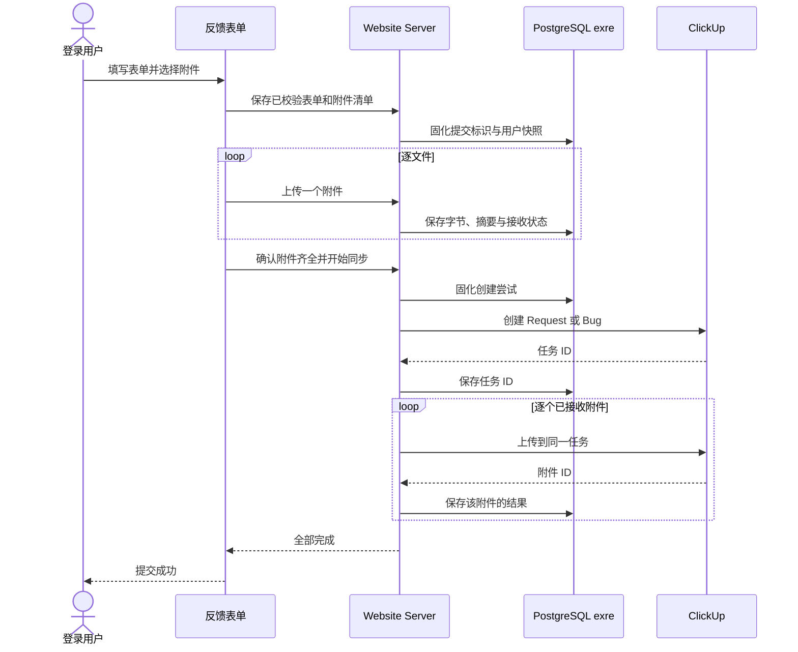

# 功能和需求、Bug 反馈表单设计

- 状态：产品设计已确认；本期普通输入框版本已实现，Tiptap 接入延后；完整验收尚未完成。
- 日期：2026-10-14。
- 模块：`support-center`，产物根目录为 `.notes/support-center/`。
- 本文件新增反馈提交能力；保留原支持中心设计与 RFC，不改写它们的历史范围。
- 2026-10-15 用户确认补充：允许 ClickUp 将正文中的字面 HTTP／HTTPS URL 自动变为可点击链接，链接文字与目标必须逐字符相同；不扩展其他格式解释能力。

## 目标与范围

登录用户从支持首页现有的「功能和需求」「Bug 反馈」卡片打开表单，将正文、自定义字段和最多 5 个附件提交至 ClickUp「需求桶」。功能和需求创建 Request，Bug 反馈创建 Bug。网站保存提交记录及附件进度，外部写入结果可核对、明确失败可继续，全部完成才向用户报告成功。

本期不实现「投诉和建议」表单，不新增需求管理后台、反馈历史页、后台投递队列、任务双向同步或公网部署。现有开发进度 iframe 和支持中心访问规则继续归原模块设计管理。

### 开发顺序与 Tiptap 延后说明

**先开发本反馈功能，正文暂用普通多行文本输入框占位，不引入 Tiptap。** Tiptap 支持正在另一分支开发；本期不安装 `@tiptap/*` 依赖、不实现富文本工具栏，也不等待该分支完成后才开发反馈提交。

本期完成表单、校验、附件、提交记录、ClickUp 同步、失败恢复及对应验收。待另一分支的 Tiptap 支持完成并可复用后，再单独修改本 Spec 和 RFC、接入富文本编辑器并补齐格式验收。Tiptap 保留为后续方向，不作为本期实施或交付的前置条件。

## 已确认的产品决定

| 项目           | 功能和需求                                        | Bug 反馈                                                 |
| -------------- | ------------------------------------------------- | -------------------------------------------------------- |
| 目标列表       | 需求桶，`901810170816`                            | 同左                                                     |
| 自定义任务类型 | Request，`custom_item_id=1005`                    | Bug，`custom_item_id=1001`                               |
| Title          | 必填，映射任务 `name`                             | 同左                                                     |
| Category       | 可选择，选填                                      | 不显示选择控件；由服务端固定为「修复」                   |
| Type           | 选填，ClickUp 已有自定义字段                      | 同左                                                     |
| 部门           | 选填                                              | 同左                                                     |
| 额外大文件链接 | 选填，映射「额外文件链接」                        | 同左                                                     |
| 正文           | 一个普通多行文本 Content，必填；后续再接入 Tiptap | 问题描述必填；复现步骤、预期结果、实际结果、发生频率选填 |
| 附件           | 每个不超过 20MB，最多 5 个                        | 同左                                                     |
| 初始任务状态   | 新增                                              | 新增                                                     |
| 用户归属       | 服务端填写本站昵称＋账号 ID                       | 同左                                                     |

用户已选择「网站保存提交记录后立即同步」方案。任务创建和附件上传分步记录；附件明确失败后继续向原任务上传。创建结果不确定时先核对，不直接再次创建。

## 表单与编辑体验

表单沿用现有支持卡片的 ExUI Modal。增大现有固定 24rem 的内容空间，桌面弹窗约 48rem 宽、最大高度不超过视口的 85%；窄屏适配可用宽高。表单正文滚动，底部提交区持续可见。Modal 的焦点锁定、关闭后焦点返回触发按钮和 Escape 行为遵循现有组件。

共同区展示 Title、Type、部门和额外大文件链接；功能和需求另展示 Category。界面以中文标签「标题」「类别」「类型」「部门」「额外大文件链接」呈现。任务类型 Request／Bug 由入口决定，不能通过表单字段修改；它与自定义字段 Type 不混用。

Category 的现有选项为开发、修复、新增、优化、设计、支持、市场、其他。Type 的现有选项为功能、界面、车辆、角色、衣服、武器、性能、动画、用户体验、其他。部门的现有选项为全部、LEO、EMS、CIV、其他。选填下拉默认不选择，可以清空；部门的「全部」是一个实际选项，不代表空值。

功能和需求本期使用 ExUI 普通多行文本输入框，中文标签为「内容」。输入和粘贴均按纯文本处理，保留用户换行，不提供富文本工具栏、链接弹窗或 Markdown 编辑／预览。图片、视频和其他文件通过附件区提交。服务端将用户文本安全转义为 ClickUp 所需的 Markdown，不把用户输入的 Markdown 标记或 HTML 解释为格式；允许 ClickUp 自动链接字面 HTTP／HTTPS URL，但不得改变文字或目标。远端核对仍拒绝任意命名链接、其他格式变化或正文内容丢失，具体封闭条件见 RFC 第 8 节。

后续 Tiptap 接入时，再基于另一分支提供的能力细化 ExUI 工具栏与链接输入、Lucide 图标，以及段落、一级至三级标题、粗体、斜体、有序／无序列表、链接、引用、行内代码、代码块、换行和撤销／重做。该格式集合属于后续阶段，本期不实现、不验收；表格、颜色、字体、协作及付费扩展仍不在范围内。

Bug 正文由多行文本输入和频率下拉组成。频率提供每次、经常、偶尔、仅一次，默认不选。服务端按「问题描述、复现步骤、预期结果、实际结果、发生频率」的固定顺序拼接 Markdown，小标题与用户文本分离；空的选填项不写入正文。普通文本中的 Markdown 特殊字符按文字处理，保留用户换行。

字段值、错误、校验和提交状态由 React Hook Form 与 Zod 管理，使用现有 ExForm 的公开接入方式或 RHF Controller，不另建字段 useState。普通输入框的清空、恢复和禁用与所属表单保持一致。后续接入 Tiptap 时，编辑器内部文档／选择／撤销栈及表单桥接另行细化。

编辑中关闭弹窗前，对未提交内容提供放弃确认。提交中关闭前说明网站接收后的步骤可能仍在继续；关闭不触发第二次提交。只在当前标签页保存非凭据的提交标识供恢复，不自动把正文或附件写入浏览器持久存储。

## 输入与附件规则

本节给出已确认方案的设计取值，供实施遵循；它们不是对既有实现的描述。

| 输入            | 设计限制                                                                                                          |
| --------------- | ----------------------------------------------------------------------------------------------------------------- |
| Title           | 去除首尾空白后 1–200 个 Unicode 码点；不允许换行                                                                  |
| Request Content | 去除空白后有实际文本；原始纯文本及安全转义后的 Markdown 的 UTF-8 字节均不超过 64 KiB；Markdown 标记按普通文字处理 |
| Bug 问题描述    | 去除首尾空白后非空；每个正文文本项不超过 16 KiB，合成正文不超过 64 KiB                                            |
| 下拉选项        | 只接受目标列表的对应选项 ID；空值不发送到 ClickUp                                                                 |
| 额外大文件链接  | 单个 HTTPS 链接，最长 2048 字符；不含 URL 用户名／密码；空值不发送                                                |
| 附件            | 每个 1–20,971,520 字节，即 20 MiB；0–5 个，总计最多 100 MiB                                                       |
| 文件类型        | 不额外限制扩展名；按普通附件处理，不执行、不解压、不生成内联预览                                                  |
| 附件展示        | 显示原文件名、大小、处理状态及编辑阶段的移除按钮                                                                  |

前端展示的 20MB 按 20×1024×1024 字节执行，前后端使用同一上限。客户端先检查声明大小和数量，服务端核验实际字节长度、数量和摘要。文件名仅作为展示元数据，不能成为本机路径；拒绝控制字符和超长文件名。

首期通过逐文件上传接收原始字节，不将 100 MiB 附件合并成单个请求。每次最多一个文件，multipart wire 预算为 20 MiB＋64 KiB；字段、part 数量和 header 大小另设有限预算。复用现有 multipart 连接生命周期能力，在读取上传字节前完成认证和归属核验。

## 架构与数据流

`apps/web/` 负责表单、普通文本输入和提交体验；请求通过 `@workspace/api-client`。`apps/server/src/domains/support/` 负责反馈提交业务；`apps/server/src/modules/clickup/` 提供通用 ClickUp 适配能力。HTTP Contract 先维护于 `api/`，不把第三方凭据或调用交给前端。

通用 ClickUp 适配器提供字段读取、任务创建、附件上传及任务读取，不依赖支持中心业务。目标列表、Request／Bug 映射和默认 Category 属于支持业务配置。两者均通过普通 service/factory 注入公开依赖，再由 fastify-plugin 暴露服务；API 插件负责认证、传输适配和 handler 映射。

图中的创建和各附件上传由前端立即驱动的有限请求逐步推进。每次推进最多执行一个外部写操作，以免一个 HTTP 请求等待全部 5 个上传；这不是后台排队方案。读取状态不会触发外部写入。浏览器关闭后不启动额外投递，当前已发出的外部请求完成或超时后保存已知结果。

## 提交记录与附件持久化

使用独立 `exre` 数据库保存反馈提交和附件，不连接 Outline 数据库，也不复用加入申请业务表。设计采用两个业务记录集合：

| 记录     | 责任与必要信息                                                                                                                                 |
| -------- | ---------------------------------------------------------------------------------------------------------------------------------------------- |
| 反馈提交 | 提交 ID、提交者 ID、昵称快照、入口类别、结构化表单、最终 Markdown、附件清单、幂等标识、载荷摘要、状态、ClickUp 任务 ID、当前尝试与安全错误分类 |
| 反馈附件 | 归属提交、固定序号、附件 ID、原文件名、媒体类型、真实大小、SHA-256、暂存 bytea 字节、接收／上传状态、ClickUp 附件 ID及当前尝试                 |

附件原始字节暂存在数据库，复用现有加入申请的 bytea 模式，但建立独立反馈表和独立上限。不使用通用 StorageService 的公开 URL 作为私有暂存；当前通用存储接口也没有业务所需的统一读取／删除契约。每次只读取一个附件用于传输，列表和状态读取不加载字节。

提交者＋客户端生成的提交 UUID 构成唯一幂等键。同键同载荷返回原记录，同键不同载荷返回冲突；点击两次、网络重试或不同会话设备携带同一提交标识并发调用时，只能得到同一份记录。下次全新反馈生成新键，不按 Title 或文本内容去重。

创建记录时固化表单和附件清单，上传过程不能修改正文或增删清单。用户在真正同步前需要修改内容时重新开始一份明确的新提交；失败恢复默认继续原载荷。每个附件按固定 ID、序号和摘要重复接收，相同字节可重用，不同字节返回冲突。

接收中的记录有效期为 24 小时，过期后不能启动 ClickUp 创建。已经开始外部同步的记录不因该期限丢弃。明确成功并持久化附件 ID 后，可在同一事务中释放对应 bytea；未知结果和明确失败的附件保留字节供核对／重试。保留提交与附件元数据。过期接收记录只能经显式维护清理，不在启动、状态读取或普通停止时删除。

数据库字段、外键、状态约束、schema-check、reset-plan 和迁移升级入口在 RFC 中一并细化。实施前须先更新 `.ai/databases/data-model.md` 并评审模型影响；本设计审阅阶段不提前改写持久模型。

## 状态、并发与重试

| 状态       | 含义                             | 允许的下一步               |
| ---------- | -------------------------------- | -------------------------- |
| 接收中     | 网站记录已保存，但附件尚未齐全   | 接收缺失文件；齐全后确认   |
| 待创建     | 全部校验与接收完成，尚未发送创建 | 启动唯一创建尝试           |
| 创建中     | 已固化创建尝试，正在执行外部请求 | 查询；重复推进不能再创建   |
| 附件上传中 | 已保存任务 ID，继续处理附件      | 推进尚未上传的附件         |
| 可重试失败 | 明确未完成的外部操作失败         | 用户主动重试失败步骤       |
| 待核对     | 外部写入结果未知                 | 只读核对；禁止盲目再次写入 |
| 完成       | 任务与全部附件均有已保存成功结果 | 读取原成功结果             |

数据库在短事务中认领步骤并固化尝试标识，外部请求放在事务之外，结果更新必须匹配该尝试。并发推进只能由一个调用执行外部写入，迟到响应不能覆盖已完成或已核对的结果。服务重启发现遗留在途尝试时转入待核对，不重新执行。没有附件的提交在任务 ID 成功保存后直接完成。

ClickUp API 没有在已核对的 Create Task 文档中声明本方案可用的幂等创建键。网站幂等只能避免本地重复发起，不能把外部写入宣称为 exactly-once：

- 创建成功但保存任务 ID 前进程退出，以及创建超时／断线／不明确的服务端错误，均进入待核对。
- 附件响应丢失也可能代表已经上传，进入该附件的待核对；保留原任务 ID，不能重新创建任务。
- 确认未写入的校验／权限拒绝或限流，可按安全错误类别提供重试；同一提交不自动循环重试失败操作。
- 同步中的客户端断线后，重新读取记录，再决定继续哪个已知步骤。
- 维护者核对远端记录后，才可将匹配的任务／附件 ID 回填，或将已证明未写入的尝试恢复为可重试；不得只凭“暂时没有查到”认定没有写入。

为便于核对，任务正文末尾附一条「ExWebsite 提交编号：提交 UUID」，与用户 Content 用分隔线分开。64 KiB 限制适用于用户正文，附加编号后的最终 Markdown 上限为 65 KiB，不能因编号占用而截断用户输入。这是方案中的运行支持信息；它不是 ClickUp 幂等键，也不承诺仅凭该标记能自动排除所有重复。

首期提供维护者的本地核对与回填入口，不新增管理页面。回填要求显式目标记录与远端 ID、复核目标 List／任务类型／用户归属／提交编号，并使用数据库事务裁决；核对不自动创建或删除远端对象。附件无法唯一匹配时继续待核对。

每个外部创建请求限时 30 秒，单附件外部上传限时 60 秒；Website 单次推进限时 90 秒。上传接收限时 120 秒，配置有限的并发槽。设计默认同时最多 2 个附件接收和 2 个同步推进；同用户创建新记录最多 10 次／10 分钟，同用户最多 2 个未过期接收记录。重放同一幂等请求不计为新记录。

## ClickUp 字段与正文映射

Workspace 为 `90181517066`。以下映射来自实际只读查询，运行时还须核验目标字段类型、任务类型适用范围与所选 option ID：

| 本站数据     | ClickUp 目标                                                                      |
| ------------ | --------------------------------------------------------------------------------- |
| Title        | `name`                                                                            |
| Request／Bug | `custom_item_id`：`1005`／`1001`                                                  |
| Content      | 服务端将普通输入框的纯文本安全转义后写入 `markdown_content`；不依赖 HTML 正文输入 |
| Category     | `4acf848b-2a8d-4404-8cda-36156e0f066d`                                            |
| Bug 默认修复 | Category option `d8b4afde-d586-40ae-93d4-0b6923ba6bb9`                            |
| Type         | `4c3befc0-5146-43a2-8610-86efe4e8124a`                                            |
| 部门         | `9b3d2027-2162-42e2-81b9-d907592cdb5b`                                            |
| 额外文件链接 | `4f7eb8a3-5de7-4f3b-87bb-8be5dc2d573f`                                            |
| 用户         | `346759da-1bc8-4ae7-aa0c-020102bc287b`，值为「昵称 (账号 UUID)」                  |
| 初始状态     | `status=新增`                                                                     |
| 附件         | 创建成功后上传至 `/task/{task_id}/attachment`                                     |

用户昵称及 UUID 来自服务端真实会话和资料快照，前端不能指定或覆盖。不额外发送邮箱、QQ、FiveM ID。使用公共 token 创建的任务，其 ClickUp 原生 creator 仍然属于该 token 的账号，本站提交者记录在「用户」字段。

Category、Type、部门按选项 ID 发送，不发送显示文本或数组索引。服务端固定 Bug 的 Category，不接受客户端改变默认值。缺失或已不适用的必要字段、任务类型及默认选项必须明确报配置不可用，不能让 ClickUp 静默忽略后仍报告成功。

本期客户端提交纯文本，服务端统一生成 Markdown；前后端共享非空、大小与转义规则，不把用户文本重新解析为富文本。普通正文中的 HTML、Markdown 标记及 URL 按文字保留，不执行 MDX／JSX、不加载链接内容，不将任意 HTML 注入本站 DOM。额外大文件链接仍只允许 HTTPS。

后续富文本阶段再依据 Tiptap 支持分支的实际版本与公开接口确定依赖、格式集合、序列化器和表单桥接；原调研版本不作为本期安装要求。富文本格式往返、编辑器链接协议校验及真实 ClickUp 格式显示验收在该阶段补齐，不阻塞本期纯文本版本。

## HTTP 与配置边界

新增 API 必须先设计 `api/openapi.yaml` 的 operation 与 schema，再生成共享 Client 类型。RFC 需完整定义以下能力及其状态／错误，不直接把本节当成已存在 endpoint：

1. 读取反馈元数据和当前可用选项。
2. 保存一份经过校验的反馈及附件清单。
3. 按提交／附件标识接收单个附件。
4. 固化接收结果并推进一次外部写入。
5. 读取本人提交的正文、附件元数据和安全进度。
6. 对明确失败的本人提交继续原步骤；与待核对严格区分。

除维护入口外，所有能力要求有效本站会话；逐请求核对提交归属，其他用户访问返回与不存在记录一致的结果。HTTP HEAD 与 GET 不得消费状态、开始同步或产生外部写入。operation 映射和原始 handler 返回值必须具备 Contract Test 覆盖。

服务端从根 `.env.local` 的 `CLICKUP_TOKEN` 读取凭据，遵循支持的进程变量优先规则；将它纳入正式 runtime 配置适配和日志脱敏范围。用户提供的第 93 行仅是本次定位线索，正式代码按键读取。只允许固定官方 API origin，不跟随携带凭据的重定向，不接受客户端指定外部主机、列表、字段映射或 token。

未配置 token 时仅反馈提交能力不可用，显示固定说明，Website 其他功能可正常运行；配置非法时提供固定安全诊断。不能将 token 放入 VITE 变量、前端构建产物、Contract 示例、日志、提交记录或设计文档。

错误遵守现有 envelope 和固定对外文案。表单校验错误显示在字段旁，流程错误和重试入口保留在弹窗正文，临时通知统一使用 ExMessage；普通 HTTP 接收成功不等于 ClickUp 已创建成功。

## 验收

实施后的验收分开报告：

- 自动检查：API lint／generate、类型检查、测试、构建；Request 纯文本转义与换行保留、Bug 拼接、非空规则、选项 ID、20 MiB 边界、第 6 个附件、总量边界、原始 handler 返回值及双向 operation 覆盖。
- 数据与异常：PostgreSQL Testcontainers 隔离 schema；幂等重放与载荷冲突、并发认领、逐附件进度、创建／附件未知结果、进程重启、迟到响应、跨用户访问、HEAD 不写入、文件真实大小与摘要、上传断线及超时释放。
- 真实浏览器：桌面／移动、明暗主题、普通输入框的键盘输入与纯文本粘贴、Modal 焦点与内部滚动、中文输入法、表单错误、空正文、关闭确认、文件移除、失败恢复、成功后清空。
- 真实 ClickUp：在目标桶分别创建一条已授权的 Request 和 Bug，核对任务类型、状态、所有填写字段、用户归属、纯文本转义与换行的实际显示和最多 5 个附件；只读 API 查询、mock 和本地通过不能替代该验收。
- 运行配置：通过正式 runtime 启动验证 token 可用且不进入日志／前端；配置缺失空态、数据库迁移前拒绝启动、旧数据库升级和停止后的数据保留。

本设计不授权立即在 ClickUp 创建测试任务或部署上线。实施阶段按已批准范围完成自动与浏览器检查；真实外部写入的验收时机和测试内容需在执行前明确。

后续 Tiptap 阶段另补富文本格式往返、工具栏、链接弹窗、编辑器 reset／恢复、中文输入法及 ClickUp 格式显示验收；这些不属于本期交付门槛。

## 取舍与限制

直接转发最简单，但创建响应丢失后无法恢复足够上下文；用户已选择保存记录后立即同步。后台队列能脱离浏览器继续投递，但增加 worker 与状态管理，本期不采用。当前方案在用户关闭页面后依赖再次打开继续未发出的步骤。

Tiptap 保留为后续编辑方向，由另一分支提供支持；本期使用普通输入框占位，先完成反馈链路。后续再复用该分支成果，并确认版本、格式与表单接入，不在本分支重复开发 Tiptap 支持。没有声称已实测包体积、性能或 ClickUp 所有专有富文本格式。

数据库暂存最多 100 MiB 附件会增加容量与备份负担；逐文件处理限制内存峰值，成功后释放字节，保留未知／失败数据便于恢复。暂存保留与维护清理属于反馈域，不改变通用存储或加入申请附件的规则。

## 证据与交接

仓库证据：`apps/web/src/pages/Support/SupportHome.tsx`、`apps/web/package.json`、`.ai/rules/frontend-forms.md`、`.ai/rules/frontend-notifications.md`、`.ai/architectures/server/request-lifecycle.md`、`.ai/databases/data-model.md`、`apps/server/src/modules/storage/service.ts`、`apps/server/src/db/schema.ts`、`apps/server/src/http/shared/multipart-upload-lifecycle.ts`。

外部证据：

- [Create Task](https://developer.clickup.com/reference/createtask)：任务类型、创建时自定义字段适用范围和 `markdown_content`。
- [Create Task Attachment](https://developer.clickup.com/reference/createtaskattachment)：任务附件需要 multipart 原始文件上传。
- [Get Custom Task Types](https://developer.clickup.com/reference/getcustomitems)、[List Custom Fields](https://developer.clickup.com/reference/getaccessiblecustomfields)：已对目标 Workspace／List 实际只读核对类型与字段映射。
- [Tiptap React](https://tiptap.dev/docs/editor/getting-started/install/react)、[Tiptap Markdown](https://tiptap.dev/docs/editor/markdown)：原富文本方案的调研来源，仅供后续阶段参考，本期不据此引入依赖。

2026-10-14 设计阶段的只读 Get Task 响应包含 `attachments` 和 `markdown_description`；当时的样本没有附件，不能据此声称已经验证附件去重、远端摘要或图片显示。设计阶段未执行任务创建、附件上传、数据库变更或表单实现。后续已授权的真实写入及其剩余边界见 `.notes/support-center/acceptance/2026-10-15-clickup-acceptance.md`。

本文件与 `.notes/support-center/rfcs/support-feedback-rfc.md` 共同交接本期普通输入框版本；优先开发反馈功能，不等待 Tiptap 支持分支。RFC 保留本文件并细化 HTTP schema、数据库约束、尝试认领、核对／回填、multipart 生命周期及落地顺序。Tiptap 支持可复用后，再单独更新两份文档并实施富文本接入。2026-10-14 的设计修改仅更新文档，当时未开始代码实现；设计审批不等于 Git 提交或远端写入授权，不自动提交本设计，也不提前提炼尚未实施的设计到 `.ai/`。
