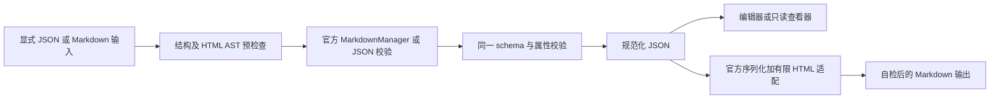

# RFC：Tiptap 共享组件与开发预览页

日期：2026-10-14。状态：实现提案，源设计已获用户书面批准；本 RFC 尚未实施。

来源：`.notes/tiptap-support/specs/2026-10-14-tiptap-support-design.md`。模块根目录：`.notes/tiptap-support/`。本 RFC 保留源设计原文，细化实现接口与验证方法，不扩大到业务 API、上传服务、账号搜索、Outline 或部署。

## 决策与完成结果

在 `packages/components/src/tiptap/` 组装官方 Tiptap 3.32.0 扩展，以 ExUI 0.8.0 实现编辑工具栏和主题样式。公开编辑器、查看器和显式转换函数，内部使用同一文档 schema；自定义节点限于 Admonition 及其标题。采用官方 MarkdownManager，通过公开扩展钩子补齐有属性内容的序列化。

在 `apps/web/` 添加仅开发构建可加载的 `/dev/tiptap` 页面，提供完整示例、编辑与阅读对照、格式导入导出、本地图片和演示 Mention。完成后，消费方能够直接使用组件并注入业务回调，生产构建没有可执行预览页面代码。

## 当前证据与约束

| 已核对来源                                                          | 对实现的影响                                                                                                                         |
| ------------------------------------------------------------------- | ------------------------------------------------------------------------------------------------------------------------------------ |
| `packages/components/package.json`、`src/index.ts`、`tsconfig.json` | 共享包源码导出，浏览器 DOM 可用，组件携带 CSS Modules；没有独立打包流程。                                                            |
| `apps/web/src/App.tsx`、`main.tsx`、`vite.config.ts`                | 路由归 Web，已有唯一 ThemeProvider、BrowserRouter、ExMessage 宿主与 ExUI 样式。                                                      |
| `vitest.config.ts`、`scripts/runtime/tests.mjs`                     | 新共享测试已在现有 include 范围；DOM 用例需显式使用 jsdom。根测试还包括独立容器和 Outline 流程。                                     |
| Tiptap 3.32.0 StarterKit 发布源码                                   | 已含 Link、Underline、ListKeymap、TrailingNode、UndoRedo、光标及基础节点，不重复安装扩展实例。                                       |
| Tiptap 3.32.0 Image 发布源码                                        | 官方 image 节点保存 width、height，并提供 resize；默认 Markdown 不保留尺寸。                                                         |
| Tiptap 3.32.0 Details 发布源码                                      | persist 可保存 open；只读时 toggle 可改变显示而不提交文档属性。默认 Markdown 使用官方块语法，本 RFC 为批准的 HTML 表达覆盖转换钩子。 |
| Tiptap 3.32.0 Mention 发布源码                                      | 保存 id、label、mentionSuggestionChar，官方 HTML 可携带稳定身份；禁止导出成只有 @显示名的文本。                                      |
| Tiptap 3.32.0 MarkdownManager 与 Marked 17.0.1 公开类型             | MarkdownManager 是公开导出；默认会修改提供的 Marked 配置，必须隔离每个转换器的 tokenizers 与 defaults。                              |
| ExUI 0.8.0 发布包 `dist/tokens/style.css`                           | 下方 token 表来自真实发布包，不能使用不存在的通用 radius 命名。                                                                      |

约束还包括 `AGENTS.md`、`CONTRIBUTING.md`、`.ai/architectures/overview.md`、`.ai/knowledge/web/exui-integration-traps.md`、`.ai/rules/frontend-forms.md`、`.ai/rules/frontend-notifications.md` 与 `.ai/architectures/contract-tests/test-layers.md`。不修改 Contract、数据库、Outline submodule 或网站运行配置。

## 目录与依赖

以下目录是新增实现的归属，文件可在同一责任范围内进一步拆分：

| 路径                                                       | 内容                                                         |
| ---------------------------------------------------------- | ------------------------------------------------------------ |
| `packages/components/src/tiptap/types.ts`                  | 公开输入、结果、组件和异步回调类型。                         |
| `packages/components/src/tiptap/TiptapEditor.tsx`          | 实例生命周期、受控替换、编辑事件及 Ref。                     |
| `packages/components/src/tiptap/TiptapViewer.tsx`          | 官方只读实例、无效内容展示和可交互折叠。                     |
| `packages/components/src/tiptap/toolbar/`                  | ExUI 工具栏、节点菜单、链接及图片输入、文本样式选择。        |
| `packages/components/src/tiptap/extensions/`               | 官方扩展工厂、Admonition、官方节点转换钩子适配。             |
| `packages/components/src/tiptap/conversion/`               | Marked 隔离适配、JSON 校验、HTML AST 白名单、Markdown 转换。 |
| `packages/components/src/tiptap/TiptapContent.module.scss` | 编辑与查看共用的作用域内容排版。                             |
| `packages/components/src/tiptap/TiptapEditor.module.scss`  | 编辑外框、工具栏、菜单及状态。                               |
| `apps/web/src/pages/Dev/TiptapPreview/`                    | 开发页面、示例 JSON、演示回调、局部样式及页面测试。          |
| `tests/browser/tiptap-preview.mjs`                         | 真实浏览器验收入口，遵循既有 browser 脚本约定。              |

在 `packages/components/package.json` 添加以下直接依赖，官方编辑器功能包锁定为 3.32.0：`@tiptap/core`、`@tiptap/pm`、`@tiptap/react`、`@tiptap/starter-kit`、`@tiptap/extension-list`、`@tiptap/extension-details`、`@tiptap/extension-image`、`@tiptap/extension-mention`、`@tiptap/suggestion`、`@tiptap/extension-highlight`、`@tiptap/extension-text-style`、`@tiptap/extension-text-align`、`@tiptap/extension-drag-handle`、`@tiptap/extension-drag-handle-react`、`@tiptap/extension-node-range`、`@tiptap/extension-collaboration`、`@tiptap/markdown`。

官方 DragHandle 3.32.0 的 peer 声明包含 NodeRange、Collaboration 和 Y helper，未标为 optional。为满足发布包的解析契约，另锁定 `@tiptap/y-tiptap` 3.0.7，并由 pnpm lockfile 满足其 yjs 13.x、y-protocols 1.x 及 ProseMirror peers。只安装必要支撑依赖，不登记 Collaboration 扩展、不创建 Y.Doc、不连接 provider，因此不增加协同编辑功能。依赖安装与干净构建必须检查 peer 警告，不能忽略缺失 peer 后宣称官方拖柄可用。

转换层直接使用 Marked 和纯 HTML AST 解析，因此另声明 `marked` 17.0.1 与 `parse5` 8.0.1；Marked 17 满足官方 Markdown 的 `^17.0.1` 依赖范围，避免无理由升级到当前 Marked 18。parse5 只负责不接触活动 DOM 的 HTML 解析与序列化，不作为另一套 Markdown 引擎。

只更新 pnpm 对应锁文件，ExUI 保持锁定发布版本；React、React DOM、React Router 保持现有 peer/dev 声明。禁止引入旧 ImageResize、Ant Design、react-contexify、旧 Markdown 拷贝或额外 UI 基础库。

## 公开契约

以下为拟新增接口，不是现有实现或 HTTP DTO。JSON 类型直接取自 Tiptap：

```ts
import type { JSONContent } from '@tiptap/core'

export type TiptapInput =
  { format: 'json'; content: JSONContent } | { format: 'markdown'; content: string }

export type TiptapIssueCode =
  | 'not-ready'
  | 'invalid-content'
  | 'unsupported-content'
  | 'unsafe-content'
  | 'limit-exceeded'
  | 'conversion-failed'
  | 'upload-failed'
  | 'mention-failed'

export interface TiptapIssue {
  code: TiptapIssueCode
  message: string
  path?: string
}

export type TiptapResult<T> =
  | { ok: true; value: T; notices: readonly TiptapIssue[] }
  | { ok: false; issues: readonly TiptapIssue[] }

export interface TiptapContentPolicy {
  allowRasterDataImages?: boolean
}

export interface TiptapMentionItem {
  id: string
  label: string
}

export interface TiptapUploadedImage {
  src: string
  alt?: string
  title?: string
  width?: number
  height?: number
}

export interface TiptapEditorHandle {
  readJSON(): TiptapResult<JSONContent>
  exportMarkdown(): TiptapResult<string>
  replaceContent(input: TiptapInput): TiptapResult<JSONContent>
  focus(): void
}

export interface TiptapEditorProps {
  initialContent?: TiptapInput
  editable?: boolean
  toolbar?: boolean
  ariaLabel: string
  className?: string
  policy?: TiptapContentPolicy
  onChange?: (content: JSONContent) => void
  onError?: (issues: readonly TiptapIssue[]) => void
  uploadImage?: (file: File, context: { signal: AbortSignal }) => Promise<TiptapUploadedImage>
  resolveMentions?: (
    query: string,
    context: { signal: AbortSignal },
  ) => Promise<readonly TiptapMentionItem[]>
}

export interface TiptapViewerProps {
  content: TiptapInput
  ariaLabel: string
  className?: string
  policy?: TiptapContentPolicy
  onError?: (issues: readonly TiptapIssue[]) => void
}

export function parseTiptapContent(
  input: TiptapInput,
  policy?: TiptapContentPolicy,
): TiptapResult<JSONContent>

export function serializeTiptapMarkdown(
  content: JSONContent,
  policy?: TiptapContentPolicy,
): TiptapResult<string>
```

`TiptapEditor` 接受 React Ref，默认可编辑且显示工具栏。`initialContent` 只在初始化使用，省略时建立 doc 和一个空 paragraph；整篇替换必须调用 `replaceContent`，不把每次变化后的 JSON 再传为初始化输入。Form 适配由消费方在 React Hook Form Controller 中接收 onChange、明确处理 reset，不把普通父级重渲染当作文档替换。

公开导出由 `packages/components/src/index.ts` 汇总上述组件、函数和类型。工具栏是编辑器内部可复用组件，首阶段不公开原生 Editor、不开放任意 extensions 注入，保证公共输入受同一 schema 与校验约束。消费方不深导入内部文件。

`readJSON` 返回独立快照；外部修改它不得改变编辑器。`replaceContent` 同步完成解析与校验，成功后以一次可撤销的文档替换事务提交；选区进入新文档的第一个有效位置，并使旧异步操作失效。失败不修改文档、历史、选区或操作代际。文档更新只发一次 onChange；选区移动、阅读折叠、格式导出不发送内容变化。

初始输入失败时显示固定错误和可恢复的空编辑器，不把失败标记为成功导入。未创建实例时 Ref 读取返回 not-ready。查看器输入失败时展示局部错误内容，不静默显示残缺结果；onError 在事件或 passive effect 中调用，不在 render 发送通知。

转换函数是同步的浏览器能力，支持 jsdom 测试，首阶段不承诺无 DOM 的 Node 服务端运行。结果仅包含固定可读诊断及节点路径，不包含原始异常、完整用户文档或堆栈。对外内容变化不得每个按键执行全篇 Markdown 导出；由显式导出和格式面板按需读取。

## 官方扩展工厂

工厂接收 editing、viewing 或 conversion 用途，建立新的配置实例和可变 storage。用途间的节点名、属性、Marks 和合法文档结构必须一致，只改变交互插件与 NodeView 配置。

| 配置       | 精确约定                                                                                                                                                                                                          |
| ---------- | ----------------------------------------------------------------------------------------------------------------------------------------------------------------------------------------------------------------- |
| StarterKit | heading.levels 为 [1, 2, 3, 4]；保留基础 Marks、Link、HorizontalRule、ListKeymap、UndoRedo、光标；TrailingNode 配置 node=paragraph、notAfter=[paragraph]，避免末尾已有 paragraph 时重复增加。不再重复登记其节点。 |
| Link       | 编辑时 openOnClick 为 false，阅读时允许安全导航；新增链接经同一 URL 策略；新窗口链接固定安全 rel。                                                                                                                |
| List       | 从官方 extension-list 增加 TaskList 和 TaskItem，nested 为 true；BulletList、OrderedList、ListItem 留给 StarterKit。                                                                                              |
| Details    | 官方 Details、DetailsSummary、DetailsContent；persist 为 true；toggle 按官方 renderToggleButton 钩子设置中文名称与展开状态。                                                                                      |
| Image      | 官方 block image；编辑用途 resize.enabled 为 true，最小交互尺寸 50px，保持宽高比；查看与转换用途 resize 为 false。allowBase64 只随内容策略显式开启。                                                              |
| Mention    | 官方 Mention，固定 @ 触发，使用 label 和 id；候选源只接注入回调。查看与转换不启动查询插件。                                                                                                                       |
| Highlight  | 官方扩展，multicolor 为 true；属性经过有限 CSS 值校验。                                                                                                                                                           |
| TextStyle  | 使用官方 TextStyleKit，关闭 fontFamily 和 lineHeight，保留 TextStyle、Color、BackgroundColor、FontSize；不额外登记相同扩展。                                                                                      |
| TextAlign  | types 为 heading、paragraph，值为 left、center、right、justify。                                                                                                                                                  |
| DragHandle | 只在编辑器可编辑时挂官方 React DragHandle；不另把同一 DragHandle 插件重复加进扩展数组。                                                                                                                           |
| Markdown   | 使用官方 MarkdownManager 的独立转换器；编辑器直接操作 JSON，不启用另一条绕过校验的 Markdown setContent 路径。                                                                                                     |

普通正文的 Tab 和 Shift+Tab 不拦截。列表和代码的上下文行为沿用官方；工具栏提供列表缩进和取消缩进。不增加 Blankspace 节点或全局快捷键扩展。

查看器使用 `useEditor` 和 `EditorContent`，editable 为 false、无 UndoRedo 交互与拖柄、Image resize 为 false。Details 使用 persist 配置：阅读点击只改变当前 NodeView 的显示状态，不更改输入 JSON。TaskItem 的只读勾选回调明确拒绝内容变更；必须验证 DOM 复选框操作后文档不变。

首次实现应断言展开后的扩展名称唯一，且所有用途的 schema JSON 签名等价。辅助 Extension 名称也纳入重复检查，不能只检查 schema nodes。

## Admonition

自定义 `admonition` 属于 block，具有 defining 语义，内容为 `admonitionTitle block+`；`admonitionTitle` 是仅能位于该容器开头的内联内容容器，不作为自由顶层节点。type 属性只允许 tip、info、warning、error，默认 info。

HTML 固定为带 `data-type="admonition"` 与 `data-admonition-type` 的 aside；标题为 `div[data-type="admonitionTitle"]`，其余子块为正文。类型保存在结构属性中，不读取任意 className。图标用不可编辑的展示装饰，不能作为标题或正文的用户内容导出。

插入命令将当前同层块范围包装为 Admonition，添加对应默认标题；已有同类容器内切换类型仅修改 type。解除包装只对当前容器执行：非空标题降为普通 paragraph，正文提升到同层，空标题可移除；保留所有文本与 Marks。操作一次可撤销，无有效块范围时返回 false，不创建残缺节点。

默认标题分别为“提示”“信息”“警告”“危险”。导入空标题维持空标题，不重新填默认值。JSON、HTML 和 Markdown 的 parse/render 使用同一 type 白名单。

## 转换、安全与规范化



### 输入原子性

所有显式导入、粘贴、图片插入和 JSON 输出检查共享 `contentPolicy`，不能只过滤工具栏输入。JSON 在 `schema.nodeFromJSON` 之前检查未知字段、节点、Marks 与属性，之后调用 ProseMirror 的结构检查；仅调用 nodeFromJSON 会忽略未知 attrs，不能据此证明无损。

顶层规范化为至少一个 paragraph；末尾不是 paragraph 时追加一个空 paragraph，末尾已是 paragraph 则不追加。导入、输出和往返比较都采用同一规则，保留用户输入的其他空段落。该规范化返回 notices，并与官方 TrailingNode 配置一致，防止挂载后节点被隐式追加而造成回调或导出差异。

Markdown 先使用同一隔离 Marked 实例 lex，遍历包括列表、Admonition 和 HTML 内部的 token。表格 token、H5/H6、未支持结构和危险 HTML 提前失败；代码 token 视为文本，不扫描其中的 HTML 字符串。正常转义和普通文本不因看起来像标签而错误拒绝。

HTML token 先由 parse5 解析为 AST、检查，再进入官方 HTML 到 JSON 能力；解析时不创建活动 DOM。可接受的大小写、默认空属性、颜色和尺寸规范化返回 notices；未知内容失败，不在移除内容后回报成功。HTML 实体仅按 HTML AST 语义解码，序列化按上下文转义。

粘贴 HTML 和明确标为 Markdown 的导入共用校验，失败时 preventDefault 并显示固定提示，保留旧文档；普通文本粘贴保持原生文本语义，不默认把用户文本猜成 Markdown。内部拖动使用已校验的文档 slice；外部 HTML drop 通过同一门禁，文件 drop 只在配置上传回调时接管。

### 允许内容与边界

| 对象       | 允许值                                                                                                                                                                 |
| ---------- | ---------------------------------------------------------------------------------------------------------------------------------------------------------------------- |
| JSON 结构  | 当前工厂 schema 节点和 Marks；仅 type、attrs、content、marks、text 等 Tiptap 文档字段，未知字段报错。缺省属性规范化为官方默认值。                                      |
| 标题及对齐 | heading level 1–4；textAlign 为 null、left、center、right、justify。                                                                                                   |
| 有序列表   | start 为安全正整数；官方 type 属性仅 null 或 1、a、A、i、I，带显式 type 的列表使用 HTML 保留。                                                                         |
| 任务与折叠 | checked、open 为 boolean；不允许以字符串冒充 JSON boolean。                                                                                                            |
| 图片       | src 符合 URL 策略；width、height 为 null 或 1–8192 的整数；alt、title 为文本或 null。                                                                                  |
| Mention    | id 非空字符串，label 为字符串或 null，mentionSuggestionChar 为 @；默认 label 缺失时显示 id。                                                                           |
| 文本颜色   | null，或合法十六进制 #RGB、#RGBA、#RRGGBB、#RRGGBBAA，规范化为统一形式；HTML 的有限 rgb/rgba 数值可规范化为十六进制。禁止 CSS var、url、expression、关键字和任意函数。 |
| 字号       | null，或 0.75–3rem；外部 px 输入按 16px=1rem 规范化，保留 notices，不依赖当前浏览器缩放。工具栏提供 0.75、0.875、1、1.125、1.25、1.5、2、3rem。                        |
| 链接       | HTTP、HTTPS、单斜线开头的站内路径或 mailto；拒绝协议相对地址、用户名密码、控制字符和其他协议。                                                                         |
| 图片地址   | HTTP、HTTPS、单斜线站内路径；策略开启时另允许 PNG、JPEG、GIF、WebP 的 Base64 Data URL。拒绝 SVG、blob、协议相对地址和其他协议。                                        |

以上有限范围是本 RFC 的实现选择；超范围必须返回诊断，不截断内容。Data URL 解码后核对类型和图片签名，不信任 MIME 声明；默认关闭，开发本地图片演示显式开启。

HTML 的基本标签白名单为 p、h1–h4、blockquote、ul、ol、li、pre、code、br、hr、strong、b、em、i、s、del、u、a、mark、span、img、details、summary，以及明确具有 Admonition 或官方 DetailsContent 语义的 aside/div。taskList/taskItem 的官方输出允许其固定 label、只读 checkbox input、空装饰 span 和正文 div，仅限合法任务节点位置，不能接受任意表单元素。

允许属性按节点登记：链接 href/title，target 为 null、_self 或 _blank，rel 为允许的 noopener/noreferrer/nofollow token；图片 src/alt/title/width/height；列表 start/type；Details open；Mention 的固定 data-type、data-id、data-label、data-mention-suggestion-char；任务列表与任务项的固定 data-type/data-checked；Admonition 固定 data 属性；Highlight 的 data-color；代码的单个 language-* 标记。不存在任意 class、id、事件属性、srcset、iframe、SVG 或全局 data 属性通配符。JSON Link 的官方 class 属性仅接受 null。

style 仅允许 text-align、color、background-color、font-size，并限定可出现的标签和上表值域。唯一固定展示例外是官方 Highlight 输出在 mark 上的 color: inherit：接受它作为继承声明，不转换为新的 TextStyle 属性；data-color 与 background-color 均需合法且一致。只读输出不保留未知属性。HTML 中模板、脚本、事件、未知标签及未知属性都拒绝整次显式导入，不先降级成文本或过滤后覆盖。

避免主线程无限工作：输入 UTF-8 字节不超过 8MiB，文档节点与文本叶共计不超过 10,000 个，文档深度不超过 32，候选最多显示 20 项。达到边界返回 limit-exceeded，不截断后标记成功。开发本地图片单文件最多 2MiB，与文档上限一致。计数同时覆盖 HTML AST、Markdown token 与最终 JSON，不能只检查转换后的较小结果。

### Marked 与官方适配

每个转换器创建独立 Marked 17 实例。使用其公开 Lexer、lexer、use、setOptions、defaults，构造满足官方 MarkdownOptions.marked 类型的可调用 facade；facade 的 parse、parseInline、walkTokens、构造器、options 和 getDefaults 均绑定或引用该实例对应的公开能力，defaults 用 getter 保持与实例同步。不能用裸类型断言伪装缺少接口的对象，也不能修改模块级 marked.use 或 marked.defaults。

MarkdownManager 每次使用该实例和新扩展配置登记一次 tokenizer。基础 options 为 gfm=true、breaks=false、async=false，indentation 为两个空格。HTML 混合输入在浏览器转换，不使用官方 Node 环境下可能将 HTML 留为字面文本的回退。

以 Node.extend/Mark.extend 增加或覆盖 parseMarkdown、renderMarkdown、markdownTokenizer，保留原节点名称、schema、命令和 NodeView。普通节点委托官方序列化；HTML、Mention、带尺寸图片和 Admonition 使用本 RFC 的适配。禁止访问 MarkdownManager 私有方法或复制其内部实现。

### Markdown 输出

| 内容                           | 规范输出                                                                                       |
| ------------------------------ | ---------------------------------------------------------------------------------------------- |
| 无附加样式的常规结构与 Marks   | 官方常规 Markdown；删除线和任务列表使用 GFM；有序列表保留 start。                              |
| 代码                           | 官方代码语法，围栏足够长以容纳正文；保留语言及正文的换行，不进行 HTML 校验。                   |
| 硬换行与分隔线                 | 显式 Markdown hard break 与 horizontal rule；不把普通段落边界当硬换行。                        |
| Admonition                     | 至少三个冒号、空格、类型、可选内联 Markdown 标题；换行后为正文，最后为等长冒号闭合行。         |
| Details                        | 完整 `<details>`，含 open、summary 和 `div[data-type="detailsContent"]`；内部正文渲染为 HTML。 |
| Mention                        | 官方 span 结构及 ID、显示名、触发字符；显示文本转义。                                          |
| 图片                           | 无尺寸时官方图片 Markdown；任一尺寸存在时输出受控 img HTML。                                   |
| 颜色、字号、高亮、下划线、对齐 | 用规范化受控 HTML 保留。                                                                       |

混合格式采用完整 HTML 子树边界：若普通 paragraph、heading、list、blockquote 等块含 HTML 专属样式、非默认 Link target/rel 或需要 HTML 的后代，以官方 generateHTML 输出该完整块，不在 HTML span 内嵌未经处理的 ** 或 ::: 文本。容器中的受控 HTML 子树继续用 HTML 表示，包括 Details 内的 Admonition，以保存嵌套结构。顶层 Admonition 仍优先输出容器，正文通过官方 helpers 递归处理。

Admonition 外层围栏长度大于全部内层容器围栏；正文中作为普通文本的边界行转义首个冒号。tokenizer 必须跟踪代码围栏状态、容器深度与闭合长度；空标题保留为空，标题硬换行输出受控 br。非法类型或未闭合容器返回诊断，不吞掉剩余正文。parse5 HTML 内容里出现的 ::: 作为文字，不再二次猜成容器。

导出前校验 JSON，导出后用同转换器重新解析并比较规范化文档语义。比较保留正文、Marks、节点层级、ID、图片尺寸、Details 状态、任务状态、列表起始与标题；仅忽略已明确定义的默认 null、属性顺序和相邻等价文本叶合并。失败返回 conversion-failed，不给出“导出成功”的残缺文本。官方 TrailingNode 的默认末尾 paragraph 需要在归一化规则中统一处理，不能任意忽略其他空段落。

Markdown 当前是含有限扩展的交换格式，不承诺第三方平台保留 HTML 和 Admonition。不添加未经确认的另一个“有损导出模式”。

## 编辑器与异步生命周期

普通渲染保持 editor 实例和扩展配置稳定，回调由最新引用承接。只有显式替换改变 documentGeneration；editable、toolbar 与主题更新不重建文档。替换成功、卸载或取消中止相关 AbortController，并使不响应 abort 的迟到 Promise 结果失效。

图片操作建立独立 operationId、generation 和 ProseMirror 映射书签，使用后续 transaction.mapping 更新目标位置。上传完成先验证返回值，再确认实例、代际和锚点仍存在；选择其他位置不把上传结果插到当前新选区。锚点被删、文档替换或卸载则丢弃结果，不创建图片。失败保留原内容，显示可重试的固定文案。外部粘贴或 drop 的多个文件逐个使用同样协议，不绕过门禁。

Mention 以查询序号与 generation 决定结果是否有效，离开建议范围或关闭弹层中止查询。最新候选按 ID 去重并限制展示数；不选择时不插入节点，选择后只插入一个官方 Mention 和必要空格。ArrowUp/Down、Enter、Escape 可操作；查询失败或空候选有可读状态，普通文本 @ 保留。只读查看、无回调和 composition 输入期间不发查询。

共享组件不得使用 fetch、共享 Client 或本地存储代替回调。文案在所属控件内呈现，临时提示经既有 ExMessage；回调失败不暴露原因对象。业务方的 Form 和提交状态不放入编辑器。

## ExUI 排版和工具栏

| 用途           | 已验证 token                                                                                                                                |
| -------------- | ------------------------------------------------------------------------------------------------------------------------------------------- |
| 正文及次级文字 | `--exui-text-primary`、`--exui-text-secondary`、`--exui-text-tertiary`。                                                                    |
| 容器与代码表面 | `--exui-surface-background`、`--exui-surface-card`、`--exui-surface-secondary`。                                                            |
| 边框及焦点     | `--exui-border-default`、`--exui-border-divider`、`--exui-border-focused`、`--exui-control-focus-ring`。                                    |
| 交互及链接     | `--exui-control-primary`、`--exui-control-hover`、`--exui-control-selected`、`--exui-text-link`。                                           |
| Admonition     | tip 使用 `--exui-feedback-success`，info、warning、error 分别使用 feedback-info、feedback-warning、feedback-danger，并搭配对应 foreground。 |
| 字体与圆角     | `--exui-font-family`、`--exui-font-family-mono`、`--density-control-radius`。                                                               |

共享内容容器 line-height 为 1.6，正文继承 ExUI 字体；H1–H4 采用 2、1.6、1.3、1.1rem 的固定层级，line-height 为 1.35，首个标题不因主题或位置变大。标题 margin-block 按层级调整，段落和列表自然排布；长文本换行，代码局部横向滚动，图片 max-width 为 100%。不使用全局 .tiptap 或 .ProseMirror 选择器污染其他页面，必要内部类限定在 CSS Module 内容容器内。

旧引用侧线、代码框、折叠框、Admonition 侧线和图片选中轮廓使用上表语义值。文字颜色和背景色调色盘使用公开 token 在当前主题下解析成合法内容色值；文档显式色值不随主题自动重写，用户可以清除颜色恢复主题继承。

工具栏从左到右提供撤销重做、段落/标题、列表及缩进、引用/代码块/折叠/Admonition/分隔线、文字格式、链接/图片、对齐。高频按钮直接显示，低频命令放 ExUI DropdownMenu/Popover；窄屏允许分组换行和更多菜单，所有已支持命令都保留入口。

工具栏以 useEditorState 选择必要状态，避免每次 transaction 强制全页面重渲染。按钮明确 type=button、可读名称和按下状态，图标 aria-hidden。鼠标操作保存编辑选区；键盘操作仍可进入控件及弹层，不能通过全局 preventDefault 抢走 Tab。链接与图片输入使用项目 Form 规则，关闭弹层恢复合理焦点。

## 开发预览页

在 `apps/web/src/App.tsx` 的 DEV 分支内建立动态导入并登记 `/dev/tiptap`，不把预览模块先静态导入再隐藏路由。使用既有 RootLayout 的普通页面框架，组件本身不登记路由。生产编译常量为 false 时，预览 import 和 Route 均被删除，不改动 Vite proxy、端口或正式导航。

预览页提供：主题切换、恢复示例、完整编辑器、同步只读查看器，以及默认折叠的 JSON/Markdown 面板。JSON 随 onChange 更新；Markdown 仅在打开或刷新格式面板、导出时转换，不在每个按键隐藏执行全篇往返自检。桌面编辑和查看并列，375px 上下排列；两侧折叠状态可独立交互，但内容 JSON 来自同一文档。

固定示例包含全部节点、Marks、四类 Admonition、嵌套列表/容器、任务状态、Details open/closed、Mention ID、图片尺寸、代码及长文本。使用本页静态样例资源与固定演示候选，不请求业务 API。图片本地回调把验证后的不超过 2MiB 栅格文件转换为 Data URL；组件与查看器同时启用显式演示策略。文件与文档只存本页内存，不以 blob URL 导出；离开页面使 pending FileReader 结果失效。

格式面板的导入按钮调用 Ref replaceContent，成功更新对照区并显示必要规范化 notices；失败保留旧 JSON。复制和导出按当前快照进行，含 Data URL 时显示“包含本地图片数据，导出文本可能较大”的提示；不宣称是已上传的永久资源。恢复示例同样通过 replaceContent，取消旧上传与候选查询。

主题切换复用现有 ThemeToggle/ThemeProvider 机制；如果 ThemeToggle 仍非公开导出，页面使用已有公共设置入口或在 Web 层按其现有组合方式提供切换，不深导入共享内部模块。不新增 provider、通知宿主或页面专属 token 层。

## 验证矩阵与执行

| 范围           | 关键回归                                                                                             |
| -------------- | ---------------------------------------------------------------------------------------------------- |
| 扩展和 schema  | 所有扩展名唯一，三用途 schema 等价；官方节点清单可创建；未知 attrs 在官方忽略前被拒绝。              |
| Admonition     | 新建、改类型、解除、撤销；标题 Marks、空标题、列表、代码含 :::、嵌套围栏均保留。                     |
| 格式转换       | 逐节点/Mark 及混合正文往返；Mention ID、图片宽高、任务 checked、Details open、有序 start/type 不丢。 |
| HTML 边界      | 合法混合格式解析；未知标签、事件、脚本、协议混淆、SVG Data URL、CSS 函数失败；代码中的相同样本保留。 |
| 原子性         | 非法初始输入和显式导入；导入失败不改变 doc、历史、选区及 generation；输出失败不返回成功文本。        |
| 多实例         | A 的 Marked tokenizer/配置不影响 B；反复创建销毁不叠加 tokenizer；相邻文本和空段落规范化一致。       |
| React 生命周期 | 最新回调生效；无关重渲染、主题和 editable 切换不丢选区；只读输入更新正确，不修改消费方 JSON。        |
| 异步           | 上传后选区移动、目标被删、文档替换、卸载；旧候选晚于新候选返回；Abort 不响应时结果仍丢弃。           |
| 页面与构建     | 示例同步、导入失败、恢复、主题；DEV 直达正常，生产预览代码与路由不存在。                             |
| 真实浏览器     | 明暗/system、375px、200% 缩放；工具栏键盘、中文输入法、拖动书签、图片缩放、Details 与只读任务交互。  |

DOM 测试文件设置 jsdom 环境，使用真实 Tiptap 与文档 schema，不能把编辑器整体 mock 后声称节点可编辑。HTML AST 和格式测试覆盖真实转换，不只比较静态对象。浏览器脚本检查布局、页面横向溢出、可用命令及图片尺寸变更；jsdom 通过不等于这些检查通过。

生产检查独立构建临时产物，通过 Vite manifest 中的模块 ID/动态导入及 JavaScript 内容检查预览模块未进入可执行 chunk，再以生产入口访问 `/dev/tiptap` 验证现有 404。不要误把同样路径的 source map 文本或报告文件当成已注册路由，也不要只看 bundle 中是否存在一条字符串。

定向验证使用 `pnpm exec vitest run packages/components/src/tiptap apps/web/src/pages/Dev/TiptapPreview`，以及共享包/Web typecheck；完整交付执行 `pnpm typecheck`、`pnpm test`、`pnpm build`。沿用现有根流程，先构建再运行依赖 Outline 编译入口的全量检查；Docker 缺失明确失败，不改用本机开发库。真实浏览器和全量自动检查分别报告，本阶段没有上线验收。

## 落地顺序、回滚与风险

落地依赖顺序为官方依赖及 schema → 属性与转换校验 → Admonition/Markdown 适配 → 编辑器与只读组件 → 工具栏及样式 → 临时预览与浏览器验证。每个阶段保留其必要行为回归，最后执行完整检查；该顺序不是另一个实施计划文件。

首次只通过开发预览消费组件，不迁移现有业务或持久内容。回滚先移除 DEV 路由与导入，再回滚公开导出、新模块及对应 pnpm 依赖变更；不得清理数据库、头像、用户配置或其他工作树内容。后续真实业务接入另行定义其回滚与数据格式承诺。

| 风险                            | 处理及检测                                                                        |
| ------------------------------- | --------------------------------------------------------------------------------- |
| Markdown Beta 或升级改变转换    | 锁定版本、真实往返语义对比、多实例隔离测试；升级前重跑同一矩阵。                  |
| HTML 混合样式丢失或原始输入越界 | parse5 预检查、同一 attrs 白名单、完整 HTML 子树边界、导出自检；失败保留原文。    |
| 上传迟到或建议覆盖新查询        | AbortController 加 operationId/generation，映射书签和最新查询序号；独立竞争用例。 |
| 官方只读 NodeView 意外变更      | resize=false、任务禁止修改、Details 仅本地展开；冻结输入并验证交互前后 JSON。     |
| 重复扩展或共享 Marked storage   | 工厂建立独立配置和 Marked facade，名称及双实例检查。                              |
| 开发页面进入生产                | DEV 内动态 import、manifest/产物和生产导航检查。                                  |
| 局部主题值与当前 ExUI 不符      | 使用已核对 token，真实明暗截图与布局检查；不新增本地主题层。                      |

不继续直接迁移旧实现，原因是旧 UI 依赖、重复登记、未实现命令和属性丢失。采用静态 HTML 查看器虽然更轻，但会增加折叠与任务交互重建，本阶段选择官方只读 EditorContent。将 Markdown 单独改成另一套自研解析器会扩大维护边界，本方案只补充官方扩展钩子和安全门禁。

## 交接状态与证据限制

源设计已在本次会话获用户书面批准。RFC 已按仓库边界、官方发布源码、公开类型和 ExUI token 核对；没有新增待用户决定的架构问题，也没有未填占位项。具体组件与转换代码尚未编写，类型编译、往返用例、真实浏览器及生产产物隔离仍属于实现阶段的必需验收，不能由本文替代。

实施者必须首先验证 Marked facade 的公开类型兼容、官方节点 HTML 属性和任务只读行为；这些是源码依据上的实现验证点，不能以跳过它们或静默削减批准范围换取通过。若发现公开接口无法实现批准语义，报告具体失败证据并返回设计调整。

## 官方依据

- [官方 StarterKit](https://tiptap.dev/docs/editor/extensions/functionality/starterkit)
- [官方 Image 与尺寸缩放](https://tiptap.dev/docs/editor/extensions/nodes/image)
- [官方 Details](https://tiptap.dev/docs/editor/extensions/nodes/details)
- [官方 Mention](https://tiptap.dev/docs/editor/extensions/nodes/mention)
- [官方 Markdown](https://tiptap.dev/docs/editor/markdown)
- [公开 Markdown 扩展钩子](https://tiptap.dev/docs/editor/markdown/guides/integrate-markdown-in-your-extension)
- [官方 HTML 转换工具](https://tiptap.dev/docs/editor/api/utilities/html)
- [官方 React DragHandle](https://tiptap.dev/docs/editor/extensions/functionality/drag-handle-react)
- [Marked 官方高级配置](https://marked.js.org/using_advanced)
- [parse5 官方仓库](https://github.com/inikulin/parse5)

发布源码核对使用 npm registry 的上述精确版本 tarball，读取源码与类型，没有安装或修改本仓库依赖。
