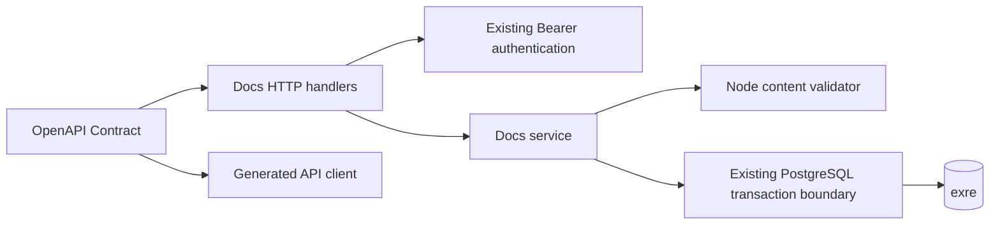

# Docs Server 架构候选 v1.2

日期：2026-10-16。状态：**DESIGN_REVIEW_REQUIRED**。本候选供独立设计审查及用户架构审批；不表示已经批准或实现。

v1.2 是对 v1.1 独立复审 R-01 的窄范围设计修订，同时回应 N-01–N-04。v1.0/v1.1 三份文件及两份审查报告保留原摘要；历史 FAIL 不因作者回应或平台探针通过而关闭。本次先交 Lead 组织同候选的受影响范围独立复审，复审通过后才提交用户架构审批。

采用现有 Fastify 内的单一 Docs 领域，以空间行锁串行化写入，使用邻接表和整数顺序管理文档树。删除批次保存在文档行中，恢复只处理同一批次；跨空间移动包含已回收后代。完整富文本使用无 DOM 的 Node 校验，正文保持 Tiptap JSON。搜索、模板、AI、附件、文档级评论创建必要表和正式 Contract，运行时明确返回 501。

## 1. 候选范围与审查单元

模块根为 `.notes/docs-service/`，来自明确指定的 `--module=docs-service`。采用 `brainstorming --handoff` 的架构路径，自主补齐实现选择。本候选是以下三个文件组成的同一审查单元，版本均为 **v1.2**：

- `.notes/docs-service/specs/2026-10-16-docs-server-v1.2-design.md`：职责、模型、事务、回收恢复、迁移与验证。
- `.notes/docs-service/specs/2026-10-16-docs-server-v1.2-contract.md`：全部 operation、字段、认证和 B 类实际响应。
- `.notes/docs-service/specs/2026-10-16-docs-server-v1.2-content.md`：完整富文本内容 profile、Node 校验及预算。

`confirmed_scope` 是需求基线已经确认的 **Server 核心功能与 B 类预留**：平级空间，只有文档节点的树，普通保存、版本检查、同级重排、换父节点、跨空间整树移动、软删除和恢复；公开正常内容，全部有效登录用户可管理全部内容。交付范围包含 Contract、生成式 Client、数据库迁移、测试和工程文档。这里的 scope 确认不等于本候选获批。

`remaining_subprojects`：上述能力的生产实现及独立代码评审、自动验收；B 类业务逻辑；后续前端。后两者没有因为本候选而获得开发授权。本期不包含 Wiki、旧 Outline 导入或删除、历史快照、永久删除、自动清理、实时协作、ACL、UI Demo 或部署。

### v1.2 实际变更范围

| 修订               | 结果                                                                                                                                                                                     |
| ------------------ | ---------------------------------------------------------------------------------------------------------------------------------------------------------------------------------------- |
| R-01 / D-07        | 撤回 onRoute 修改 GET 的 exposeHeadRoute 可关闭生成的错误机制；仅对 12 个 GET 标识对应的 HEAD 分支追加统一 404，先分支再安装普通 GET 认证/预检。Contract 第 1/5 节和第 11/13/14 节同步。 |
| N-01               | 保留 v1.1 已独立核验的 route errorHandler 委托，补 foundation 在先的明确依赖，不重写统一错误链。                                                                                         |
| N-02               | PostgreSQL deparse 引用统一固定 `REL_18_0`，Fastify 本轮引用固定 `v5.12.5`；锁定 Glue 4.11.4 的本地源码指纹另列。                                                                        |
| N-03               | 将真实 PG18 deparse 签名采集、固化和漂移验证拆成明确实施步骤；本次不运行数据库实验。                                                                                                     |
| N-04               | 使用 Docs transport 内最小 hook 组合函数，保序并复制数组，不导入私有函数、不修改共享模块。                                                                                               |
| 内容附录与其余设计 | 内容附录仅更新版本和证据复用说明；五表、树/回收、配额、30 个正式 operation、内容 profile/预算与 B 类 501 语义均保留。                                                                    |

第 14 节记录作者核实、88 个临时平台组合场景的可行性证据及局限。独立复审刷新前，候选状态仍为 **DESIGN_REVIEW_REQUIRED**。

### 沿用的 v1.1 修订背景

| 修订               | 结果                                                                                                                             |
| ------------------ | -------------------------------------------------------------------------------------------------------------------------------- |
| 配额与空间生命周期 | 保留 10,000 篇物理硬上限和无 purge 范围，说明迁出释放配额、独立回收根的限制及满额时各操作行为。                                  |
| 延迟外键与迁移     | 核实 PostgreSQL 会输出延迟属性，沿用完整定义比对；冻结历史表集合，列清 readiness/reset 接线，不新增 journal 前缀匹配机制。       |
| HTTP 接缝          | 明确 Docs 错误联合、解析期 route errorHandler、全部 12 个 GET 的 HEAD 策略、route config 封闭形状、代理预算派生及 501 日志取舍。 |
| 树与资源边界       | 排序改列服务不变量，恢复批次保序；补充有界文本投影与按命令类别注入的超时及实测门禁。                                             |
| 内容 profile       | tableRow 改为上游的零或多单元格语法，说明 rowspan 覆盖空行；区分 schema、值域及读写失败，固定 parity 入口与字段。                |

第 13 节保留 D-01–D-19 作者响应及出处，D-07 以本轮修订替换错误机制。v1.1 独立复审已核验的未变化语义及其源码证据可复用；R-01 与本轮变化必须由独立 Reviewer 重新判定，作者不能自行关闭。

### 九项边界索引

| 基线边界                                 | 本候选定稿位置               |
| ---------------------------------------- | ---------------------------- |
| 1. 空间生命周期与真正空空间              | 第 4 节；Contract 第 2、3 节 |
| 2. 树约束、排序、稳定 ID、分页           | 第 5 节；Contract 第 4 节    |
| 3. 事务、锁顺序、移动竞争与回收后代      | 第 6 节                      |
| 4. 删除分组、回收读取、恢复范围          | 第 7 节                      |
| 5. 完整 Tiptap 与有限预算                | 内容附录全部                 |
| 6. 版本和统一错误                        | 第 6、8 节；Contract 第 6 节 |
| 7. B 类表、正式 operation、实际 501      | 第 9 节；Contract 第 7、8 节 |
| 8. 模板、存储、评论、AI、搜索接缝        | 第 9 节                      |
| 9. 迁移、历史完整 schema、保留数据与测试 | 第 10、11 节                 |

## 2. 依据与取舍

已通过 CLI 下载并阅读父任务的研究和执行基线。现有研究文件 `.notes/docs-service/specs/2026-10-16-docs-service-research.md` 保持原样，不作为批准记录。项目依据为当前 `AGENTS.md`、`.ai/README.md`、`.ai/CONTEXT.md`、Server 请求与认证生命周期、Contract 结构、数据模型、Tiptap 内容边界、存储生命周期及 Monica 协作约定。

本地源码核对基点为 `f4bc36ffe85a7c04fe3a96e6a5d272dcb2206bc1`，另核对当前工作区的工程规则；不能用该 commit 代表工作区所有未提交材料。以下是本次重新读取的固定上游源码；GitHub 页面抓取失败后，通过对应的官方 raw 内容读取，未将研究附件当作实际源码阅读。

| 证据                                                                                                                                                                                                                                                                                                         | 观察与本项目采用范围                                                                                           |
| ------------------------------------------------------------------------------------------------------------------------------------------------------------------------------------------------------------------------------------------------------------------------------------------------------------ | -------------------------------------------------------------------------------------------------------------- |
| [Docmost 页面模型](https://github.com/docmost/docmost/blob/b81872c003f26360a24cc439b5694e4400753021/apps/server/src/database/migrations/20240324T086300-pages.ts)                                                                                                                                            | 分开保存空间、父节点、顺序、JSONB 正文和文本投影。本项目采用这些职责，不采用 Yjs、搜索触发器或上游级联删除。   |
| [Docmost 树锁](https://github.com/docmost/docmost/blob/b81872c003f26360a24cc439b5694e4400753021/apps/server/src/database/repos/page/page.repo.ts#L163)与[移动服务](https://github.com/docmost/docmost/blob/b81872c003f26360a24cc439b5694e4400753021/apps/server/src/core/page/services/page.service.ts#L405) | 空间固定顺序锁定、事务内重读、复核位置并检查后代。本项目以空间行锁实现同样的串行化，不引入 advisory key 映射。 |
| [Docmost 回收与恢复](https://github.com/docmost/docmost/blob/b81872c003f26360a24cc439b5694e4400753021/apps/server/src/database/repos/page/page.repo.ts#L211)                                                                                                                                                 | 此版本恢复按后代集合清除删除标记。不能直接套用到“此前单独删除的子文档不得误恢复”的需求；本项目增加批次归属。   |
| [BookStack 整数排序](https://github.com/BookStackApp/BookStack/blob/d3db80004b51a395a9dabdd406f5fbda3d4d76e4/app/Sorting/BookSorter.php#L66)                                                                                                                                                                 | 顺序使用整数并按排序结果重写。对本期受限规模，比 fractional indexing 的字符串生成、排序规则及再平衡更简单。    |
| [Fumadocs Page Tree](https://www.fumadocs.dev/docs/headless/page-tree)                                                                                                                                                                                                                                       | 导航只放必要元数据，正文另取。本期只采用职责分离，不接入其 UI 或内容源 API。                                   |
| [PostgreSQL 18 锁规则](https://www.postgresql.org/docs/18/explicit-locking.html)                                                                                                                                                                                                                             | 行锁持有至事务结束；统一资源顺序避免互锁。本项目的顺序、事务和写入口必须一起执行。                             |

Docmost 的[评论](https://github.com/docmost/docmost/blob/b81872c003f26360a24cc439b5694e4400753021/apps/server/src/database/migrations/20240324T086600-comments.ts)、[附件](https://github.com/docmost/docmost/blob/b81872c003f26360a24cc439b5694e4400753021/apps/server/src/database/migrations/20240324T086700-attachments.ts)、[模板](https://github.com/docmost/docmost/blob/b81872c003f26360a24cc439b5694e4400753021/apps/server/src/database/migrations/20260412T135891-templates.ts)分别有业务表。本项目仅借鉴关系拆分，去掉选区、评论线程、协作状态、历史与商业模块。

本次比较并放弃两条路径：独立 Wiki 平台会扩大身份、运行与 Contract 边界；closure table、物化路径与 fractional position 会增加本期树写入和迁移成本。选择邻接表、递归查询、整数顺序与空间写锁。成熟项目提供依据，本项目的批次、预算和临时授权规则仍以本需求为准。研究中的 Stars 是历史关注度快照，本候选不将其作为质量证据或重新声称当前数值。

## 3. 领域与依赖

唯一实现领域为 `apps/server/src/domains/docs/`，内部保留普通 `service`、参数化数据库查询、`content/` 校验和 `api/` 接入。服务依赖现有数据库事务与纯内容校验；HTTP 不进入核心服务。没有另一个 HTTP Server、数据库、队列、搜索集群或插件平台。

业务入口 `apps/server/src/domains/docs/plugin.ts` 通过 `fastify-plugin` 暴露 `docsServices`，只在 `apps/server/src/domains/docs/fastify.d.ts` 声明。`apps/server/src/create-services.ts` 负责构造并通过 `BusinessServices`、`apps/server/src/app.ts` 注入；入口 import 不连接数据库或启动 worker。`apps/server/src/domains/docs/api/plugin.ts` 声明真实 decorator 与 `api-auth` 依赖，安装按 operation 筛选的 hook。`apps/server/src/http/plugin.ts` 显式汇总 Docs API；全部 handler 进入 `apps/server/src/domains/docs/api/operations.ts` 和统一 `serviceHandlers`，仍只注册一次 Glue。



Contract 源预计新增 `api/paths/docs.yaml`、`api/schemas/docs.yaml`，由 `api/openapi.yaml` 引用。内容结构留在该 Contract 中；Node 的 ProseMirror schema 只检查文档语法，不另定义 HTTP DTO。生成物照既有流程生成，禁止手改。全部 API 实际路径为 `/api/docs/...`，不新增 Web 页面，不恢复 `/docs/` 旧深路径。

## 4. 最小数据模型与空间

共 **五张表**。Stage 2 建空间、文档；Stage 3 建模板、附件、评论。搜索复用文档文本投影，AI 无状态，不机械建表。下面是获批后更新 `.ai/databases/data-model.md` 和物理 schema 的依据，本次不修改它们。

通用规则：业务主键由 Server 生成 UUID，HTTP 使用稳定 ID；时间沿用工程的毫秒安全整数边界，数据库使用 `bigint`。所有版本从 1 开始，限定在 JS 安全整数范围；溢出安全失败。账号关系只记录操作事实，均不构成所有权或权限。外键默认限制物理删除，不级联删除文档内容。

| 表                 | 字段与职责                                                                                                                                                                                                                                                            |
| ------------------ | --------------------------------------------------------------------------------------------------------------------------------------------------------------------------------------------------------------------------------------------------------------------- |
| `docs_spaces`      | `id`、`name`、`description`、`version`、`tree_version`、创建/更新时间、创建/更新账号。`version` 用于空间元数据；`tree_version` 用于树读取与树命令。                                                                                                                   |
| `docs_documents`   | `id`、`space_id`、可空 `parent_id`、`position`、`title`、`content_schema_version`、`content` JSONB、`text_content`、`version`、创建/更新时间、创建/更新账号；以及可空的 `deleted_at`、`deleted_by_user_id`、`deletion_batch_id`、`deletion_root_id`。不保存历史正文。 |
| `docs_templates`   | `id`、`space_id`、`name`、`content_schema_version`、`content` JSONB、`version`、创建/更新时间、创建/更新账号。只属于一个空间，正文校验与文档相同。                                                                                                                    |
| `docs_attachments` | `id`、`document_id`、`medium`、`storage_key`、`file_name`、`content_type`、`byte_size`、`sha256`、创建时间、上传账号。唯一 `(medium, storage_key)`；不保存字节或签名 URL，不复制 `space_id`。                                                                         |
| `docs_comments`    | `id`、`document_id`、`body` 纯文本、`version`、创建/更新时间、创建/更新账号。不包含选区、段落、位置、锚点、父评论或通知状态。                                                                                                                                         |

Docs 新实体主键及其相互引用使用 PostgreSQL `uuid`；操作账号外键使用与现有 `auth_users.id` 一致的 `text`，不把账号表迁成 UUID。名字、标题和描述使用受长度约束的 text；`position` 使用 integer；版本、字节数和时间使用 bigint。除表中明确可空的父与删除四字段外均非空。内容列检查 JSONB object、根 type 为 doc、`content_schema_version=1`；版本/时间/字节数检查安全整数区间，position 检查非负。附件 medium 限 file/cos、sha256 限小写 64 位十六进制，评论 body 检查长度；完整内容、路径和空白语义仍由 service 验证。模板/附件/评论建立所属 ID 加 `(created_at,id)` 的列表索引。版本、计数、updated/deleted 时间在 Docs 记录解码边界显式转为安全整数，不能假设现有 DB 转换器会自动处理所有新 bigint 列。

### 空间生命周期

空间名字为去除首尾空白后的 1–100 字符，描述为 0–2,000 字符；拒绝全空白名字。名字可重复，不作为路由或唯一标识。创建返回空空间，`version=1`、`treeVersion=1`，不创建默认文档、成员或模板。改名和描述更新检查空间 `expectedVersion`，递增空间版本，不修改文档身份。

删除空间是物理删除，条件为**没有任何文档行，包括已回收行，也没有任何模板行**。附件和评论依附文档，因而不可能使无文档空间额外变为非空。先取得空间写锁、校验空间及树版本，再检查引用；非空返回 `DOCS_SPACE_NOT_EMPTY`，不隐式清空回收站。DB 外键是最后一道保护。新建文档/模板必须取得相同空间锁，因此空检查与并发插入不会穿透。

模板归属阻止空空间删除是本候选的自主决定，需随整体审批。现在 B operation 不创建模板；未来实现仍须遵守该条件。

## 5. 树约束、排序与读取

### 数据库约束

- `space_id` 非空并引用空间；`parent_id` 可空表示空间根。`id != parent_id`。
- 唯一键 `(space_id, id)`，复合自外键 `(space_id, parent_id)` 引用它，使用 **DEFERRABLE INITIALLY DEFERRED / ON UPDATE NO ACTION / ON DELETE NO ACTION**，保证提交时父子同空间，并允许一次事务移动完整子树。
- `position` 的数据库约束仅为非负整数。建立活动同级读取索引 `(space_id, parent_id, position, id) WHERE deleted_at IS NULL`，另建不含删除过滤的 `(space_id, parent_id, id)` 支持物理递归。
- 删除四字段必须同时为空或同时非空；`deletion_root_id` 引用稳定文档 ID。服务保证同一批次只有一个根、根属于该批次、整批同空间、其他成员处于根的物理后代。建立 `(space_id, deletion_batch_id, id)` 和回收根的时间索引。

### 服务不变量

活动同级位置必须唯一且连续为 `0..n-1`，读取按 `(position,id)`；回收行保留的位置不参与正常排序。这是所有 Docs 写入口在空间锁内重排所维护的服务不变量，**不是数据库唯一约束**。不建立会阻止交换中间状态的 partial unique index，也不为此新增 deferred constraint trigger。测试逐次检查同级集合，不把普通非唯一索引误认成完整性保障。

活动文档的全部祖先必须活动；服务检查环和层数。数据库的自引用 CHECK 与父外键只能覆盖其中一部分，不能证明无环或祖先活动。读取发现损坏安全失败，不能截断后返回正常树。`(position,id)` 即使出现重复 position 也构成全序；但绕过锁和树版本更新的写入仍会破坏命令及分页保证，不承诺支持此类直写。

本候选的规模预算为每空间最多 **10,000 篇物理文档（含回收）**，物理树最多 **64 层**（根文档为第 1 层）。这是支持整数重排及有界递归的显式限制，不是历史产品承诺。创建、移动在锁内计算目标总量和最大深度；回收不释放数量配额。超限返回 413。递归携带 visited/path 和深度，发现环或违反既有约束返回固定 500；正常业务导致的新超限返回 413。内部查询只读取本次需要的元数据，不装载整树正文。

### 配额、迁出与真正空空间的组合后果

配额按当前 `space_id` 的物理行数计算，不是空间累计创建次数。活动根可以连同完整物理子树迁出，源空间立即释放对应行数；其中已回收后代跟随迁出而保持回收。若全部文档已经迁出且无模板，源空间重新成为真正空空间，可以删除。因此，“曾经创建过文档的空间永久不可删除”不成立。

独立回收根不能直接移动，仍计入所在空间配额。只剩回收内容的空间不能删除，也没有本期的非公开清空操作。恢复会立即重新公开本批正文；“先恢复再迁出”是有公开影响的内容操作，不能包装成无公开影响的回收清理方法。本期不新增 purge、手工 SQL 清理路径、隐式豁免或自动释放配额。

| 当前空间已到 10,000 篇物理行        | 核心行为                                                                |
| ----------------------------------- | ----------------------------------------------------------------------- |
| 读取空间、正常树/文档及登录后回收站 | 允许，按原认证与内容状态执行。                                          |
| 修改空间名字/描述，编辑已有活动文档 | 允许；仍检查版本及原有元数据/正文预算，不增加文档行数。                 |
| 同空间重排或换父节点                | 允许；检查版本、活动目标、无环及 64 层限制，不按新增行计额。            |
| 回收或恢复                          | 允许；不增加物理行数，回收不释放配额，恢复立即公开本批内容。            |
| 迁出活动根及其物理子树              | 允许；目标空间数量/深度及两侧版本必须合法，提交后按迁出行数释放源配额。 |
| 新建文档或从其他空间移入非空子树    | 413 `DOCS_LIMIT_EXCEEDED`；无部分创建/移动。                            |
| 删除空间                            | 409 `DOCS_SPACE_NOT_EMPTY`；数量下降到真正零且无模板后才可删除。        |

B 类 operation 仍按其 501 约定执行，不能作为释放配额的可用能力。剩余限制是：纯回收满额空间无法在保持内容不公开的条件下靠本期 API 释放配额或删除空间。该限制随最终候选显式提交用户架构审批；不能统称满额空间“不可写”。

### 顺序与稳定引用

统一的移动命令同时覆盖重排和换父节点。调用方指定目标父 ID 与 `beforeDocumentId`；空值表示追加到目标活动同级末尾。Server 从目标同级序列移出当前根，再插入锚点之前；锚点必须是目标同级的活动文档且不是被移动文档。重写受影响同级的整数位置。调用方不能提交任意 `position` 或整棵树。

文档 ID 不因改名、换父节点、跨空间、回收或恢复而改变。读取以 `/api/docs/documents/{documentId}` 为稳定入口，正文中已有引用字符串原样保留；不按空间、标题或路径重写内容，也不承诺校验所有外部链接的可达性。

### 元数据分页

`getDocsTree` 每次读取一个父节点的直接活动子文档；省略 `parentId` 读取根层。返回 `id/spaceId/parentId/title/position/version/hasChildren`，不返回正文、删除信息或账号资料。默认 100、最大 200 项，按需逐层加载，不构造带全部正文的嵌套树响应。

游标为不透明 base64url JSON，包含格式版本、空间、父 ID、`treeVersion`、末项 `(position,id)`；最大 1,024 字符，解析后严格核对形状与查询作用域，不是授权凭据，不需要新秘密。一次请求使用只读一致快照读取空间版本、父状态和当前页。后续页发现版本变化返回 409 `DOCS_TREE_CHANGED`，调用方从首批重读，不能拼接跨版本的树。空间列表按 `(createdAt,id)` keyset 分页；它只保证 keyset 行为，不宣称跨请求历史快照。

每次成功文档写入，包括仅正文保存，都使所属空间 `treeVersion` 加 1。这样导航返回的文档 `version` 与游标属于同一可检查代际；本期接受不同文档写入引起的分页重读，不另建导航 revision 系统。

## 6. 事务、锁与版本

### 所有 Docs 写入口共用的顺序

1. 在事务外完成纯输入、内容校验和规范化，不持有数据库锁执行 DOM、文件或网络操作。HTTP 在读取大正文前前置验证 Bearer；Glue 在 handler 前再次校验。
2. 开始现有数据库边界的 `READ COMMITTED` 事务。根据命令显式给出的空间 ID 去重、按 UUID 字节序排序，**逐个**执行 `SELECT ... FOR UPDATE` 锁定空间行。不得先锁文档再找空间，不在 SQL 的带 LIMIT 选择中隐含决定锁集合。
3. 锁定全部空间后重新读取实际文档和目标父节点。`expectedSpaceId` 或移动的 `sourceSpaceId` 与实际位置不符立即 409；禁止在已经持有较大 ID 的锁后追加第三个空间。缺失空间返回 404。
4. 需要显式锁定文档行时，先取得全部候选 ID，再按 UUID 顺序锁定；候选包含被移动/回收/恢复集合和受影响的活动同级。空间锁阻止新的树写入穿透。所有后续写入口，包括未来模板/评论/附件关联写入，遵守空间先于文档的顺序。
5. 在锁内校验版本、目标活动状态、同空间父节点、锚点、环、数量、深度、删除批次，再执行更新。复合父外键在提交时核验，任一步失败全部回滚。提交后才返回结果。

空间元数据更新和删除也取得空间锁。空间创建没有既有空间锁；UUID 新建后插入。业务不持有账号或会话排他锁，不形成从 Docs 返回身份写入的反向锁序。Bearer 仍遵循既有请求认证语义，创建/更新账号外键不能变成作者权限检查。

同空间所有写入串行，跨空间锁两行，空间以外的独立写入仍可并行。选择行锁省去 advisory hash 冲突和独立锁 key 生命周期；该取舍适合当前单实例规模，并仍能约束多个 Server 进程共同使用同一 DB 的受控写入口。未经这些 service 的直接 SQL 不在业务并发保证内。

### 各命令的版本

| 命令           | 必须匹配                                                | 成功变更                                                         |
| -------------- | ------------------------------------------------------- | ---------------------------------------------------------------- |
| 空间元数据更新 | `expectedVersion`                                       | 空间 `version+1`。                                               |
| 删除空间       | 空间 `expectedVersion` 与 `expectedTreeVersion`         | 真空才删除。                                                     |
| 创建文档       | `expectedTreeVersion`                                   | 新文档版本 1；位置变化的同级版本递增；空间树版本递增一次。       |
| 保存正文/标题  | `expectedSpaceId`、文档 `expectedVersion`               | 当前文档版本递增；正文、标题、投影原子更新；空间树版本递增一次。 |
| 重排/移动      | 根文档 `expectedVersion`、源/目标树版本                 | 根和实际字段变化的文档各递增一次；每个受影响空间树版本递增一次。 |
| 回收           | 根 `expectedVersion`、所属空间树版本                    | 本次新回收行、位置变化的同级版本各递增一次；树版本递增一次。     |
| 恢复           | 根 `expectedVersion`、`deletionBatchId`、所属空间树版本 | 本批恢复行、位置变化的同级版本各递增一次；树版本递增一次。       |

同空间移动的两个 expected tree version 必须相等并匹配当前值。成功保存相同内容也递增版本；成功移动到当前位置也递增根版本和树版本，以统一命令语义。一个文档在同一命令中因多项变化只加一次版本。其 `updatedAt/updatedBy` 同步更新。树内父 ID 未变的同空间后代无需递增；跨空间后代因 `spaceId` 变化全部递增。版本不产生历史快照。

本期不提供写命令 request-ID 去重。响应丢失后重发旧版本得到 409，调用方重读确认现状，不自动重试并覆盖。锁/语句期限、死锁或序列化中止使事务回滚并返回固定 503 `DOCS_BUSY`；该错误显式携带 `retryAfterSeconds: 1`，由既有出口生成 `Retry-After: 1`。未知驱动异常归固定 500。

服务只按 PostgreSQL SQLSTATE 分类已知的 `55P03`（锁不可用/锁期限）、`57014`（受控查询取消/语句期限）、`40P01`（死锁）、`40001`（序列化中止），等待事务边界回滚后转成 DocsError；不解析或回显驱动 message/SQL。调用方仍须重读后决定是否重试，不自动重放旧写入。

`DocsServiceOptions.timeouts` 在构造时按 `metadata/content/tree` 三类命令注入，每类都有 `lockTimeoutMs` 与 `statementTimeoutMs`，本候选默认均为 5,000/10,000。构造时复制冻结配置，检查两值都是 `1..2147483647` 范围整数且 lock 不大于 statement，符合 PostgreSQL 毫秒配置域。值由可信组装层给定，不接受 HTTP 参数、不新增环境变量或通用配置平台，只在本事务设置 PostgreSQL LOCAL 配置，不改连接池全局行为。lock timeout 限制每次锁等待，statement timeout 限制每条 SQL，**不是整次事务或 HTTP 的总期限**。

20,000 行是两空间移动的受影响集合上界，不是已实测的性能承诺。实现使用批量更新和现有索引，不逐行发出 20,000 次 SQL。独立 PG18 测试须记录三层/64 层树、接近满额子树及两侧同级大幅重排的实际规模、索引、超时配置和耗时；还须验证低期限注入时的完整回滚和固定 503。默认预算达不到门禁时，先优化查询，再按命令类别调整有限超时并刷新性能/竞争证据，不能以已有设计文字宣称通过。

### 移动算法与竞争结果

锁后按物理父子关系递归取得根和**全部后代，不加 `deleted_at IS NULL` 过滤**。目标父节点和排序锚点必须活动。目标父不能是根或物理后代；目标父链与子树高度之和不得超过 64。跨空间还检查目标的物理数量配额。

同空间只更改根的父与位置并重排两侧活动同级。跨空间将物理集合所有 `space_id` 原子改到目标空间，根改到指定父节点并插入目标顺序；后代父 ID、正文 ID、删除批次、删除时间和删除人保持不变。附件和评论只引用文档 ID，无须同步空间字段。提交时复合自外键阻止遗漏任何物理后代。

跨空间命令的受影响集合还包括两侧重排同级，去重后最多 20,000 行；不能用单空间 10,000 的上界约束其响应计数或锁集合。单空间的持久数量配额仍在提交后的每个空间分别检查。

| 竞争                          | 必须出现的结果                                                                                   |
| ----------------------------- | ------------------------------------------------------------------------------------------------ |
| A 移到 B 下，同时 B 移到 A 下 | 同空间串行；后执行者先遇到旧树版本冲突；新版本重试也会被环检查拒绝。                             |
| S→T 与 T→S 同时移动不同子树   | 两边均先锁较小空间 ID，再锁较大 ID；不互锁，后执行者旧版本冲突。                                 |
| 删除祖先与移动后代            | 先提交删除则后代不再活动，移动失败；先提交移动则删除旧树版本失败，重读后删除不再包含移出的子树。 |
| 保存与跨空间移动              | 先保存使移动树版本冲突；先移动使保存位置/文档版本冲突，不会将旧空间状态写回。                    |
| 删除空空间与向该空间创建/移动 | 共用空间行锁；先插入则删除非空，先删除则写入找不到目标空间。                                     |

## 7. 回收分组与恢复

### 新回收批次

只能回收活动根。锁内遍历完整物理子树，但**只给当前活动行**写入新 `deletion_batch_id`、`deletion_root_id=所选根 ID`、同一删除时间与操作账号。先前已回收行的四项归属不修改，也不合并批次。父子 ID 保留，活动同级重排。重复回收已回收根返回 409 `DOCS_ALREADY_TRASHED`；不存在返回 404。

不需要删除批次表：批次只在尚未恢复的文档上表达恢复集合，不存删除历史、原文快照或终态审计。批次 UUID 不复用。服务不提供部分恢复或单独移动已回收节点的入口，因此同批次不会被拆散。

### 管理读取与公开过滤

公开文档详情、树和未来搜索只读取活动内容，不接受 `includeDeleted` 绕过；即使带 Bearer，普通详情读取回收文档仍返回 404。独立的登录后回收站按空间分页列出**每个批次根**，返回批次 ID、根元数据、同批条数、删除时间和版本，不带全部正文；根可能仍挂在另一个回收批次之下，也必须单独列出。

从稳定 ID 读取普通文档详情时，也在同一快照内核验最多 64 层的祖先活动链；发现损坏不变量返回固定 500，不公开正文。不能因为按 ID 查询绕过了树导航，就暴露错误留在回收祖先下面的活动行。

已登录用户可通过专门的回收详情 operation 读取某篇已回收文档的完整正文与批次归属。回收站不是作者私有列表。所有响应 `no-store`，不返回账号邮箱、token 或数据库内部值。

### 恢复范围和安置

恢复入口只接受当前批次根。提供根版本、批次 ID、当前空间和树版本；以 `(space_id, deletion_batch_id, deletion_root_id)` 精确选出成员并复核组结构。非根请求返回 409 `DOCS_RESTORE_ROOT_REQUIRED`，旧批次或版本返回 409，不扩大到整棵物理子树。

原父为空则在本空间根层追加；原父仍存在、同空间且活动则在原父下追加；原父已回收或不可用则将本批根脱离原父，在本空间根层追加。返回 `placement` 明确说明 `original-parent` 或 `space-root`。不自动恢复父批次，不接受任意目标空间/父节点参数。DB 引用损坏与组结构损坏是 500，不用正常 fallback 隐藏数据错误。

仅清除本批成员的删除四字段，保留它们的内部父子关系。对每个受影响父层，先保留当前活动同级的 `(position,id)` 顺序，再将本批待恢复同级按**保留的旧 `(position,id)` 升序**追加到末尾，最后连续重排为 `0..n-1`。外部父层只追加本批根；批内父层也使用相同规则，不能任意按数据库返回顺序恢复。其他删除批次不参与此重排，仍保持回收状态及其物理父指针；独立恢复一个旧子批次时，如果父仍回收，它会单独移到空间根层。恢复完成后清除批次信息，不保留“已恢复历史记录”。

例：A→B→C，先回收 C 得到 G1，再回收 A 得到 G2（成员 A、B）。恢复 G2 只恢复 A、B；C 留在 G1。若先恢复 G1，父 B 尚回收，则 C 在原空间根层恢复，之后恢复 G2 不会把 C 拉回旧位置。

### 已回收后代的跨空间移动

例：活动 A 属于 S，后代 C 已回收为 G1。移动 A 到 T 时，C 和 G1 的全部成员一起改到 T；删除归属和状态不变，回收站 G1 出现在 T。之后恢复 G1 时使用 T 的树版本和根的新版本。不得只移动活动行而把 C 留在 S，也不得清空 C 的删除标记；旧 S 的恢复请求必须冲突。

由于只允许活动根移动、只允许整批恢复，任何被包含的回收批次都完整位于被移动物理子树内。实现必须验证这一不变量，发现一批跨空间或根不在集合中时整事务失败，不能“修复”部分内容后成功。

## 8. 统一失败与公开生效

保存成功即公开生效，没有 draft/published 字段或异步发布流程。Docs `Error` 只提供固定 `code/statusCode/publicMessage`，由 `apps/server/src/errors.ts` 的既有出口生成 `error.code/message/requestId`。不新增错误 envelope、SQL 消息或正文片段。

Contract 形状错误为 400 `BAD_REQUEST`；内容语义失败、版本冲突、404、401、413 与 501 的精确约定见 Contract 附录。错误出口和 Docs 的 onRequest hook 均使用 `Cache-Control: no-store`。公开返回的“已回收”和“未知文档”合并为 404；管理命令中的已回收状态可返回明确 409。

新增 `apps/server/src/domains/docs/errors.ts` 的 `DocsErrorCode`，以 type import 并入 `apps/server/src/errors.ts` 的封闭 `ErrorCode` 联合；错误对象携带固定 `statusCode/publicMessage`，busy 另有 retry 字段。当前代码尚未包含这些取值，不能只写文档错误码表就声称类型接线完成。

解析期的 bodyLimit 413 和不支持媒体类型 415 先于 `preValidation`，因此在 Docs 按 operation 筛选的**路由 errorHandler** 中分类，再委托预先捕获的既有统一 errorHandler。`preValidation` 只做已解析内容预检，不承担解析期重映射；`onError` 不替换异常或自发第二份响应。具体 native error code、委托与非 Docs 隔离要求见 Contract 第 5 节。

## 9. B 类最小预留与接缝

所有 B operation 都有正式请求/响应 schema、稳定 operationId、明确 security 和实际 handler。**本期合法请求实际返回 501 `DOCS_FEATURE_NOT_IMPLEMENTED`，不返回空列表、假附件、假 AI 建议或成功的模板结果。** 未来 2xx 的形状进入 Contract，但说明为预留；不能据生成类型声称功能可用。

| 能力 | 本期持久化准备与后续接缝                                                                                                                                                                                                                                                                                                                                                                                                                                              |
| ---- | --------------------------------------------------------------------------------------------------------------------------------------------------------------------------------------------------------------------------------------------------------------------------------------------------------------------------------------------------------------------------------------------------------------------------------------------------------------------- |
| 搜索 | 文档表的 `text_content` 是保存事务中的派生投影，不作为正文事实来源。每个文本叶只提取一次，Mention 只取 label（无 label 用 id），图片只取 alt，块与换行边界各用有界分隔符；不展开表格跨度、不重复祖先文本。保留 Unicode 和代码字面文本。投影最多 8 MiB UTF-8，构造时先计数再追加，DB 以 `octet_length(text_content)` CHECK 复核，不截断正文或投影后成功；越界中止同一保存事务。未来查询必须过滤回收行。本期不建英语 tsvector/GIN、分词扩展或搜索服务，不验收中文搜索。 |
| 模板 | 仅空间内模板；不引入全局共享范围。应用模板复制内容到现有文档，要求同空间、模板版本与文档版本，经过普通 Node 校验和保存事务。不在文档保存活的 `template_id` 关联；后来修改/删除模板不改变已应用正文。当前全部 501。                                                                                                                                                                                                                                                    |
| 附件 | 附件只能属于一篇文档，以稳定文档 ID 关联；跨空间不改归属。未来 Docs 上传入口由 Server 生成 `docs/{documentId}/{attachmentId}` key，固定当前介质，调用既有 `StorageService.upload(key, Uint8Array, {medium,contentType})`，只把 medium/key/字节摘要等可信元数据入表。调用方不能提交任意 URL、bucket、key 或“已存在”声明。                                                                                                                                              |
| 评论 | 仅文档级纯文本，1–10,000 字符，所有有效登录用户可管理；公开读取正常文档的评论。Contract 和 DB 都没有 selection、range、paragraph、anchor、position、parentCommentId。文档回收后，未来公开评论列表也必须不可读。当前不保存评论。                                                                                                                                                                                                                                       |
| AI   | 无状态的整篇建议 operation，输入文档版本及指令，输出基于该版本的建议正文；不建立 AI job/history 表，不连模型或消费凭据。未来返回建议不能直接写库，应用建议仍走普通保存及版本检查。                                                                                                                                                                                                                                                                                    |

### 存储的真实限制

现有 `api/paths/storage.yaml`、`api/schemas/storage.yaml` 只有通用上传计划、上传及 complete 结果，结果仅为 URL，不是 Docs 归属证明；基础 adapter 只有 `put/getUrl`，没有通用对象所有权登记。现有本地 URL 公开读取，COS URL 有签名期限。因此本候选选择 **Docs 自己接收字节后在服务内调用现有 StorageService**，不把通用上传返回的 URL 注册为附件，也不新增直传完成协议。

未来上传必须先校验会话/文档状态，再在事务外写对象，最后在短事务中复查文档版本与活动状态并创建附件行。失败留下的未引用对象只能显式核对后清理；本期不增加清理 worker，也不承诺对象存储与 DB 的跨系统原子事务。未来下载先核对文档活动状态，再用保存的 medium/key 生成访问地址；不持久化过期签名 URL。

这些是后续实现必须遵守的接缝，本期不写入对象、不扩展 StorageService、不实现 multipart 内容消费。预留上传的早期 501 行为见 Contract 附录。现有通用存储地址和正文中的外部图片地址不能因文档回收而撤销；本候选不声称提供字节级撤回能力。若未来需要私密或可撤回附件，必须另行审查存储访问模型。

接受既有 `apps/server/src/errors.ts` 把 501 记为 error 级的一次日志，字段仅固定 code/statusCode，文案为既有 `request failed`。本期不改变全站日志分级，不在 Docs handler 再记一次，也不记录指令、正文或原始异常。16 个 B operation 的预期 501 会产生这种日志；这是明确取舍，不能误报为已实现业务发生内部崩溃。

## 10. 迁移与保留数据

获批后先更新并审查 `.ai/databases/data-model.md`，再改 `apps/server/src/db/schema.ts`，通过 `pnpm --filter @workspace/server db:generate` 生成并审阅增量 migration；根目录没有独立 `db:generate` 脚本。当前 journal 到 `0002_persistent_notifications`；预计新增 `0003_docs_core`（两表及其约束/索引）和 `0004_docs_reservations`（三表）。编号如被其他已接受变更占用，按实际 journal 追加，不能改写旧 migration。复合自外键的延迟属性以审阅后的 migration SQL 为准，不能假设 Drizzle 默认外键生成就已经包含它。

当前 `apps/server/src/db/migration-runner.ts` 的真实机制是：`COMPLETE_TABLE_SETS` 为候选数组，对当前表集合检查**长度相同且逐项名字都存在**；另行检查 journal 是否存在，迁移后由 readiness 检查最新结构及 journal 非空。它没有 journal 前缀/哈希与表集合的绑定映射，本候选不新增这种机制，也不声称有此检查。

先将历史 0000、0001、0002 的表名冻结为各自显式字面量快照，再追加核心/B 阶段快照；每份只读快照以 `Object.freeze` 固定，不引用会增长的 `APPLICATION_TABLES`，不通过其下标 slice 推导历史基线。`apps/server/src/db/schema-check.ts` 的 `BASELINE_APPLICATION_TABLES` 同样改为固定的 0000 字面量。快照分别对应 12/15/24/26/29 个精确表名；数字只供说明，不能以“表数相同”代替成员匹配。候选数组的位置或注释标签不是 journal 匹配器。测试从历史 migration 前缀建立夹具，是验证升级入口，不是已有前缀自动匹配能力的证据。空库按全序列建立，不从旧 Outline 或 SQLite 导入。

启动 readiness 增加 Docs 的表、字段、类型、可空性、版本/删除 tuple/投影 check、外键、主键和唯一约束、索引定义与有效状态。名称存在不能替代真实定义；所有新增约束与索引均补充手写签名，不能只追加 Drizzle table export。仍在监听前检查，缺失则提示显式 `pnpm db:migrate` 并拒绝启动。不在启动时建库、迁移、reset 或补造默认内容。

**延迟外键的检查策略**：沿用 `apps/server/src/db/schema-check.ts` 的 `pg_get_constraintdef(c.oid,true)` 完整字面量比较，把 Docs 复合自外键预期定义中的 `DEFERRABLE INITIALLY DEFERRED` 一起登记，保留其目标列及 NO ACTION 语义。PostgreSQL 18 的[固定发布标签源码](https://github.com/postgres/postgres/blob/REL_18_0/src/backend/utils/adt/ruleutils.c#L2596)按 `condeferrable/condeferred` 追加延迟属性，单/双参数 SQL 函数使用同一 worker。故 D-02 所称“该函数不输出延迟属性”不成立，无须为该理由新增一套 catalog flag 查询。本次读取该官方源文件 SHA-256 为 `a6a616102bc6d77e303472db766639c100b88d03035560d0be974350be8a6fc1`；只做源码核验，未运行数据库实验。

签名必须取 PG18 的实际 deparse 结果，不能直接照抄建表 SQL：默认 NO ACTION 在 deparse 中可能省略，但语义仍是 NO ACTION；不能自行给输出补字或为了“规范化”删除延迟后缀。当前运行配置的 search_path 与隔离测试中的 schema 均沿用现有受控边界，预期签名据该环境核实。

获准实施后，将以下内容作为独立步骤执行并交独立复核，不能仅在泛化“验证”中带过：

1. 在隔离 PG18 容器和逐用例 schema 中从真实新增 migration 建立 Docs 五表；记录 PG 完整版本及受控 search_path。枚举五表全部 PK/FK/UNIQUE/CHECK，按表/约束名排序输出 `pg_get_constraintdef(oid,true)`，保存实际结果作为该代码头的验证材料。不预设“29 条约束”的数量；完整约束集合与五表定义及手写 migration 逐项核对，不能拿当前全库表数代替约束清单。
2. 把该真实 deparse 结果逐字固化到 `APPLICATION_CONSTRAINT_DEFINITIONS`；核对复合自外键目标列、默认 NO ACTION 语义及 `DEFERRABLE INITIALLY DEFERRED` 后缀。显式审阅测试 schema/正常运行 search_path 对限定名的影响，不能删除延迟文本或自行补默认文本以凑签名。更新对应索引签名并核对集合完整性。
3. 验证正常结构 readiness 通过；`NOT DEFERRABLE`、`DEFERRABLE INITIALLY IMMEDIATE` 以及引用列/目标列漂移均失败。再验证至少三层物理子树跨空间提交成功，遗漏后代或注入中途异常时全部回滚。采集、固化、反例均未执行，不能从源码核验直接宣称通过。

| 必须同步的接线                                                    | 具体内容                                                                                                     |
| ----------------------------------------------------------------- | ------------------------------------------------------------------------------------------------------------ |
| `apps/server/src/db/schema-check.ts` 的 `tableDefinitions`        | 添加五张表的 Drizzle export，覆盖字段类型/可空性/约束存在性。                                                |
| 同文件 `APPLICATION_TABLES` 与 `BASELINE_APPLICATION_TABLES`      | 当前表名单增至 29；历史 0000 改为不依赖数组顺序的固定快照。                                                  |
| 同文件 `APPLICATION_CONSTRAINT_DEFINITIONS`                       | 每个新增 PK、FK、UNIQUE、CHECK 的完整实际定义，含延迟属性及 `text_content` 字节上界。                        |
| 同文件 `APPLICATION_INDEX_SIGNATURES`                             | 所有新增普通索引及 PK/UNIQUE 生成的索引签名，保留唯一性、列序、predicate 及有效状态检查。                    |
| `apps/server/src/db/reset-plan.ts` 的 `DROP_ORDER`                | 在既有顺序前加入 comments、attachments、templates、documents、spaces，先依赖者后被依赖者，保留原表相对顺序。 |
| 同文件 `BASELINE_NOT_NULL_COLUMNS`                                | 添加五个新表 export；该名字虽带 BASELINE，实际用于当前受控 reset 的 NOT NULL 归属核验，不能漏掉 Docs。       |
| `apps/server/src/db/migration-runner.ts` 的 `COMPLETE_TABLE_SETS` | 五个完整阶段的固定名字集合，冻结旧值后再追加，不建额外历史映射框架。                                         |

readiness/reset 共用签名集，因此漏签名也会影响 reset 的对象归属判断；测试检查 Docs 每个预期约束/索引都有定义签名。只在临时容器中验证“Docs 五表有数据时受控 reset 可完成并重建最新结构”和未知对象仍阻止 reset。本轮不执行任何 reset、迁移或实际库连接。

两个增量 migration 各自在可回滚事务中创建结构，无外部文件/网络副作用，不改既有业务行。已经成功迁移后优先前滚修复，不提供自动 down/drop；旧二进制未必接受新表集合，不能承诺原地回滚应用即可启动。恢复旧版本必须由操作者单独确认维护方案并保留升级后数据与升级前备份，不能以 reset 代替回退。头像、uploads、账号、通知、身份历史和退休 Outline 数据全部保留。

## 11. 验证与实施边界

实现验收遵循 `.ai/architectures/contract-tests/test-layers.md`；当前没有根 `TESTING.md`。数据库用现有 PostgreSQL Testcontainers 与逐用例 schema，Docker 不可用明确 FAIL，不连接开发库。

| 必须覆盖              | 具体反例与期望                                                                                                                                                                                                                                                                                                                                                                                                                                                    |
| --------------------- | ----------------------------------------------------------------------------------------------------------------------------------------------------------------------------------------------------------------------------------------------------------------------------------------------------------------------------------------------------------------------------------------------------------------------------------------------------------------- |
| Contract 双向覆盖     | 核心和所有 B operation 都有真实 handler；遗漏与多余 operation 均阻止启动；直接原始 handler 输出另作 schema 断言。                                                                                                                                                                                                                                                                                                                                                 |
| 公开/登录边界         | 匿名可读正常空间/树/文档；匿名管理/回收读取 401；不同登录账号均可管理；邮箱等私有资料不进入响应。                                                                                                                                                                                                                                                                                                                                                                 |
| 空间与分页            | 重名合法；新空间可删；把活动根及回收后代迁出后源空间重新为空且可删；独立回收根不能直移，纯回收空间不可删；满额时逐项验证第 5 节行为，迁出按物理行数释放配额，创建/移入超额回滚；恢复立即公开本批。分页无正文；游标作用域错误 400、版本变化 409。                                                                                                                                                                                                                  |
| 结构与原子性          | 自引用、后代、错空间父/锚点、缺失父、配额和深度；至少三层整树跨空间成功；遗漏物理后代或更新根后注入失败，全部后代与两侧顺序/版本回滚。固定随机种子生成连续多步重排/换父/回收/恢复，每步断言各活动同级恰好 `0..n-1`、无环及批次不拆散。                                                                                                                                                                                                                            |
| 双连接竞争            | 并发互移、反向跨空间、删除/移动、保存/移动、删除空空间/创建；用屏障控制事务顺序，不以 sleep 猜竞争。                                                                                                                                                                                                                                                                                                                                                              |
| 回收恢复              | 先删子再删父；两种恢复顺序；嵌套批次均可枚举；非根/旧批次失败；父回收 fallback；保留现有同级顺序并按旧 `(position,id)` 保序追加本批；移动包含已回收后代且恢复发生在新空间。                                                                                                                                                                                                                                                                                       |
| 版本                  | 每种命令缺失/旧版本、同命令只加一次、同空间双版本相等、旧请求无重试覆盖；内容和结构共享版本但没有历史。                                                                                                                                                                                                                                                                                                                                                           |
| 富文本                | 完整所有节点/Marks/属性正反例、默认规范化与无信息损失；schema parity 与独立值域 parity；rowspan 完整覆盖的空行可写可读、缺格空行写入 400、存量损坏读 500；危险 URL、NUL/无效 Unicode、未知节点/属性明确拒绝；8 MiB 文本投影及多次引用不膨胀。                                                                                                                                                                                                                     |
| 内容传输              | 8 MiB 边界、规范化后越界、10,000 节点、32 层、累计虚拟网格；超过全局 4 MiB 的合法 Docs 正文可保存；9 MiB wire 超限、chunked、错误长度和非 identity 编码。                                                                                                                                                                                                                                                                                                         |
| B 类保留              | 逐 operation 的合法请求 501/no-store；认证失败仍 401；JSON 反例拒绝；原始 handler 抛固定错误；DB/存储/AI 均无业务写入或调用；每次 501 只记一次固定 error 级日志。                                                                                                                                                                                                                                                                                                 |
| 迁移/readiness/reset  | 空库、重复迁移、每个历史 migration 前缀升级；冻结集合不受新表追加/重排影响；保留旧数据及样例 Docs 数据；拒绝半迁移、非应用对象、journal 缺失/空记录和约束漂移；非延迟/初始立即外键失败；Docs 有数据的容器 reset 成功，未知对象仍阻止 reset。                                                                                                                                                                                                                      |
| 服务边界与传输        | Node 导入校验模块不需要 DOM/React；API 注册仍唯一 Glue；解析期 413/415 是 Docs 码，其他 API 不受重映射；错误出口只执行一次。                                                                                                                                                                                                                                                                                                                                      |
| Docs HEAD 与 GET 回归 | Contract 第 5 节全部 12 条路径 × 匿名/有效/无效 Bearer：HEAD 均统一 404/no-store/X-Request-Id/零 body；统一出口内部固定 NOT_FOUND envelope，认证、内容预检、Docs/DB/存储 handler 均零调用。分别核验 inherited/route hook 顺序、已有函数/数组 hook 保序；同路径 GET 保留核心 200/B 501 及受保护 401，坏参数 HEAD 不先经 GET 校验；非 Docs 公开/受保护 GET/HEAD 保持原行为。content/command bodyLimit、编码拒绝和错误出口仍须原回归。不能以没有自动路由为验收条件。 |
| 注册配置、代理及超时  | 30 个 operation 的 docs config 逐项与 kind/method/body/预算匹配，缺键/额外键/非安全整数拒绝 boot；代理从 Contract 派生 Docs wire 最大值，非固定 64 MiB；最坏规模与超时注入实测见第 6 节。                                                                                                                                                                                                                                                                         |

实现阶段先改 Contract，再串行运行 `pnpm api:lint`、`pnpm api:generate`；最终执行 `pnpm api:check`、`pnpm typecheck`、`pnpm test`、`pnpm build`。共享目录的生成与 Git/运行资源写入串行。使用当前候选代码头重新取得独立评审及适用测试证据。

**本次状态**：设计内联自检及文件静态检查单独记录；第 14 节仅执行无端口、无数据库的临时平台组合探针。上述生产实现、Contract lint/generate、类型检查、Docs 功能测试及构建均 **NOT_EXECUTED**。真实浏览器、UI Demo 和部署验收不属于本期验收。没有操作数据库、运行服务、Git 索引、commit 或 push。

## 12. 自主决定、假设与剩余风险

本候选自主决定：真正空空间才能删除；空间级串行写；邻接表与整数重排；树 10,000 篇物理行/64 层预算；同批恢复保序及父不可用时根层追加；正文和结构共享文档版本；所有文档写使树版本变化；空间内模板；纯文本平级评论；附件由 Docs 接收字节；B operation 明确 501 并接受既有 error 级日志。这些选择在独立复审通过后，随 v1.2 一起提交用户审批，不冒称访谈已逐项批准。

配额组合后果也必须进入最终审批：活动子树迁出可以释放源配额并使其重新为空；独立回收根不能直移且继续占额；纯回收空间不能删除；纯回收满额空间没有本期的非公开释放路径，恢复会重新公开内容。满额只阻止新增/移入，不阻止合法读取、编辑、回收、恢复、同空间调整或移出。维持无 purge 范围，不新增手工 SQL 清理路径。

假设：当前规模适合有界事务与空间串行化；没有其他业务绕过 Docs service 直接更新这些表；用户接受高并发冲突后重读，不要求透明重试。任何放宽配额、部分恢复、回收节点移动、私密附件或实时协作都会改变不变量，须重新审查受影响设计。

证据局限与风险：本次没有运行新实现来证明锁、延迟外键、序列化、9 MiB 路由或最坏规模超时；内容附录的 schema/值域 parity 和真实 socket 测试是实施门禁。`@tiptap/pm` model 子入口已从 3.32.0 官方 package exports 静态核对，但无 DOM 的真实 Node 导入尚未执行。上游版本及本地锁定版本已记录，后续升级必须重新比较。B 类功能的可用性、中文搜索质量、云存储可达性、AI 效果及公网部署均没有本期验收证据。

交接状态保持 `DESIGN_REVIEW_REQUIRED`。由 Lead 安排独立 Reviewer 复审同一 v1.2，独立审查通过后，由 Lead 将具体候选及文件摘要提交用户架构审批。本轮不提交用户审批。团队审查不等于用户批准；未取得明确批准前，不标记 Stage 1 完成、不启动核心或 B 类生产实现，不将未批准结论写入 `.ai/`。

## 13. D-01–D-19 作者核实与响应

本节保留 v1.1 对[原独立审查报告](https://monica.woa.com/api/attachments/01a140fe-ca46-75a4-96c8-372d9ca2fd0d/download)的作者响应，报告 SHA-256 为 `b8902b2bb4940621729e52efd7ae695ed316421ed5ec316f5dd74ccad51a7482`；v1.0 文件保持原样。v1.1 独立复审已核验除 HEAD 机制外的响应，本轮保留未变化语义，不重开无关项。下表 D-07 是 v1.2 对原错误机制的纠正；本节其余是既有作者响应，**不是作者自授独立关闭状态**。

| 项   | 核实结论与依据                                                                                                                                                                                                              | 沿用处置及 v1.2 修订入口                                                                                                                                                                                                         |
| ---- | --------------------------------------------------------------------------------------------------------------------------------------------------------------------------------------------------------------------------- | -------------------------------------------------------------------------------------------------------------------------------------------------------------------------------------------------------------------------------- |
| D-01 | **部分成立**：规则组合后果说明不足；但“任何写入过的空间永不可删”忽略活动子树跨空间迁出，满额也非所有操作不可写。                                                                                                            | 采纳限制披露，不采纳放宽配额、purge 或 SQL 清理建议。主设计第 5/12 节和 Contract 第 3/4 节明确活动迁出、独立回收根、纯回收空间、满额操作矩阵；第 11 节补可达空状态/迁出释放/公开恢复测试。                                       |
| D-02 | **关键事实前提不成立**：官方 PostgreSQL 18 worker 输出 DEFERRABLE/INITIALLY DEFERRED，本地 `apps/server/src/db/schema-check.ts` 比较完整定义。原“跨空间移动只在 COMMIT 失败”也不能覆盖所有 SQL 形态；非延迟 FK 可更早失败。 | 不新增 catalog flag 检查机制。采纳完整 Docs 约束签名、非延迟/初始立即漂移及多层移动成功/回滚门禁，第 10/11 节明确。只完成源码核验，数据库实验仍 NOT_EXECUTED；独立 Reviewer 必须刷新原结论。                                     |
| D-03 | **成立**：当前 ErrorCode 未含 Docs；原生 parser 413/415 默认会走 BAD_REQUEST；retry header 需要对象字段。建议把重映射放 preValidation 的部分不成立，因为该阶段在解析后。                                                    | 主设计第 8 节及 Contract 第 5/6 节补 DocsErrorCode 类型接线、路由 errorHandler 分类后委托统一出口、busy.retryAfterSeconds=1；真实 parser 反例和非 Docs 不变是实施门禁。                                                          |
| D-04 | **成立**：现有匹配器只比较集合长度及成员；APPLICATION_TABLES 活别名和按下标 slice 都会使历史集合漂移。                                                                                                                      | 第 10 节改正事实描述，冻结 0000–0004 各阶段名字快照；不新增 journal 前缀映射，升级夹具的 migration 前缀与实际匹配器分开表述。                                                                                                    |
| D-05 | **成立**：table export、手写签名和 reset 清单均需显式追加，单纯生成 migration 不足。                                                                                                                                        | 第 10 节列七处接线、受控删除顺序、全部 PK/FK/UNIQUE/CHECK/索引签名，限定 `pnpm --filter @workspace/server db:generate`。第 11 节安排隔离容器有数据 reset 及未知对象阻止 reset；本轮不运行。                                      |
| D-06 | **部分成立**：位置连续/唯一应列为服务不变量；但重复 position 不必然使带 id 的全序分页重复。绕过锁/树版本的写入确实不受保证。                                                                                                | 第 5 节分清 DB 与服务保障，第 11 节增加确定性随机序列逐步不变量断言。不采纳新增 constraint trigger，保持现有简单写入边界。                                                                                                       |
| D-07 | **12 GET 计数成立，但 v1.1 机制错误**：Fastify 在 onRoute 之前决定 HEAD 生成，修改 GET 的 exposeHeadRoute 无法关闭自动注册；R-01 成立。                                                                                     | v1.2 撤回关闭注册的主张，仅按 GET operationId 清单匹配自动 HEAD 分支，先分流并追加 onRequest 委托统一 404，再 return；普通 GET 另装认证/预检。Contract 第 1/5 节、主设计第 11/14 节同步矩阵，30 operation 不变；独立复审待刷新。 |
| D-08 | **成立（需明确分支判别）**：v1.0 明确根 type，但未将所有节点/Mark 分支的互斥条件写死。                                                                                                                                      | 内容第 3 节为每分支必填 type 与唯一 const，封闭 attrs；保留 oneOf，不改 anyOf。逐类型、未知与混合字段反例验证；子内容不允许嵌套 doc。                                                                                            |
| D-09 | **成立**：只写“重排”不足以确定恢复相对顺序。                                                                                                                                                                                | 主设计第 7 节固定当前活动同级先行、本批按保留 `(position,id)` 保序追加，再连续重排；第 11 节验证，与根层 fallback 一致。                                                                                                         |
| D-10 | **事实成立，接受原行为**：统一出口对 >=500 记录 error。                                                                                                                                                                     | 主设计第 9 节/Contract 第 8 节明确每次预留 501 接受一次固定 error 日志，不新增全站日志特例，不重复记日志。                                                                                                                       |
| D-11 | **成立**：`scripts/runtime/nginx.mjs` 的上限由 join/storage 派生，64 MiB 只是当前夹具结果。                                                                                                                                 | Contract 第 5 节纳入生成 Contract 的 docs content/command wire 最大值，并安排三类预算分别取大的纯渲染测试；无新代理或本机重载。                                                                                                  |
| D-12 | **成立（缺少显式边界）**：纯文本投影可能接近正文大小。                                                                                                                                                                      | 主设计第 9/10/11 节明确投影 8 MiB UTF-8 上界、只提取每个叶一次、不展开跨度、构造与 DB 双重预算、超限整事务失败，不截断成功。                                                                                                     |
| D-13 | **成立**：共用 docs 键需要精确类别和注册验证。                                                                                                                                                                              | Contract 第 5 节固定 read/content/command/reserved-upload 四种封闭形状，计数 12/4/13/1；错键、错值、method/body 错配和缺配置阻止 boot，不新增通用框架。                                                                          |
| D-14 | **性能证据缺口，采纳门禁**：没有实测证明最坏规模满足默认超时，statement timeout 也不是总事务期限。                                                                                                                          | 主设计第 6/11 节按可信 service 构造参数区分 metadata/content/tree，5s/10s 为待验默认；满额子树、两侧大重排、64 层及低期限回滚单独记录配置/耗时并刷新独立证据。                                                                   |
| D-15 | **成立**：已读取官方 3.32.0 TableRow，语法是零或多个单元格；现有网格实现允许被前方 rowspan 完整覆盖的空行。                                                                                                                 | 内容第 3 节纠正 `*`，提供被覆盖空行的有效 JSON；未覆盖空行/零宽/重叠/越界写入 400，预算超限 413，真实存量损坏读 500。合法空行不会仅因 schema 差异在 GET 失败。                                                                   |
| D-16 | **已有行为覆盖，采纳机制说明**：完整预设确实 persist=true；open 的上游注册有条件。                                                                                                                                          | 内容第 3 节把 Node profile 的 open 固定存在、默认 false，与不得持久化 persist 分开写；补 persist 属性反例。不改浏览器配置。                                                                                                      |
| D-17 | **值域已有覆盖，测试分层缺口成立**：heading 1–4 来自 validate/policy，不是 schema 默认数值属性。                                                                                                                            | 内容第 2/6 节增加独立值域/策略 parity，逐项边界测试，不能由 schema parity 代替；包含 heading=5 的结构合法/策略拒绝反例。                                                                                                         |
| D-18 | **采纳明确本地规则及漂移测试**：自研 Admonition 与有限枚举不由上游 Schema 自动提供。                                                                                                                                        | 内容第 2 节列 Server 需维护的枚举/数值/URL/样式规则及本仓库来源；测试与浏览器 validator/policy、Contract 对照。维持领域内纯实现，不新建共享包，不运行时 import 组件内部。                                                        |
| D-19 | **成立**：工厂/purpose 与 selectable 等比较字段需固定。                                                                                                                                                                     | 内容第 2 节绑定完整工厂 purpose=conversion，补 selectable/draggable 等字段和 Mark rank；复用现有不重名及三 purpose 一致性证据，另行执行 Node/策略 parity。                                                                       |

可保留的既有证据是同一源码基点上的结构注入/唯一 Glue、严格 AJV、全局 4 MiB、存储真实 API、锁定版本与 24/8 清单、账号 text 外键、Testcontainers 约定、当前 24 张表及 30 个无冲突 operation、完整物理批次移动推演；v1.1 复审对配额披露、完整约束比对、错误委托、恢复排序、投影/内容规则等未变化语义的核验也可复用。这些不是 v1.2 整体独立通过结论。HEAD 分支、有关 HTTP 文字、验证矩阵及本轮补充的依赖/实施步骤须独立复核；v1.0/v1.1 的历史 FAIL 和指纹绑定保持原样。

新候选三文件的完整 SHA-256 在本次 Monica 交接评论与附件快照中记录，避免把自身摘要写入文件导致递归变化。生产实现、Contract 生成、类型检查、Docs 功能测试、构建、内容校验模块纯 Node 导入、数据库实验和性能测试均 NOT_EXECUTED；平台探针与设计静态检查另行报告。

## 14. v1.2 窄范围修订、响应与平台证据

本轮输入是 [v1.1 完整独立复审报告](https://monica.woa.com/api/attachments/01a14128-5ed7-7479-9d29-c9598f7f3198/download)，已通过 CLI 下载并阅读，报告 SHA-256 为 `1b76ebe8028c30cae018efe7f96c60c86d72f8da168057565b5335a7bd571314`。同时重新下载三份 v1.1 附件，四份均与共享工程文件字节摘要一致。未修改 v1.0/v1.1 或两份审查报告。

### R-01、N-01–N-04 作者响应

| 项   | 核实与取舍                                                                                                                                            | 具体处置与仍需独立核验                                                                                                                                                                                                          |
| ---- | ----------------------------------------------------------------------------------------------------------------------------------------------------- | ------------------------------------------------------------------------------------------------------------------------------------------------------------------------------------------------------------------------------- |
| R-01 | **成立，采纳 Lead 裁定**。本地 Fastify 源码确认开关先求值；普通 route onRequest 又排在 inherited hook 后，因此不能给 HEAD 先装认证再加 404。          | 仅对 12 GET 标识的 HEAD 分支追加统一 404，并先分支后装 GET hooks。Contract 第 1/5 节含完整顺序、12 路径矩阵、统一出口/no-store/ID/零 body 及非 Docs 回归；第 11/13 节同步。88 场景平台探针 PASS，**不是独立关闭或 Docs 验收**。 |
| N-01 | **保留已核验方案**。捕获 foundation 的统一 app.errorHandler 在 v1.1 已独立实证；throw 重映射异常也可行，但本轮无需替换。                              | Contract 第 5 节明确 foundation 先安装、API dependencies 与捕获时点，仍只委托一次。解析期重映射/日志/安全文案语义不变，复用既有平台证据；实际 Docs parser/sockets 门禁仍未执行。                                                |
| N-02 | **采纳固定来源**。deparse 统一以 `REL_18_0` 的 ruleutils.c 第 2596–2599 行为本候选引用基准，不混用浮动 STABLE 分支的行号。                            | 第 10 节既有固定引用与文件摘要保留；本轮 Fastify 路由/Reply/Routes 引用统一 `v5.12.5`。Glue 按已安装 4.11.4 的文件摘要核验，不把未核实的上游 tag 当证据。                                                                       |
| N-03 | **采纳实施步骤细化**。readiness 比较真实 deparse 字面量，不能照抄建表 SQL；建议中的“29 条约束”数量未经真实 migration 固化，本候选按完整约束集合核对。 | 第 10 节分开采集全部 Docs 约束、固化手写签名、运行漂移/整树反例三步，注明完整版本/search_path、集合核对与默认文本规则。本次未运行 PG，独立实现证据仍须补齐。                                                                    |
| N-04 | **采纳 Docs 内局部组合能力，不采纳共享整理**。multipart appendHook 未导出，不能直接 import；本轮无必要改其可见性。                                    | Contract 第 5 节限定 transport 内小函数，处理 undefined/function/array 并生成新数组，保留原 hook 顺序，HEAD 分支优先选择。临时夹具覆盖三种形状；不改共享模块或引入通用框架。                                                    |

### 源码依据与锁定

本轮读取的是锁定安装目录，另以[Fastify v5.12.5 route.js](https://github.com/fastify/fastify/blob/v5.12.5/lib/route.js)、[同标签 reply.js](https://github.com/fastify/fastify/blob/v5.12.5/lib/reply.js)作为上游固定入口。符号与本地行号一起定位，不把不同展示格式的行号互套。Glue 的本地组装和 serviceHandlers 函数约定分别见 `apps/server/node_modules/fastify-openapi-glue/index.js:105`、`apps/server/src/contract/document.ts:104`。

| 本地锁定文件                                                       | 本轮相关事实                                                                                           | SHA-256                                                            |
| ------------------------------------------------------------------ | ------------------------------------------------------------------------------------------------------ | ------------------------------------------------------------------ |
| `apps/server/node_modules/fastify/lib/route.js`（5.12.5）          | shouldExposeHead 在 onRoute 前；自动 HEAD 再次经过 onRoute；preReady 组合 inherited 然后 route hooks。 | `eb46caeb2bff2409e49fdba6aa29b84c2ed2c009649d7c90eefdd5c83def1051` |
| `apps/server/node_modules/fastify/lib/reply.js`（5.12.5）          | callNotFound 委托当前 404 context；HEAD 不向客户端输出响应体。                                         | `55c860c723df28a22bf051310c4688f0cfe962b4bc06ade17e6b818f52fdb1fb` |
| `apps/server/node_modules/fastify-openapi-glue/index.js`（4.11.4） | 组装 schema/config/认证 preHandler；不透传 exposeHeadRoute；本项目 handler 仍为函数。                  | `c1b316ebd07bbc93d94ba1614422f383dd187906951b888c49d0bb429f293d58` |

`apps/server/src/http/foundation.ts`、`apps/server/src/http/cors.ts`、`apps/server/src/errors.ts`、`apps/server/src/http/plugin.ts`、`apps/server/src/http/shared/request-normalization.ts` 共同确定继承与错误出口边界。foundation 的 onRequest 只拥有 ID/CORS/OPTIONS，普通请求不触发认证；API 归一化在 preValidation。现有模块 transport 按其他 operationId 安装路由 hook，不匹配 Docs 清单。因此本设计无需抢占 foundation hook，也不能假设追加 route hook 会先于它运行。

### 本轮平台组合探针（PASS，非 Docs 功能测试）

环境为 **Node v22.22.1 / Fastify 5.12.5 / fastify-openapi-glue 4.11.4 / tsx 4.23.13**。脚本及 JSON 输出随本次 Monica 评论上传；脚本在任务临时目录运行，通过 `app.ready()`、`app.inject()` 和 `app.close()` 验证合成 OpenAPI 3.1 夹具，不监听端口、不连接数据库、不写生产文件、不生成正式 Contract。

探针实际导入现有 HTTP foundation（含错误出口、CORS 与 multipart 注册）、请求归一化、authenticateBearer 和 AuthError；API 作用域使用 `encapsulate: true` 与 `dependencies: ['http-foundation']`，最后由真实 Glue 注册合成 Contract。路径/operationId/认证列从 v1.1 Contract 附录的 12 个 GET 行读取，不引入第二份生产 endpoint。正式 Docs 尚未实现，所以 operation handler 用核心 200 / B 501 的内存函数，authenticateToken 用固定令牌内存夹具；未导入业务装配，不调用真实身份查询、DB 或存储服务。501 夹具只证明链路继续到原来的保留分支，不能充当实际保留功能通过。

| 场景                                                                   | 数量 | 实际结果                                                                                                                                                   |
| ---------------------------------------------------------------------- | ---- | ---------------------------------------------------------------------------------------------------------------------------------------------------------- |
| 12 Docs 路径 HEAD × 三种 Bearer                                        | 36   | 全部 404、no-store、X-Request-Id、零 wire body；onSend 观察到既有统一 NOT_FOUND envelope，requestId 与 header 一致；Bearer 认证、预检和 handler 均未执行。 |
| 相同 12 路径 GET × 三种 Bearer                                         | 36   | 核心公开 200，核心受保护 401/200/401；B 公开 501，B 受保护 401/501/401；正常 GET 保留 no-store、原归一化及预检，登录成功依次执行前置与 Glue 两次认证。     |
| 公开/受保护、核心/B 四个代表 HEAD，坏 UUID/额外 query/gzip/无效 Bearer | 4    | 全部提前 404，未因 GET 校验/认证得到 400/401/415。                                                                                                         |
| 非 Docs 公开/受保护 GET 与 HEAD × 三种 Bearer                          | 12   | 公开均 200；受保护均 401/200/401；未被 Docs 白名单拦截。                                                                                                   |

合计 **88 场景 PASS**；其中 Docs HEAD 40、Docs GET 36、非 Docs 12。所有请求带允许的 Origin 并核对 CORS/Vary、服务端生成的请求 ID；调用方传入的 X-Request-Id 未冒充服务端 ID。前置夹具按路径轮换无 route hook、单函数、双函数数组，HEAD 在它们之后触发 404 且保序，不覆盖既有基础 hook。

代表执行轨迹如下，GET/HEAD 均经过 inherited onRequest；只有 GET 进入 inherited preValidation。onRequest 的已有两个安全函数在两条路径均保留。

```text
getDocsTrashedDocument HEAD valid:
inherited-onRequest -> existing-1 -> existing-2 -> docs-head-404
404; payloadBytes=0; authCalls=0

getDocsTrashedDocument GET valid:
inherited-onRequest -> existing-1 -> existing-2 -> docs-get-onRequest -> docs-auth
-> inherited-preValidation -> docs-get-preValidation -> glue-auth -> handler
200; authCalls=2
```

复现方式：通过 CLI 下载同评论的脚本附件到当前任务 `MONICA_TASK_TEMP_DIR`，保留当前工作区及已安装依赖，在仓库根执行；它只读 v1.1 快照，不依赖临时旧路径。

```powershell
$probePath = Join-Path $env:MONICA_TASK_TEMP_DIR '2026-10-16-docs-server-v1.2-head-probe.mjs'
$env:TSX_TSCONFIG_PATH = Join-Path $env:MONICA_TASK_WORKDIR 'apps/server/tsconfig.json'
$tsxLoader = ([uri](Join-Path $env:MONICA_TASK_WORKDIR 'apps/server/node_modules/tsx/dist/loader.mjs')).AbsoluteUri
node --import $tsxLoader $probePath
if ($LASTEXITCODE -ne 0) { exit $LASTEXITCODE }
```

脚本 SHA-256：`ed25486750c79364b6855d00661b99536532f308c618b2924fe64a82c9de3db9`。JSON 输出 SHA-256：`d62e3298bfe4b8f3aa2fec15a9a8d203721f366acc0dbfb649667e346275a455`。输出字段标明平台组合可行性，不代表 Docs 实现或验收。

**证据边界**：这不是实际 Docs plugin、生成 Contract、完整业务 DTO、内容校验或数据库/性能验收。v1.1 已核验且本轮未变化的正文与错误委托证据沿用，不重复无关探针。实际 Docs 第 11 节全部门禁仍待获批后实施；包括真实 HTTP/原始 handler、内容 wire、数据库零调用 spy、迁移/readiness 与性能实验。本轮作者修订仅准备好了复审候选；历史 FAIL 由独立 Reviewer 刷新，Lead 再组织用户批准同一具体版本。
